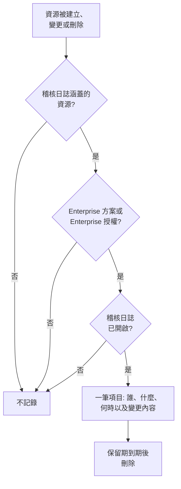

# 稽核日誌

稽核日誌記錄誰在你的專案中變更了什麼：它所涵蓋資源的每一次建立、變更和刪除，以及變更前後的值。用它查明誰關閉了某個監測器或變更了某個 API 金鑰，並為法規遵循審查保留紀錄。在 OneUptime Cloud 上它屬於 Enterprise 方案，自行託管時屬於 Enterprise Edition。

:::cards
- [開啟稽核日誌](#開啟稽核日誌): 所有專案預設關閉。
- [閱讀稽核日誌](#閱讀稽核日誌): 誰在何時變更了什麼。
- [記錄哪些內容](#記錄哪些內容): 它涵蓋的資源和操作。
- [項目保留多久](#項目保留多久): 7 到 180 天。
:::

## 變更如何成為項目

- **預設關閉。** 在有人開啟稽核日誌之前，專案不會記錄任何內容，也不會記錄開啟之前發生的事。
- **記錄人們所做的事。** 由人員、API 金鑰、MCP 用戶端或工作流程做出的變更會被記錄。OneUptime 自身做出的變更（例如來自背景工作的變更）不會被記錄，除非你開啟**儲存系統事件**。
- **項目無法變更。** 任何人都無法在儀表板中或透過 API 編輯或刪除項目。項目只有在保留期到期時才會消失。

## 開始之前

- **在 OneUptime Cloud 上：Enterprise 方案。** 在其他方案上，稽核日誌頁面會顯示該功能的作用以及如何取得。
- **自行託管時：Enterprise Edition**，以及包含稽核日誌的授權。請參閱[企業版](/docs/self-hosted/enterprise)。
- **可以讀取稽核日誌的角色。** Project Owner、Project Admin、Settings Admin 或 **Read Audit Log** 權限。開啟稽核日誌和變更其設定需要 Project Owner、Project Admin 或編輯專案的權限。

## 開啟稽核日誌

:::steps
### 開啟稽核日誌設定

前往**專案設定 → 稽核日誌 → 設定**。**稽核日誌**在側邊選單中預設收合：點選它即可展開。

### 編輯設定

點選 **Edit Audit Log Settings**。

### 開啟

開啟**啟用稽核日誌**，設定**保留時間（天）**，並選擇是否**儲存系統事件**。點選**儲存變更**。
:::

| 設定 | 初始值 | 作用 |
| --- | --- | --- |
| **啟用稽核日誌** | 關閉 | 從現在起記錄專案資源的變更。 |
| **保留時間（天）** | 7 | 每個項目保留的天數：7 到 180。 |
| **儲存系統事件** | 關閉 | 同時記錄 OneUptime 自身做出的、不是由人員或金鑰發起的變更。 |

對這些設定的變更會在一分鐘內生效。

## 閱讀稽核日誌

**專案設定 → 稽核日誌 → 稽核日誌**列出專案中的每個項目，最新的在前：

| 欄 | 顯示內容 |
| --- | --- |
| **何時** | 多久以前，附帶日期和時間。 |
| **操作** | `Create`、`Update` 或 `Delete`，或者對於有人下載的封包擷取檔案為 `Download`。 |
| **資源** | 資源名稱（資源存在時可點選開啟）及其類型。 |
| **執行者** | 做出變更的主體：人員、API 金鑰、工作流程，或對於 OneUptime 自身做出的變更為 `System`。人員透過 MCP 用戶端做出的變更會註明是哪個用戶端。 |
| **變更** | 變更了多少個欄位，或在建立或刪除時記錄了多少個欄位。點選可查看每個欄位。 |

依**資源類型**、**資源名稱**、**操作**、**使用者電子郵件**或**時間**篩選。變更只顯示被變更的欄位及其前後值，未做任何變更的儲存不會新增項目。

監測器、事件、警示、狀態頁面、SLO 以及許多其他資源，在其側邊選單的收合區段（如**進階**）中也有自己的**稽核日誌**頁面。它只顯示該資源的項目，以及屬於它的內容的項目：SLO 的頁面還會顯示其規則和擁有者。

## 記錄哪些內容

| 資源 | 日誌中的**資源類型** |
| --- | --- |
| 監測器 | `Monitor` |
| 事件 | `Incident` |
| 警示 | `Alert` |
| 狀態頁面 | `Status Page` |
| 排定維護事件 | `Scheduled Maintenance Event` |
| 待命策略 | `On-Call Policy` |
| 服務等級目標（SLO） | `Service Level Objective` |
| SLO 的規則和擁有者 | `SLO Burn Rate Rule`、`SLO Monitor Rule`、`Service Level Objective User Owner`、`Service Level Objective Team Owner` |
| 團隊 | `Team` |
| 自訂角色，以及獲得角色的團隊和 API 金鑰 | `Custom Role`、`Team Custom Role`、`API Key Custom Role` |
| 標籤 | `Label` |
| 事件狀態和嚴重性 | `Incident State`、`Incident Severity` |
| 警示狀態和嚴重性 | `Alert State`、`Alert Severity` |
| 監測器狀態 | `Monitor Status` |
| 排定維護狀態 | `Scheduled Maintenance State` |
| 事件角色 | `Incident Role` |
| 事後分析狀態 | `Postmortem Status` |
| API 金鑰 | `API Key` |
| 人們連接的 MCP 用戶端 | `MCP Client Authorization` |
| 資產清單項目 | `Inventory Item` |
| 收集器設定 | `Collector Config` |
| vCenter 伺服器 | `vCenter` |
| 封包擷取及其下載 | `Packet Capture` |
| 安全案件及其優先順序與狀態、劇本及其執行、受保護的實體、實體重要性，以及被重設的實體風險 | `Security Case`、`Security Case Priority`、`Security Case Status`、`Security Playbook`、`Security Playbook Run`、`Protected Entity`、`Entity Criticality`、`Entity Risk` |
| 稽核日誌匯出 | `Audit Log Export` |

當管理員在他人的帳戶上新增或移除通知方式或個人待命規則時，也會記錄，但不包含地址或號碼本身。

其他資料不在稽核日誌中，例如誰在某個團隊中，或單獨新增給團隊的權限。任何人都無權讀取的欄位會從所有項目中省略，金鑰、權杖和密碼記錄為 `[REDACTED]`：項目只顯示它們已變更，絕不顯示其值。

## 項目保留多久

每個項目的保留時間，是其被記錄時專案所設的**保留時間（天）**，之後會被刪除。新的保留時間適用於新項目：已記錄的項目保持原有日期。

要將項目保留超過 180 天，請在記錄時將它們傳送到你自己的儲存空間或 SIEM：請參閱[稽核日誌匯出](/docs/configuration/audit-log-export)。你也可以使用擁有 **Read Audit Log** 的 API 金鑰透過 API 讀取它們，並儲存到你需要的地方。請參閱[OneUptime API 參考](/docs/api-reference/api-reference)。

## 當方案或授權不再包含稽核日誌時

- **在 OneUptime Cloud 上**，離開 Enterprise 方案的專案會停止記錄，其稽核日誌頁面會顯示升級卡片，直到重新回到該方案。
- **自行託管時**，如果 Enterprise 試用期或寬限期結束時沒有授權，或者授權不包含稽核日誌，稽核日誌就會停止記錄。稽核日誌會以紅色顯示這一點。已記錄的項目會保留，一旦啟用授權，就會以相同的設定恢復記錄。請參閱[授權到期或缺少時](/docs/self-hosted/enterprise#授權到期或缺少時)。

## 疑難排解

:::details 稽核日誌為空
稽核日誌預設關閉，不會記錄開啟之前的任何內容。如果清單提示稽核日誌已關閉，請依其連結前往設定並開啟。否則，變更一個監測器或事件，然後重新整理清單。
:::

:::details 稽核日誌中缺少某項變更
檢查該資源是否列在[記錄哪些內容](#記錄哪些內容)中，以及變更是否發生在開啟稽核日誌之後。OneUptime 自身做出的變更只有在開啟**儲存系統事件**時才會被記錄。
:::

## 後續步驟

:::cards
- [稽核日誌匯出](/docs/configuration/audit-log-export): 將稽核日誌傳送到你自己的儲存空間或 SIEM。
- [使用者、團隊與權限](/docs/permissions/index): 決定誰可以讀取稽核日誌。
- [專案設定](/docs/configuration/project-settings): 專案的其他設定。
- [帳單與用量](/docs/configuration/billing): 變更專案的方案。
- [企業版](/docs/self-hosted/enterprise): 自行託管的安裝中的稽核日誌。
:::
