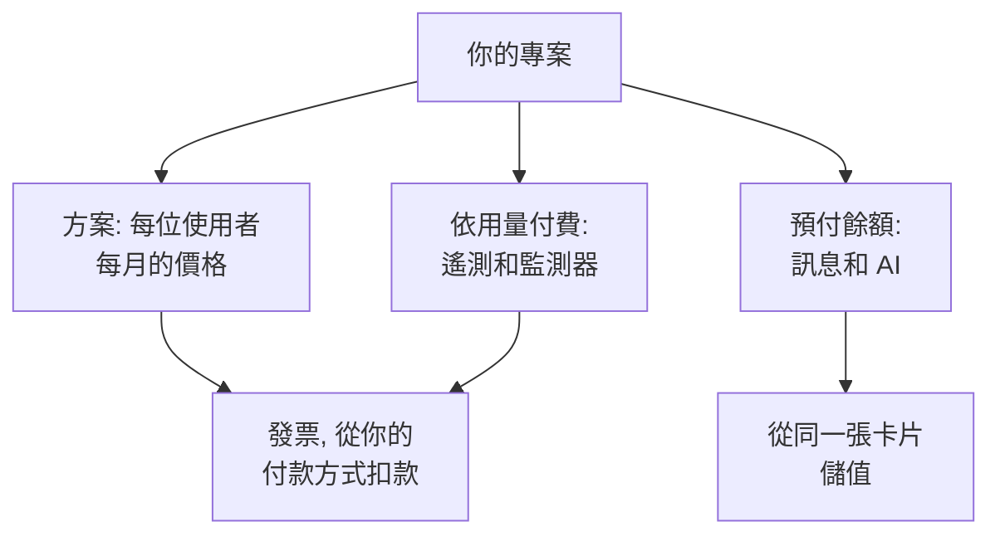

# 帳單與用量

在 OneUptime Cloud 上，專案依使用者為其方案付費，並為其使用的內容付費：遙測資料、作用中監測器，以及從預付餘額中支付的訊息和 AI 工作。本頁說明在哪裡查看和變更每一項，以及誰可以操作。自行託管的安裝沒有帳單功能，也沒有這些頁面。

:::cards
- [你的方案和席次](#你的方案和席次): 方案的費用，以及誰算作一個席次。
- [付款方式](#付款方式): 發票扣款所用的卡片。
- [發票](#發票): 支付、下載發票，並查看你的用量。
- [預付餘額](#預付餘額): 訊息和 AI，手動或自動儲值。
:::

## 專案為什麼付費

| 內容 | 計費方式 |
| --- | --- |
| 方案 | 依每位使用者每月計價，按月或按年計費。專案中的每個人都是一個席次。 |
| 遙測 | 擷取的資料每 GB $0.10，含 15 天保留期。更長的保留期費用更高，不足 7 天的保留期按 7 天計費：請參閱[保留期的費用](/docs/telemetry/data-retention#保留的成本)。 |
| 工作階段重播 | 每 GB $2，含 15 天保留期。 |
| 作用中監測器 | 每個監測器每月 $1。除手動監測器外，每個監測器都是作用中的，即使已關閉也是如此。 |
| 簡訊、電話、WhatsApp 和 Telegram | 每則訊息傳送時從專案餘額中支付。 |
| OneUptime AI | 從專案的 AI 點數中支付，除非它執行在你自己的 LLM 提供者上。 |

[價格頁面](https://oneuptime.com/pricing)對各方案進行了比較。

## 開始之前

- **OneUptime Cloud。** **專案設定**中的**帳單與發票**區段僅存在於 OneUptime Cloud，並且預設收合：點選其標題即可展開。
- **可以讀取帳單的角色。** Project Owner、擁有 **Manage Billing** 的人以及三個帳單角色可以讀取所有帳單頁面。請參閱[誰可以做什麼](#誰可以做什麼)。

## 你的方案和席次

前往**專案設定 → 帳單與發票 → 帳單**。**目前方案**卡片顯示專案的方案及每位使用者的價格，還有**席次**：專案中的每個人一個。

從你邀請某人的那一刻起，即使對方尚未接受，此人也算作一個席次，直到你將其移除。要變更席次數量，請邀請或移除人員：請參閱[邀請成員](/docs/permissions/inviting-people)。

## 變更方案

:::steps
### 先新增付款方式

變更方案需要付款方式。沒有付款方式時，**Change Plan** 會改為開啟 **Add a Payment Method**：請參閱[付款方式](#付款方式)。

### 點選 Change Plan

在**目前方案**卡片上點選 **Change Plan**。**年度方案**預設開啟：將其關閉可查看按月價格。

### 選擇方案

每個方案都顯示其每位使用者的價格。方案下方的說明會告訴你試用期會怎樣：專案仍在試用期內時顯示 **Your free trial carries over**，不在試用期時顯示 **Changing plan does not start a free trial**。

### 儲存變更

點選**儲存變更**。付費方案從你切換的那一刻起計費，你在該方案下邀請的每個人都在被邀請時計費。
:::

API 金鑰需要 Growth 或更高的方案，而在 Scale 方案以下，SCIM 連線只能移除人員。會停止它們的方案會在你選擇前說明涉及多少個，停止期間**帳單**頁面會顯示**此方案不包含**。不會刪除任何內容：在包含它們的方案上，它們會再次生效。

> [!NOTE]
> 透過經銷商或雲端市集（AWS Marketplace、Microsoft Marketplace、Google Cloud Marketplace 或 Vercel Marketplace）購買了 OneUptime？**帳單**頁面會註明。經銷商會替你變更方案，而雲端市集會把專案的方案和用量計入你的雲端帳單。

## 付款方式

**付款方式**卡片列出專案中的卡片。發票會自動從預設卡片扣款。

:::steps
### 點選新增付款方式

在**付款方式**卡片上點選**新增付款方式**。

### 輸入卡片資訊

輸入付款資訊，然後點選 **Save payment method**。你新增的方式會成為預設方式，新增後即啟用依用量付費。這不會變更你的方案。
:::

- **設為預設**會把清單中的另一種方式設為發票扣款的方式。
- 預設方式上的 **Re-sync Autopay** 可修正仍從舊卡片扣款的續約。
- 專案至少保留一種付款方式：刪除最後一種之前，請先新增另一種。

## 帳單地址和發票電子郵件

**商業詳細資料／帳單地址**卡片包含你的發票上關於你的資訊。點選**更新**，然後填寫兩個步驟：

| 步驟 | 欄位 |
| --- | --- |
| **帳單地址** | **商業詳細資料／帳單地址**：公司的法定名稱、地址以及加值稅號或稅籍編號。**國家**：你的帳單所在國家。 |
| **發票** | **財務/會計電子郵件**：發票、收據和帳單訊息的傳送地址，多個地址以逗號分隔。**透過電子郵件發送發票**：每張發票開立後立即傳送到那裡。 |

## 發票

**專案設定 → 帳單與發票 → 發票**列出專案的發票，每張都有**發票編號**、**發票日期**、**金額**和**發票狀態**。

- **支付發票**用於支付仍未付款的發票。
- **下載**以 PDF 格式開啟發票。對於仍未付款的發票，它位於列選單 **⋯** 中。

當你的銀行仍在處理付款時，OneUptime 會提示：有些銀行確認信用卡付款最多需要 2 天，發票會自行更新。請不要重複付款。

## 使用歷程

**專案設定 → 帳單與發票 → 使用歷程**顯示專案傳送的遙測資料，每個產品、服務和日期一列：

| 欄 | 顯示內容 |
| --- | --- |
| **產品** | 日誌、追蹤、指標以及其他類型的遙測資料。 |
| **天** | 傳送的日期。 |
| **服務** | 傳送資料的服務，或主機、叢集等其他資源。 |
| **已擷取資料（GB）** | 擷取了多少。 |
| **資料保留期（天）** | 保留多長時間。 |
| **總成本** | 花費多少，以美元計。 |

一天的用量在當天結束後顯示。依**產品**、**天**或**服務**篩選，找出增長的部分。

## 預付餘額

簡訊、電話、WhatsApp 和 Telegram 訊息從專案的餘額中支付，OneUptime AI 從其 AI 點數中支付。你需要預先為每一項儲值：

| 餘額 | 位置 |
| --- | --- |
| 簡訊、電話、WhatsApp 和 Telegram | **專案設定 → 通知 → 通知設定** |
| OneUptime AI | **專案設定 → 人工智慧 → AI 點數** |

:::steps
### 立即儲值

在頁面的**目前餘額**卡片上點選**儲值餘額**。輸入 $20 到 $1,000 之間的金額，然後點選**儲值**。金額會從專案的卡片扣除。

### 或讓它自動儲值

在**自動儲值**卡片上點選**編輯自動儲值**，然後開啟**啟用自動儲值**。它預設關閉。開啟後，每當餘額降到 $10 時，OneUptime 就會儲值 $20，金額也可以自行設定。
:::

當餘額不足以支付時，訊息不會傳送，或 OneUptime AI 會停止，專案的擁有者會收到電子郵件。請參閱[呼叫未送出時](/docs/on-call/escalation-rules#呼叫未送出時)和[AI 點數用完時](/docs/ai/ai-sre#ai-點數用完時)。

## 誰可以做什麼

| 要做的事 | 需要 |
| --- | --- |
| 讀取帳單頁面：方案、發票、用量、餘額和付款方式 | Project Owner、**Manage Billing**、**Billing Admin**、**Billing Member** 或 **Billing Viewer** |
| 下載發票 | Project Owner、Project Admin、**Manage Billing**、**Read Invoices**、**Billing Admin** 或 **Billing Member** |
| 變更帳單地址和發票電子郵件 | Project Owner、**Manage Billing**、**Billing Admin** 或 **Billing Member** |
| 開啟或關閉簡訊、電話、WhatsApp 或 Telegram | Project Owner、**Manage Billing** 或 **Billing Admin** |
| 新增付款方式 | Project Owner、**Manage Billing** 或 **Create Payment Method** |
| 支付發票 | Project Owner、**Manage Billing** 或 **Edit Invoices** |
| 變更方案、為餘額儲值或變更自動儲值 | Project Owner 或 **Manage Billing** |

你無權使用的按鈕會顯示為鎖定狀態，並說明誰可以使用。關於帳單角色，請參閱[使用者、團隊與權限](/docs/permissions/index#團隊)。

## 需要方案的設定

在 OneUptime Cloud 上，以下管理設定需要方案。你沒有相應方案的頁面會顯示該功能的作用以及所需的方案。

| 設定 | 所需方案 |
| --- | --- |
| 標籤 | Growth |
| API 金鑰 | Growth |
| 你自己的 SMTP 伺服器和 Twilio 帳戶 | Growth |
| 你自己的 LLM 提供者 | Growth |
| 連接 MCP 用戶端 | Growth |
| 建立團隊 | Scale |
| SSO、OIDC 和 SCIM | Scale |
| 保留期覆寫 | Scale |
| 稽核日誌 | Enterprise |

## 取消方案

要停止為專案付費，請刪除它：刪除後計費即停止。請參閱[刪除專案](/docs/configuration/project-settings#刪除專案)。透過經銷商購買的專案在經銷商處取消，透過雲端市集購買的專案在市集上取消。

## 疑難排解

:::details "Add a payment method in Project Settings > Billing and Invoices > Billing before using paid monitoring or telemetry"
使用 Free 方案的專案在建立作用中監測器或傳送遙測資料之前需要付款方式，因為這些是依用量付費的。在[付款方式](#付款方式)下新增一個。手動監測器仍然免費。
:::

:::details 紅色橫幅提示有未付發票
有未付發票的專案會變為非作用中狀態，如果發票一直未付，專案將被刪除。開啟**發票**，在每張仍未付款的發票上點選**支付發票**。
:::

:::details Change Plan 開啟了 Add a Payment Method
專案還沒有付款方式。請先新增一個，然後變更方案。
:::

:::details 使用歷程為空
用量按天統計，一天結束後才會顯示。沒有傳送過遙測資料的專案沒有任何列。
:::

## 後續步驟

:::cards
- [專案設定](/docs/configuration/project-settings): 適用於整個專案的其他所有設定。
- [邀請成員](/docs/permissions/inviting-people): 新增占用你席次的人員。
- [資料保留](/docs/telemetry/data-retention): 依需要保留遙測資料，不多保留。
- [捨棄過濾器與清理規則](/docs/telemetry/drop-filters-and-scrub-rules): 不再為你不使用的遙測資料付費。
:::
