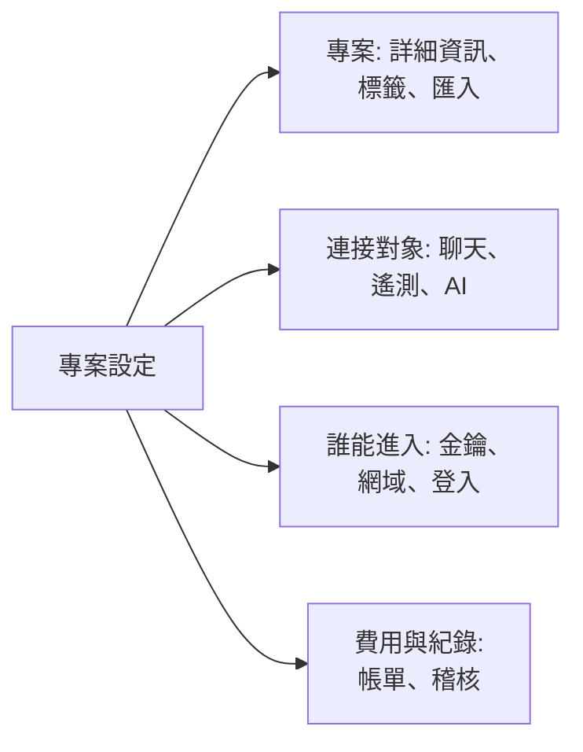

# 專案設定

專案設定包含適用於整個專案的內容：名稱、它所連接的工具、金鑰、人員的登入方式、帳單以及稽核紀錄。大部分內容只需設定一次，之後很少再改動。本頁是這些設定的地圖，並說明沒有獨立頁面的設定：專案詳細資訊、標籤、功能旗標和刪除專案。

:::cards
- [尋找設定](#尋找設定): 側邊選單中每個區段包含的內容。
- [專案詳細資訊](#專案詳細資訊): 名稱、ID 和支援存取。
- [標籤](#標籤): 用於資源、權限和規則的標記。
- [刪除專案](#刪除專案): 需要什麼，以及會隨之消失什麼。
:::

## 開啟專案設定

前往**產品 → 設定 → 專案設定**。側邊選單把頁面分成若干區段，預設只展開**基礎**：點選某個區段的標題即可展開。在某個區段的任意頁面上，該區段會自動展開。

## 開始之前

- **可以變更專案的角色。** 這些設定大多由 Project Owner 和 Project Admin 變更。帳單、通知管道和刪除專案需要更多權限，具體見各區段說明。
- **在 OneUptime Cloud 上：包含該設定的方案。** 某些設定需要特定方案：請參閱[需要方案的設定](/docs/configuration/billing#需要方案的設定)。

## 尋找設定

| 區段 | 頁面 | 詳細閱讀 |
| --- | --- | --- |
| **基礎** | **專案**、**標籤** | [專案詳細資訊](#專案詳細資訊)、[標籤](#標籤) |
| **工作區** | **Slack**、**Microsoft Teams**、**Video Calls** | [Slack](/docs/workspace-connections/slack)、[Microsoft Teams](/docs/workspace-connections/microsoft-teams)、[視訊通話](/docs/workspace-connections/video-calls) |
| **遙測與 APM** | **擷取金鑰**、**資料保留** | [擷取金鑰](/docs/telemetry/ingestion-keys)、[資料保留](/docs/telemetry/data-retention) |
| **通知** | **通知設定**、**通知日誌**、**行動應用程式** | [通知](#通知) |
| **人工智慧** | **AI Features**、**LLM 提供商**、**外部 MCP 伺服器**、**AI 點數**、**AI 日誌**、**MCP 伺服器** | [LLM 提供者](/docs/ai/llm-provider)、[外部 MCP 伺服器](/docs/ai/external-mcp-servers)、[MCP 伺服器](/docs/ai/mcp-server)、[AI SRE](/docs/ai/ai-sre#成本控制) |
| **進階** | **網域**、**API 金鑰**、**功能旗標**、**從其他工具匯入** | [自訂網域](/docs/status-pages/branding-and-domains#自訂網域)、[API 金鑰](/docs/permissions/index#api-金鑰)、[功能旗標](#功能旗標)、[從 Opsgenie 移轉](/docs/moving-to-oneuptime/opsgenie)及其他移轉指南 |
| **安全性** | **SSO**、**SCIM** | [SSO](/docs/identity/sso)、[SCIM](/docs/identity/scim) |
| **帳單與發票** | **帳單**、**使用歷程**、**發票** | [帳單與用量](/docs/configuration/billing) |
| **稽核日誌** | **稽核日誌**、**設定**、**匯出** | [稽核日誌](/docs/configuration/audit-logs)、[稽核日誌匯出](/docs/configuration/audit-log-export) |
| **危險區域** | **危險區域** | [刪除專案](#刪除專案) |

**帳單與發票**和**AI 點數**僅存在於 OneUptime Cloud：自行託管的安裝沒有帳單功能。

## 專案詳細資訊

**專案設定 → 基礎 → 專案**有兩張卡片。

**專案詳細資訊**顯示專案的名稱和 ID：

- **專案名稱**：點選**編輯專案**可重新命名專案。名稱至少 2 個字元。重新命名需要 Project Owner，或編輯專案或管理帳單的權限。
- **專案 ID**：在 API、CLI 和 Terraform 中使用，或聯絡支援時複製它。
- **Data Residency**：在 OneUptime Cloud 上，OneUptime 記錄後你的專案資料所存放的位置。只有 OneUptime 會設定它。

**客戶支援存取權**決定在 OneUptime Cloud 上 OneUptime 支援團隊能否開啟專案。需要協助時，開啟**允許 OneUptime 支援團隊存取此專案**：由於支援團隊屆時可以檢視和變更專案中的一切，OneUptime 會先確認，你再點選**允許支援團隊進入**。處理完後將其關閉：變更會立即儲存。Project Owner 和 Project Admin 可以變更此項。

## 標籤

標籤是你貼在監測器、事件、狀態頁面和其他資源上的標記。它們用於篩選和分組清單，並限制團隊權限和專案規則的作用範圍。

:::steps
### 開啟標籤

前往**專案設定 → 基礎 → 標籤**。

### 建立標籤

點選**建立標籤**。為其填寫**名稱**，如有需要再填寫**描述**。**標籤顏色**已預先選好一種頁面上還沒有標籤使用的顏色：如果你願意，可以另選一種。點選**建立標籤**儲存。
:::

在 OneUptime Cloud 上，建立和變更標籤需要 Growth 方案。關於標籤如何限制權限，請參閱[標籤](/docs/permissions/index#標籤)；關於在資源建立時為其加上標籤，請參閱[標籤與擁有者規則](/docs/configuration/label-and-owner-rules)。

在清單中，記錄的標籤會上下逐一顯示；超過四個時，會顯示前三個和一個查看其餘標籤的連結。凡是列出標籤的地方（清單、記錄頁面和每個標籤選擇器），標籤都依自然順序排列：名稱以數字開頭的標籤排在前面，依該數字的大小排序（`2. Team` 在 `10. Owner` 之前），其餘標籤依字母順序排在後面，不分大小寫。若要決定標籤的順序，請讓名稱以數字開頭，例如 `1. Category` 和 `2. Subcategory`。

### 封存標籤

要停用某個標籤，請從其所在列的 **⋯** 選單中將其封存，而不是刪除。已有該標籤的項目會保留它，您仍可依它篩選，但任何人都無法再將它新增到任何項目：每個標籤選擇器都不會提供它，API、Terraform 和 MCP 會拒絕它。對話方塊會列出設定為使用該標籤的規則和權限，在您變更它們之前，它們會繼續使用該標籤。已封存的標籤會另外列在摺疊的 **已封存的標籤** 區段中，**取消封存** 可將其恢復。**刪除** 會先列出該標籤將從中移除的所有項目，並提供 **改為封存**。

## 通知

**專案設定 → 通知**包含專案傳送通知的方式：

- **通知設定**：**通知管道**卡片為專案開啟或關閉簡訊、電話、WhatsApp 和 Telegram。四者預設皆為關閉。由 Project Owner、**帳單管理員** 或擁有 **Manage Billing** 的人開啟它們。該頁面還包含專案自己的郵件伺服器，位於**自訂 SMTP 設定**下（請參閱[SMTP](/docs/emails/smtp)），以及專案自己的 Twilio 帳戶（請參閱[Twilio 整合](/docs/self-hosted/twilio-integration)）。在 OneUptime Cloud 上，它還包含支付這些訊息的餘額：請參閱[預付餘額](/docs/configuration/billing#預付餘額)。
- **通知日誌**：專案傳送的每則通知，每個管道一個分頁：**電子郵件**、**SMS**、**WhatsApp**、**Telegram**、**Webhook**、**呼叫**、**推送**和**工作區**。
- **行動應用程式**：取得 iOS 和 Android 應用程式的位置。請參閱[應用程式概觀](/docs/mobile-desktop-apps/index)。

## 功能旗標

**專案設定 → 進階 → 功能旗標**為專案開啟或關閉選用功能。每個功能都是一個開關，切換後立即儲存。目前該頁面包含**監測器群組**，在新專案中預設關閉：開啟後，監測器選單中會加入監測器群組。關閉它不會刪除任何群組。請參閱[監測器群組](/docs/monitor/monitor-groups)。

## 刪除專案

刪除專案會為所有成員刪除其中的一切：監測器、事件、狀態頁面、待命設定和遙測資料。任何操作都無法將其復原。

:::steps
### 開啟危險區域

前往**專案設定 → 危險區域**。

### 點選刪除按鈕

點選**刪除專案**。對話方塊會請你確認。

### 輸入專案名稱

準確輸入專案名稱。在你輸入之前，**刪除專案**會保持鎖定。在 OneUptime Cloud 上，對話方塊還會詢問你離開的原因：回答是選填的。

### 確認

點選**刪除專案**。OneUptime 會刪除專案並將你移出該專案。
:::

> [!CAUTION]
> 刪除專案無法復原。這需要 Project Owner，或刪除專案的權限。

在 OneUptime Cloud 上，刪除專案即可取消其方案：專案刪除後計費停止。透過雲端市集計費的專案會為其用量產生最後一筆費用，而在市集上的購買會一直有效，直到你在那裡取消。

## 疑難排解

:::details 側邊選單中似乎缺少某個區段
除**基礎**外，所有區段預設都是收合的。點選該區段的標題即可展開。在自行託管的安裝中，既沒有**帳單與發票**區段，也沒有**AI 點數**頁面。
:::

:::details 編輯專案被鎖定
重新命名需要 Project Owner，或編輯專案或管理帳單的權限。鎖定的按鈕會顯示你缺少的權限。
:::

:::details 對話方塊中的刪除專案一直處於鎖定狀態
請完全依照對話方塊顯示的樣子輸入專案名稱：大小寫有區別。
:::

## 後續步驟

:::cards
- [邀請成員](/docs/permissions/inviting-people): 把你的團隊帶進專案。
- [帳單與用量](/docs/configuration/billing): 你的方案、付款方式、發票和用量。
- [稽核日誌](/docs/configuration/audit-logs): 查看誰在專案中變更了什麼。
- [SSO](/docs/identity/sso): 讓人們透過你的身分提供者登入。
:::
