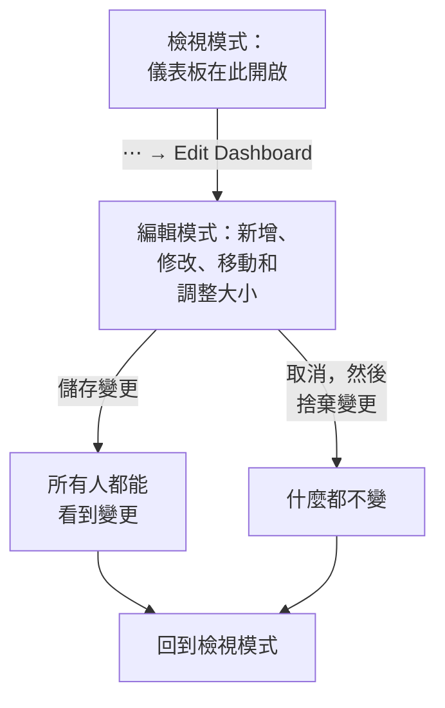

# 建立儀表板

要建立儀表板，請開啟 **產品 → 儀表板** ，點選 **建立儀表板** 。 **建立儀表板** 對話方塊會先問你要如何開始，再問名稱。 **從零開始** 會給你一個空白儀表板；範本會為你建立它的小工具，通常還有變數，並填好它的名稱（如果專案中已有同名的儀表板，則會加上編號，例如「Kubernetes Dashboard 2」）。點選 **建立儀表板** ，新的儀表板隨即開啟。空白儀表板會在畫布上開啟，並提供一個 **新增小工具** 按鈕，用來加入第一個小工具。

:::cards
- [新建儀表板](#新建儀表板): 從零開始，或從範本開始。
- [編輯與儲存](#編輯與儲存): 在你點選「儲存變更」之前，任何人看到的都不會改變。
- [新增小工具](#新增小工具): 從目錄中選擇、進行設定，然後擺到定位。
- [放大高峰](#放大高峰): 在圖表上拖曳，讀取那一刻的整個儀表板。
:::

## 開始之前

專案擁有者和管理員可以建立和編輯所有儀表板。其他人需要團隊權限：建立儀表板需要 `CreateDashboard` ，修改儀表板需要 `EditDashboard` 。專案成員和檢視者不需要這兩個權限也能閱讀儀表板。無權編輯儀表板的人仍可開啟它的 **⋯** 選單，其中的 **編輯儀表板** 會被鎖定，並說明需要哪個權限。

## 新建儀表板

:::steps
### 選擇開始方式

開啟 **產品 → 儀表板** ，點選 **建立儀表板** 。 **建立儀表板** 對話方塊從 **從零開始** 開始，這是一個可以加入你自己的小工具的空白儀表板。下方的 **或從範本開始** 列出六個 **推薦** 範本。

### 選擇範本

點選一個範本，查看它會加入什麼：它的小工具（名稱與 **新增小工具** 中一致），以及你在工具列中用來縮小範圍的變數。其他範本可以在搜尋框旁選擇一個類別或 **所有範本** ，或在 **搜尋範本…** 中輸入來尋找：你輸入的每個詞都必須相符。然後點選 **使用此範本** ，或按兩下該範本。在搜尋框中，方向鍵選擇範本， **Enter** 使用它。

### 為儀表板命名

範本的名稱已經填好，並依專案中已有的名稱往後編號。 **從零開始** 時名稱是空的：請輸入一個。描述為選填，收合在 **更多欄位** 底下，你也可以稍後在儀表板的 **概覽** 頁面加入。 **返回** 會帶你回到離開時的範本選擇。

### 建立

點選 **建立儀表板** 。新的儀表板隨即開啟：如果是範本，會立即顯示它的小工具；否則顯示帶有 **新增小工具** 的空白畫布。
:::

範本依選擇器中的類別列出：

| 類別 | 範本 |
| --- | --- |
| 監控與 APM | Monitor Dashboard, Metrics Dashboard, Real User Monitoring Dashboard, SLO Dashboard |
| 事件應變 | Incident Dashboard, Alert Dashboard |
| 基礎設施 | Kubernetes Dashboard, Kubernetes Cost Dashboard, Hosts Dashboard, Proxmox Dashboard, VMware Dashboard, Ceph Dashboard, Storage Array Dashboard, Docker Swarm Dashboard, Network Dashboard |

**推薦** 包含 Monitor Dashboard、Incident Dashboard、Alert Dashboard、Kubernetes Dashboard、Hosts Dashboard 和 Metrics Dashboard。範本只是起點，而不是連動：儀表板建立後，你可以隨意修改。之後範本不會再更新它。

## 編輯與儲存

儀表板以檢視模式開啟，供閱讀使用。要修改它，請開啟工具列中的 **⋯** 選單並選擇 **編輯儀表板** 。工具列會在名稱旁顯示 **編輯中** ，並把時間範圍和其他控制項換成 **新增小工具** 、 **變數** 、 **取消** 和 **儲存變更** 。下方還有一列，用來設定儀表板的 **預設時間範圍** 和 **預設自動重新整理** 。

在你儲存之前，變更只屬於你自己。編輯期間不會儲存任何內容，所以其他人看到的仍是原本的儀表板。

- **儲存變更** 會一次儲存小工具、它們的位置和大小、變數以及預設時間範圍和自動重新整理，然後回到檢視模式。如果儲存遭到拒絕，例如因為你在這段期間失去了權限，你會帶著變更留在編輯模式，格線上方會顯示原因。
- **取消** 會先詢問，因為它會丟棄你的變更： **捨棄變更** 回到已儲存的儀表板， **繼續編輯** 則讓你回到工作中。

編輯期間，自動重新整理會暫停，放大後的時間範圍會回到你選擇的範圍。

## 新增小工具

:::steps
### 開啟小工具目錄

點選 **新增小工具** ：編輯時它在工具列中，空白儀表板則在畫布上。目錄依小工具顯示的內容分組。在搜尋框中輸入名稱或用途即可尋找（"error budget", "pods"），按 Enter 加入第一個結果。

### 選擇小工具

點選它。小工具會放到格線上第一個容得下它的空位，並開啟它的設定。

### 設定顯示內容

設定對話方塊會在設定上方顯示小工具的 **Live Preview** ，預覽會跟著你的每一次修改更新。選擇小工具讀取的內容（指標查詢、篩選器、文字）和外觀，然後點選 **完成** 。

### 擺到定位

拖曳小工具來移動它，拖曳它的邊緣或角落來調整大小。請參閱 [格線上的小工具](#格線上的小工具) 。
:::

[儀表板小工具](/docs/dashboards/widgets) 列出了每個小工具及其設定。

## 格線上的小工具

畫布是一個十二欄寬的格線。小工具會貼齊格線，頁面會隨著你新增列而向下延伸。拖曳小工具時，虛線外框會顯示它將落在哪裡，以及所在的欄和列；調整大小時，外框會以格線單位顯示它的大小。擋路的小工具會自動讓開，因此兩個小工具永遠不會重疊。

每種小工具都有最小尺寸，讓繪製的內容保持清晰可讀：圖表至少六欄寬、三列高，而單一數字只需要一格。

格線與螢幕同寬。在較窄的螢幕上，格線的欄會變窄，列高保持不變。在手機上，小工具會一個接一個縱向排列，每個都與螢幕同寬，順序與它們在格線上的位置一致：從上到下逐列排列，同一列內由左到右。圖表在手機上會畫得更高，為繪圖區留出空間。在手機上編輯時顯示的是格線，可以左右捲動。

之後要修改小工具，請在編輯時點選它。它的設定會再次開啟，底部多出兩個按鈕：

- **Duplicate Widget** 會在第一個空位加入一個設定相同的複本。
- **刪除小工具** 會在你確認後將它移除。

## 時間範圍與自動重新整理

在檢視模式下，工具列的時間範圍選擇器決定所有圖表、數字、日誌和追蹤小工具讀取的時間視窗。可以選擇從最近 5 分鐘到最近 3 個月的預設範圍，或自訂開始和結束時間。儀表板會以其預設時間範圍開啟：除非編輯者另行設定，否則為最近一小時。

事件、警示、監測器和資源的清單顯示的是目前狀態，與時間範圍無關。

時間範圍旁邊的自動重新整理選單會每 5 秒、10 秒、30 秒、1 分鐘、5 分鐘或 15 分鐘重新讀取每個小工具，並顯示距離下一次重新整理的倒數計時。調查問題時請把它關閉，讓畫面保持靜止。儀表板會以其預設自動重新整理開啟：除非編輯者另行設定，否則為關閉。

只要儀表板有一個小工具，時間範圍選擇器、變數和自動重新整理就會出現。

### 儀表板的預設設定

編輯儀表板時，工具列按鈕下方的一列決定所有人開啟它時的設定： **預設時間範圍** （從最近 5 分鐘到最近 3 個月的預設範圍）和 **預設自動重新整理** 。 **儲存變更** 會把它們與儀表板的其餘部分一起儲存，對你的團隊和公開連結的訪客同樣生效。自訂的開始和結束不能作為預設值：否則儀表板會永遠停留在那個時刻。只要儀表板有一個小工具，這一列就會出現。

在這些設定出現之前儲存的儀表板，會以最近一小時和原有的自動重新整理開啟。透過 API 和 Terraform，兩者都位於儀表板的 `dashboardViewConfig` 中：`timeRange` 是依 API 參考寫法書寫的預設範圍，例如 `Past 1 Day`；`refreshInterval` 例如 `1m`。其他任何值都會被拒絕。

### 你自己的選擇

你在檢視模式下選擇的時間範圍和自動重新整理只屬於你，瀏覽器會為每個儀表板記住它們：重新整理頁面、重新啟動瀏覽器或牆面螢幕重新開機後，儀表板都會依你離開時的樣子開啟。只有預設範圍會被記住。自訂範圍或放大只持續到你離開頁面，因此儀表板永遠不會停留在過去的某個時刻。

每個選擇器的第一項會顯示儀表板的預設值，例如 預設（Past 1 Day）。選擇它即可回到預設值：瀏覽器會忘記你的選擇，儀表板會重新跟隨預設值，即使之後有人修改了它。你自己儲存新的預設值後，會立即看到它們。

### 放大高峰

查看高峰時，你不必動用時間範圍選擇器。在任何折線圖或面積圖上拖過感興趣的區段， **整個儀表板** 就會切換到那個時間視窗，就像你在時間範圍選擇器中選了它一樣：每個使用時間範圍的小工具都會一起重新查詢，所以你在整個儀表板上讀到的是同一時刻，而不是某張圖表與相鄰圖表比例不同。即時清單一如往常地繼續顯示目前正在發生的事情。

**雙擊任意圖表** 即可復原：無論你放大了幾次，儀表板都會回到開始放大之前的範圍。放大生效期間，時間範圍選擇器旁會出現 **重設縮放** 按鈕；在未放大的儀表板上雙擊則不會有任何作用。

放大後的時間視窗是固定的，因此即使開啟了自動重新整理，它也不會往前捲動——這是刻意的設計，因為調查到一半時間視窗悄悄移走會更糟。重設放大即可讓它重新捲動。

放大只在檢視模式下有效；在編輯模式下，拖曳會移動小工具並調整其大小。長條圖也以同樣的方式放大（在長條上拖曳），雙擊長條圖也會像其他圖表一樣重設儀表板。只有拖曳才會放大：單擊圖表永遠不會改變儀表板的時間範圍。同樣的手勢適用於 OneUptime 中所有的圖表；請參閱 [放大時間範圍](/docs/telemetry/charts-and-time-ranges) 。

## 全螢幕

**⋯ → 全螢幕** 會在整個螢幕上顯示儀表板的小工具，適合牆上的顯示器或會議。按 Esc 離開。

## 讓儀表板經得起時間考驗的建議

- **一個儀表板一個主題。** 幾個聚焦的儀表板勝過一個塞滿所有監控內容的頁面。
- **把最重要的小工具放在最上面。** 人們從上往下閱讀，所以要讓他們第一眼看到的內容回答「一切健康嗎？」
- **用文字小工具為各區段命名。** 每隔幾列放一個簡短的標題（「延遲」、「錯誤」、「容量」），即使隔著房間也能輕鬆瀏覽頁面。
- **用變數取代複本。** 如果你正打算為第二個服務建立同樣的儀表板，請改為新增一個 `service` 變數。請參閱 [儀表板變數與篩選器](/docs/dashboards/variables) 。
- **大幅修改前先複製。** 儀表板 **設定** 頁面上的 **複製儀表板** 會建立一個安全的複本，讓你嘗試新想法。

## 後續步驟

:::cards
- [儀表板小工具](/docs/dashboards/widgets): 每個小工具、它的設定，以及該選哪一個。
- [儀表板變數與篩選器](/docs/dashboards/variables): 每個服務、主機或客戶一個儀表板。
- [共用與公開儀表板](/docs/dashboards/sharing): 在團隊之外分享儀表板。
- [儀表板設定與權限](/docs/dashboards/configuration): 擁有者、標籤、封存，以及誰可以做什麼。
:::
