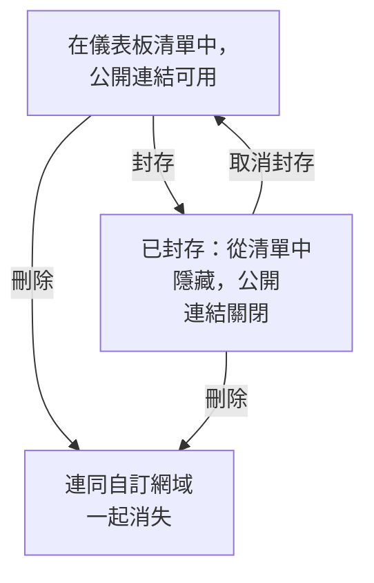

# 儀表板設定與權限

當你有了一個值得保留的儀表板，本頁會介紹誰可以閱讀和修改它、擁有者和標籤如何整理你的儀表板，以及如何複製、匯出、封存和刪除儀表板。

:::cards
- [誰可以做什麼](#誰可以做什麼): 每個操作背後的權限，以及誰擁有這些權限。
- [擁有者](#擁有者): 儀表板所屬的使用者和團隊。
- [複製儀表板](#複製儀表板): 一個安全的複本，自動為你編號。
- [封存儀表板](#封存儀表板): 收起儀表板而不刪除它。
:::

## 誰可以做什麼

儀表板遵循你專案的 [權限](/docs/permissions/index) 。每個操作都需要以下其中一種權限，透過團隊取得：

| 操作 | 所需權限 |
| --- | --- |
| 閱讀儀表板 | `ReadDashboard` ，或專案角色：Project Owner、Project Admin、Project Member、Viewer 或某個 Settings 角色 |
| 建立儀表板 | `CreateDashboard` 、Project Owner 或 Project Admin |
| 修改儀表板：它的小工具、變數、分享、品牌，以及封存它 | `EditDashboard` 、Project Owner 或 Project Admin |
| 刪除儀表板 | `DeleteDashboard` 、Project Owner 或 Project Admin |
| 新增和移除擁有者 | 儀表板擁有者權限、Project Owner、Project Admin 或 Project Member |
| 新增和修改自訂網域 | 儀表板網域權限、Project Owner、Project Admin、Project Member、Settings Admin 或 Settings Member |
| 建立擁有者規則和標籤規則 | 規則權限、Project Owner 或 Project Admin |

因此，Project Member 可以閱讀所有儀表板，但要建構儀表板需要 `CreateDashboard` 和 `EditDashboard` 。閱讀、編輯和刪除都可以分別限制在團隊擁有的儀表板上，或帶有某些標籤的儀表板上：請參閱 [範圍：一條允許權限能涵蓋多遠](/docs/permissions/index#範圍一條允許權限能涵蓋多遠) 。

在團隊的 **權限** 頁面上指派它們：開啟 **產品 → 團隊** 並選擇該團隊。

誰可以在專案之外查看儀表板是另一個問題，由儀表板的 **分享設定** 頁面決定：請參閱 [公開儀表板的存取](#公開儀表板的存取) 。

## 擁有者

儀表板的 **擁有者** 是它所屬的使用者和團隊。在儀表板的 **擁有者** 頁面上新增他們，或在 **儀表板** 清單中選取多個儀表板，一次為它們全部新增擁有者。

擁有者會在你要求時縮小存取範圍：限定在團隊所擁有儀表板上的團隊權限，只會作用於把該團隊或執行操作的本人列為擁有者的儀表板。單純擁有並不會授予任何權限。

**儀表板** 清單會顯示每個儀表板的擁有者，它的 **擁有者** 篩選器可以找到某個人或團隊擁有的儀表板。

## 標籤

標籤是用來整理儀表板的標記。在儀表板的 **概覽** 頁面上新增它們（你也在那裡編輯名稱和描述），或從 **儀表板** 清單一次為多個儀表板新增。

常見做法：

- **依團隊**: `team:platform` 、 `team:checkout` 、 `team:growth` 。
- **依環境**: `env:prod` 、 `env:staging` 。
- **依用途**: `purpose:oncall` 、 `purpose:exec` 、 `purpose:investigation` 。

在已經累積大量儀表板的專案中， **儀表板** 清單上的 **標籤** 篩選器是找到儀表板最快的方式。標籤也會限制權限：限定在某些標籤上的團隊權限，只會作用於帶有其中任一標籤的儀表板。

## 擁有者規則和標籤規則

與其手動新增擁有者和標籤，不如讓規則來做。在 **儀表板** 側邊選單的 **設定** 底下， **擁有者規則** 會新增擁有者， **標籤規則** 會新增標籤，作用於每個與之相符的新儀表板：依據它已有的標籤，或它的名稱或描述中的模式。 [標籤與擁有者規則](/docs/configuration/label-and-owner-rules) 說明了規則如何比對，以及如何對已有的儀表板執行規則。

## 公開儀表板的存取

誰可以在專案之外查看儀表板，是儀表板 **分享設定** 頁面上的一個選擇（在儀表板本身也可以用 **⋯ → 分享** 開啟；請參閱 [共用與公開儀表板](/docs/dashboards/sharing) ）：

1. **僅限此專案中的成員** （預設）——儀表板沒有公開連結；它的公開位址會顯示「找不到」頁面。
2. **任何擁有連結的人** ——任何擁有公開連結的人不需登入即可查看。
3. **任何擁有連結和密碼的人** ——訪客要先輸入密碼，儀表板才會出現。

在同一頁面的 **更多設定** 底下， **IP 允許清單** （Scale 方案）會拒絕來自清單以外任何 IP 位址對公開連結的請求。最嚴密的公開設定是 **任何擁有連結和密碼的人** 加上 IP 允許清單——適用於需要兩層保護的合作夥伴入口網站。

## 複製儀表板

要複製儀表板，請開啟它，前往它的 **設定** 頁面並點選 **複製儀表板** 。複本的名稱會自動填好：儀表板的名稱，依專案中已有的名稱往後編號（「Checkout API」會複製為「Checkout API 2」，再複製一次則為「Checkout API 3」）。如有需要可以修改，然後以 **複製儀表板** 確認，複本隨即開啟。複本包含儀表板的小工具、變數、描述和標籤。品牌和自訂網域會保留在原本的儀表板上，公開分享一律從關閉狀態開始，由你決定是否開啟。

當你想把一個範本（例如「我們的值班儀表板」）衍生為某個服務專用的複本時，這是正確的做法。

## 匯出與匯入

儀表板以 JSON 形式移轉：

- 儀表板 **設定** 頁面上的 **匯出儀表板** 會把它下載為 JSON 檔案。要匯出多個，請在 **儀表板** 清單中選取它們並選擇 **匯出 JSON** 。
- **儀表板** 清單上方的 **匯入 JSON** 會依這樣的檔案建立儀表板，可以在本專案，也可以在其他專案中。

匯出的內容包含儀表板本身的設定，其中包括它的小工具和變數。它的擁有者和標籤不包含在內，指向本專案資源（例如 SLO 或資料來源）的小工具，在另一個專案中可能需要重新選擇這些資源。

## 封存儀表板

把你不再使用但想保留的儀表板封存。封存的儀表板會從 **儀表板** 清單中消失，如果它是公開的，它的公開連結將停止運作——它的 URL 和自訂網域會回應 "Dashboard not found"。它的小工具、變數、品牌、網域和公開設定都會保留，因此取消封存後它會完全恢復原樣，包括公開連結。

要封存一個儀表板，請開啟它，前往它的 **設定** 頁面並點選 **封存** 。要封存多個，請在 **儀表板** 清單中選取它們並選擇 **封存** 。要恢復一個，請開啟 **儀表板 → 進階 → 已封存** ，選取它並選擇 **取消封存** ，或者開啟它並點選其頁面頂端橫幅上的 **取消封存** 。

封存是刪除的可逆替代方案：不確定時，先選擇封存。

## 刪除儀表板

開啟儀表板的 **刪除** 頁面。刪除無法復原：儀表板、它的小工具和變數，以及關聯到它的所有自訂網域都會被移除。你的遙測資料不受影響。

如果儀表板透過自訂網域公開，刪除後該位址會立即停止回應。要繼續提供該位址，請在刪除這個儀表板之後，把網域新增到另一個儀表板：一個網域同一時間只屬於一個儀表板。

## 稽核日誌

儀表板的 **稽核日誌** 頁面會列出對儀表板的每一次變更，以及變更者。稽核日誌屬於 Enterprise 方案和 [企業版](/docs/self-hosted/enterprise) 。

## 資料保留與備份

儀表板本身不會過期。它們顯示的資料遵循專案的保留設定：時間範圍設為最近 3 個月時，日誌保留 15 天的專案會顯示其中最近 15 天的資料。

如果你自行託管 OneUptime，定期備份資料庫就足夠了：儀表板的設定與專案的其他資料一起儲存。在 OneUptime Cloud 上，備份會由我們替你處理。如果想要自己的複本，可以把儀表板匯出為 JSON，或透過 [OneUptime API](/docs/api-reference/api-reference) 讀取它。

## 後續步驟

:::cards
- [共用與公開儀表板](/docs/dashboards/sharing): 公開連結、密碼、IP 允許清單和自訂網域。
- [使用者、團隊與權限](/docs/permissions/index): 團隊、角色、範圍和封鎖。
- [儀表板變數與篩選器](/docs/dashboards/variables): 每個服務一個儀表板。
- [儀表板概觀](/docs/dashboards/index): 全局概觀。
:::
