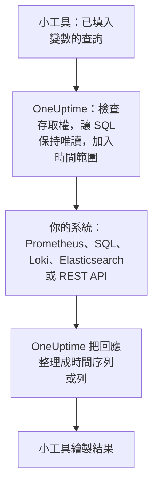

# 外部資料來源

外部資料來源用於連線 OneUptime 以外的系統，例如 Prometheus、SQL 資料庫、ClickHouse、Loki、Elasticsearch 或 REST API，讓你的儀表板能把它的資料和你自己的資料並排繪製。系統只需要連線一次；之後每個小工具都會用該系統自己的語言執行唯讀查詢。

:::cards
- [連線資料來源](#連線資料來源): 選擇類型，然後說明它在哪裡、如何登入。
- [撰寫查詢](#撰寫查詢): PromQL、SQL、LogQL、Query DSL 或請求。
- [限制](#限制): 保護雙方的逾時和上限。
- [安全防護](#安全防護): 唯讀查詢和唯寫認證資訊。
:::

## 查詢如何執行

小工具把已填入變數的查詢傳送給 OneUptime。OneUptime 會檢查你是否有權讀取該資料來源，填入時間範圍，並使用它保存的認證資訊查詢你的系統。接著它會把回應整理成時間序列或列，交給小工具繪製。



## 開始之前

- **包含此功能的方案。** 在 OneUptime Cloud 上，建立和修改資料來源需要 **Growth** 方案。刪除則在任何方案上都可以。
- **新增資料來源的權限。** 專案擁有者和管理員可以新增資料來源；其他人需要 `CreateDataSource` ，修改和刪除還需要 `EditDataSource` 和 `DeleteDataSource` 。所有能讀取專案資料來源的人（包括成員和檢視者）都能看到這些資料來源的小工具資料。
- **唯讀帳號。** 儀表板只會讀取。請用只能讀取的帳號連線資料庫，用只能查詢的權杖連線 HTTP 來源。
- **可達的網路路徑。** 連線到你系統的是 OneUptime 的 API 伺服器，因此它必須能夠連到你的系統：會被拒絕的位址請參閱 [安全防護](#安全防護) 。

## 支援的系統

| 類型 | 查詢語言 | 適用於 |
| --- | --- | --- |
| Prometheus | PromQL | Prometheus, Thanos, Cortex, Mimir, VictoriaMetrics |
| PostgreSQL | SQL | PostgreSQL, TimescaleDB, CockroachDB |
| MySQL | SQL | MySQL, MariaDB |
| Microsoft SQL Server | T-SQL | SQL Server, Azure SQL |
| ClickHouse | SQL | ClickHouse（透過其 HTTP 介面） |
| Grafana Loki | LogQL | Loki 及相容 Loki 的端點 |
| Elasticsearch | Query DSL (JSON) | Elasticsearch, OpenSearch |
| REST API | 請求 (JSON) | 任何以 JSON 回應的 HTTP(S) API |

## 連線資料來源

:::steps
### 開啟資料來源

開啟 **產品 → 儀表板** ，在側邊選單中展開 **設定** ，然後點選 **資料來源** 。

### 選擇類型

點選 **建立Data Source** 。 **Choose a Data Source Type** 對話方塊會依存放的內容為類型分組：指標、日誌、資料庫、搜尋和 API。點選其中一個。

### 命名

在 **基本資訊** 底下，為它指定一個 **名稱** ，例如「正式環境 Prometheus」，如有需要再填寫 **描述** 。

### 說明它在哪裡

在 **連線** 底下，HTTP 來源要填寫它回應的 **URL** 。資料庫要填寫 **Database Host** 、 **Database Port** （連接埠為 5432、3306、1433 或 8123 時留空）和 **資料庫名稱** 。

### 說明如何登入

在 **驗證** 底下，輸入 **使用者名稱** 和 **密碼** ；若是 HTTP 來源，則輸入以 Bearer 權杖傳送的 **API 權杖** 。 **更多欄位** 中包含 **Custom HTTP Headers** （例如 `{ "X-Scope-OrgID": "tenant-1" }` ）和 **Additional Options** ：資料庫使用 `sslEnabled` 和 `sslRejectUnauthorized` ，Elasticsearch 使用 `elasticsearchIndex` ，未設定時 Elasticsearch 會讀取所有索引（ `*` ）。

### 測試

點選 **建立Data Source** ，然後點選它所在列的 **測試** 。OneUptime 會用你提供的資訊連線，並告訴你是否成功或哪裡出了問題。
:::

之後要修改資料來源，請從清單中開啟它。 **Data Source Details** 上的 **編輯** 可以修改機密資訊以外的所有內容； **更新憑證** 會取代密碼、權杖或標頭，留空的欄位則維持不變； **測試** 會再次檢查它。

## 在小工具中使用

編輯儀表板，點選 **新增小工具** ，然後選擇外部資料來源分組中的小工具： **圖表** 、 **值** 、 **量測值** 或 **表格** 。在它的設定中：

- 選擇 **Data Source** 並撰寫 **查詢** 。編輯器會顯示查詢語言的名稱，並提供該類型的範例。
- 在圖表上， **新增查詢** 會在同一座標軸上疊加更多查詢，而 **Legend (optional)** 設定會依標籤為每條序列命名： `{{instance}} — errors` 會把序列的 `instance` 標籤寫在最前面。
- 在值或量測值上， **Reduce** 會把資料點歸約為一個數字：最新值（預設）、第一個值、平均值、總和、最小值或最大值。 **Unit** 會加上後綴，並換算已知單位： `Bytes` 顯示為 1.5 MB， `ms` 顯示為 2.4 s。
- 在表格上，任何唯讀查詢都可以使用，列會依傳回的樣子顯示。

## 撰寫查詢

每種類型使用自己的語言，但傳回結果的規則相同：

- **圖表、值和量測值需要時間序列。** SQL 查詢要傳回一個名為 `time` 、 `timestamp` 、 `date` 或 `ts` 的時間欄，以及一個數值型的 `value` 欄（或第一個數值欄）；其他所有欄都會成為序列標籤。Elasticsearch 需要 `date_histogram` 彙總，Loki 需要像 `rate()` 或 `count_over_time()` 這樣的指標查詢。
- **表格顯示列。** 依查詢傳回的樣子顯示：SQL 列、Prometheus 序列、Loki 日誌行、Elasticsearch 命中結果，或 REST API 的 `rowsPath` 處的物件。

:::tabs
@tab Prometheus
```text title="PromQL"
sum by (job) (rate(http_requests_total{job=~"{{job}}"}[5m]))
```
@tab SQL
```sql title="SQL"
SELECT date_trunc('minute', created_at) AS time, COUNT(*) AS value
FROM orders
WHERE created_at BETWEEN $__startTime AND $__endTime
GROUP BY 1
ORDER BY 1
```
@tab Loki
```text title="LogQL"
sum by (app) (rate({app="api"} |= "error" [5m]))
```
@tab Elasticsearch
```json title="Query DSL"
{
  "query": { "range": { "@timestamp": { "gte": "$__startTime", "lte": "$__endTime" } } },
  "aggs": {
    "over_time": {
      "date_histogram": { "field": "@timestamp", "fixed_interval": "1m" }
    }
  }
}
```
@tab REST API
```json title="Request"
{
  "path": "/api/stats?from=$__startTimeMs&to=$__endTimeMs",
  "method": "GET",
  "rowsPath": "data.items",
  "timestampField": "time",
  "valueField": "count",
  "seriesField": "service"
}
```
:::

### 時間巨集

Prometheus 和 Loki 在每次請求時都會收到儀表板的時間範圍，因此它們的查詢不需要額外處理。其他類型會把時間範圍填到你寫巨集的位置：

| 巨集 | 替換為 | 適用於 |
| --- | --- | --- |
| `$__startTime`, `$__endTime` | 範圍的開始和結束（UTC）：在 SQL 中為 `'2026-10-13 09:00:00'` ，其他地方為 ISO 8601 | SQL, Elasticsearch, REST API |
| `$__startTimeMs`, `$__endTimeMs` | 同樣的值，以自 1970 年以來的毫秒數表示 | SQL, Elasticsearch, REST API |
| `$__rangeSeconds` | 範圍的長度（秒） | SQL |

SQL 巨集以 UTC 寫入，因此請讓資料庫工作階段以 UTC 執行，或在查詢中進行轉換。

### 儀表板變數

在查詢的任何位置寫入 `{{name}}` ，小工具會在傳送查詢前把變數的值填進去。多選變數的多個值會以 `|` 串接，這正是 PromQL 或 LogQL 規則運算式比對器所需的形式： `job=~"{{job}}"` 。沒有選取任何值的變數會讓預留位置保持原樣，因此錯誤訊息會顯示它的名稱。如何新增變數，請參閱 [儀表板變數與篩選器](/docs/dashboards/variables) 。

## 限制

每個查詢都有上限，讓一個每分鐘重新整理、包含二十個小工具的儀表板不會讓 OneUptime 或你的系統超載：

| 限制 | 值 |
| --- | --- |
| 連線 | 10 秒 |
| 執行查詢 | 30 秒 |
| 時間序列回應中的資料點 | 11,000 |
| 表格中的列 | 1,000 |
| 單一回應中的序列 | 100 |
| HTTP 來源的回應 | 20 MB |

Prometheus 和 Loki 的範圍查詢會在整個時間範圍內要求大約 250 個資料點，間隔不小於 10 秒、不大於一天。

## 安全防護

- **SQL 保持唯讀。** 查詢必須是一條以 `SELECT` 、 `WITH` 、 `SHOW` 、 `EXPLAIN` 、 `DESCRIBE` 或 `DESC` 開頭的陳述式。會寫入或變更工作階段的字詞，例如 `INSERT` 、 `UPDATE` 、 `DELETE` 、 `DROP` 、 `INTO` 或 `SET` ，在字串和加上引號的名稱以外的任何位置都會被拒絕，因此請為與它們同名的欄加上引號。在字串中以兩個引號（ `''` ）表示一個引號：引號前的反斜線會被拒絕。PostgreSQL、MySQL 和 ClickHouse 的工作階段也是唯讀的。SQL Server 沒有唯讀工作階段，因此請用唯讀登入帳號連線它。
- **認證資訊唯寫。** **密碼** 、 **API 權杖** 和 **Custom HTTP Headers** 會加密儲存，API 永遠不會傳回它們，即使是傳回給你本人。
- **位址會被檢查。** 迴路位址、連結本機位址（雲端中繼資料所在之處）和其他保留位址在任何地方都會被拒絕。私人位址在 OneUptime Cloud 上會被拒絕，在自行託管的安裝中則會被允許，除非 `DATA_SOURCE_BLOCK_PRIVATE_ADDRESSES` 為 `true` ：請參閱 [私有網路存取](/docs/self-hosted/private-network-access) 。
- **公開儀表板永遠不會執行它們。** 外部資料來源小工具連同查詢一起，都會被排除在 [公開儀表板](/docs/dashboards/sharing) 之外。

## 疑難排解

:::details 測試顯示無法連線
從 OneUptime 執行的位置檢查 URL，或主機和連接埠：防火牆、OneUptime Cloud 上的私人位址，或只在本機監聽的資料庫，從這裡看起來都一樣。對於需要 TLS 的資料庫，請在 **Additional Options** 中加入 `{ "sslEnabled": true }` 。
:::

:::details "Only read-only queries are allowed"
查詢不是以 `SELECT` 、 `WITH` 、 `SHOW` 、 `EXPLAIN` 、 `DESCRIBE` 或 `DESC` 開頭。請傳送一條只讀取的陳述式： `;` 之後的第二條陳述式同樣會被拒絕，訊息為 "Only a single SQL statement is allowed per query."
:::

:::details "Query contains a keyword that is not allowed"
一個會寫入的字詞出現在字串之外，通常是欄名，例如 `delete` 或 `set` 。請依資料庫的方式為它加上引號：PostgreSQL 中用 `"delete"` ，SQL Server 中用 `[delete]` ，MySQL 和 ClickHouse 中用反引號。
:::

:::details 圖表一直是空的，但表格顯示了列
查詢傳回了列，但沒有時間序列。在 SQL 中把時間欄命名為 `time` 、把數字命名為 `value` ；在 Elasticsearch 中加入 `date_histogram` 彙總；或用 `rate()` 或 `count_over_time()` 把 Loki 日誌查詢變成指標查詢。
:::

:::details 部分資料遺失
回應達到了某個 [限制](#限制) 。請縮小時間範圍、篩選查詢，或把它彙總成較少的序列。
:::

## 後續步驟

:::cards
- [儀表板小工具](/docs/dashboards/widgets): 每個小工具，包括外部資料來源分組。
- [儀表板變數與篩選器](/docs/dashboards/variables): 可在查詢中使用的變數。
- [私有網路存取](/docs/self-hosted/private-network-access): 從自行託管的安裝連到私有網路中的系統。
- [儀表板設定與權限](/docs/dashboards/configuration): 誰可以新增資料來源，以及誰可以讀取它們。
:::
