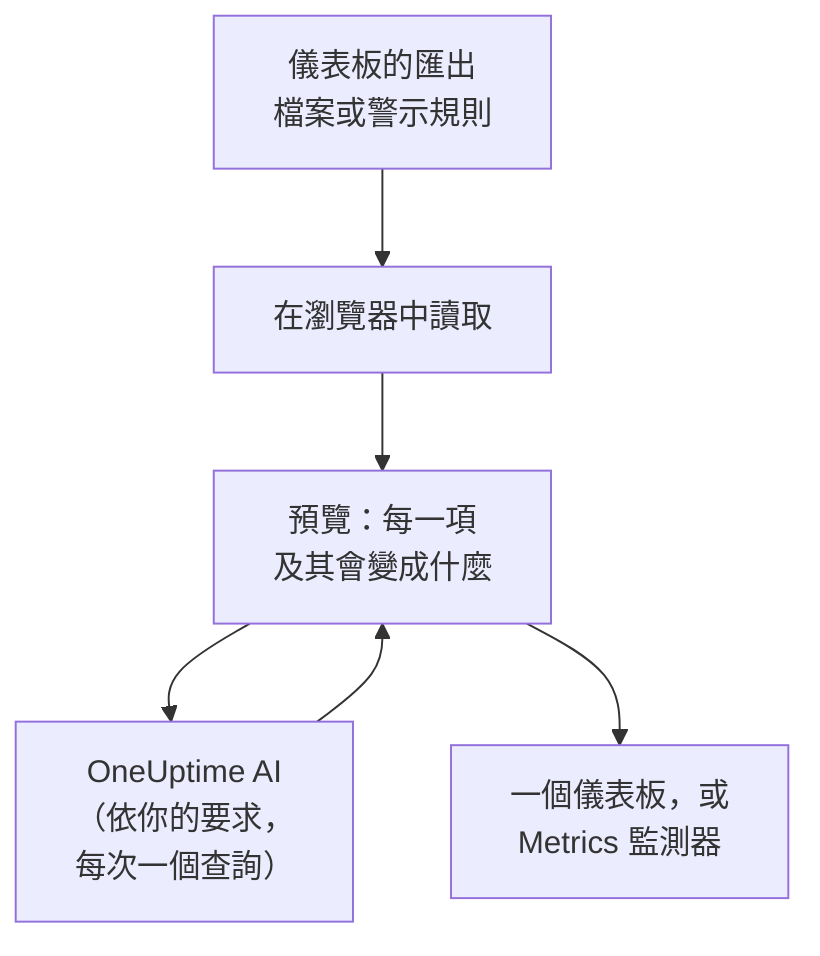

# 從 Grafana 和 Datadog 匯入

把你在 Grafana 或 Datadog 中做好的儀表板，或為 Prometheus、Grafana、Datadog 寫好的警示規則帶進 OneUptime。貼上或上傳檔案，看清每個面板和每條規則會變成什麼，然後再建立儀表板或監測器。

:::cards
- [匯入儀表板](#匯入儀表板): Grafana 儀表板的 JSON 模型，或 Datadog 儀表板的匯出檔案。
- [匯入警示規則](#匯入警示規則): Prometheus 規則檔、Grafana 警示規則和 Datadog 監測器。
- [每一項如何轉換](#每一項如何轉換): 精確轉換、近似轉換或不轉換，以及原因。
- [用 OneUptime AI 轉換查詢](#用-oneuptime-ai-轉換查詢): 用於沒有規則能轉換的查詢。
:::

## 匯入的過程

OneUptime 在你的瀏覽器中讀取檔案，並逐一轉換每個面板、小工具、變數和規則。預覽會列出所有項目及其各自會變成什麼。在你選擇建立之前不會建立任何東西；建立時會使用你自己的權限，與儀表板和監測器表單的建立方式相同。

## 開始之前

- 匯入的小工具和監測器以 PromQL 讀取本專案自己的指標。透過 Prometheus remote write、OpenTelemetry 或 Datadog Agent 傳送它們，它們會保留在那裡的名稱。
- 匯入儀表板需要能建立儀表板的角色，匯入警示規則需要能建立監測器的角色。
- 檔案最大 10 MB，其中最多讀取 500 個面板或規則。

## 匯入儀表板

:::steps
### 開啟儀表板匯入

開啟 **產品 → 儀表板** ，然後選擇 **更多選項 → Import from Grafana or Datadog** 。

### 貼上儀表板

在 Grafana 中，從儀表板的設定裡複製 JSON 模型。在 Datadog 中，匯出儀表板的 JSON。貼上它，或選擇 **Upload a File** ，然後選擇 **預覽** 。

### 建立儀表板

檢查每個面板和每個變數會變成什麼，為儀表板命名，然後選擇 **建立儀表板** 。新的儀表板隨即開啟。
:::

Grafana 的 PromQL 保持原樣：OneUptime 會像 Grafana 一樣填入 `$__interval`、`$__rate_interval` 和 `$__range`，設為 All 的變數符合所有值。Datadog 查詢會變成針對 Datadog Agent 所傳送指標的 PromQL：`avg:system.cpu.user{host:web-1}` 讀取 `system_cpu_user{host="web-1"}`。

## 匯入警示規則

:::steps
### 開啟警示匯入

開啟 **產品 → 監測器** ，然後選擇 **更多選項 → Import Alerts** 。

### 貼上規則

貼上 Prometheus 規則檔或 PrometheusRule 資源、Grafana 匯出的警示規則，或以 JSON 匯出的 Datadog 監測器，然後選擇 **預覽** 。

### 建立監測器

取消勾選不需要的規則，在 **When a rule fires** 中選擇觸發的規則要開啟什麼，然後選擇 **建立監測器** 。
:::

每條規則都會變成一個 Metrics 監測器，帶有一個 PromQL 查詢、規則的條件和它的時間窗口。它會為每個越過閾值的序列開啟一個警示或事件，並在序列恢復時解決它。標題和描述來自規則的摘要或訊息，並填入序列的標籤。

## 每一項如何轉換

| 狀態 | 含義 |
| --- | --- |
| **Converted exactly** | 它讀取相同的資料，並以相同的方式顯示。 |
| **Converted approximately** | 它會被建立，其備註會說明有何不同。 |
| **Not converted** | 不會為它建立任何東西，其備註會說明原因。 |

記錄規則、針對日誌的警示規則、讀取日誌、追蹤或事件的 Datadog 小工具，以及 Datadog 的異常、離群值和預測監測器都不會被轉換。

## 用 OneUptime AI 轉換查詢

沒有規則能轉換的查詢會顯示 **Convert with OneUptime AI** ，這需要專案已開啟 AI。只有該查詢和儀表板變數的名稱會傳送給你專案的 AI 提供者。答案會像任何查詢一樣經過檢查並呈現給你：選擇 **Use This Query** 即可使用。在你建立儀表板或監測器之前，不會建立任何東西。

## 後續步驟

:::cards
- [儀表板小工具](/docs/dashboards/widgets): 修改匯入的小工具所顯示的內容。
- [儀表板變數與篩選器](/docs/dashboards/variables): 匯入所建立的變數。
- [指標監控](/docs/monitor/metrics-monitor): 匯入所建立的監測器。
- [PromQL](/docs/telemetry/promql): 匯入的小工具和監測器所讀取的語言。
:::
