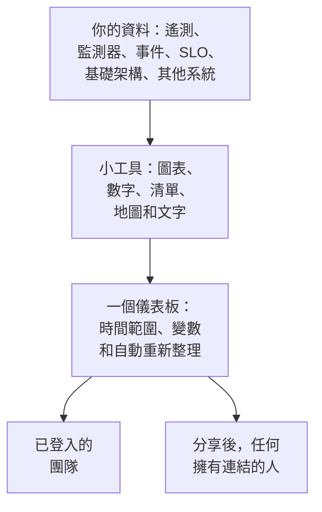

# 儀表板概觀

儀表板是由你自行擺放的小工具組成的一個頁面：指標、日誌和追蹤的圖表，事件、警示和監測器的清單，你的 SLO 和基礎架構，甚至還有 OneUptime 以外系統的資料。你可以為值班螢幕、團隊的晨間檢查或給客戶看的頁面建立儀表板，並與專案成員或任何擁有連結的人分享。

:::cards
- [儀表板如何運作](#儀表板如何運作): 資料從哪裡來，誰能看到。
- [找到你的儀表板](#找到你的儀表板): 儀表板清單，以及每個儀表板自己的頁面。
- [建立你的第一個儀表板](#建立你的第一個儀表板): 從範本到分享的頁面，只需五個步驟。
- [範例：值班儀表板](#範例值班儀表板): 一個適用於所有服務的頁面。
:::

## 儀表板如何運作

每個小工具都在儀表板的時間範圍內、依其變數篩選後，從一個來源讀取資料。開啟儀表板的每個人看到的都是相同的小工具：你的團隊登入後可以看到，訪客則在你分享後透過公開連結看到。

| 術語 | 意義 |
| --- | --- |
| 儀表板 | 一個頁面：名稱、小工具格線、時間範圍、變數和自動重新整理設定。 |
| 小工具 | 格線上的一個圖塊：圖表、數字、清單、地圖、時鐘或一段文字。 |
| 變數 | 工具列中的選擇器，把每個支援它的小工具限定到某一個服務、主機或客戶。 |
| 時間範圍 | 所有圖表和數字讀取的時間視窗。儀表板以其預設值開啟，除非編輯者另行設定，否則為最近一小時；每位檢視者都可以自行選擇。 |
| 自動重新整理 | 小工具重新讀取資料的頻率：關閉，或從每 5 秒到每 15 分鐘。 |
| 檢視與編輯 | 儀表板以閱讀方式開啟。編輯是另外一個步驟，以儲存或捨棄變更作結。 |

## 儀表板適合做什麼

- **一個「一切正常嗎？」頁面。** 給值班工程師、團隊站立會議或牆上的螢幕使用。
- **看清關聯**: CPU 飆升、延遲上升和一個未解決的事件放在同一頁上一目了然，分散在三個頁面上就很容易錯過。
- **調查問題**: 把你一再開啟的圖表並排擺放，在高峰上拖曳，就能讀取那一刻所有小工具的資料。
- **在團隊之外分享**: 為客戶或合作夥伴提供效能頁面，可視需要用密碼或 IP 允許清單保護。

## 找到你的儀表板

開啟 **產品 → 儀表板** 。 **儀表板** 清單會顯示專案中的儀表板及其描述、標籤和擁有者。你可以依名稱或描述搜尋，用 **擁有者** 和 **標籤** 篩選器縮小清單，或選取多個儀表板來變更它們的標籤或擁有者、封存它們或將它們匯出為 JSON。

清單的側邊選單包含管理所有儀表板的頁面：

| 頁面 | 在那裡做什麼 |
| --- | --- |
| **儀表板** | 專案中的儀表板。建立一個，或透過 **匯入 JSON** 匯入儀表板。 |
| **儀表板 → 播放清單** | 在 NOC 牆面螢幕等畫面上 [依序顯示儀表板](/docs/dashboards/playlists) 。 |
| **設定 → 擁有者規則** | 自動為新儀表板新增擁有者。 |
| **設定 → 標籤規則** | 自動為新儀表板新增標籤。 |
| **設定 → 資料來源** | 連線 Prometheus、SQL 資料庫、ClickHouse、Loki、Elasticsearch 或 REST API。 |
| **進階 → 已封存** | 你封存的儀表板。在這裡取消封存。 |

開啟一個儀表板後，它自己的側邊選單包含以下頁面。除了 **基礎** 之外，所有區段預設都是收合的：點選標題即可展開。

| 頁面 | 在那裡做什麼 |
| --- | --- |
| **儀表板** | 儀表板本身。閱讀它，或從它的 **⋯** 選單進行編輯。 |
| **概覽** | 名稱、描述和標籤。 |
| **分享設定** | 誰可以查看、公開連結，以及「更多設定」下的 IP 允許清單。 |
| **擁有者** | 擁有它的使用者和團隊。 |
| **品牌** | 公開儀表板的頁面標題、描述、標誌、主題和 Favicon。 |
| **自訂網域** | 在你自己的網域上託管公開儀表板。 |
| **設定** | 複製、匯出或封存儀表板。 |
| **稽核日誌** | 對儀表板的每一次變更，以及變更者。 |
| **刪除** | 永久刪除儀表板。 |

## 建立你的第一個儀表板

:::steps
1. **建立** — 選擇一個範本，或 **從零開始** 。範本會填好名稱並帶著它的小工具開啟；從零開始的儀表板開啟時是空的，畫布上有 **新增小工具** 。
2. **新增小工具** — 從目錄中選擇一個小工具，在設定中指定它讀取的內容，然後把它拖曳到定位並調整大小。
3. **視需要新增變數** — 例如，一個 `service` 變數可以讓一個儀表板顯示任意服務。
4. **儲存** — 點選 **儲存變更** 。在你這麼做之前，編輯期間的任何變更都不會保留。
5. **（選用）公開分享** — 在儀表板上選擇 **⋯ → 分享** ，並決定誰可以查看：任何擁有連結的人，或任何擁有連結和密碼的人。
:::

[建立儀表板](/docs/dashboards/authoring) 會逐一說明每個步驟。

## 範例：值班儀表板

目標：為 checkout 服務做一個頁面，包含它的延遲、錯誤率、未解決的事件和最新日誌，並且同樣適用於其他所有服務。

1. 點選 **建立儀表板** ，選擇 **從零開始** ，並將儀表板命名為「Checkout 值班」。
2. 點選 **新增小工具** ，新增一個請求延遲指標的 **圖表** ，以 P95 彙總。
3. 在它旁邊新增錯誤率的 **值** ，警告門檻設為 1，嚴重門檻設為 5。
4. 在它們下方，新增一個篩選為未解決事件的 **事件清單** ，以及該服務日誌的 **日誌串流** 。
5. 開啟 **變數** ，新增一個名為 `service` 的變數，來源為 Telemetry Attribute，屬性鍵為 `service.name` ，預設值為 `checkout` 。
6. 點選 **儲存變更** 。在工具列的 `service` 選擇器中選擇 `payments` ：圖表、值和日誌串流會切換到 payments 服務，而事件清單繼續顯示所有未解決的事件。

## 儀表板與 OneUptime 其他功能的關係

- **監測器和遙測** 是資料的來源。你傳送的每個指標、日誌和追蹤都可以放到小工具上。
- **事件和警示** 會顯示在 **事件清單** 和 **警示清單** 小工具中。儀表板只負責呈現：處理它們要在各自的頁面上進行。
- **狀態頁** 告訴客戶你的服務是否正常運作。儀表板則詳細呈現它的運作情況。兩者並行合作。
- **工作流程** 會對發生的事情採取行動。儀表板是你閱讀這些事情的地方。

## 後續步驟

:::cards
- [建立儀表板](/docs/dashboards/authoring): 建立儀表板、編輯它並儲存變更。
- [儀表板小工具](/docs/dashboards/widgets): 每個小工具，以及該選哪一個。
- [儀表板變數與篩選器](/docs/dashboards/variables): 每個服務、主機或客戶一個儀表板。
- [共用與公開儀表板](/docs/dashboards/sharing): 公開連結、密碼、IP 允許清單和自訂網域。
:::
