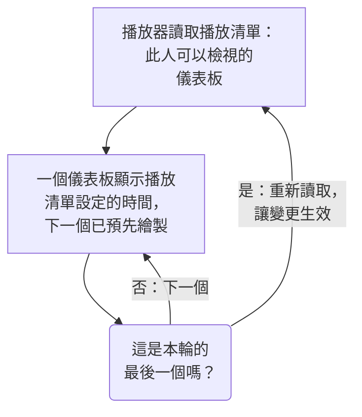

# 儀表板播放清單

播放清單會在一塊無人操作的螢幕上依序顯示一組儀表板，例如 NOC 大螢幕或團隊的電視：每個儀表板顯示你選定的時間，循環不停，直到有人暫停為止。只要建立一次播放清單，在螢幕上開啟它的播放器，然後讓它持續播放即可。

:::cards
- [播放清單如何播放](#播放清單如何播放): 順序、輪替，以及每個儀表板顯示什麼。
- [建立播放清單](#建立播放清單): 名稱、依序排列的儀表板，以及每個儀表板的顯示時間。
- [在螢幕上播放](#在螢幕上播放): 播放器的工具列、按鈕和按鍵。
- [誰能看到什麼](#誰能看到什麼): 權限，以及檢視者無權閱讀的儀表板。
:::

## 播放清單如何播放

播放器會先顯示播放清單中的第一個儀表板，時間到了就顯示下一個，顯示完最後一個後再從第一個開始。每個儀表板都會以編輯者儲存時的樣子開啟：使用它自己的預設時間範圍、自動重新整理和變數，不論播放器的網址寫了什麼。在一個儀表板顯示期間，播放器會在看不見的地方預先繪製下一個，因此兩個儀表板之間螢幕絕不會空白。

播放清單只參照它的儀表板，從不複製：編輯者儲存到儀表板的變更，會在該儀表板下一次輪到時出現在螢幕上。播放器在每一輪之前都會重新讀取播放清單，因此新增、移動或移除的儀表板會在一輪之內出現，不必重新載入螢幕；如果這次讀取失敗，螢幕會再播放一次手上的這一輪。

## 建立播放清單

:::steps
### 開啟播放清單
開啟 **產品 → 儀表板** ，然後在側邊選單中開啟 **播放清單** 。清單會顯示每個播放清單有幾個儀表板、每個儀表板顯示多久，每一列都有 **播放** 。

### 命名
按一下 **建立播放清單** ，並為它取一個說明在哪裡播放的 **名稱** ，例如「NOC 大螢幕」。

### 新增儀表板
在 **儀表板** 下，依螢幕顯示的順序從 **新增儀表板** 中逐一選取。儀表板所在列上的按鈕可以將它上移、下移或移除。已封存的儀表板不會出現在可選清單中。

### 選擇每個儀表板的顯示時間
**每個儀表板顯示時間** 預設為 1 分鐘；可以選擇 15 秒到 1 小時之間的時間。按一下 **建立播放清單** 。
:::

播放清單的頁面會依序列出它的儀表板、每個儀表板的顯示時間和 **播放器連結** 。 **編輯播放清單** 可以變更名稱、儀表板、它們的順序和時間。頁面底部的 **刪除儀表板播放清單** 會刪除播放清單，但絕不會刪除其中的儀表板。

透過 API 和 Terraform，播放清單由 `name` 、依顯示順序排列的清單 `dashboards` （形如 `[{"dashboardId": "<id>"}]` ，最多 100 個），以及 `intervalInSeconds` （10 到 86400 之間的任意整數秒，也就是最長一天）組成。超出這些範圍的值會被拒絕，並說明錯在哪裡。

## 在螢幕上播放

在播放清單所在列或它的頁面上按一下 **播放** 。播放器會蓋過 OneUptime 的其餘部分，填滿瀏覽器視窗； **全螢幕** 會填滿整個螢幕。若要讓一塊螢幕獨立啟動，在它上面開啟 **播放器連結** 並加入書籤：開啟這個連結會直接進入播放器。

播放器的工具列會顯示螢幕上的儀表板、播放清單、本輪進度（「第 2 個，共 5 個」）以及接下來的儀表板。在一個儀表板的輪次中，工具列下方的進度線會逐漸填滿。工具列的按鈕可以前往上一個儀表板、暫停或播放，以及前往下一個儀表板；在電腦上，下面這些按鍵的作用相同：

| 按鍵 | 作用 |
| --- | --- |
| `Space` | **暫停或播放** 。暫停時儀表板會留在螢幕上，工具列顯示 **已暫停** 。 |
| `Right Arrow` | **下一個儀表板** 。 |
| `Left Arrow` | **上一個儀表板** 。 |
| `F` | **全螢幕** ，或離開全螢幕。 |
| `Esc` | **離開播放器** ，回到播放清單的頁面。在全螢幕狀態下，第一次按 `Esc` 只會離開全螢幕。 |
| `?` | **顯示鍵盤快速鍵** 。 |

前往的儀表板，不論是下一個還是上一個，都會得到完整的一輪時間。在由右向左閱讀的頁面上，例如波斯語頁面，方向鍵會互換： `Left Arrow` 前往下一個儀表板。播放期間，在瀏覽器允許的情況下，播放器會防止螢幕進入睡眠。

## 誰能看到什麼

播放清單有自己的權限，和儀表板的權限一樣透過團隊取得：

| 操作 | 所需權限 |
| --- | --- |
| 檢視和播放播放清單 | `ReadDashboardPlaylist` ，或專案角色：Project Owner、Project Admin、Project Member、Viewer 或某個 Settings 角色 |
| 建立播放清單 | `CreateDashboardPlaylist` 、Project Owner 或 Project Admin |
| 修改播放清單：它的名稱、儀表板和時間 | `EditDashboardPlaylist` 、Project Owner 或 Project Admin |
| 刪除播放清單 | `DeleteDashboardPlaylist` 、Project Owner 或 Project Admin |

播放清單絕不會向任何人顯示其無權閱讀的儀表板。播放器只播放在螢幕上登入的人可以閱讀且未封存的儀表板，其餘的都會略過：已刪除的儀表板、已封存的儀表板，或其權限不允許檢視的儀表板。播放清單的頁面會說明略過每一個的原因。儲存播放清單時，編輯者自己看不到的儀表板會保留在其中，因此別人放進去的內容不會遺失。

| 播放器發現 | 顯示 |
| --- | --- |
| 可以顯示的儀表板 | 依序輪流顯示。 |
| 沒有可以顯示的儀表板 | **目前沒有可顯示的內容** ，並且每分鐘再檢查一次。 |
| 播放清單已刪除，或此人無權閱讀 | **找不到播放清單** 。 |
| 讀取失敗 | **無法載入此播放清單** ，並且每分鐘重試一次，或在按下 **再試一次** 時重試。 |

> [!NOTE]
> 播放器是給已登入 OneUptime 的人使用的。若要在一塊螢幕上播放播放清單，請在這塊螢幕上用可以閱讀該播放清單及其儀表板的帳號登入，例如具有 Viewer 角色的團隊成員。

## 後續步驟

:::cards
- [建立儀表板](/docs/dashboards/authoring): 建立播放清單要顯示的儀表板。
- [儀表板變數與篩選器](/docs/dashboards/variables): 每個儀表板開啟時使用的已儲存選擇。
- [共用與公開儀表板](/docs/dashboards/sharing): 向不登入的人展示一個儀表板。
- [儀表板設定與權限](/docs/dashboards/configuration): 擁有者、標籤，以及誰可以閱讀儀表板。
:::
