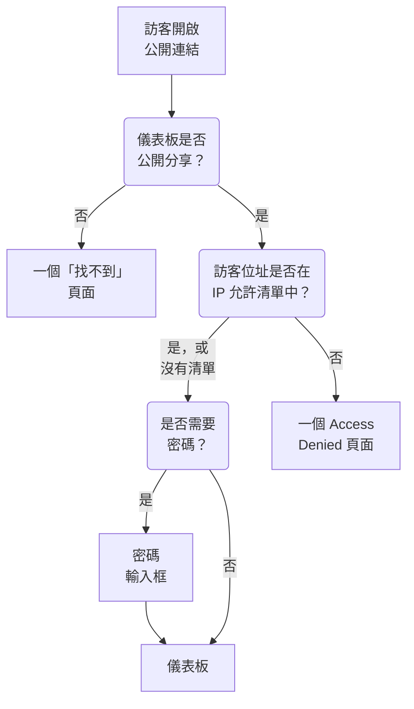

# 共用與公開儀表板

預設情況下，儀表板只在你的專案內可見：只有登入你專案的人才能看到。你也可以透過公開連結分享它，用密碼保護這個連結，把它限制在特定 IP 位址，並在你自己的網域上託管它。本頁介紹全部四種方式。

:::cards
- [誰可以查看儀表板](#誰可以查看儀表板): 三選一，每種選擇都需要對應的方案。
- [使用密碼分享](#使用密碼分享): 把連結和密碼依序分享給應該查看的人。
- [IP 允許清單](#ip-允許清單): 只允許你的辦公室或 VPN 開啟公開連結。
- [自訂網域](#自訂網域): 在你自己的網域上提供儀表板，並附上免費憑證。
:::

## 訪客會經歷什麼

開啟儀表板公開連結的訪客會依序經過以下檢查。登入 OneUptime 的專案成員無論你在這裡如何選擇，都能在產品內看到儀表板。



## 誰可以查看儀表板

開啟儀表板並選擇 **⋯ → 分享** ，或在儀表板的側邊選單中開啟 **分享設定** 。 **誰可以查看此儀表板** 卡片是一個單選項：

- **僅限此專案中的成員** （預設）：成員登入 OneUptime 後可以看到儀表板。它沒有公開連結：它的公開位址顯示的「找不到」頁面與沒有儀表板的位址相同，不會透露任何關於該儀表板的資訊，連名稱也不會。
- **任何擁有連結的人** ：儀表板是公開的。任何擁有連結的人不需登入即可查看。
- **任何擁有連結和密碼的人** ：訪客開啟連結後，輸入你與他們分享的一組密碼。任何人都不需要帳號。

選擇一個選項時會要求確認，並說明對訪客有何變化，然後立即生效。儀表板還沒有密碼時，選擇 **任何擁有連結和密碼的人** 會在同一個對話方塊中要求設定密碼；在維持這個選項期間， **變更密碼** 可以取代密碼。儀表板公開期間，它的 **公開連結** 會顯示在選項下方，並附有一個複製按鈕。

在專案內部，擁有者和標籤控制誰能看到什麼——請參閱 [儀表板設定與權限](/docs/dashboards/configuration) 。能查看但不能編輯儀表板的人可以看到這個選項並複製公開連結，但不能變更選項。

在 OneUptime Cloud 上，分享儀表板需要 **Growth** 方案：在較低的方案上，兩個公開選項會顯示所需的方案且無法選擇。把儀表板改回私人（ **僅限此專案中的成員** ）在任何方案上都可以，因此試用結束時或降級方案後仍保持公開的儀表板，一律可以停止分享；對話方塊會說明再次分享需要 **Growth** 。在 **任何擁有連結的人** 和 **任何擁有連結和密碼的人** 之間切換，以及變更密碼，在任何方案上都可以。透過 API 或 Terraform 建立的儀表板也適用同樣的方案：以公開方式建立需要 **Growth** ，帶 IP 允許清單建立需要 **Scale** 。

這個選項儲存在三個欄位中，API 和 Terraform 仍像以前一樣讀寫它們： `isPublicDashboard` 、 `enableMasterPassword` 和 `masterPassword` 。只有公開儀表板才有公開連結，只要 `enableMasterPassword` 開啟，訪客就會被要求輸入密碼。 `enableMasterPassword` 已開啟但未設定密碼的公開儀表板，不會讓任何人透過公開連結進入： **分享設定** 頁面會將它顯示為 **任何擁有連結和密碼的人** ，說明目前還沒有人能開啟連結，並提供 **設定密碼** 。選擇 **僅限此專案中的成員** 也會關閉 `enableMasterPassword` 並保留密碼，因此再次使用密碼分享時可以重新使用它。

## 公開儀表板

公開儀表板：

- 一律以閱讀方式開啟。訪客無法編輯，也永遠看不到編輯控制項。
- 包含你加入的變數。訪客可以使用與你的團隊相同的選擇器，還可以變更時間範圍、放大、開啟自動重新整理和進入全螢幕。
- 使用你在儀表板 **品牌** 頁面上設定的品牌：頁面標題、描述、標誌、Favicon。

請像發布網頁一樣看待分享儀表板。上面的每個小工具都會讓任何擁有連結的人讀得到。分享之前，先看看畫布上有什麼。

每個小工具只會發布它繪製的內容，而且只針對它所指向的資源。例如，SLO 小工具會發布該 SLO 的關鍵數字，但永遠不會發布它的定義——請參閱 [SLO](/docs/dashboards/widgets#slo) 。外部 **Data Source** 小工具是例外：它們會被完全排除在公開儀表板之外而不被轉譯，因為它們的設定就是查詢本身。另外還有幾個小工具在沒有登入工作階段時無法顯示，並會在原位置說明這一點： [在公開儀表板上](/docs/dashboards/widgets#在公開儀表板上) 列出了它們。

## 使用密碼分享

選擇 **任何擁有連結和密碼的人** ，並在對話方塊中輸入密碼。訪客在儀表板出現之前會看到密碼輸入框。輸入框只顯示儀表板的名稱、頁面標題和 Favicon：描述、標誌和小工具會在輸入密碼後出現。密碼以雜湊形式儲存——沒有人能讀回它。新密碼立即生效；輸入過舊密碼的人最多還能繼續查看儀表板 7 天。

在以下情況使用密碼：

- 你想與合作夥伴或客戶分享，但不希望 URL 外洩後可以被利用。
- 儀表板是「半公開」的——開放到不想把每位檢視者都邀請為團隊成員，但又沒有開放到可以放到公開網際網路上。

如需更嚴格的控管（每位檢視者各自的帳號、誰查看了什麼的稽核記錄），請將儀表板維持為 **僅限此專案中的成員** ，改為把檢視者邀請為唯讀團隊成員。

## IP 允許清單

在 **分享設定** 頁面的 **更多設定** 底下， **IP 允許清單** 區段（ `ipWhitelist` 欄位）會把公開連結限制在你列出的 IP 位址或 IPv4 範圍內，每行一個，例如 `203.0.113.7` 或 `10.0.0.0/8` 。無論是否使用密碼都會生效；登入的專案成員不受影響。留空則允許所有位址。它與選項分開單獨儲存，在 OneUptime Cloud 上修改它需要 **Scale** 方案；清空它在任何方案上都可以。清單生效期間，收合的 **更多設定** 標題會顯示 **IP 允許清單** 及其中的項目數。

在以下情況使用：

- 儀表板只能從你的辦公室或 VPN 存取。
- 供應商入口網站只能從其已知 IP 存取。
- 你希望在密碼之外再加一層保護。

來自其他任何 IP 的請求都會被拒絕，並顯示一個 **Access Denied** 頁面，其中不會透露任何關於儀表板的資訊：沒有名稱、沒有品牌，也沒有密碼輸入框。既不是 IP 位址也不是 IPv4 範圍的行會在儲存時被拒絕，因為伺服器會略過它。

## 自訂網域

預設情況下，公開儀表板透過它的公開連結、在 OneUptime 自己的位址上提供。要把它託管在你自己的子網域上（例如 `dashboard.acme.com` ），請在儀表板的側邊選單中開啟 **品牌 → 自訂網域** 。它的運作方式與狀態頁的 **自訂網域** 頁面完全相同。

此卡片的標題是 **自訂網域** ，並說明了要做什麼：把每個網域的 CNAME 記錄指向你的安裝的儀表板 CNAME 記錄，OneUptime 就會為該網域核發 SSL 憑證並替你續約。表格有兩欄： **網域** 和 **狀態** 。

把儀表板放到你自己的網域上需要三個步驟，只有前兩步需要你來做：

1. **新增網域**: 一個子網域，以及一個你已驗證的網域。
2. **新增它的 CNAME 記錄**: 在你的 DNS 供應商處新增。新增網域後， **DNS 設定** 對話方塊會立即帶著這筆記錄開啟。
3. **免費 SSL 憑證會自動核發**: 一旦找到記錄就會核發。沒有需要按的按鈕。

驗證通過後，你的自訂網域和原始 URL 都可以存取該儀表板。

### 新增網域

點選 **建立儀表板 網域** 。對話方塊只有一頁：

- **子網域** ：只填標籤部分，預留位置為 `dashboard (leave blank for root)` 。只輸入 `dashboard` ，而不是完整的主機名稱。留空或輸入 `@` 則使用根（apex）網域。
- **網域** ：在 **專案設定 → 網域** 底下驗證過的網域，你在那裡用 TXT 記錄證明網域屬於你。未驗證的網域不會列出，因為它會被拒絕。欄位旁的 **新增網域** 連結會在新分頁中開啟那個頁面。
- **更多欄位** ：已收合。收合時，它的標題會說明該網域將使用哪種憑證：「我們為此網域核發免費的 SSL 憑證並自動續約。」只有要使用你自己的憑證時才需要展開（見下文）。

點選 **建立儀表板 網域** 。對話方塊關閉，新網域的 **DNS 設定** 隨即開啟。網域的完整名稱在新增時就已固定，因此 **編輯** 只能變更它的憑證。要使用其他子網域，請新增那個網域並刪除舊的。

### DNS 設定與立即檢查

**DNS 設定** 對話方塊會顯示要在 DNS 供應商處新增的記錄，每行一個欄位，每個欄位都附有複製按鈕： **類型** 為 `CNAME` ， **名稱** 為你新增的完整網域， **值** 為你的安裝的儀表板 CNAME 記錄。對於沒有子網域的根網域，對話方塊會附加一則說明：許多 DNS 供應商不允許在那裡使用 CNAME 記錄，因此請改用供應商的 ALIAS、ANAME 或 CNAME 扁平化記錄，值保持不變。

OneUptime 每 15 分鐘檢查一次所有未驗證的網域，檢查找到記錄後，會在同一次檢查中為該網域訂購免費的 Let's Encrypt 憑證，無論你是否回來查看。要立即檢查，請點選 **立即檢查** ：

- **尚未找到記錄。** 對話方塊會保持開啟，並說明它尋找的是哪筆記錄。新的 DNS 記錄可能需要一段時間才會生效。稍後再次點選 **立即檢查** ，或交給每 15 分鐘一次的檢查。
- **已找到記錄。** 對話方塊會顯示「您的 CNAME 記錄已驗證。」以及憑證接下來會怎樣。免費憑證會在那一刻訂購，通常在 15 分鐘內生效。

在網域通過驗證且憑證就位之前，它所在的列都有一個 **DNS 設定** 動作，可以開啟同一個對話方塊。對於憑證訂購一直失敗或憑證已過期的已驗證網域，在那裡點選 **立即檢查** 會重新訂購，並顯示上一次訂購失敗的原因。每個網域每 15 分鐘最多訂購一次；在此期間，OneUptime 會自行持續重試，並在每次連續失敗後稍微延長等待時間。續約會自動進行，遠早於憑證到期，而 DNS 檢查失敗永遠不會移除仍然有效的憑證。

### 解讀狀態欄

**狀態** 欄說明每個網域在通往 HTTPS 的路上處於哪一步，共有七種狀態之一，與狀態頁相同。訂購失敗時，原因會顯示在下面一行。

| 狀態欄顯示的內容 | 意義 |
| --- | --- |
| 等待 DNS：請新增 CNAME 記錄。 | 尚未找到 CNAME 記錄。開啟 **DNS 設定** 查看記錄，在 DNS 供應商處新增，然後點選 **立即檢查** ，或等待每 15 分鐘一次的檢查。 |
| 正在核發免費憑證，通常會在 15 分鐘內完成。 | 記錄已驗證，憑證正在訂購或寫入。不需要任何操作。 |
| 暫時無法核發免費憑證。我們會繼續嘗試。 | 記錄已驗證，但由於下面一行所示的原因，憑證訂購失敗。修正原因後，開啟 **DNS 設定** 並點選 **立即檢查** 即可立即重新訂購。 |
| 憑證已過期。我們會繼續嘗試續約。 | 由於續約失敗，網域的憑證已過期。開啟 **DNS 設定** 並點選 **立即檢查** ，即可立即續約並查看原因。 |
| 憑證已核發，將自動續約。 | 完成。該網域透過 HTTPS 提供憑證，OneUptime 負責續約。 |
| 憑證已核發，但續約失敗。我們會繼續嘗試。 | 該網域仍在提供有效的憑證，但由於下面一行所示的原因，上一次續約失敗。OneUptime 會在憑證到期前很早就再次嘗試。 |
| 正在使用您上傳的憑證。 | 記錄已驗證，該網域使用你上傳的憑證提供服務。 |

如果訂購失敗，常見原因是你的網域上有不允許 `letsencrypt.org` 的 CAA 記錄，以及在自行託管的安裝中，Let's Encrypt 無法透過 80 連接埠連到伺服器。

### 使用你自己的憑證，以及重新核發

要改用你自己的憑證，請在新增網域時展開 **更多欄位** ，開啟 **上傳自訂憑證** ，然後貼上 **憑證** 及其 **憑證私密金鑰** 。OneUptime 會在 15 分鐘內開始使用它，而不是訂購 Let's Encrypt 憑證，它會取代該網域之前的任何 Let's Encrypt 憑證。上傳憑證的續約需要你自己負責：編輯網域並貼上新憑證。如果該網域之前有免費憑證，在你的憑證使用期間，OneUptime 會繼續為它續約，因此可以隨時立即切換回去。

為某個網域訂購免費憑證後，該列會顯示 **Reissue SSL** ，當你希望在自動續約之前取得新憑證時，它會向 Let's Encrypt 申請一張全新的憑證。每個網域每 24 小時可以重新核發一次。

在自行託管的安裝中，儀表板自訂網域由環境變數 `DASHBOARD_CNAME_RECORD` （Helm chart 中為 `dashboard.cnameRecord` ）開啟，它就是你的 CNAME 記錄所指向的目標。沒有它時，卡片和 **DNS 設定** 對話方塊會顯示 "Custom Domains not enabled for this OneUptime installation" 而不是記錄，OneUptime 也不會為儀表板驗證網域或訂購憑證。

### 誰可以檢查和重新核發

**立即檢查** 、訂購網域憑證和 **Reissue SSL** 都會變更網域，因此需要編輯網域的權限： **Edit Dashboard Domain** ，或包含該權限的角色（Project Owner、Project Admin、Project Member、Settings Admin 或 Settings Member）。

只能讀取網域的人，例如 Viewer 或 Settings Viewer，仍然可以看到 **狀態** 欄以及 **DNS 設定** 中要新增的記錄。對他們來說， **立即檢查** 和 **Reissue SSL** 處於鎖定狀態，並說明需要哪個權限。無論如何，OneUptime 都會自行持續檢查每個網域並為它訂購憑證。

API 金鑰也是如此。只能讀取儀表板網域的金鑰無法呼叫 `/dashboard-domain` 上的 `verify-cname` 、 `order-ssl` 或 `reissue-ssl` 。如有需要，請為它授予 **Read Dashboard Domain** 和 **Edit Dashboard Domain** 。

一個網域同一時間只屬於專案中的一個儀表板。如果你要向多個受眾提供相同的內容，可以為一個儀表板關聯多個自訂網域：使用你自己品牌的客戶專用儀表板、聯名品牌的合作夥伴儀表板，或附有獨立 URL 的公開健康狀態頁面。

## 品牌

在儀表板的 **品牌** 頁面上，你可以設定：

- **頁面標題** ——顯示在瀏覽器分頁和頁面頂端的內容。
- **頁面描述** ——搜尋引擎和社群預覽使用的描述。
- **標誌** ——顯示在公開儀表板頁首中的圖片。
- **Favicon** ——瀏覽器分頁中的小圖示。

標誌和 Favicon 是上傳到儀表板所屬專案中的檔案，每次儲存時都會檢查這一點——無論是從儀表板、API、Terraform 還是工作流程儲存。在其他專案中上傳的檔案會被拒絕，提示文字與已不存在的檔案相同："The logo's file could not be found. Upload the logo again." 或 "The favicon's file could not be found. Upload the favicon again." 公開儀表板只會顯示其所屬專案中的圖片。

頁面標題和描述也會顯示在團隊所見的儀表板工具列頂端，取代儀表板的名稱和描述。標誌和 Favicon 只會出現在公開儀表板上。

訪客只有在被允許查看儀表板後才能看到品牌。在輸入密碼之前，使用密碼分享的儀表板只顯示頁面標題和 Favicon，搜尋引擎和連結預覽能看到頁面標題，但看不到頁面描述。附有 IP 允許清單的儀表板只會向清單中的位址顯示品牌，搜尋引擎和連結預覽什麼也看不到。

## 嵌入

你可以用 iframe 把公開儀表板嵌入你自己的網站，使用它的公開連結或其中一個自訂網域：

```html title="embed.html"
<iframe
  src="https://dashboard.acme.com"
  width="100%"
  height="800"
  frameborder="0"
></iframe>
```

如果儀表板使用密碼分享，訪客會在 iframe 中看到密碼輸入框。

## 傳送連結

公開連結會以已儲存的預設值開啟儀表板。要傳送一個開啟時就是特定值的連結，請把變數以 `?var-<name>=<value>` 的形式加到連結上，就像訪客選擇值時網址列所做的那樣；多個值以逗號分隔。時間範圍不屬於連結的一部分：每次造訪都從最近一小時開始。

## 後續步驟

:::cards
- [儀表板設定與權限](/docs/dashboards/configuration): 擁有者、標籤，以及誰可以變更分享設定。
- [儀表板變數與篩選器](/docs/dashboards/variables): 訪客使用的選擇器，以及保留選擇的連結。
- [儀表板小工具](/docs/dashboards/widgets): 每個小工具在公開儀表板上發布的內容。
- [狀態頁概觀](/docs/status-pages/index): 告訴客戶你的服務是否正常運作。
:::
