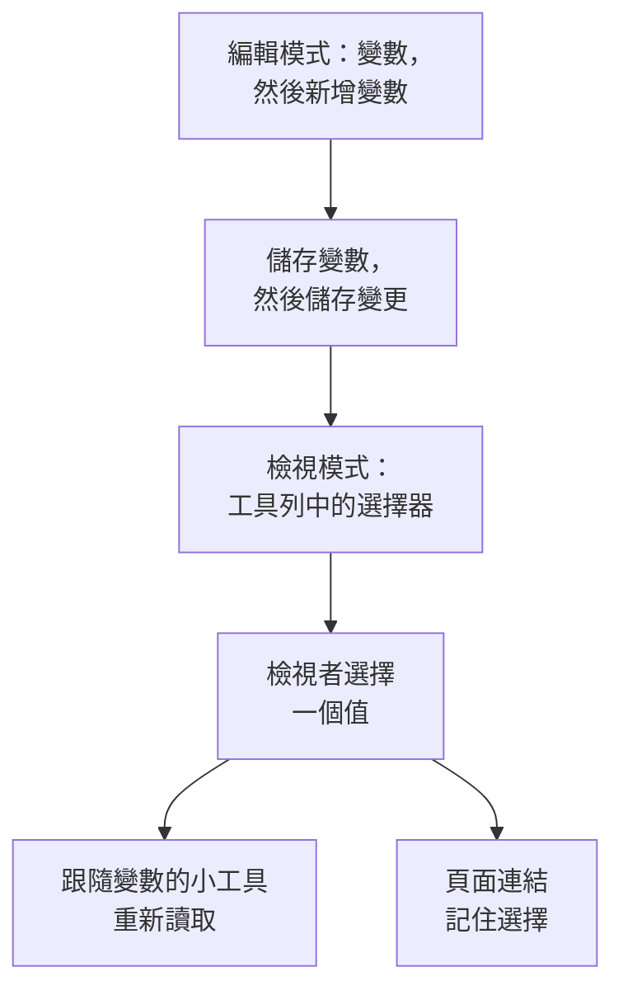

# 儀表板變數與篩選器

變數是儀表板工具列中的選擇器。新增一個 `service` 變數，同樣的圖表就能顯示 `checkout` 、 `payments` 或 `search` ：檢視者在工具列中選擇，而不需要你建立三個幾乎一樣的儀表板。

:::cards
- [新增變數](#新增變數): 命名、選擇值的來源，然後儲存。
- [變數來源](#變數來源): Telemetry Attribute、Project Labels、Custom List 和 Text Input。
- [小工具如何使用變數](#小工具如何使用變數): 哪些小工具會跟隨哪些變數。
- [保留選擇的連結](#保留選擇的連結): 傳送一個開啟時就是同一服務的連結。
:::

## 變數如何運作

變數在編輯儀表板時定義，並隨儀表板一起儲存。在檢視模式下，每個變數都是工具列中的一個選擇器。檢視者選擇一個值後，每個跟隨該變數的小工具都會重新讀取資料，頁面連結也會記住這個選擇。



## 新增變數

:::steps
### 開啟變數對話方塊

開啟儀表板，選擇 **⋯ → 編輯儀表板** ，然後點選工具列中的 **變數** 。 **儀表板變數** 對話方塊會列出儀表板的變數；工具列中的按鈕會顯示變數的數量。

### 新增一個

點選 **新增變數** 。新的變數會讀取一個遙測屬性；如有需要，可以選擇另一個 **來源** 。

### 填寫

為它指定一個 **名稱** ，供小工具和連結使用，例如 `service` ：只能包含字母、數字和底線，以字母或底線開頭，且不能與儀表板的其他名稱重複。如有需要，再為工具列加上一個 **標籤** 、設定起始的 **預設** 值，並勾選 **允許多選** 讓檢視者可以選擇多個值。

### 儲存

點選 **儲存變數** ，然後點選工具列中的 **儲存變更** 。儀表板回到檢視模式後，變數的選擇器就會出現在工具列中。
:::

之後要修改或移除變數，請再次開啟對話方塊：修改它的欄位，或點選旁邊的垃圾桶圖示。

## 變數來源

**來源** 決定變數的值從哪裡來，以及哪些小工具會跟隨它。

| 來源 | 值從哪裡來 | 多選 |
| --- | --- | --- |
| Telemetry Attribute | 指標中某一個屬性鍵的值，例如 `service.name` | 是 |
| Project Labels | 你允許的專案標籤，從 1 到 1,000 個 | 是 |
| Custom List | 你輸入的以逗號分隔的值，例如 `prod, staging` | 是 |
| Text Input | 檢視者輸入的任何內容 | 否 |

### Telemetry Attribute

設定 **屬性鍵** ，例如 `service.name` 、 `host.name` 或 `k8s.namespace.name` ；此欄位會建議你的遙測資料中帶有的鍵。選擇器最多提供該鍵的 100 個值，這些值讀取自過去一天的指標，因此新的服務不必編輯儀表板就會出現在其中。

這是最常用的來源，因為它不需要另外的清單：值就是你已經在傳送的那些。

### Project Labels

選擇現有的專案標籤，作為儀表板下拉式清單提供。例如，建立一個名為 `UNIT` 的變數，把來源設為 **專案標籤** ，然後選擇標籤 `0660` 和 `0661` 。

儀表板會儲存所選標籤的 ID 和顯示名稱。篩選使用的是 ID，因此重新命名專案標籤不會破壞它的繫結。顯示名稱會隨儀表板一起儲存；要更新重新命名後標籤的顯示名稱，請在變數編輯器中重新選取該標籤。公開儀表板也會顯示這些已儲存的選項。

在 **監測器清單** 小工具中，開啟 **篩選器 → 標籤變數** 並選取 `UNIT` 。此後選擇 `0660` 會顯示帶有該標籤的監測器。其他小工具不受影響，除非它們明確支援並繫結該變數： **SLO 清單** 也有同樣的 **標籤變數** 設定。

小工具的固定篩選器仍然有效。例如，有固定標籤 `network` 且 `UNIT` 設為 `0660` 時，監測器必須同時帶有這兩個標籤。選擇多個單位時，符合其中任何一個即可。選擇 **全部** 只會移除變數條件，固定的標籤、狀態和監測器類型篩選器仍會保留。

缺少變數，或選取的內容不在設定的選項之內時，會顯示錯誤。所選標籤沒有符合的監測器時，會顯示空白清單。不再需要繫結時，請明確地將它從小工具中移除。

### Custom List 和 Text Input

Custom List 提供你輸入的以逗號分隔的值。Text Input 讓檢視者輸入任意值，例如 IP 位址或請求 ID。兩者本身都不會篩選小工具：它們的值會填入你寫 `{{name}}` 的地方（見下文）。

舊儀表板中的 Query 變數會被保留，並在工具列中顯示一個文字方塊：OneUptime 不再從查詢載入它的值。

## 多選與預設值

勾選 **允許多選** 後，檢視者可以選擇一個或多個值，小工具會顯示其中任何一個的資料。空白的選擇代表 **全部** ，而多選變數一律從 **全部** 開始，因此它的 **預設** 值會顯示為灰色。

單選變數從它的 **預設** 值開始，沒有預設值時則從 **全部** 開始。 **全部** 會移除變數的篩選，因此小工具會顯示所有內容。

想在不離開儀表板的情況下比較「checkout 和 payments 合在一起」時，請使用多選。如果數字無法在各個值之間相加，例如平均值的平均值，請避免使用。

## 小工具如何使用變數

每種來源以自己的方式作用於小工具：

- **遙測屬性** 變數不需要在小工具上做任何設定就能篩選：每個指標圖表、值、量測值和表格； **日誌圖表** 、 **日誌串流** 、 **追蹤圖表** 和 **追蹤表** ；以及資源帶有該屬性的基礎架構清單，例如主機清單上的 `host.name` 和 Kubernetes 清單上的 `k8s.namespace.name` 。沒有該屬性的指標圖表在選取某個值時不會顯示資料：選擇 **全部** 即可再次看到。 **追蹤清單** 以及事件和警示清單不會跟隨這類變數。
- **專案標籤** 變數會篩選 **標籤變數** 中指定了它的 **監測器清單** 或 **SLO 清單** 。
- **任何變數** 都可以用 `{{name}}` 的形式寫入文字：在 [HTML 小工具](/docs/dashboards/widgets#html) 中、 [外部資料來源](/docs/dashboards/data-sources) 的查詢中，以及 **監測器清單** 或 **SLO 清單** 的標題中。像 `{{UNIT}} NETWORK` 這樣的標題會顯示為 `0660 NETWORK` 、 `0660, 0661 NETWORK` 或 `All NETWORK` 。標題只控制顯示的文字；要篩選監測器查詢，請設定 **標籤變數** 。

[SLO 小工具](/docs/dashboards/widgets#slo) 可以跟隨 `sloName` 鍵上的 Telemetry Attribute 變數，讓檢視者選擇它要顯示哪個 SLO。

## 保留選擇的連結

頁面連結以 `?var-<name>=<value>` 的形式攜帶每個變數的選擇，多個值以逗號分隔，因此複製的連結開啟時會保留相同的選擇，包括明確的 **全部** 。像下面這樣的連結會開啟 payments 服務：

```text title="A dashboard link with a variable"
https://oneuptime.com/dashboard/<project-id>/dashboards/<dashboard-id>?var-service=payments
```

連結還會以 `range` 和 `refresh` 攜帶你選擇的時間範圍和自動重新整理，讓收到連結的人看到與你相同的內容。它們的取值見 [傳送連結](/docs/dashboards/sharing#傳送連結)。

## 範例：每個服務一個儀表板

一個服務儀表板通常包含：

1. 一個 `service` 變數，來源為 Telemetry Attribute，屬性鍵為 `service.name` ，預設值為你最忙碌的服務。保持多選關閉，讓圖表一次只顯示一個服務。
2. 一個 `namespace` 變數，來源為 Telemetry Attribute，屬性鍵為 `k8s.namespace.name` ，開啟多選以便比較命名空間。
3. 一個 `environment` 變數，來源為 Custom List，值為 `prod, staging` ，在資料來源查詢中以 `{{environment}}` 的形式使用。
4. 讀取這些屬性的小工具：服務指標的圖表和值、一個日誌串流，以及一個 Kubernetes Pod 清單。

結果：一個適用於每個服務的儀表板，頂端有三個選擇器。

## 後續步驟

:::cards
- [儀表板小工具](/docs/dashboards/widgets): 哪些小工具會跟隨哪些變數。
- [外部資料來源](/docs/dashboards/data-sources): 把變數放進 PromQL 或 SQL 查詢。
- [共用與公開儀表板](/docs/dashboards/sharing): 公開儀表板上的變數。
- [建立儀表板](/docs/dashboards/authoring): 編輯模式、儲存和時間範圍。
:::
