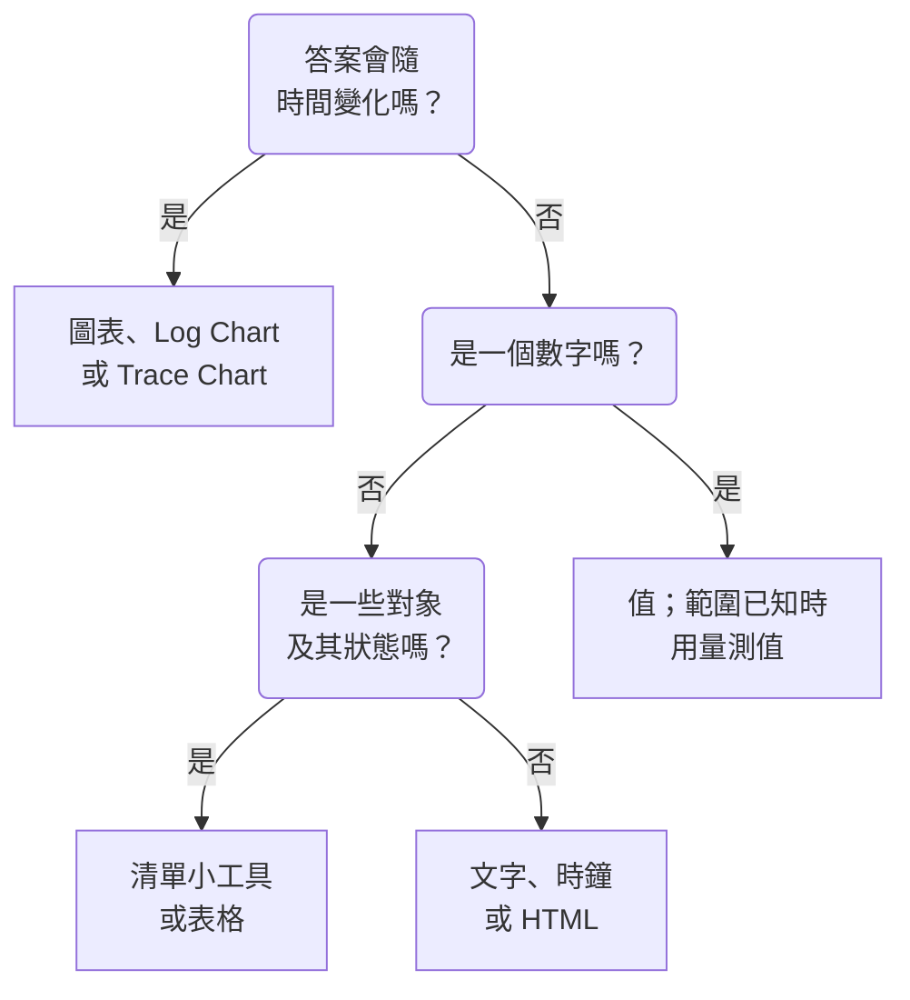

# 儀表板小工具

小工具是儀表板上的一個圖塊。本頁依 **新增小工具** 目錄本身的分組，列出其中每個小工具、它顯示什麼，以及重要的設定。關於如何把小工具放到格線上並儲存，請參閱 [建立儀表板](/docs/dashboards/authoring) 。

:::cards
- [該用哪個小工具？](#該用哪個小工具): 依圖塊要回答的問題來選。
- [圖表與數字](#圖表與數字): 以指標查詢為基礎的圖表、值、量測值和表格。
- [日誌、追蹤與安全性](#日誌追蹤與安全性): 數量圖表、即時串流和清單。
- [為清單和表格排序](#為清單和表格排序): 依某一欄排序，並設定所有人看到的順序。
- [小工具無法顯示時](#小工具無法顯示時): 出錯的小工具會顯示什麼，以及如何修正。
:::

## 該用哪個小工具？

從圖塊需要回答的問題出發：

| 問題 | 小工具 |
| --- | --- |
| 某個指標隨時間如何變化？ | **圖表** |
| 各嚴重等級的日誌隨時間有多少？ | **日誌圖表** |
| 請求有多快、有多少失敗，隨時間如何變化？ | **追蹤圖表** |
| 此刻的某一個數字是多少？ | **值**，範圍已知時用 **量測值** |
| 哪些主機、服務或端點特別突出？ | **表格** 或 **追蹤表** |
| 此刻正在發生什麼？ | **日誌串流**、**追蹤清單**、**事件清單** 或 **警示清單** |
| 我們的所有網站都正常嗎？ | **監測器清單** |
| 我們是否守住了承諾的可靠性？ | **SLO** 或 **SLO 清單** |
| 我們的叢集和主機處於什麼狀態？ | 基礎架構分組中的小工具 |
| 我們的網路分布在世界何處，哪裡出了故障？ | **網路地圖** |
| 標題、備註、另一個辦公室的時間？ | **文字** 或 **時鐘** |
| 存放在 OneUptime 以外的資料？ | 外部資料來源分組中的小工具 |
| 沒有任何小工具能做的事？ | **HTML**，前提是確認其他小工具都做不到 |



大多數儀表板會組合幾種：頂端一張圖表，旁邊一兩個值，一個文字標題，下方一兩個清單。

## 圖表與數字

這四個小工具讀取的指標查詢，與指標瀏覽器的建構方式相同：選擇一個指標和一種彙總方式，加入屬性篩選器，再依某個屬性分組，就能為每個值得到一條序列。

### 圖表

儀表板時間範圍內一個或多個指標查詢的時間序列。 **Chart Type** 可將它繪製為折線圖、長條圖、面積圖、堆疊面積圖或圓餅圖。 **Additional Queries** 會在同一座標軸上疊加更多指標， **Formulas** 則用 `+` 、 `-` 、 `*` 、 `/` 、 `%` 、 `^` 和括號把它們組合起來，例如 `(1 - a) * 100` 。每個查詢的顯示設定可以加入圖例和單位、顏色、警告線和嚴重線，以及適用於只增不減之計數器的每秒速率。

當線條的形狀能說明狀況時使用它：延遲、錯誤、吞吐量或佇列深度。

### 值

一個附有迷你走勢線的大數字：查詢在整個時間範圍內的值，加總或計數時取總和，最大值時取最高值，最小值時取最低值，其他情況取平均值。箭頭會把範圍的後半段與前半段比較（兩段以同樣的方式計算），並依 **Trend Direction** 著色：數值越高越好還是越差，或依指標名稱判斷。將指標停在箭頭上可查看兩段各自的值，停在迷你走勢線上可讀取任一點的值與時間。值達到 **Warning Threshold** 時背景變黃，達到 **Critical Threshold** 時變紅。

當一個數字就能回答問題時使用它：錯誤率、P95 延遲或今天處理的請求數。

### 量測值

介於最小值和最大值之間的錶盤，未設定時為 0 和 100，從 **Warning Threshold** 起是黃色區域，從 **Critical Threshold** 起是紅色區域。

當數值落在已知範圍內時使用它：以百分比表示的 CPU 或磁碟使用率，或佇列的容量。

### 表格

以列顯示指標值。使用 **Group By Attributes** 時每個值一列，例如每個 `host.name` 一列；不使用時，每一列是一個時間區段。 **Metrics & Columns** 用來設定欄：指標，以及以指標為基礎的公式，例如以百分比表示的可用性。分組時， **Reduce across time** 會把每一列的序列歸約為一個值：最新值、平均值、總和、最小值或最大值。

在欄中開啟 **依閾值著色**，即可為該欄的值著色：達到 **警告閾值** 的值會顯示為琥珀色並帶三角形，達到 **嚴重閾值** 的值會顯示為紅色粗體並帶圓形。百分比欄從 80 和 90 開始。對於低值才是問題的欄（例如可用磁碟空間），請在 **方向** 中選擇 **越低越差**。

閾值依表格顯示的數值判斷，因此以 1 的比例傳送的使用率指標（例如 `system.cpu.utilization`）會以百分比顯示和比較。在 **閾值顏色** 中， **彩色背景** 會填滿整個儲存格，而不是為數值著色。

需要看細項而不是趨勢時使用它：最吵雜的主機、各服務的錯誤、各端點的請求。

## 文字、時鐘與 HTML

這些小工具不需要資料來源。

### 文字

一行或一段文字，用作標題、備註或指向操作手冊的連結。開啟 **Markdown** 可以繪製標題、連結、清單、程式碼和表格；否則文字會依輸入原樣顯示，你也可以設為粗體、斜體或底線。

### 時鐘

以數字或指針錶盤顯示任何時區的目前時間，並可加上「雪梨辦公室」之類的標籤。未指定時區時，會顯示每位檢視者自己的時區。每個辦公室加一個，就能看到誰還醒著。

### HTML

把你自己的 HTML、CSS 和 JavaScript 繪製成小工具。它的設定包括 HTML 內文、選用的樣式表、選用的指令碼，以及三個權限開關。

當你需要任何內建小工具都無法提供的內容時使用它：嵌入的第三方徽章、從內部 API 取得的表格、自訂圖例，或一組指向你自己工具的樣式化連結。

#### 能做什麼，不能做什麼

此小工具會在自己獨立隔離的來源上的沙箱框架中轉譯。在這個框架內，你的程式碼幾乎可以做任何事：建構 DOM、執行計時器、從任何 URL 擷取資料、在 canvas 上繪圖。

它不能做的是存取周圍的 OneUptime 頁面。它無法存取儀表板的 DOM、Cookie、本機儲存空間或 API 工作階段，也不能讓瀏覽器分頁跳到別處。無論儀表板是私人的還是公開分享的，都是如此。

貼上任何內容之前，有兩點值得了解：

- 小工具發出的 `fetch` 是來自不透明來源的跨來源請求，因此你呼叫的伺服器必須透過 CORS 允許它。不支援從這裡呼叫 OneUptime API。
- 小工具一開始是透明的。如果希望它填滿卡片，請在 CSS 中為 `body` 設定背景。在深色主題下，它的文字一開始是淺色，它的 `<html>` 元素帶有 `dark` 類別：以 `html.dark` 開頭撰寫 CSS 規則，即可只為深色主題設定樣式。

#### 使用儀表板變數

在 HTML、CSS 或 JavaScript 的任何位置寫入 `{{variableName}}` ，小工具轉譯前它就會被替換為該變數的目前值。選擇新的值會重新轉譯小工具。指向不存在變數的預留位置會保持原樣。

指令碼還會在 `window.ONEUPTIME` 上取得相同的值，以及儀表板的時間範圍：

```javascript title="window.ONEUPTIME"
window.ONEUPTIME.variables.environment; // current value, or "" if unset
window.ONEUPTIME.startDate; // ISO 8601 string, start of the dashboard's time range
window.ONEUPTIME.endDate; // ISO 8601 string, end of it
```

儀表板每次重新整理時，小工具都會重新載入，因此自行擷取資料的小工具也能跟上重新整理的間隔。

#### 權限

**Run JavaScript** （預設開啟）會執行你的指令碼。關閉後只轉譯標記和樣式——此時指令碼會被完全排除在小工具之外，而不只是被封鎖。

**Open links in a new tab** （預設開啟）允許連結和 `window.open` 開啟瀏覽器分頁。連結一律在新分頁中開啟；小工具永遠無法讓儀表板本身跳轉。

**Allow forms to submit** （預設關閉）允許小工具內的 `<form>` 送出。

能編輯儀表板的人決定這個小工具執行什麼，而檢視儀表板的每個人都會執行它——在公開儀表板上，這包括匿名訪客。看待附有 HTML 小工具之儀表板的編輯權限，要像看待你發布的任何其他程式碼的存取權限一樣。

## 日誌、追蹤與安全性

| 小工具 | 顯示內容 | 重要設定 |
| --- | --- | --- |
| **日誌圖表** | 隨時間變化的日誌量，每個嚴重等級一條序列，以長條、線或面積顯示。 | 嚴重等級、內文包含的文字、屬性篩選器。 |
| **日誌串流** | 符合篩選器的最新日誌行。 | 嚴重等級、內文包含的文字、屬性篩選器（例如 `@service.name:checkout` ）、列數。 |
| **追蹤圖表** | 隨時間變化的請求數、錯誤數或回應時間（平均、最小、最大、P50 到 P99）。 | 指標、要計算的 span，以及用來拆分序列的屬性。 |
| **追蹤清單** | 最新的追蹤及其持續時間和狀態。 | 狀態、列數。 |
| **追蹤表** | 依請求數排列的主要 span 名稱、狀態或屬性值，以及中位數、平均、最小和最大回應時間。 | 要依什麼為列分組，以及要計算哪些 span。 |
| **安全事件** | 最新的安全性事件，及其嚴重等級、事件類別和主機。 | 嚴重等級、事件類別、訊息包含的文字。 |
| **安全事件流向** | 安全性事件從來源、經事件類別、到嚴重等級的流向。 | 嚴重等級、事件數量。 |

與追蹤瀏覽器一樣，追蹤類小工具只計算根 span，除非你在設定中包含子 span。常見的配置是頂端放延遲圖表，下方放緩慢追蹤的清單。

## 事件、警示與監測器

| 小工具 | 顯示內容 | 篩選器 |
| --- | --- | --- |
| **事件清單** | 事件及其狀態和嚴重等級。 | 未解決、已確認或已解決；嚴重等級、狀態、監測器和標籤。 |
| **警示清單** | 警示及其狀態和嚴重等級。 | 未解決、已確認或已解決；嚴重等級、狀態、監測器和標籤。 |
| **監測器清單** | 監測器及其目前狀態。 | 是否正常運作、狀態、監測器類型和標籤，或檢視者在工具列中選擇的 **標籤變數** 。 |

與大多數清單小工具一樣，這三個小工具可以繪製依狀態著色的蜂巢格子，而不是表格：在 **檢視模式** 中選擇。無論儀表板的時間範圍為何，它們顯示的都是目前狀態。

## 服務等級目標

### SLO

一個服務等級目標，以單一數字或隨時間變化的線條繪製。

**設定**: 哪個 SLO（或在儀表板變數中選取的 SLO）；顯示它三個數字中的哪一個（SLI、Error Budget Remaining 或 Burn Rate）；以 Tile 還是圖表方式顯示；以及選用的標題。

- **Tile** 顯示目前數字，有第二行時也一併顯示——SLI 下方是目標，錯誤預算下方是剩餘分鐘數。狀態標籤會為整體著色。
- **圖表** 在儀表板的時間範圍內繪製同一個數字，並在 SLI 序列上以虛線標出目標。歷史資料由評估工作程序每隔幾分鐘寫入一次，因此全新的 SLO 在第一次評估之前，圖表會是空的。

當儀表板回答的是「我們是否兌現了承諾？」而不是「此刻正在發生什麼？」時使用它。

SLO 小工具可以在 [公開儀表板](/docs/dashboards/sharing) 上使用。發布的是 SLO 的關鍵數字——名稱、目標、目前 SLI、剩餘錯誤預算、消耗速率和狀態——與小工具繪製的是哪一個無關。它的定義會保持私密：它監看的監測器、標籤、描述、查詢和評估排程永遠不會傳送給公開檢視者。Tile 小工具只發布這些目前數字；圖表小工具還會發布它所繪製的那一條序列的歷史，此外不發布任何內容。

### SLO List

列出每個 SLO 及其狀態、SLI、錯誤預算和消耗速率，剩餘預算最少的排在最前面。可以依狀態或標籤篩選，或使用檢視者在工具列中選擇的 **標籤變數** 篩選。 [SLO 指標與儀表板](/docs/slo/metrics) 示範了兩個 SLO 小工具的實際用法。

## 基礎架構

這些小工具會列出代理程式或收集器向 OneUptime 回報的資源。在篩選器中依叢集、主機或命名空間縮小範圍，並以清單或蜂巢格子顯示。

| 分組 | 小工具 | 資料來源 |
| --- | --- | --- |
| **主機** | **主機**，含連線狀態、作業系統、CPU 和記憶體 | 任何傳送 `host.name` 的 OpenTelemetry 收集器 |
| **Kubernetes** | **Pod**、**節點**、**命名空間**、**部署**、**StatefulSets**、**DaemonSets**、**工作**、**CronJobs** | [Kubernetes 代理程式](/docs/monitor/kubernetes-agent) |
| **Docker** | **主機**、**容器**、**映像**、**網路**、**磁碟區** | Docker 代理程式 |
| **Docker Swarm** | **節點**、**服務** | Docker Swarm 代理程式 |
| **Podman** | **主機**、**容器**、**映像**、**網路**、**磁碟區** | Podman 代理程式 |
| **Proxmox** | **節點**、**客體** | Proxmox 代理程式 |
| **VMware** | **主機**、**虛擬機器** | VMware 代理程式，或你連線的 vCenter |
| **Ceph** | 以依狀態著色的牆顯示的 **OSD** ，以及 **儲存池** | Ceph 代理程式 |
| **儲存陣列** | **磁碟區**，以及以依狀態著色的牆顯示的 **硬體** | Storage Array 代理程式 |

當你想在一個頁面上同時看到基礎架構的狀態，以及在其上執行之工作負載的遙測資料時，使用它們。

### Network Map

在世界地圖上繪製你的網路站點，每個站點固定在自己的經緯度上，並依彙總到它的監測器狀態著色。距離相近的站點會共用一個標記，標記內顯示數量；只代表一個站點的標記，點選後會開啟該站點。

地圖會依繪製的站點自動取景——位於單一國家內的網路會以該國家填滿畫面，橫跨多個大洲的網路則以整個世界開啟。沒有縮放或平移控制項：儀表板圖塊是一張圖片，要瀏覽階層請前往 Network 底下的 Network Map 頁面。

地圖上方會顯示有多少站點停擺，因為在兩百個綠點中的一個兩像素紅點，在看儀表板的距離上沒有人看得清楚。地圖下方的涵蓋範圍列會說明地圖沒有顯示的內容：沒有座標的站點，以及是否達到了列數上限。

**設定**: 標題、地圖或清單檢視、最多繪製的站點數、是否顯示站點名稱，以及依站點類型和狀態的篩選器。當地圖過於擁擠而無法閱讀名稱時，站點名稱會自動隱藏；工具提示仍會顯示每個標記的名稱。

站點只有在有座標時才會顯示。在站點上加入緯度和經度（或從 CSV 匯入）即可將它固定在地圖上。

## 外部資料來源

外部資料來源分組會從不屬於 OneUptime 的系統繪製 **圖表** 、 **值** 、 **量測值** 或 **表格** ：Prometheus、PostgreSQL、MySQL、SQL Server、ClickHouse、Loki、Elasticsearch 或任何 REST API。你只需要連線系統一次，然後用該系統自己的語言撰寫每個小工具的查詢。 [外部資料來源](/docs/dashboards/data-sources) 說明了具體做法。

## 為清單和表格排序

點選某一欄的標題，即可依該欄為清單或表格排序：第一次點選依下表所示排序，下一次點選反向排序，再下一次點選讓小工具回到它自己的順序。如果小工具已經依這一欄排序，點選會讓順序反過來。箭頭標出列所依據的排序欄。

| 欄 | 第一次點選 | 下一次點選 |
| --- | --- | --- |
| 狀態或嚴重程度 | 最差的優先 | 最佳的優先 |
| 時間 | 最新的優先 | 最舊的優先 |
| 數字 | 最高的優先 | 最低的優先 |
| 文字 | A→Z | Z→A |

什麼算最差，由你的專案自己的順序決定：監視器狀態看其優先順序，事件或警示的嚴重程度和狀態看你在專案中排列的順序，停機、未就緒或已關機的資源排在健康資源之前。Pod 的階段依 Failed、Unknown、Pending、Running 和 Succeeded 的順序排列。SLO 的 SLI 和錯誤預算，以及 Proxmox 客體的 VMID，依從低到高排列。

排序的是整個清單，而不只是畫面上的列：一個顯示 25 列、依最差的優先排序的清單，顯示的是全部中最差的 25 個。值相同的列保持小工具自己的順序。無法對整個清單排序的欄（例如安全性事件的訊息）不能排序。

### 你自己的排序

你的排序只屬於你：瀏覽器會為該儀表板上的該小工具記住它，因此重新整理頁面或牆面螢幕重新開機後它仍然保留，其他人也看不到。讓小工具回到自己順序的那次點選會忘記你的排序，此後小工具遵循它自己的順序，即使編輯者之後變更了這個順序也是如此。

### 所有人看到的順序

要設定小工具為所有人開啟時的順序，請編輯該小工具，在 **排序** 中選擇順序，或在其 **Live Preview** 中點選某一欄的標題，然後點選 **儲存變更**。你會立即看到新的順序；自己為該小工具排過序的檢視者會保留自己的排序。

儀表板範本會讓主機、節點、Pod、Swarm 服務和網路裝置清單以最差的優先開啟。

透過 API 和 Terraform，順序是小工具的 `arguments.sort`：一欄加一個方向，例如 `status:desc`。清單小工具會拒絕它沒有的欄，錯誤訊息會列出它可用的排序。

## 在公開儀表板上

[公開儀表板](/docs/dashboards/sharing) 會為訪客繪製大多數小工具，每個小工具只顯示它被設定要顯示的內容。少數小工具在沒有登入工作階段時無法顯示：

- **日誌圖表** 、 **追蹤圖表** 、 **追蹤表** 、 **安全事件** 和 **安全事件流向** 會在原位置說明它們在公開儀表板上無法使用。
- 外部資料來源小工具會完全排除在公開儀表板之外，因為它們的設定就是查詢本身。

## 小工具無法顯示時

無法繪製的小工具會在原位置顯示 **無法顯示此小工具** ，而儀表板的其餘部分會繼續正常運作。當 OneUptime 沒有該類型的小工具（已被移除、透過 API 撰寫儀表板時拼錯，或由較新的版本加入），或者小工具在繪製時出錯（例如儲存的設定不完整）時，就會出現這種情況。

如果你可以編輯儀表板，請點選該小工具上的 **編輯小工具** 。儀表板會切換到編輯模式並開啟該小工具的設定：修正設定，或點選 **刪除小工具** ，然後點選 **儲存變更** 。繪製時出錯的小工具還會提供 **再試一次** ，並在下一次自動重新整理或你變更時間範圍時重新繪製。

公開儀表板的訪客只會被告知該小工具無法顯示。

## 後續步驟

:::cards
- [儀表板變數與篩選器](/docs/dashboards/variables): 讓檢視者把小工具指向某個服務、主機或客戶。
- [外部資料來源](/docs/dashboards/data-sources): 在你自己的資料旁邊繪製 Prometheus、SQL、Loki 等的資料。
- [建立儀表板](/docs/dashboards/authoring): 新增、排列並儲存小工具。
- [共用與公開儀表板](/docs/dashboards/sharing): 在團隊之外分享儀表板。
:::
