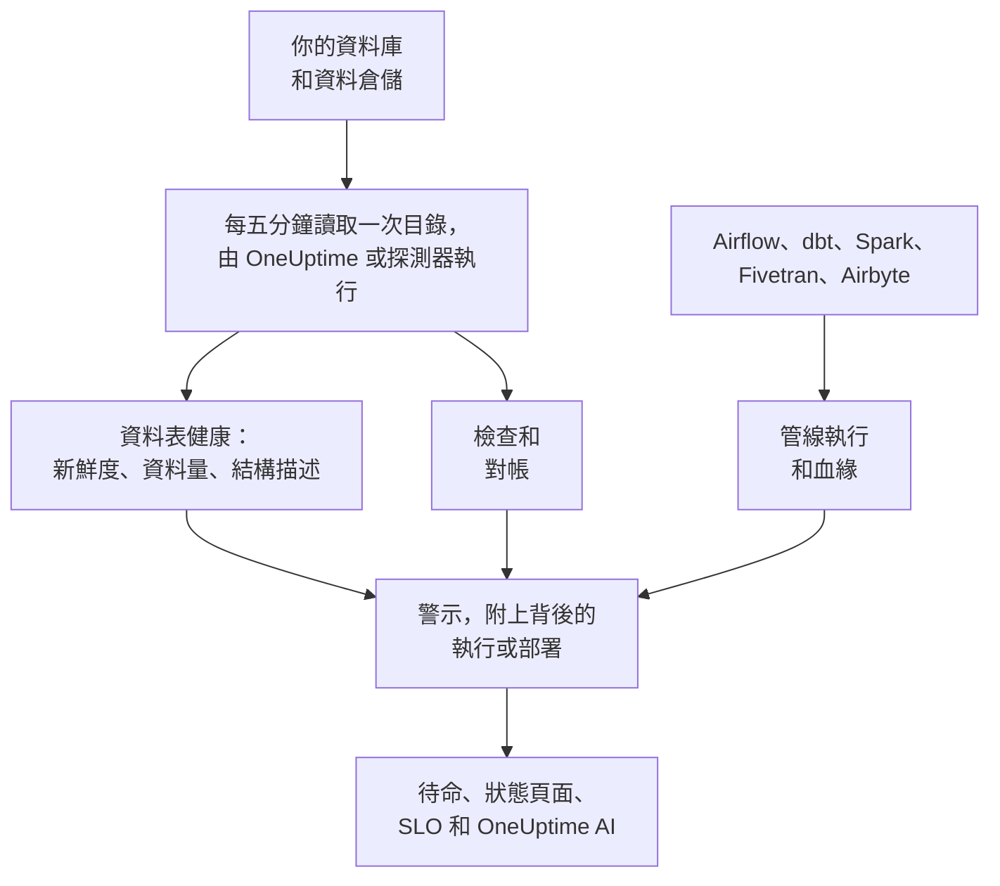

# 資料可觀測性

資料可觀測性會監看你的公司所倚賴的資料表，無論它們位於 PostgreSQL、MySQL、SQL Server、Oracle、MongoDB、Redshift、Snowflake、BigQuery、ClickHouse、Databricks 還是 Athena，並在使用這些資料的人察覺之前，告訴你哪些資料延遲、缺漏、錯誤或損壞。它會自行學習每個資料表的節奏，讀取每個資料庫的目錄，因此不會有任何值離開資料庫，並把每個資料問題連結到背後的管線執行、部署或上游資料表。

它能回答四個疑問：

:::cards
- [資料是否新鮮？](/docs/data-observability/table-health): 每個資料表的最後變更時間、列數、大小和欄，每五分鐘讀取一次，並在資料表延遲、縮小或結構改變時發出警示。
- [資料是否正確？](/docs/data-observability/checks): 針對資料表內容的檢查、資料表與其複本之間的對帳，以及 dbt 的測試，失敗時發出警示。
- [資料從哪裡來，又流向哪裡？](/docs/data-observability/lineage-and-pipelines): 來自你的管線、dbt、Fivetran、Airbyte、檢視以及資料庫本身查詢歷史的血緣，讓一個問題只開啟一個警示。
- [使用資料的人能否信賴它？](/docs/data-observability/data-products): 具有新鮮度 SLA 的資料產品，顯示在狀態頁面上並作為 SLO 追蹤，還附有「data as of」徽章。
:::

## 運作方式

1. 使用唯讀登入 **連接資料庫**。資料安全已經知道的資料庫不需任何操作就會受到監看，你的 Google Cloud 連線找到的每個 BigQuery 資料集也是如此。私人網路中的資料庫，則由你在該網路中執行的探測器讀取。
2. **每五分鐘**，OneUptime 會讀取每個資料庫的目錄和統計資料：每個資料表和檢視、其欄、列數和大小，以及它最後一次變更的時間。不會掃描任何資料表，在 MongoDB 上只會讀取最新文件的欄位名稱。儲存貯體中的路徑也能以同樣方式監看。
3. **學習每個資料表的節奏**：它通常多久變更一次。錯過節奏的資料表即為延遲；列數下降或欄發生變化的資料表也會如實回報。
4. **建議的警示** 會把以上每一項變成由你決定是否新增的監測器，而你新增的檢查會讀取資料表中保存的內容。
5. **血緣** 說明哪些資料表為哪些資料表提供資料，因此當某個資料表的來源先發生故障時，該資料表上的警示會被視為該來源的後果：只有一個警示，而不是十個。

## 有何不同

- **它與 OneUptime 的其他部分融為一體。** 資料警示就是一般的警示：它會透過待命呼叫、開啟事件、顯示在狀態頁面上，並計入 SLO。追蹤會指出正在寫入某個資料表的服務，這些服務及其部署會顯示在每個資料表警示的旁邊。
- **不需逐一設定資料表。** 節奏、排程和通常的執行時間，都從每個資料表和管線的實際行為中學習而來；為某個資料庫建議的監測器會涵蓋其中的每個資料表，包括日後建立的資料表。
- **一個原因只有一個警示。** 如果某個警示的上游資料表、管線或資料庫已有一個開啟的警示，它會作為後果加入該警示，並且已被確認，因此一次失敗的載入只會呼叫一次。
- **每個警示都會自行說明。** 它會對可能的原因排序，說明有哪些項目依賴該資料表以及誰擁有它，並從你對它的回應中學習：把某個警示標示為 **不是問題**，下一次同樣的情況就會保持安靜。
- **OneUptime AI 了解你的資料。** 資料警示的調查從資料表的寫入者、執行和上游資料表開始；詢問 AI、Slack、Microsoft Teams 和 AI 代理都能查詢某個資料表是否新鮮；還能用一句話撰寫檢查。請參閱 [OneUptime AI 與 API](/docs/data-observability/ai-and-api)。

## 開始之前

- **能設定它的角色。** Project Owner、Project Admin 和 Telemetry Admin 可以連接資料庫。任何可以編輯資料資產的人都能新增檢查、對帳和資料產品；Viewer 可以讀取它找到的內容。請參閱 [權限參考](/docs/permissions/reference)。
- **每個資料庫上的唯讀登入。** [連接資料庫](/docs/data-observability/connect) 列出了每種引擎至少需要的權限。OneUptime 會建議你的追蹤、雲端帳戶和資料庫監控已經知道的資料庫。

## 快速入門

:::steps
### 連接資料庫

開啟 **資料可觀測性**，前往 **資料庫**，然後選擇 **連接資料庫**。選擇引擎，並提供唯讀連線字串，或是你的探測器從中讀取連線字串的環境變數名稱。[連接資料庫](/docs/data-observability/connect) 會說明每種引擎的登入。

### 查看它的資料表

五分鐘內，它的資料表就會出現在 **資料表** 下，每個都會顯示列數、大小和最後一次變更的時間。資料表變更兩次後，就能得知它的新鮮度：保持節奏時為 **新鮮**，錯過節奏後為 **延遲**。

### 新增建議的警示

在 **資料庫** 上，為該資料庫選擇 **建議的警示**，然後新增你需要的警示：延遲的資料表、列數驟降或異常偏低的資料表、欄發生變化的資料表，以及停止回報的資料庫。每一個都是一般的監測器：待命、擁有者、維護時段和狀態頁面的用法都與其他監測器相同。
:::

## 費用

在 OneUptime Cloud 上，專案的前 100 張資料表免費。之後每張資料表每月 $1，超過 1,000 張的部分每張 $0.25。檢視免費，您停止監看的資料庫中的資料表也免費。帶有警示的檢查會以作用中監視器計費。**資料庫** 與 **概覽** 會顯示您的專案監看的資料表數量及其費用，[定價](https://oneuptime.com/pricing) 頁面提供計算機。

自行託管的 OneUptime 不需為資料表付費。

## 後續步驟

:::cards
- [連接資料庫](/docs/data-observability/connect): 每種引擎的最小權限登入，以及適用於私人網路的探測器。
- [資料表健康](/docs/data-observability/table-health): 新鮮度、資料量、結構描述變更、未使用的資料表，以及每個資料表寫入的指標。
- [檢查與對帳](/docs/data-observability/checks): 針對資料表值的規則、資料表與其複本的比較，以及 dbt 的測試。
- [血緣與管線](/docs/data-observability/lineage-and-pipelines): OpenLineage、dbt、Fivetran 和 Airbyte，以及一個原因只有一個警示。
- [資料產品](/docs/data-observability/data-products): 為使用資料的人提供的新鮮度 SLA，顯示在狀態頁面上並作為 SLO 追蹤。
- [OneUptime AI 與 API](/docs/data-observability/ai-and-api): 調查、用一句話撰寫檢查、供 AI 代理使用的新鮮度，以及每個端點。
:::
