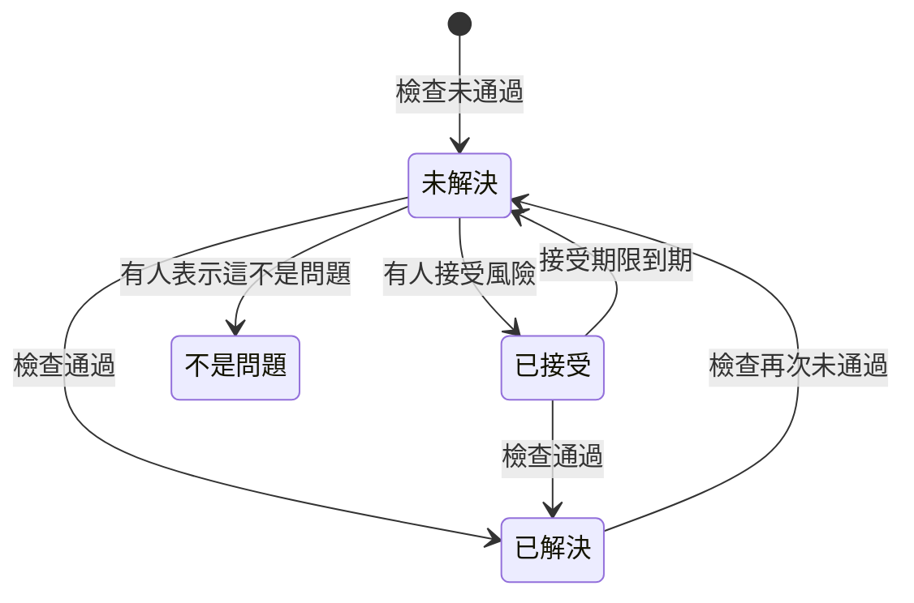

# 資料安全檢查與問題

資料安全會對每個資料儲存區執行 32 項檢查，分為九組。一項檢查會讀取關於某個資料儲存區的已知資訊（它的設定方式、在其中找到了什麼、誰可以存取它、它位於何處），然後判定為通過、未通過或無法判斷。未通過的檢查會在該資料儲存區上開啟一個問題，檢查通過後，問題會自行關閉。本頁列出每項檢查、問題的嚴重程度和風險分數如何計算，以及問題在其生命週期中會經歷什麼。

:::cards
- [檢查如何判定](#檢查如何判定): 通過、未通過或無法判斷，以及未通過的情況有多嚴重。
- [每項檢查](#每項檢查): 全部 32 項，以及每項檢查的內容和修正方式。
- [風險分數](#風險分數): 同一嚴重程度內的問題如何排序。
- [問題會經歷什麼](#問題會經歷什麼): 未解決、已解決、已接受、不是問題。
- [在此修正](#在此修正): 按一下即可封鎖公開的儲存貯體，或停止共用快照。
:::

## 檢查如何判定

每項檢查都會讀取關於資料儲存區的事實，並以下列四種方式之一回答：

| 回答 | 意義 | 問題會如何 |
| --- | --- | --- |
| 通過 | 檢查沒有發現任何不妥。 | 未解決或已接受的問題會變為已解決。 |
| 未通過 | 檢查發現了缺失，並用一句話說明它看到了什麼：這就是問題的證據。 | 開啟一個問題，或更新現有的未解決問題。 |
| 無法判斷 | 某項事實無法讀取：角色沒有的權限、失敗的呼叫。 | 不會有任何變化：未解決的問題會保持開啟，因為在 OneUptime 無法查看時，任何人都不能斷定缺失已修正。 |
| 不適用 | 資料儲存區的種類沒有這項設定。 | 未解決的問題會變為已解決。 |

### 嚴重程度取決於資料

同一個缺失發生在越敏感的資料上就越重要。每項檢查都會為每個敏感度等級指定一個嚴重程度，問題則採用其資料儲存區所對應的嚴重程度：保存卡號的公開儲存貯體為「嚴重」，保存網站圖片的公開儲存貯體只有「低」。破折號表示完全不會產生問題。資料儲存區的敏感度來自其發現（請參閱 [敏感資料類型](/docs/data-security/data-types#敏感度)），因此內容樣本能讓嚴重程度正確無誤。

少數檢查則改為根據它們看到的內容設定嚴重程度。**其中儲存了祕密** 在任何資料儲存區上都是「高」，在公開或與其他帳戶共用的資料儲存區上則是「嚴重」。

## 每項檢查

表中的嚴重程度依序對應受限、機密、內部和公開資料。每個問題的頁面都會顯示針對其資料儲存區的完整修正方式（主控台步驟、CLI 指令，以及適用時的 Terraform），並已填入資料儲存區的名稱和地區。

### 暴露

| 檢查 | 適用對象 | 檢查內容 | 嚴重程度 | 修正方式 |
| --- | --- | --- | --- | --- |
| 網際網路上的任何人都能讀取它（`public-read`） | 物件儲存、資料倉儲、搜尋 | 資料儲存區的政策、ACL 或 IAM 繫結讓任何人無須登入即可讀取其資料。 | 嚴重 / 嚴重 / 高 / 低 | 移除授予匿名主體或所有已驗證主體的每項權限。必須公開的檔案應放在標記為 **刻意公開** 且不保存其他任何內容的資料儲存區中。 |
| 網際網路上的任何人都能變更它（`public-write`） | 物件儲存、資料倉儲、搜尋 | 資料儲存區的政策、ACL 或 IAM 繫結讓任何人都能寫入或刪除其資料。 | 嚴重 / 嚴重 / 嚴重 / 高 | 移除授予匿名主體或所有已驗證主體的每項寫入或刪除權限。 |
| 未封鎖公開存取（`public-access-not-blocked`） | AWS S3 Bucket | 儲存貯體或其帳戶的 S3 封鎖公開存取未完全開啟，因此只要變更一次政策就可能使其公開。 | 高 / 中 / 低 / — | 為儲存貯體開啟全部四項封鎖公開存取設定。 |
| 資料庫接受來自網際網路的連線（`internet-reachable`） | 資料庫、資料倉儲、搜尋、快取 | 資料庫開啟了公用端點或公用網路存取。 | 高 / 高 / 中 / 低 | 關閉公用端點，並透過私人網路或堡壘主機存取資料庫。 |
| 其防火牆允許所有位址（`open-to-all-addresses`） | 資料庫、資料倉儲、搜尋、快取 | 防火牆規則或授權網路允許 0.0.0.0/0 或整個位址範圍。 | 嚴重 / 嚴重 / 高 / 中 | 將允許所有位址的規則替換為需要存取的位址或網路。 |
| 任何人都能還原它的快照（`snapshot-public`） | 資料庫、快照 | 資料庫快照已公開共用，因此任何雲端帳戶都能還原完整的複本。 | 嚴重 / 嚴重 / 嚴重 / 高 | 將快照設為私人。 |
| 它的快照與其他帳戶共用（`snapshot-shared-externally`） | 資料庫、快照 | 資料庫快照與你已連線帳戶以外的帳戶共用。 | 高 / 高 / 中 / 低 | 停止與不應擁有該快照的帳戶共用快照。 |
| 你的組織以外的帳戶可以存取它（`shared-with-external-accounts`） | 遙測以外的所有資料儲存區 | 資料儲存區的政策將存取權授予未連線到 OneUptime 的帳戶、租用戶或專案。 | 高 / 高 / 中 / 低 | 檢閱每個外部主體，並移除不需要存取權的主體。 |

### 加密

| 檢查 | 適用對象 | 檢查內容 | 嚴重程度 | 修正方式 |
| --- | --- | --- | --- | --- |
| 其資料未進行靜態加密（`not-encrypted-at-rest`） | 遙測以外的所有資料儲存區 | 儲存加密已關閉。 | 高 / 中 / 低 / — | 開啟靜態加密。RDS 執行個體無法就地加密：請還原其快照的加密複本。 |
| 受限資料未使用你自己的金鑰加密（`no-customer-managed-key`） | 遙測以外的所有資料儲存區 | 資料儲存區保存受限資料，但使用的是供應商的預設金鑰，而不是客戶自管金鑰。 | 中 / — / — / — | 使用你在金鑰服務中管理的金鑰加密資料儲存區。 |
| 允許未加密的連線（`encryption-in-transit-not-enforced`） | 遙測以外的所有資料儲存區 | 資料儲存區接受不使用 TLS 的連線。 | 高 / 中 / 低 / — | 要求每個連線都使用 TLS。在 S3 上，拒絕 `aws:SecureTransport` 為 false 的每個請求。 |
| 它接受早於 1.2 的 TLS（`weak-tls`） | 遙測以外的所有資料儲存區 | 最低 TLS 版本為 1.0 或 1.1。 | 中 / 中 / 低 / — | 將最低 TLS 版本設為 1.2 或更新版本。 |

### 復原

| 檢查 | 適用對象 | 檢查內容 | 嚴重程度 | 修正方式 |
| --- | --- | --- | --- | --- |
| 它沒有備份，或備份保留不到 7 天（`no-backups`） | 資料庫、資料倉儲 | 自動備份已關閉，或保留不到 7 天。 | 高 / 中 / 低 / — | 開啟自動備份，並至少保留 7 天。 |
| 時間點復原已關閉（`no-point-in-time-recovery`） | AWS DynamoDB Table、Azure Cosmos DB Account | 資料表或資料庫無法還原到出錯之前的某個時刻。 | 中 / 低 / — / — | 開啟時間點復原。 |
| 它可以一步刪除（`deletion-protection-off`） | 資料庫、資料倉儲 | 刪除保護已關閉。 | 中 / 低 / — / — | 開啟刪除保護。 |
| 已刪除或已覆寫的檔案無法復原（`deleted-data-not-recoverable`） | 物件儲存 | 版本控制和虛刪除都已關閉。 | 中 / 低 / — / — | 開啟版本控制或虛刪除。 |

### 可見性

| 檢查 | 適用對象 | 檢查內容 | 嚴重程度 | 修正方式 |
| --- | --- | --- | --- | --- |
| 沒有人會知道誰讀取了它（`access-not-logged`） | 遙測以外的所有資料儲存區 | 對資料儲存區的讀取沒有記錄：沒有存取日誌，也沒有資料存取稽核日誌。 | 高 / 中 / 低 / — | 為讀取開啟存取日誌或稽核日誌：S3 伺服器存取日誌或 CloudTrail 資料事件、Azure StorageRead 診斷日誌、Cloud Storage Data Access 稽核日誌。 |

### 存取

| 檢查 | 適用對象 | 檢查內容 | 嚴重程度 | 修正方式 |
| --- | --- | --- | --- | --- |
| 任何擁有帳戶金鑰的人都能讀取所有內容（`shared-key-access`） | Azure Storage Account | 儲存體帳戶允許共用金鑰存取，這會繞過 Microsoft Entra ID，且不會留下以個人為單位的稽核軌跡。 | 中 / 低 / — / — | 將應用程式改為使用 Microsoft Entra ID，然後關閉儲存體帳戶金鑰存取。 |
| 物件可以帶有自己的存取規則（`object-acls-enabled`） | AWS S3 Bucket、Google Cloud Storage Bucket | 物件 ACL 已開啟，因此即使儲存貯體看起來是私人的，單一物件仍可能被設為公開。 | 低 / 低 / — / — | 在 S3 上，將 Object Ownership 設為 Bucket owner enforced。在 Cloud Storage 上，開啟統一儲存貯體層級存取權。 |
| 超過 25 個身分可以讀取受限資料（`many-readers`） | 遙測以外的所有資料儲存區 | 擁有資料儲存區讀取權的身分數量，超出大多數團隊所能檢閱的範圍。 | 中 / — / — / — | 開啟資料儲存區的 **誰可以存取** 頁面，並移除未使用或範圍超出需要的存取權。 |

### 資料衛生

| 檢查 | 適用對象 | 檢查內容 | 嚴重程度 | 修正方式 |
| --- | --- | --- | --- | --- |
| 其中儲存了祕密（`secrets-stored`） | 遙測以外的所有資料儲存區 | 在資料儲存區的資料中找到了密碼、API 金鑰、權杖或私密金鑰。 | 高 / 高 / 高 / 高 | 將找到的每個祕密視為已外洩並加以輪替。將祕密移至祕密管理工具，並從資料儲存區中刪除。 |
| 儲存了卡片安全碼（`card-security-codes-stored`） | 遙測以外的所有資料儲存區 | 找到了 CVV 或 CVC 代碼。PCI DSS 禁止在付款授權後保留它們，無論是否加密。 | 嚴重 / 嚴重 / 嚴重 / 嚴重 | 停止寫入它們的程式碼，刪除已儲存的安全碼，並確認備份中沒有殘留。 |
| 卡號以可讀形式儲存（`card-numbers-readable`） | 遙測以外的所有資料儲存區 | 以可讀形式找到了完整的卡號。PCI DSS 要求卡號無論儲存在何處都必須不可讀。 | 高 / 高 / 高 / 高 | 透過你的支付供應商將卡號權杖化，或在欄位層級加密，並刪除可讀的複本。 |
| 密碼以純文字儲存（`plaintext-passwords`） | 遙測以外的所有資料儲存區 | 密碼欄位保存的值不是密碼雜湊（bcrypt、argon2、scrypt 或 PBKDF2）。 | 嚴重 / 嚴重 / 嚴重 / 嚴重 | 使用 bcrypt、scrypt 或 argon2 對密碼進行雜湊，遷移已儲存的密碼，並讓每個帳戶重設密碼。 |
| 正式環境資料被複製到非正式環境的資料儲存區（`production-data-in-non-production`） | 遙測以外的所有資料儲存區 | 在正式環境資料儲存區中找到的值，也在此處（開發、測試或預備環境的資料儲存區）找到。 | 高 / 中 / — / — | 以遮罩資料或合成資料取代該複本，並從非正式環境的資料儲存區中刪除真實資料。 |
| 90 天內無人使用的敏感資料（`stale-sensitive-data`） | 遙測以外的所有資料儲存區 | 資料儲存區保存敏感資料，且 90 天內沒有任何讀取或寫入。 | 中 / 低 / — / — | 確認不再需要這些資料，然後設定保留日期將其封存，或將其刪除。 |
| 此敏感資料儲存區沒有擁有者（`no-owner`） | 所有資料儲存區 | 資料儲存區保存敏感資料，但沒有擁有者。 | 中 / 低 / — / — | 在資料儲存區的 **擁有者** 頁面上新增擁有者，或新增符合其標記的擁有者規則。 |

### 遙測

| 檢查 | 適用對象 | 檢查內容 | 嚴重程度 | 修正方式 |
| --- | --- | --- | --- | --- |
| 敏感資料正進入你的遙測（`sensitive-data-in-telemetry`） | 遙測 | 日誌、追蹤、例外、重播或 AI 對話中帶有未被任何清除規則遮罩的敏感資料。 | 高 / 中 / 低 / — | 在每項發現上按下 **清除**，在擷取時遮罩該資料，然後修正寫入它的程式碼。 |
| 祕密正進入你的遙測（`secrets-in-telemetry`） | 遙測 | 密碼、API 金鑰或權杖出現在日誌、追蹤、例外或 AI 對話中。 | 嚴重 / 嚴重 / 嚴重 / 嚴重 | 先輪替該祕密，然後按下 **清除** 並修正寫入它的程式碼。 |

### 資料落地

| 檢查 | 適用對象 | 檢查內容 | 嚴重程度 | 修正方式 |
| --- | --- | --- | --- | --- |
| 資料儲存在允許的地區以外（`residency-violation`） | 遙測以外的所有資料儲存區 | 資料儲存區所在的地區，或其資料複寫到的地區，違反了資料落地規則。 | 高 / 高 / 中 / — | 將資料移到允許的地區，或停止將其複製到其他地區。如果該傳輸合法，請接受該問題並記錄原因。 |

### AI

| 檢查 | 適用對象 | 檢查內容 | 嚴重程度 | 修正方式 |
| --- | --- | --- | --- | --- |
| 敏感資料正被傳送給 AI 供應商（`sensitive-data-to-ai`） | AI 對話 | OneUptime 中記錄的 AI 對話將敏感資料帶給模型供應商。 | 嚴重 / 高 / 低 / — | 在傳送提示之前遮蔽敏感值，或將這些呼叫改為傳送給你自行託管的模型。 |
| 用於 AI 的資料儲存區中有受限資料（`sensitive-data-in-ai-store`） | 遙測以外的所有資料儲存區 | 標記為 AI 訓練或檢索資料的資料儲存區保存了受限資料。 | 高 / 中 / — / — | 在受限資料被用來訓練模型或為模型提供依據之前，將其移除或遮罩。 |

## 風險分數

嚴重程度說明問題有多嚴重。風險分數介於 0 到 100 之間，會根據讓同一個缺失變得更糟的因素，為同一嚴重程度的問題排序：

```text
risk = severity + 10 × exposure + 6 × volume + 5 × activity + 4 × production, at most 100
```

| 因素 | 分數 |
| --- | --- |
| 嚴重程度 | 嚴重 75 分，高 50 分，中 25 分，低 0 分 |
| 暴露 | 公開 10 分，其他帳戶 8 分，可從網際網路存取 6 分，未知 3 分，私人 0 分 |
| 數量 | 最多 6 分，依資料儲存區估計的敏感記錄數以對數尺度計算：10 筆記錄 1 分，1,000 筆 3 分，一百萬筆 5 分，一千萬筆以上 6 分 |
| 活動 | 過去一週內 Security Operations 在該資料儲存區上看到偵測時為 5 分 |
| 正式環境 | 位於正式環境的資料儲存區為 4 分 |

這些額外因素最多加 25 分，因此問題的分數絕不會低於較低嚴重程度的問題。一個保存一百萬筆受限資料記錄的公開正式環境儲存貯體，其「嚴重」問題的分數為 75 + 10 + 5 + 4 = 94。每個問題都會列出為其分數加分的因素及各自的分數，資料儲存區則會顯示其最嚴重的未解決問題的分數。

資料儲存區的環境（正式環境、預備環境、開發環境、測試環境或未知）來自其標記（`env`、`environment`、`stage`、`tier` 等），如果沒有這類標記，則來自其名稱中的字詞，例如 `prod`、`staging`、`dev` 或 `qa`。如果兩者都無法說明，請在資料儲存區上自行設定。

## 問題會經歷什麼



OneUptime 會在檢查執行時開啟、更新和解決問題。人員對問題所做的，是決定接下來會發生什麼：

| 狀態 | 如何進入此狀態 | 後續情況 |
| --- | --- | --- |
| **未解決** | 其檢查目前在該資料儲存區上未通過。 | 在檢查通過之前，它會計入概覽、資料儲存區的摘要和合規性。 |
| **已解決** | 其檢查在之後的執行中通過、不再適用或已被關閉，或其資料儲存區已封存。人員也可以選擇 **標記為已解決**：資料儲存區會立即重新檢查。 | 如果檢查再次未通過，它會重新開啟，且問題會記錄重新開啟的次數。 |
| **已接受** | 人員選擇了 **接受風險**，並填寫了 **原因** 以及 **接受期限** 中最多一年後的日期。 | 在該日期之前，它會保持關閉，之後如果檢查仍未通過，它會重新開啟。屆時如果原因仍然成立，請再次接受它。 |
| **不是問題** | 人員選擇了 **不是問題**：該發現有誤。 | 即使檢查未通過，它也會保持關閉。**重新開啟** 會將它改回未解決。 |

Security Member、Security Admin、Project Admin 和 Project Owner 可以變更問題的狀態，並將其 **指派** 給某個人或團隊。每次變更都會寫入問題的 **時間軸**：它何時開啟、每次嚴重程度的變更、每次狀態變更及其執行者、要求的重新檢查，以及整合執行的動作。

重新開啟的問題會保留其歷程。已接受的風險每天都會重新檢視，因此即使沒有進行任何掃描，也會準時到期。

## 在此修正

關於公開儲存貯體或共用快照的未解決問題，可以直接在其頁面上修正。在主控台步驟上方，**在此修正** 會提供修正它的變更：

| 問題 | 其資料儲存區 | 按鈕 | 變更的內容 |
| --- | --- | --- | --- |
| `public-read`、`public-write` 或 `public-access-not-blocked` | S3 儲存貯體、Azure 儲存體帳戶或 Cloud Storage 儲存貯體 | **封鎖公開存取** | 開啟儲存貯體的四項封鎖公開存取設定、關閉儲存體帳戶的匿名 Blob 存取，或強制執行儲存貯體的禁止公開存取 |
| `snapshot-public` 或 `snapshot-shared-externally` | RDS 快照、RDS 資料庫，或 Aurora 或 DocumentDB 叢集 | **撤銷共用** | 停止與所有人以及與你已連線帳戶以外的帳戶共用該快照，或該資料庫的每個已共用手動快照 |

它會先詢問，說明會變更什麼以及什麼將停止運作。它只變更資料儲存區的共用方式，從不變更其資料，也不會變更任何已經關閉的內容。標記為 **刻意公開** 的資料儲存區永遠不會被封鎖。

它透過資料儲存區的雲端連線執行，因此連線需要開啟 **資料安全回應**，並再次執行其設定指令（請參閱 [設定資料安全](/docs/data-security/setup#讓資料安全關閉暴露)）。在此之前，面板會說明需要開啟什麼。資料儲存區會在之後立即重新檢查，一旦檢查通過，問題就會自行解決。問題的 **時間軸** 和資料儲存區的 **時間軸** 會說明做了什麼，以及是誰做的。

## 檢查的設定

**資料安全 → 設定 → 檢查** 會依組別列出每項檢查、它要找的內容，以及未通過時在每個敏感度下的嚴重程度。每項檢查都可以針對專案進行調整，每次變更都會立即儲存：

- **它的開關** 可在檢查不符合你的工作方式時將其關閉。其未解決和已接受的問題會變為已解決，並註明該檢查已不再執行。
- **它的嚴重程度** 預設為 **依敏感度**，也可以設為單一嚴重程度，讓該檢查的每次未通過都採用此嚴重程度，無論其資料儲存區保存什麼。

若只想讓某項檢查在單一資料儲存區上保持安靜，請在該資料儲存區的問題上接受風險，或將問題標記為不是問題。如果是發現本身有誤，而不是缺失無關緊要，請改為將該發現標記為不敏感（請參閱 [敏感資料類型](/docs/data-security/data-types#不敏感與絕不敏感)）。

資料儲存區上的 **立即檢查** 會重新讀取其設定並執行其檢查。**立即掃描** 會對其內容取樣，並在掃描結束時執行其檢查。

## 後續步驟

:::cards
- [資料安全整合](/docs/data-security/integrations): 問題開啟時的安全案例、警示和擁有者電子郵件。
- [資料流、存取與資料落地](/docs/data-security/flows-access-residency): 多項檢查所讀取的存取權、複本和地區。
- [資料安全合規性](/docs/data-security/compliance): 每項檢查可作為證據的合規框架要求。
:::
