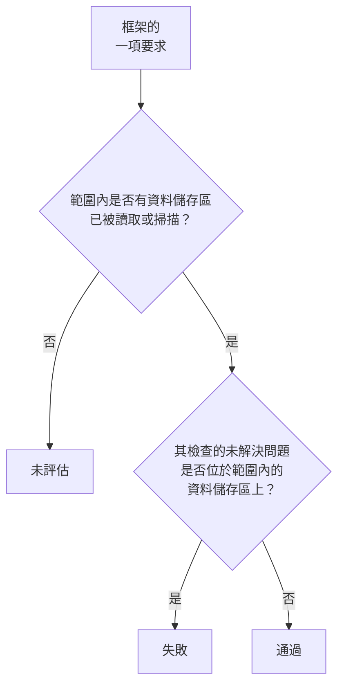

# 資料安全合規性

資料安全根據掃描的結果為九個框架評分。每個框架涵蓋其規範所針對的資料儲存區（GDPR 涵蓋保存個人資料的資料儲存區，PCI DSS 涵蓋找到卡片資料的資料儲存區，SOC 2 涵蓋每個資料儲存區），而它的每項要求是否滿足，取決於作為其證據的檢查。**資料安全 → 合規性** 顯示每個框架的分數、它涵蓋多少資料儲存區，以及每項要求和使其失敗的未解決問題數量。分數是稽核的證據，而不是證書：它說明的是 OneUptime 在它讀取的資料儲存區中能看到什麼。

:::cards
- [框架](#框架): 這九個框架，以及每個框架涵蓋哪些資料儲存區。
- [框架如何評分](#框架如何評分): 通過、失敗和未評估的要求。
- [要求及其檢查](#要求及其檢查): 每項要求，以及作為其證據的檢查。
- [處理活動記錄](#處理活動記錄): 根據你的資料儲存區撰寫的 GDPR 第 30 條記錄。
:::

## 框架

| 框架 | 全名 | 範圍內的資料儲存區 |
| --- | --- | --- |
| GDPR | 歐盟一般資料保護規則 | 保存個人資料的資料儲存區。 |
| CCPA | 加州消費者隱私法（經 CPRA 修訂） | 保存個人資訊的資料儲存區。 |
| HIPAA | HIPAA 安全規則 | 保存健康資料的資料儲存區。 |
| PCI DSS | PCI DSS v4.0 | 找到卡號的資料儲存區。 |
| SOC 2 | SOC 2 信任服務準則 | 每個資料儲存區。 |
| ISO 27001 | ISO/IEC 27001:2022 | 每個資料儲存區。 |
| NIST CSF | NIST 網路安全框架 2.0 | 每個資料儲存區。 |
| LGPD | 巴西一般個人資料保護法 | 保存巴西境內人士個人資料的資料儲存區。 |
| DPDP | 印度 2023 年數位個人資料保護法 | 保存印度境內人士個人資料的資料儲存區。 |

## 框架涵蓋哪些資料儲存區

資料儲存區的範圍取決於在其中找到的資料，因此會隨著掃描找到更多內容而改變：

- **SOC 2、ISO 27001 和 NIST CSF** 是安全框架：它們涵蓋每個資料儲存區，無論其中保存什麼。
- **GDPR、CCPA、HIPAA 和 PCI DSS** 涵蓋保存其所保護資料類型的資料儲存區。個人資料會納入 GDPR 和 CCPA，健康資料還會納入 HIPAA，卡號、卡片安全碼和卡片到期日則會納入 PCI DSS。只保存祕密或商業文件的資料儲存區不在其中任何一個的範圍內。
- **LGPD 和 DPDP** 是各國自己的法律：它們涵蓋保存巴西或印度境內人士個人資料的資料儲存區，這是從屬於該國的資料類型判斷的，例如巴西 CPF 或印度 Aadhaar 號碼。

[敏感資料類型](/docs/data-security/data-types#內建資料類型) 列出每個資料類型及其國家。

## 框架如何評分

- 當對應到要求的檢查沒有任何未解決問題位於框架範圍內的資料儲存區上時，**要求即通過**；有的話則 **失敗**。
- 只要範圍內還沒有任何資料儲存區的設定被讀取或內容被掃描，要求就 **不會被評估**。
- **有兩項要求由資料安全本身滿足**：GDPR 第 30 條（處理活動記錄）和 ISO 27001 A.5.12（資訊分類）。當範圍內的每個資料儲存區都已被讀取或掃描時，它們即通過；只要還有一個沒有，它們就失敗。
- **分數** 是框架已評估的要求中通過的比例，以整數百分比表示。沒有任何已評估要求的框架沒有分數。

只有未解決的問題才算數。風險已被接受的問題，或被標記為不是問題的問題，不會使其要求失敗，因此接受風險是稽核在問題上看得到的一項決定：誰接受了它、為什麼，以及期限到何時。

## 要求及其檢查

### GDPR

| 要求 | 要求內容 | 檢查 |
| --- | --- | --- |
| 第 5(1)(c) 條 | 資料最小化 | `production-data-in-non-production`、`stale-sensitive-data`、`sensitive-data-in-telemetry`、`sensitive-data-to-ai`、`sensitive-data-in-ai-store` |
| 第 5(1)(e) 條 | 儲存限制 | `stale-sensitive-data` |
| 第 25 條 | 設計及預設之資料保護 | `production-data-in-non-production`、`stale-sensitive-data`、`sensitive-data-in-telemetry`、`sensitive-data-to-ai`、`sensitive-data-in-ai-store` |
| 第 28 條 | 處理者 | `sensitive-data-to-ai` |
| 第 30 條 | 處理活動記錄 | 由資料安全本身滿足 |
| 第 32 條 | 處理的安全性 | `public-read`、`public-write`、`public-access-not-blocked`、`internet-reachable`、`open-to-all-addresses`、`snapshot-public`、`snapshot-shared-externally`、`shared-with-external-accounts`、`not-encrypted-at-rest`、`no-customer-managed-key`、`encryption-in-transit-not-enforced`、`weak-tls`、`no-backups`、`no-point-in-time-recovery`、`deletion-protection-off`、`deleted-data-not-recoverable`、`access-not-logged`、`shared-key-access`、`object-acls-enabled`、`many-readers`、`secrets-stored`、`plaintext-passwords`、`secrets-in-telemetry` |
| 第 44-49 條 | 向第三國傳輸 | `residency-violation` |

### CCPA

| 要求 | 要求內容 | 檢查 |
| --- | --- | --- |
| 1798.100(c) | 蒐集僅限於必要範圍 | `production-data-in-non-production`、`stale-sensitive-data`、`sensitive-data-in-telemetry`、`sensitive-data-to-ai`、`sensitive-data-in-ai-store` |
| 1798.150 | 合理的安全程序 | `public-read`、`public-write`、`public-access-not-blocked`、`internet-reachable`、`open-to-all-addresses`、`snapshot-public`、`snapshot-shared-externally`、`shared-with-external-accounts`、`shared-key-access`、`object-acls-enabled`、`many-readers` |

### HIPAA

| 要求 | 要求內容 | 檢查 |
| --- | --- | --- |
| 164.308(a)(7) | 應變計畫 | `no-backups`、`no-point-in-time-recovery`、`deletion-protection-off`、`deleted-data-not-recoverable` |
| 164.312(a)(1) | 存取控制 | `public-read`、`public-write`、`public-access-not-blocked`、`internet-reachable`、`open-to-all-addresses`、`snapshot-public`、`snapshot-shared-externally`、`shared-with-external-accounts`、`shared-key-access`、`object-acls-enabled`、`many-readers` |
| 164.312(a)(2)(iv) | 加密與解密 | `not-encrypted-at-rest`、`no-customer-managed-key` |
| 164.312(b) | 稽核控制 | `access-not-logged` |
| 164.312(e)(1) | 傳輸安全 | `encryption-in-transit-not-enforced`、`weak-tls` |

### PCI DSS

| 要求 | 要求內容 | 檢查 |
| --- | --- | --- |
| 3.3.1 | 授權後不保留敏感驗證資料 | `card-security-codes-stored` |
| 3.4.1 | 顯示卡號時加以遮罩 | `card-numbers-readable`、`sensitive-data-in-telemetry` |
| 3.5.1 | 卡號無論儲存在何處都無法讀取 | `not-encrypted-at-rest`、`no-customer-managed-key`、`card-numbers-readable` |
| 4.2.1 | 以強式密碼學保護傳輸中的卡片資料 | `encryption-in-transit-not-enforced`、`weak-tls` |
| 7.2 | 依需要定義和指派存取權 | `public-read`、`public-write`、`public-access-not-blocked`、`internet-reachable`、`open-to-all-addresses`、`snapshot-public`、`snapshot-shared-externally`、`shared-with-external-accounts`、`shared-key-access`、`object-acls-enabled`、`many-readers` |
| 8.3.2 | 驗證因素在儲存時無法讀取 | `plaintext-passwords` |
| 10.2 | 稽核日誌記錄對卡片資料的存取 | `access-not-logged` |

### SOC 2

| 要求 | 要求內容 | 檢查 |
| --- | --- | --- |
| A1.2 | 備份與復原 | `no-backups`、`no-point-in-time-recovery`、`deletion-protection-off`、`deleted-data-not-recoverable` |
| CC6.1 | 邏輯存取安全 | `public-read`、`public-write`、`public-access-not-blocked`、`internet-reachable`、`open-to-all-addresses`、`snapshot-public`、`snapshot-shared-externally`、`shared-with-external-accounts`、`not-encrypted-at-rest`、`no-customer-managed-key`、`shared-key-access`、`object-acls-enabled`、`many-readers`、`secrets-stored`、`plaintext-passwords`、`secrets-in-telemetry` |
| CC6.7 | 資訊傳輸 | `encryption-in-transit-not-enforced`、`weak-tls` |
| CC7.2 | 系統元件監控 | `access-not-logged` |

### ISO 27001

| 要求 | 要求內容 | 檢查 |
| --- | --- | --- |
| A.5.9 | 資訊及其他相關聯資產之清冊 | `no-owner` |
| A.5.12 | 資訊分類 | 由資料安全本身滿足 |
| A.5.15 | 存取控制 | `public-read`、`public-write`、`public-access-not-blocked`、`internet-reachable`、`open-to-all-addresses`、`snapshot-public`、`snapshot-shared-externally`、`shared-with-external-accounts`、`shared-key-access`、`object-acls-enabled`、`many-readers` |
| A.5.34 | PII 之隱私及保護 | `production-data-in-non-production`、`stale-sensitive-data`、`sensitive-data-in-telemetry`、`sensitive-data-to-ai`、`sensitive-data-in-ai-store` |
| A.8.11 | 資料遮罩 | `production-data-in-non-production`、`stale-sensitive-data`、`sensitive-data-in-telemetry`、`sensitive-data-to-ai`、`sensitive-data-in-ai-store` |
| A.8.12 | 資料洩露預防 | `secrets-stored`、`secrets-in-telemetry` |
| A.8.13 | 資訊備份 | `no-backups`、`no-point-in-time-recovery`、`deletion-protection-off`、`deleted-data-not-recoverable` |
| A.8.15 | 日誌記錄 | `access-not-logged` |
| A.8.24 | 密碼學之使用 | `not-encrypted-at-rest`、`no-customer-managed-key`、`encryption-in-transit-not-enforced`、`weak-tls`、`plaintext-passwords` |

### NIST CSF

| 要求 | 要求內容 | 檢查 |
| --- | --- | --- |
| ID.AM-07 | 維護資料和中繼資料的清冊 | `no-owner` |
| PR.AA-05 | 管理存取權限 | `public-read`、`public-write`、`public-access-not-blocked`、`internet-reachable`、`open-to-all-addresses`、`snapshot-public`、`snapshot-shared-externally`、`shared-with-external-accounts`、`shared-key-access`、`object-acls-enabled`、`many-readers` |
| PR.DS-01 | 保護靜態資料 | `not-encrypted-at-rest`、`no-customer-managed-key`、`secrets-stored`、`secrets-in-telemetry` |
| PR.DS-02 | 保護傳輸中的資料 | `encryption-in-transit-not-enforced`、`weak-tls` |
| PR.DS-11 | 保留並測試資料備份 | `no-backups`、`no-point-in-time-recovery`、`deletion-protection-off`、`deleted-data-not-recoverable` |
| DE.CM-09 | 監控資料及其使用 | `access-not-logged` |

### LGPD

| 要求 | 要求內容 | 檢查 |
| --- | --- | --- |
| 第 6 條 | 必要性與目的限制 | `production-data-in-non-production`、`stale-sensitive-data`、`sensitive-data-in-telemetry`、`sensitive-data-to-ai`、`sensitive-data-in-ai-store` |
| 第 33 條 | 資料的國際傳輸 | `residency-violation` |
| 第 46 條 | 安全措施 | `public-read`、`public-write`、`public-access-not-blocked`、`internet-reachable`、`open-to-all-addresses`、`snapshot-public`、`snapshot-shared-externally`、`shared-with-external-accounts`、`not-encrypted-at-rest`、`no-customer-managed-key`、`shared-key-access`、`object-acls-enabled`、`many-readers` |

### DPDP

| 要求 | 要求內容 | 檢查 |
| --- | --- | --- |
| 第 8(5) 條 | 合理的安全防護措施 | `public-read`、`public-write`、`public-access-not-blocked`、`internet-reachable`、`open-to-all-addresses`、`snapshot-public`、`snapshot-shared-externally`、`shared-with-external-accounts`、`not-encrypted-at-rest`、`no-customer-managed-key`、`shared-key-access`、`object-acls-enabled`、`many-readers` |
| 第 8(7) 條 | 目的達成後刪除 | `production-data-in-non-production`、`stale-sensitive-data`、`sensitive-data-in-telemetry`、`sensitive-data-to-ai`、`sensitive-data-in-ai-store` |
| 第 16 條 | 傳輸至印度境外 | `residency-violation` |

## 處理活動記錄

GDPR 第 30 條要求你保存處理活動的記錄。資料安全會撰寫其中關於個人資料存放位置的部分：每個保存個人資料的資料儲存區一列。

| 欄 | 來源 |
| --- | --- |
| 資料儲存區、種類、供應商和地區 | 探索 |
| 環境 | 資料儲存區的標記或名稱，或你設定的值 |
| 敏感度、類別和資料類型 | 掃描找到的內容，或你設定的敏感度 |
| 擁有者 | 資料儲存區的擁有者：人員，以及其團隊的成員 |
| 目的 | 你在資料儲存區的 **目的** 中填寫的內容：它為什麼保存個人資料 |
| 保留期 | 你在資料儲存區的 **保留期** 中填寫的內容：資料在其中保留多久 |
| 框架 | 其資料類型使其納入範圍的框架 |

請在每個資料儲存區的 **設定** 中填寫 **目的** 和 **保留期**：這是任何掃描都無法得知的兩件事。任何可以讀取資料儲存區的人，也可以透過資料安全的 API 在 `/data-security/record-of-processing` 和 `/data-security/compliance` 取得這份記錄和分數（請參閱 [資料安全整合](/docs/data-security/integrations#apiterraform-和-mcp)）。

## 後續步驟

:::cards
- [資料安全檢查與問題](/docs/data-security/checks-and-issues): 每項要求背後的檢查，以及如何修正它們。
- [資料流、存取與資料落地](/docs/data-security/flows-access-residency): 資料落地規則，用於 GDPR、LGPD 和 DPDP 的跨境傳輸。
- [敏感資料類型](/docs/data-security/data-types): 使資料儲存區納入框架範圍的資料類型。
:::
