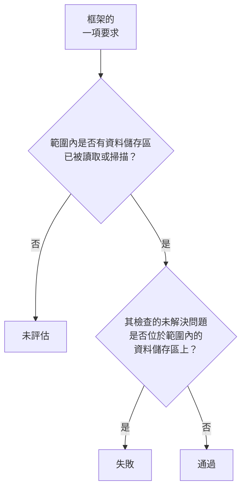

# 資料安全合規性

資料安全根據掃描的結果為九個框架評分。每個框架涵蓋其規範所針對的資料儲存區（GDPR 涵蓋保存個人資料的資料儲存區，PCI DSS 涵蓋找到卡片資料的資料儲存區，SOC 2 涵蓋每個資料儲存區），而它的每項要求是否滿足，取決於作為其證據的檢查。**資料安全 → 合規性** 顯示每個框架的分數、它涵蓋多少資料儲存區，以及每項要求和使其失敗的未解決問題數量。每個包含資料儲存區的資源（Kubernetes 叢集、Docker 或 Podman 主機、資料庫、服務或雲端資源）也都有屬於自己的相同頁面，不適用於它的內容可以在那裡關閉。分數是稽核的證據，而不是證書：它說明的是 OneUptime 在它讀取的資料儲存區中能看到什麼。

:::cards
- [框架](#框架): 這九個框架，以及每個框架涵蓋哪些資料儲存區。
- [框架如何評分](#框架如何評分): 通過、失敗和未評估的要求。
- [在資源的頁面上](#在資源的頁面上): 單一叢集、主機、資料庫、服務或雲端資源的合規性，以及為它關閉了哪些內容。
- [要求及其檢查](#要求及其檢查): 每項要求，以及作為其證據的檢查。
- [處理活動記錄](#處理活動記錄): 根據你的資料儲存區撰寫的 GDPR 第 30 條記錄，並附上供你確認的 OneUptime AI 草稿。
- [影響評估](#影響評估): 為每個需要的資料儲存區提供資料保護影響評估。
- [稽核證據](#稽核證據): 稽核人員在每項要求下閱讀的內容，可連同你的記錄和問題歷程記錄一起匯出。
:::

## 框架

| 框架 | 全名 | 範圍內的資料儲存區 |
| --- | --- | --- |
| GDPR | 歐盟一般資料保護規則 | 保存個人資料的資料儲存區。 |
| CCPA | 加州消費者隱私法（經 CPRA 修訂） | 保存個人資訊的資料儲存區。 |
| HIPAA | HIPAA 安全規則 | 保存健康資料的資料儲存區。 |
| PCI DSS | PCI DSS v4.0 | 找到卡號的資料儲存區。 |
| SOC 2 | SOC 2 信任服務準則 | 每個資料儲存區。 |
| ISO 27001 | ISO/IEC 27001:2022 | 每個資料儲存區。 |
| NIST CSF | NIST 網路安全框架 2.0 | 每個資料儲存區。 |
| LGPD | 巴西一般個人資料保護法 | 保存巴西境內人士個人資料的資料儲存區。 |
| DPDP | 印度 2023 年數位個人資料保護法 | 保存印度境內人士個人資料的資料儲存區。 |

## 框架涵蓋哪些資料儲存區

資料儲存區的範圍取決於在其中找到的資料，因此會隨著掃描找到更多內容而改變：

- **SOC 2、ISO 27001 和 NIST CSF** 是安全框架：它們涵蓋每個資料儲存區，無論其中保存什麼。
- **GDPR、CCPA、HIPAA 和 PCI DSS** 涵蓋保存其所保護資料類型的資料儲存區。個人資料會納入 GDPR 和 CCPA，健康資料還會納入 HIPAA，卡號、卡片安全碼和卡片到期日則會納入 PCI DSS。只保存祕密或商業文件的資料儲存區不在其中任何一個的範圍內。
- **LGPD 和 DPDP** 是各國自己的法律：它們涵蓋保存巴西或印度境內人士個人資料的資料儲存區，這是從屬於該國的資料類型判斷的，例如巴西 CPF 或印度 Aadhaar 號碼。

[敏感資料類型](/docs/data-security/data-types#內建資料類型) 列出每個資料類型及其國家。

## 框架如何評分

- 當對應到要求的檢查沒有任何未解決問題位於框架範圍內的資料儲存區上時，**要求即通過**；有的話則 **失敗**。
- 只要範圍內還沒有任何資料儲存區的設定被讀取或內容被掃描，要求就 **不會被評估**。
- **有兩項要求由資料安全本身滿足**：GDPR 第 30 條（處理活動記錄）和 ISO 27001 A.5.12（資訊分類）。當範圍內的每個資料儲存區都已被讀取或掃描時，它們即通過；只要還有一個沒有，它們就失敗。
- 當範圍內的每個資料儲存區都屬於關閉了該要求的資源時，要求即 **已關閉**（請參閱 [在資源的頁面上](#在資源的頁面上)）。
- **分數** 是框架已評估的要求中通過的比例，以整數百分比表示：已關閉的要求既不算通過，也不算失敗。沒有任何已評估要求的框架沒有分數。

只有未解決的問題才算數。風險已被接受的問題，或被標記為不是問題的問題，不會使其要求失敗，因此接受風險是稽核在問題上看得到的一項決定：誰接受了它、為什麼，以及期限到何時。

## 在資源的頁面上

在使用資料安全的專案中，資源一旦包含資料安全已知的資料儲存區，其選單中就會出現一個 **安全性** 區段，向可以讀取資料儲存區的人顯示，在你展開之前會保持摺疊。各資源的資料儲存區如下：

| 資源 | 其資料儲存區 |
| --- | --- |
| Kubernetes 叢集 | 在其上執行的資料庫 |
| Docker 或 Podman 主機 | 在其上執行的資料庫 |
| 資料庫 | 資料庫本身 |
| 服務 | 其遙測：它傳送的日誌、追蹤和例外 |
| 雲端資源 | 資源本身，即儲存貯體、資料庫或資料倉儲 |

- **資料安全** 會列出這些資料儲存區（風險最高的排在最前面）以及其上的未解決問題。每一項都會在資料安全中開啟，並在那裡處理。
- **合規性** 只針對這些資料儲存區為框架評分。其資料使其納入範圍的框架排在前面；已關閉的框架，以及沒有任何資料儲存區保存相關資料的框架，則摺疊在下方。

每個框架都有一個開關 **適用於此處**，它的每項要求也有。關閉後，該資源的資料儲存區就會被排除在該框架或該要求之外，在資源的頁面上和 **資料安全 → 合規性** 上都是如此；後者會顯示有多少資料儲存區已在其所屬資源上被關閉。重新開啟即可將它們放回。每個開關都會立即儲存，每次變更都會記錄在專案的 [稽核日誌](/docs/configuration/audit-logs) 中。

關閉其中一個後，它下方會接著詢問 **為什麼這不適用於此處？** 原因是選填的：寫一個簡短的原因並選擇 **儲存原因**，或選擇 **暫不** 略過。此後，它會顯示由誰在何時關閉，以及關閉的原因，並提供 **新增原因** 或 **編輯原因**，以便日後填寫或變更。與開關一樣，原因也會記錄在稽核日誌中。

**資料安全 → 合規性** 會為每個資源說明同樣的內容。選取一個框架後，它會在 **已關閉整個框架** 下列出關閉了整個框架的資源，每項要求也會在其狀態下方列出關閉了該要求的資源：每個資源都連結到它自己的合規性頁面，並註明是誰、在何時以及為何關閉的。其 **匯出 CSV** 會把它們放在 `Turned Off On` 欄中，**匯出 JSON** 則放在 `turnedOff` 清單中。

一個資料儲存區只遵循一個資源的開關。在 Kubernetes 叢集上，或在 Docker 或 Podman 主機上執行的資料庫，會遵循該叢集或主機的開關：為叢集關閉某個框架後，其上的每個資料庫也都會關閉該框架。資料庫自己的合規性頁面會說明這一點並連結到那裡，其開關則被鎖定。

安全性成員、安全性管理員、專案管理員和專案擁有者可以開啟和關閉框架與要求，就像他們可以調整檢查一樣。安全性檢視者可以看到哪些內容已關閉，以及關閉的原因。

## 要求及其檢查

### GDPR

| 要求 | 要求內容 | 檢查 |
| --- | --- | --- |
| 第 5(1)(c) 條 | 資料最小化 | `production-data-in-non-production`、`stale-sensitive-data`, `new-personal-data-column`、`sensitive-data-in-telemetry`、`sensitive-data-to-ai`、`sensitive-data-in-ai-store` |
| 第 5(1)(e) 條 | 儲存限制 | `stale-sensitive-data` |
| 第 25 條 | 設計及預設之資料保護 | `production-data-in-non-production`、`stale-sensitive-data`, `new-personal-data-column`、`sensitive-data-in-telemetry`、`sensitive-data-to-ai`、`sensitive-data-in-ai-store` |
| 第 28 條 | 處理者 | `sensitive-data-to-ai` |
| 第 30 條 | 處理活動記錄 | 由資料安全本身滿足 |
| 第 32 條 | 處理的安全性 | `public-read`、`public-write`、`public-access-not-blocked`、`internet-reachable`、`open-to-all-addresses`、`snapshot-public`、`snapshot-shared-externally`、`shared-with-external-accounts`、`not-encrypted-at-rest`、`no-customer-managed-key`、`encryption-in-transit-not-enforced`、`weak-tls`、`no-backups`、`no-point-in-time-recovery`、`deletion-protection-off`、`deleted-data-not-recoverable`、`access-not-logged`、`shared-key-access`、`object-acls-enabled`、`many-readers`、`unused-access`、`secrets-stored`、`plaintext-passwords`、`secrets-in-telemetry` |
| 第 44-49 條 | 向第三國傳輸 | `residency-violation` |

### CCPA

| 要求 | 要求內容 | 檢查 |
| --- | --- | --- |
| 1798.100(c) | 蒐集僅限於必要範圍 | `production-data-in-non-production`、`stale-sensitive-data`, `new-personal-data-column`、`sensitive-data-in-telemetry`、`sensitive-data-to-ai`、`sensitive-data-in-ai-store` |
| 1798.150 | 合理的安全程序 | `public-read`、`public-write`、`public-access-not-blocked`、`internet-reachable`、`open-to-all-addresses`、`snapshot-public`、`snapshot-shared-externally`、`shared-with-external-accounts`、`shared-key-access`、`object-acls-enabled`、`many-readers` |

### HIPAA

| 要求 | 要求內容 | 檢查 |
| --- | --- | --- |
| 164.308(a)(4) | 資訊存取管理 | `unused-access` |
| 164.308(a)(7) | 應變計畫 | `no-backups`、`no-point-in-time-recovery`、`deletion-protection-off`、`deleted-data-not-recoverable` |
| 164.312(a)(1) | 存取控制 | `public-read`、`public-write`、`public-access-not-blocked`、`internet-reachable`、`open-to-all-addresses`、`snapshot-public`、`snapshot-shared-externally`、`shared-with-external-accounts`、`shared-key-access`、`object-acls-enabled`、`many-readers` |
| 164.312(a)(2)(iv) | 加密與解密 | `not-encrypted-at-rest`、`no-customer-managed-key` |
| 164.312(b) | 稽核控制 | `access-not-logged` |
| 164.312(e)(1) | 傳輸安全 | `encryption-in-transit-not-enforced`、`weak-tls` |

### PCI DSS

| 要求 | 要求內容 | 檢查 |
| --- | --- | --- |
| 3.3.1 | 授權後不保留敏感驗證資料 | `card-security-codes-stored` |
| 3.4.1 | 顯示卡號時加以遮罩 | `card-numbers-readable`、`sensitive-data-in-telemetry` |
| 3.5.1 | 卡號無論儲存在何處都無法讀取 | `not-encrypted-at-rest`、`no-customer-managed-key`、`card-numbers-readable` |
| 4.2.1 | 以強式密碼學保護傳輸中的卡片資料 | `encryption-in-transit-not-enforced`、`weak-tls` |
| 7.2 | 依需要定義和指派存取權 | `public-read`、`public-write`、`public-access-not-blocked`、`internet-reachable`、`open-to-all-addresses`、`snapshot-public`、`snapshot-shared-externally`、`shared-with-external-accounts`、`shared-key-access`、`object-acls-enabled`、`many-readers` |
| 7.2.4 | 審查帳戶及其存取權 | `unused-access` |
| 8.3.2 | 驗證因素在儲存時無法讀取 | `plaintext-passwords` |
| 10.2 | 稽核日誌記錄對卡片資料的存取 | `access-not-logged` |

### SOC 2

| 要求 | 要求內容 | 檢查 |
| --- | --- | --- |
| A1.2 | 備份與復原 | `no-backups`、`no-point-in-time-recovery`、`deletion-protection-off`、`deleted-data-not-recoverable` |
| CC6.1 | 邏輯存取安全 | `public-read`、`public-write`、`public-access-not-blocked`、`internet-reachable`、`open-to-all-addresses`、`snapshot-public`、`snapshot-shared-externally`、`shared-with-external-accounts`、`not-encrypted-at-rest`、`no-customer-managed-key`、`shared-key-access`、`object-acls-enabled`、`many-readers`、`secrets-stored`、`plaintext-passwords`、`secrets-in-telemetry` |
| CC6.2 | 不再需要的存取權會被移除 | `unused-access` |
| CC6.7 | 資訊傳輸 | `encryption-in-transit-not-enforced`、`weak-tls` |
| CC7.2 | 系統元件監控 | `access-not-logged` |

### ISO 27001

| 要求 | 要求內容 | 檢查 |
| --- | --- | --- |
| A.5.9 | 資訊及其他相關聯資產之清冊 | `no-owner` |
| A.5.12 | 資訊分類 | 由資料安全本身滿足 |
| A.5.15 | 存取控制 | `public-read`、`public-write`、`public-access-not-blocked`、`internet-reachable`、`open-to-all-addresses`、`snapshot-public`、`snapshot-shared-externally`、`shared-with-external-accounts`、`shared-key-access`、`object-acls-enabled`、`many-readers` |
| A.5.18 | 存取權限 | `unused-access` |
| A.5.34 | PII 之隱私及保護 | `production-data-in-non-production`、`stale-sensitive-data`, `new-personal-data-column`、`sensitive-data-in-telemetry`、`sensitive-data-to-ai`、`sensitive-data-in-ai-store` |
| A.8.11 | 資料遮罩 | `production-data-in-non-production`、`stale-sensitive-data`, `new-personal-data-column`、`sensitive-data-in-telemetry`、`sensitive-data-to-ai`、`sensitive-data-in-ai-store` |
| A.8.12 | 資料洩露預防 | `secrets-stored`、`secrets-in-telemetry` |
| A.8.13 | 資訊備份 | `no-backups`、`no-point-in-time-recovery`、`deletion-protection-off`、`deleted-data-not-recoverable` |
| A.8.15 | 日誌記錄 | `access-not-logged` |
| A.8.24 | 密碼學之使用 | `not-encrypted-at-rest`、`no-customer-managed-key`、`encryption-in-transit-not-enforced`、`weak-tls`、`plaintext-passwords` |

### NIST CSF

| 要求 | 要求內容 | 檢查 |
| --- | --- | --- |
| ID.AM-07 | 維護資料和中繼資料的清冊 | `no-owner` |
| PR.AA-05 | 管理存取權限 | `public-read`、`public-write`、`public-access-not-blocked`、`internet-reachable`、`open-to-all-addresses`、`snapshot-public`、`snapshot-shared-externally`、`shared-with-external-accounts`、`shared-key-access`、`object-acls-enabled`、`many-readers`、`unused-access` |
| PR.DS-01 | 保護靜態資料 | `not-encrypted-at-rest`、`no-customer-managed-key`、`secrets-stored`、`secrets-in-telemetry` |
| PR.DS-02 | 保護傳輸中的資料 | `encryption-in-transit-not-enforced`、`weak-tls` |
| PR.DS-11 | 保留並測試資料備份 | `no-backups`、`no-point-in-time-recovery`、`deletion-protection-off`、`deleted-data-not-recoverable` |
| DE.CM-09 | 監控資料及其使用 | `access-not-logged` |

### LGPD

| 要求 | 要求內容 | 檢查 |
| --- | --- | --- |
| 第 6 條 | 必要性與目的限制 | `production-data-in-non-production`、`stale-sensitive-data`, `new-personal-data-column`、`sensitive-data-in-telemetry`、`sensitive-data-to-ai`、`sensitive-data-in-ai-store` |
| 第 33 條 | 資料的國際傳輸 | `residency-violation` |
| 第 46 條 | 安全措施 | `public-read`、`public-write`、`public-access-not-blocked`、`internet-reachable`、`open-to-all-addresses`、`snapshot-public`、`snapshot-shared-externally`、`shared-with-external-accounts`、`not-encrypted-at-rest`、`no-customer-managed-key`、`shared-key-access`、`object-acls-enabled`、`many-readers` |

### DPDP

| 要求 | 要求內容 | 檢查 |
| --- | --- | --- |
| 第 8(5) 條 | 合理的安全防護措施 | `public-read`、`public-write`、`public-access-not-blocked`、`internet-reachable`、`open-to-all-addresses`、`snapshot-public`、`snapshot-shared-externally`、`shared-with-external-accounts`、`not-encrypted-at-rest`、`no-customer-managed-key`、`shared-key-access`、`object-acls-enabled`、`many-readers` |
| 第 8(7) 條 | 目的達成後刪除 | `production-data-in-non-production`、`stale-sensitive-data`, `new-personal-data-column`、`sensitive-data-in-telemetry`、`sensitive-data-to-ai`、`sensitive-data-in-ai-store` |
| 第 16 條 | 傳輸至印度境外 | `residency-violation` |

## 處理活動記錄

GDPR 第 30 條要求你保存處理活動的記錄。資料安全會撰寫其中關於個人資料存放位置的部分：每個保存個人資料的資料儲存區一列。它是 **資料安全 → 合規性** 最後的 **處理活動紀錄** 卡片，附有 **匯出 CSV** 和 **匯出 JSON**。

| 欄 | 來源 |
| --- | --- |
| 資料儲存區、種類、供應商和地區 | 探索 |
| 環境 | 資料儲存區的標記或名稱，或你設定的值 |
| 敏感度、類別和資料類型 | 掃描找到的內容，或你設定的敏感度 |
| 擁有者 | 資料儲存區的擁有者：人員，以及其團隊的成員 |
| 目的 | 你在資料儲存區的 **目的** 中填寫或確認的內容：它為什麼保存個人資料。對於 OneUptime 為你的安全所保留的資料儲存區，由 OneUptime 填寫 |
| 保留期 | 你在資料儲存區的 **保留期** 中填寫或確認的內容：資料在其中保留多久。對於 OneUptime 為你的安全所保留的資料儲存區，由 OneUptime 填寫；對於服務的遙測，則根據你專案的遙測保留期填寫 |
| 可讀取者 | 可以讀取 OneUptime 為你的安全所保留之資料儲存區的人 |
| 框架 | 其資料類型使其納入範圍的框架 |
| 宣告方 | 對於 OneUptime 為你的安全所保留的資料儲存區，為 OneUptime |
| 合法依據 | 你填寫或確認的內容：資料儲存區依據 GDPR 第 6 條的合法依據，即同意、契約、法定義務、重大利益、公共任務和正當利益之一。對於 OneUptime 為你的安全所保留的資料儲存區，為正當利益 |
| 資料主體 | 你填寫或確認的內容：資料儲存區中的資料涉及哪些人，例如客戶、使用者、員工或病患 |
| 接收者 | 根據資料儲存區的資料流推算得出：其資料被傳送到的外部主機和 AI 提供者，以及保存其副本的資料儲存區 |
| 跨境傳輸 | 根據資料儲存區的地區、其雲端將它複寫到的地區以及其副本所在的地區，對照資料主體所在的國家/地區推算得出：每一次離開這些國家/地區的傳輸，或無法得知的原因 |
| 影響評估 | 資料儲存區是否需要資料保護影響評估，以及其進度：不需要、需要、已草擬或已編輯 |
| 等待檢閱 | 草稿正在等待人員處理的欄位。在有人確認之前，草稿絕不會進入記錄，也不會出現在記錄的匯出中 |

對於資料安全找到的資料儲存區，任何掃描都無法得知它為什麼保存個人資料、保存多久、依據什麼或涉及哪些人：請在其 **設定** 中填寫這些內容，或確認 OneUptime AI 的草稿。任何可以讀取資料儲存區的人，也可以透過資料安全的 API 在 `/data-security/record-of-processing`、`/data-security/compliance`，以及針對單一資源的 `/data-security/resource-compliance` 取得這份記錄和分數（請參閱 [資料安全整合](/docs/data-security/integrations#apiterraform-和-mcp)）。

### OneUptime AI 的草稿

OneUptime AI 根據資料安全對資料儲存區的了解，草擬其 **目的**、**保留期**、**合法依據** 和 **資料主體**：找到的資料類型，它的名稱、標記和描述，使用它的服務及其團隊寫明的用途，以及其資料流向何處、存放在哪裡。它絕不會看到你資料中的任何值（請參閱 [資料安全中的 OneUptime AI](/docs/data-security/ai)）。

- **草稿會標示為「草稿」** 並說明原因，其依據的事實點一下即可查看。在你按下 **確認**，或透過 **編輯** 將其改成你自己的說法之前，它不會進入記錄。
- **你寫下的內容絕不會被草稿覆蓋。** 你填寫的欄位永遠不會被重新草擬。你確認過的草稿只有在其依據的某個事實改變時才會被重新草擬，而且只是提議，並不會直接套用：它會標示為 **已提議變更**，附上變化之處，以及 **使用新草稿** 和 **保留目前內容**。
- **處理活動紀錄** 卡片上的 **檢閱草稿** 會逐一帶你查看草稿正在等待你處理的資料儲存區。資料儲存區的 **設定** 中有相同的欄位，並為其中的空白欄位提供 **用 OneUptime AI 草擬**。
- **自行草擬**：在 **資料安全 → 人工智慧** 下的 **處理新問題** 開啟期間，OneUptime AI 會依你的 AI 規則所允許的，每天一次為風險最高的資料儲存區草擬空白欄位。

服務遙測的保留期、接收者和跨境傳輸都由一般程式碼推算得出，絕不會被草擬。這些草稿只是起點，而非法律建議：請讓負責你合規事務的人員審核。

### OneUptime 為你的安全所保留的資料儲存區

有四個資料儲存區為了保護你的網路而刻意保存 IP 位址和使用者名稱：**安全事件**、**Network Flows**、**安全位址保管庫** 和 **安全使用者保管庫**。記錄會列出你的專案擁有的每一個。OneUptime 宣告它們，而不是去找到它們：它們保存什麼在設計上就已知，因此不會有掃描讀取它們，不會有檢查套用到它們，保存這些位址和使用者名稱也絕不會產生問題，因為這正是它們的用途。它們在 **資料儲存區** 中顯示 **由 OneUptime 宣告**，**概覽** 和各框架的分數都不包含它們。

| 資料儲存區 | 存放的內容 | 保留期 | 可讀取者 |
| --- | --- | --- | --- |
| 安全事件 | 執行動作者及其所觸及對象的 IP 位址、使用者名稱和電子郵件地址 | 你專案的 [遙測保留期](/docs/telemetry/data-retention)，每次讀取記錄時都會讀取，因此變更會立即生效 | 專案擁有者、專案管理員、安全性管理員、安全性成員、安全性檢視者，以及擁有 Read Security Event 的任何人 |
| Network Flows | 彼此通訊雙方的 IP 位址 | 流量抵達後 30 天 | 任何可以讀取網路裝置的人 |
| 安全位址保管庫 | 執行雜湊的 IP 位址規則在 [安全事件](/docs/telemetry/security-events) 讀取的日誌和追蹤中留下的每個權杖背後的 IP 位址 | 位址最後一次出現後 30 天 | 僅 OneUptime 內部的安全事件掃描：任何人員、頁面、匯出、API 或 AI 工具都無法讀取 |
| 安全使用者保管庫 | 執行雜湊的規則在 [安全事件](/docs/telemetry/security-events) 讀取日誌和追蹤中使用者的位置留下的每個權杖背後的使用者 | 使用者最後一次出現後 30 天 | 僅 OneUptime 內部的安全事件掃描：任何人員、頁面、匯出、API 或 AI 工具都無法讀取 |

每個資料儲存區的目的都是「網路與資訊安全（GDPR 前言第 49 點）」。若要寫入你自己的目的或保留期，請使用資料儲存區 **設定** 中的 **編輯紀錄**：留空的欄位會保留 OneUptime 的內容。

只要你的專案仍保存某個資料儲存區的資料，記錄就會列出它：位址保管庫會在已啟用的 IP 位址規則對安全事件讀取的日誌或追蹤進行雜湊處理期間列出，使用者保管庫會在其他模式的已啟用規則這樣做期間列出，兩者之後都再列出 31 天（請參閱 [清理敏感資料](/docs/telemetry/drop-filters-and-scrub-rules#清理敏感資料)）。資料消失後，該資料儲存區會被封存；如果資料回來，它也會帶著你的目的和保留期一起回來。

若要從「安全使用者保管庫」以及透過它顯示此人的事件和案例中刪除某個人，請提交刪除請求：請參閱[刪除個人](/docs/telemetry/security-events#刪除個人)。

## 影響評估

GDPR 第 35 條要求在可能帶來高風險的處理之前進行資料保護影響評估。資料安全會說明哪些資料儲存區需要評估：保存特殊類別資料（例如健康資料）的資料儲存區、保存大量人員資料（約 100,000 筆記錄或更多）的資料儲存區，或資料會離開資料主體所在國家/地區的資料儲存區。

資料儲存區選單中 **設定** 下方的 **影響評估** 會說明該資料儲存區為何需要評估，或說明它不需要。**草擬評估** 會請 OneUptime AI 根據資料儲存區的記錄、其未解決的問題和最近修正的問題、其暴露程度、可存取它的對象數量以及其加密情況，撰寫第 35(7) 條要求的四個部分：

| 部分 | 條文 |
| --- | --- |
| 處理及其目的 | 第 35(7)(a) 條 |
| 必要性與比例性 | 第 35(7)(b) 條 |
| 對資料主體的風險 | 第 35(7)(c) 條 |
| 因應風險的措施 | 第 35(7)(d) 條 |

每個部分都會說明由誰在何時撰寫，並附上草擬部分所依據的事實。**編輯** 會讓該部分歸你所有，此後它永遠不會被重新草擬；**重新草擬** 只草擬無人編輯過的部分。如果某個部分所依據的事實在撰寫後有所改變，該部分會註明這一點。**匯出 PDF** 和 **匯出 Markdown** 會下載該評估。

## 稽核證據

在 **資料安全 → 合規性** 上選擇的框架的 **稽核證據**，是稽核人員在其每項要求下閱讀的內容，涵蓋過去 30、90、180 或 365 天：

- 其範圍內的資料儲存區，以及其檢查的狀態；
- 期間內其檢查新開啟和已修正的問題，以及修正的速度；
- 在其下接受的風險，及其原因和到期時間；
- 關閉它的資源，以及關閉的原因。

**草擬證據** 會請 OneUptime AI 在每項要求下撰寫一段嚴格依據這些事實的段落；**編輯** 會讓該段落歸你所有，此後它永遠不會被重新草擬。沒有段落的要求會照原樣顯示其證據。**匯出 PDF** 和 **匯出 Markdown** 會下載該證據及兩個附錄：範圍內資料儲存區的處理活動記錄，以及其中引用的問題歷程記錄。

## 後續步驟

:::cards
- [資料安全檢查與問題](/docs/data-security/checks-and-issues): 每項要求背後的檢查，以及如何修正它們。
- [資料流、存取與資料落地](/docs/data-security/flows-access-residency): 資料落地規則，用於 GDPR、LGPD 和 DPDP 的跨境傳輸。
- [敏感資料類型](/docs/data-security/data-types): 使資料儲存區納入框架範圍的資料類型。
:::
