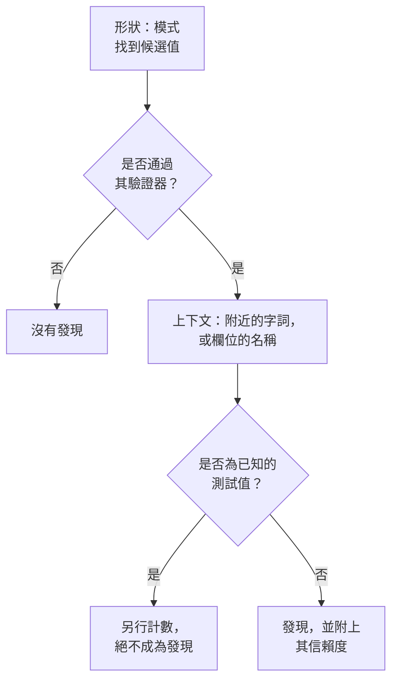

# 敏感資料類型

資料安全認得 143 種敏感資料：卡號、銀行帳戶、43 個國家的國民身分證號碼、健康識別碼、API 金鑰和權杖，以及特殊類別的個人資料。每種都有類別和敏感度，如果它屬於某個國家，還會標明該國家。本頁說明如何找到一個值，並列出每種資料類型，讓你能判斷某項內容為何被找到，並決定如何處理。

:::cards
- [如何找到一個值](#如何找到一個值): 形狀、驗證器、上下文、測試值、信賴度。
- [欄位和資料欄](#欄位和資料欄): 如何判斷整個資料欄或屬性。
- [自由文字中的姓名和街道地址](#自由文字中的姓名和街道地址): 掃描器內執行的小模型，以及它的分數。
- [每種資料類型](#內建資料類型): 全部 143 種，依類別列出。
- [你自己的資料類型](#你自己的資料類型): 員工編號、保單號碼，以及「測試」方塊。
- [OneUptime AI 找到的資料類型](#oneuptime-ai-找到的資料類型): 在沒有任何偵測器能歸類的欄位中找到的、貴公司自己的資料類型。
- [OneUptime AI 的判定](#oneuptime-ai-的判定): 對每個等待你處理的發現給出判定，並以你團隊的決定作為先例。
:::

## 如何找到一個值



每次掃描（無論是日誌行、CSV 儲存格、資料庫列，還是物件的前幾個位元組）都會執行相同的步驟：

1. **形狀。** 每種資料類型都有用來找出候選值的模式：十六位數字、`AKIA` 加上十六個字母、一個字詞加上 `@` 和網域。模式絕不會比對到較長字串的其中一段，因此不會在更長的一串數字中找到卡號。
2. **驗證器。** 候選值必須通過其類型自身的規則：總和檢查碼（卡號用 Luhn、IBAN 用 mod 97、Aadhaar 號碼用 Verhoeff，以及大多數國民身分證號碼的檢查碼）、真實存在的日期、已知的前綴，或對祕密而言足夠的隨機性。未通過的候選值根本不會成為發現。`000000000` 和 `123456789` 這類預留位置值在每種數值類型中都無法通過。
3. **上下文。** 候選值附近（預設為其前 64 個字元和其後 32 個字元以內）說明它是什麼的字詞，會將其信賴度提高一級，名稱指向該類型的欄位也是如此。說明它是其他東西（例如訂單號碼或追蹤號碼）的字詞，會將信賴度降低一級。沒有總和檢查碼且形狀常見的數字（例如護照號碼或銀行帳戶）只有在旁邊有指明它的字詞時才會計入。
4. **已知的測試值。** 公開的測試卡號（例如 Stripe 的 `4242 4242 4242 4242`）、範例 IBAN、`example.com` 和其他保留網域上的地址、文件用的 IP 位址、政府文件中印出的範例身分證號碼、`sk_test_` 這類測試模式金鑰以及預留位置金鑰，都會另行計數。它們絕不會產生發現，因此充滿這些值的資料儲存區會被視為測試環境，而不是外洩事件。
5. **信賴度。** 剩下的就是發現，其確定程度取決於證據所能支持的程度。

| 信賴度 | 意義 |
| --- | --- |
| **高** | 值通過了其驗證器，且其周圍的字詞或其所在的欄位說明了它是什麼；或者，對欄位而言，其大部分值都是該類型。 |
| **中** | 值通過了其驗證器，但周圍沒有任何內容可以確認它；或者欄位的名稱說明了它保存什麼，且部分值與之相符。 |
| **低** | 形狀相符，但沒有任何內容可以確認它。 |

只有信賴度為「高」和「中」的發現才會計入：它們會使資料儲存區被視為敏感，並且可能開啟問題。信賴度為「低」的發現會以摺疊方式列在資料儲存區上，供人工判斷：對正確的發現按 **確認** 會使其變為「高」，並在之後的掃描中維持「高」。

當兩種資料類型都認定同一段字元時，較確定的發現勝出：先比較信賴度，再看哪個偵測器自身的規則證明得更多，最後看哪個比對結果較長。

較長的值會以 64 KB 的視窗讀取，相鄰視窗重疊 4 KB，因此無論值位於何處都能完整找到，且單一值最多讀取 4 MB。

## 欄位和資料欄

資料欄、JSON 欄位或日誌屬性會作為一個整體來判斷。它的名稱暗示一種資料類型，而它的取樣值則加以證明。包含該類型的值所占的比例，決定了發現的確定程度：

| 包含該類型的值 | 信賴度 |
| --- | --- |
| 60% 以上 | 高 |
| 25% 以上 | 欄位名稱指向該類型時為高，否則為中 |
| 更少 | 欄位名稱指向該類型時為中，否則為低：例如其他內容的資料欄中夾雜的幾個電子郵件 |

值的平均長度超過 80 個字元的欄位屬於自由文字（備註、訊息、描述），預期不會只保存一種類型。它的發現會保留每個符合項目自身獲得的信賴度，並註明它們是在自由文字中找到的。每個欄位最多分類 1,000 個值，每個值最多 16 KB。

欄位的名稱會拆分成字詞（`customerEmail`、`customer_email` 和 `customer-email` 都是「customer email」），當類型的名稱提示中的字詞以相同順序相鄰出現時，就會比對成功：「date of birth」會比對到 `customer_date_of_birth`，而不會比對到 `birth_city`。以點分隔的路徑中，只有最後一部分是欄位自己的名稱；當最後一部分是 `number`、`id` 或 `value` 這類通用字詞時，還會加上它前面的部分：`customer.address.city` 不是街道地址，而 `card.number` 仍然是卡號。

有些資料類型無法從其值判斷：沒有任何模式能區分人名和街道名，或區分宗教和其他任何字詞。這些類型只在欄位有值時，單憑欄位的名稱找出：人名、使用者名稱、性別、國籍、健康資訊、種族或族裔出身、宗教信仰、性傾向、政治觀點、工會會員身分、生物特徵資料、基因資料和犯罪紀錄。此時，如果 60% 以上的值看起來像人名、使用者名稱、性別或國籍，信賴度就是高，否則為中。在自由文字中，人名和街道地址也會由一個小模型找到：請參閱 [自由文字中的姓名和街道地址](#自由文字中的姓名和街道地址)。

名稱表明保存密碼的欄位（`password`、`passwordHash`、`pwd`，但不包括 `password_changed_at`）應該保存雜湊：bcrypt、argon2、scrypt、PBKDF2，或資料儲存區可能使用的其他方案。空值、`********` 這類預留位置值和已加密的值會被排除。在其餘的值中，如果不是雜湊的值多於雜湊，該欄位保存的就是密碼本身，這是任何模式都看不出來的，而該資料儲存區會無法通過 [密碼以純文字儲存](/docs/data-security/checks-and-issues#資料衛生)。

### 沒有任何偵測器能歸類的欄位

名稱不指向任何資料類型、值也不符合任何偵測器的欄或欄位，並不代表它是安全的：它可能是你自己的客戶編號，也可能是以另一種語言命名的欄。專案開啟 **啟用 AI** 後，內容掃描會保留這類欄位，每次掃描最多 200 個，並詢問 OneUptime AI 每個欄位包含專案的哪種資料類型，每個資料儲存區一次最多 40 個欄位。它只會得到欄位名稱、相鄰欄位的名稱以及值的形狀——每個字母寫成 `a` 或 `A`，每個數字寫成 `9`，因此 `AB-1234` 會變成 `AA-9999`——從不包含任何值。自由文字、少於 5 個值的欄位、較小的整數，以及名稱表示 ID、時間或狀態的欄位都不會被詢問。

遙測掃描也以同樣的方式保留沒有任何偵測器能歸類的屬性，來自服務的日誌、Span、指標和其餘遙測，每次掃描每個服務最多 50 個。它從不保留 OneUptime 自己的屬性、OpenTelemetry 慣例寫在每筆記錄上用來說明記錄來源的屬性（例如服務、主機或 Pod），也從不保留自由文字，例如日誌本文。

OneUptime AI 給出的每種類型都是一個信賴度為「低」的發現，標示為 **由 OneUptime AI 建議**，並附上理由；理由以你專案的語言撰寫，橫跨該發現所在的整列顯示。與任何「低」發現一樣，在有人於資料儲存區的 **內容** 頁面上選擇 **確認** 之前，它不計入任何內容；**標記為不敏感** 會將其駁回。已得到回答的欄位在 30 天內不會再次詢問，經人工判斷過的欄位則不會再詢問。

## 自由文字中的姓名和街道地址

沒有任何模式能把人名和其他字詞區分開來。因此，自由文字（支援備註、一行記錄、一則例外訊息、一段提示詞）也會由一個小型語言模型讀取，它能找到人名和街道地址。模型在掃描器內執行，在 OneUptime 的工作程序和您的探測器上：文字從不離開掃描器，執行時不會下載任何東西，也不會撰寫任何提示詞。它不是 OneUptime AI，OneUptime AI 的開關不會開啟或關閉它：控制它的是 **尋找姓名和街道地址**。

- **它讀取什麼。** 值的平均長度超過 80 個字元的欄位；名稱表明有人在其中寫自由文字的欄位，無論其值多短，例如 `delivery_note`、`comentario`、`Lieferhinweis` 或 `opmerking`（見[短值](#短值)）；以及遙測中的每則記錄內文、例外訊息、堆疊追蹤和 AI 對話，無論多短。它最多讀取一個欄位的 100 個不同值、總共 32 KB 文字，單一值最多讀取 16 KB。
- **它找到什麼。** **人名** (`person-name`) 和 **街道地址** (`postal-address`)：模型在門牌號碼旁讀到的地點，例如 `14 Calle Mayor`，以及其後的郵遞區號和城市。單獨的城市或國家不算街道地址。
- **它有多確定。** 模型找到的姓名或地址本身是「中」。欄位名稱表示該欄位存放姓名或地址，或附近的字詞這樣表示時（例如 "customer"、"Kunde" 或 "dirección"），是「高」。模型不確定時，也就是分數低於 0.6，是「低」。每個發現保留它自己取得的信賴度，所以一千行記錄中的一個人名仍然是「中」。
- **測試值。** `Jane Doe`、`John Smith`、`Max Mustermann` 和 `123 Main Street` 這類預留位置值會另外計算，和每種類型的測試值一樣。
- **它保留什麼。** 它的樣本和透過欄位名稱找到的姓名一樣遮罩：保留第一個字元，加上四個星號，即 `M****`。它們從不產生指紋。在資料儲存區的 **內容** 頁面上，這類發現會顯示 **由掃描器的模型在自由文字中找到**。
- **它的記錄和規則。** 它做出的發現會列出找到它的記錄，每一行都圍繞姓名或地址擷取，其中的每個姓名和地址都已遮罩；而且和任何發現一樣， **清除** 會在這些記錄上證明一條規則：這些記錄會用模型重新讀取，每次最多用它 20 秒的時間。它沒有時間讀取的記錄不會列出，清單會說明有多少個值它沒有時間讀取。在模型無法執行的地方，清單會說明這一點，該發現的規則也不會被證明。

| 模型 | 授權 | 大小 | 修訂版本 | 已量測的語言 |
| --- | --- | --- | --- | --- |
| [openmasq/ner-multilingual](https://huggingface.co/openmasq/ner-multilingual)：六層多語言 BERT，int8 ONNX | Apache 2.0 | 98 MB | `8cf7273` | 英文、西班牙文、德文、法文、義大利文、葡萄牙文、荷蘭文 |

### 它找得有多準

它透過掃描器自己的程式碼，在為此撰寫的測試集上量測：七種語言的 392 個虛構句子（記錄行、支援備註、電子郵件、提示詞），其中 168 個既沒有姓名也沒有地址。一個發現與同類型的姓名或地址重疊即為正確。門檻在量測任何模型之前就已寫下：所有語言合計每種類型的精確率至少 0.90、每種語言至少 0.85，召回率至少 0.70，並且在兩者都不含的值中每 1,000 個最多 20 個誤判。量測的四個模型中有兩個達到門檻，選了其中較小的一個。這些分數由測試守住：對模型或掃描器的變更只要讓任一分數下降，測試就會失敗。

| 語言 | 姓名：精確率 | 姓名：召回率 | 地址：精確率 | 地址：召回率 |
| --- | --- | --- | --- | --- |
| 英文 | 0.96 | 0.96 | 1.00 | 1.00 |
| 西班牙文 | 0.96 | 0.96 | 1.00 | 1.00 |
| 德文 | 1.00 | 0.93 | 1.00 | 1.00 |
| 法文 | 0.96 | 0.96 | 1.00 | 1.00 |
| 義大利文 | 0.96 | 0.96 | 1.00 | 1.00 |
| 葡萄牙文 | 0.93 | 0.89 | 1.00 | 1.00 |
| 荷蘭文 | 0.96 | 0.89 | 1.00 | 1.00 |
| 七種語言合計 | 0.96 | 0.94 | 1.00 | 1.00 |

在測試集中兩者都不含的 168 個句子上，它每 1,000 個有 18 個誤判。在公開基準 [gretelai/synthetic_pii_finance_multilingual](https://huggingface.co/datasets/gretelai/synthetic_pii_finance_multilingual)（Apache 2.0）的一部分上：七種語言各 15 份金融文件，標籤由機器產生且不完整，所以請和上表一起看，而不要單獨看：

| 語言 | 姓名：精確率 | 姓名：召回率 | 地址：精確率 | 地址：召回率 |
| --- | --- | --- | --- | --- |
| 英文 | 0.91 | 0.90 | 0.83 | 1.00 |
| 西班牙文 | 0.89 | 0.37 | 0.58 | 0.70 |
| 德文 | 0.93 | 0.58 | 0.75 | 0.70 |
| 法文 | 0.84 | 0.50 | 0.42 | 0.83 |
| 義大利文 | 0.73 | 0.61 | 0.79 | 0.69 |
| 荷蘭文 | 0.91 | 0.49 | 1.00 | 0.89 |
| 瑞典文 | 1.00 | 0.61 | 1.00 | 0.93 |
| 七種語言合計 | 0.89 | 0.54 | 0.77 | 0.82 |

量測的四個模型，在撰寫的測試集上，在同一台機器上依序執行，每個都用 onnxruntime 的原生程式碼在一個核心上計時。OneUptime 用 onnxruntime 的 WebAssembly 執行選中的模型，它能在每個映像檔中執行，速度慢五到八倍：

| 模型 | 授權 | 大小 | 姓名：精確率 / 召回率 | 地址：精確率 / 召回率 | 每 1,000 個的誤判 | 每 1,000 個 75 / 1,181 字元值的耗時 |
| --- | --- | --- | --- | --- | --- | --- |
| openmasq/ner-multilingual（選中） | Apache 2.0 | 98 MB | 0.963 / 0.939 | 1.000 / 1.000 | 18 | 5.9 秒 / 82 秒 |
| Wismut/nym-pii-multilingual-small | MIT | 121 MB | 0.995 / 0.974 | 0.985 / 1.000 | 12 | 7.4 秒 / 103 秒 |
| jkomyno/minilmv2-l6-h384-ner-en-it-q8 | MIT | 34 MB | 0.704 / 0.929 | 0.839 / 1.000 | 369 | 3.7 秒 / 68 秒 |
| balticml/mmbert-small-pii-redaction | Apache 2.0 | 38 MB | 0.712 / 0.995 | 0.762 / 0.992 | 589 | 7.8 秒 / 159 秒 |

### 短值

只有當欄位的名稱表明有人在其中寫自由文字時，才會讀取短欄位。這條規則在選定之前經過了測量：在七種語言的資料庫的 49 個欄上，共 588 個值，包括商品名稱、標題、標籤、職稱和門市名稱（其中品牌、角色或街道的名稱都不算發現），以及包含 91 個姓名和 28 個街道地址的簡短配送備註、支援留言和客戶備註。最先考慮的規則是讀取每個包含四個或更多單字的欄位，它讀取了目錄中的 108 個值，並從中得出 53 個錯誤的姓名，例如 polo 衫名稱中的 `Ralph Lauren` 和書名中的 `Tom Sawyer`：

| 規則 | 讀取的目錄值 | 姓名：精確率 | 姓名：召回率 | 地址：精確率 | 每 1,000 個的誤判 |
| --- | --- | --- | --- | --- | --- |
| 四個或更多單字的欄位（未選中） | 108 | 0.62 | 0.99 | 1.00 | 222 |
| 名稱表明自由文字的欄位（選中） | 0 | 0.98 | 0.99 | 1.00 | 14 |

選中規則的各語言分數。一項測試鎖定這些分數，以及選擇模型時所用的標準：

| 語言 | 姓名：精確率 | 姓名：召回率 | 地址：精確率 | 地址：召回率 |
| --- | --- | --- | --- | --- |
| 英文 | 1.00 | 1.00 | 1.00 | 1.00 |
| 西班牙文 | 1.00 | 1.00 | 1.00 | 1.00 |
| 德文 | 1.00 | 1.00 | 1.00 | 1.00 |
| 法文 | 1.00 | 1.00 | 1.00 | 1.00 |
| 義大利文 | 1.00 | 1.00 | 1.00 | 1.00 |
| 葡萄牙文 | 0.86 | 0.92 | 1.00 | 1.00 |
| 荷蘭文 | 1.00 | 1.00 | 1.00 | 1.00 |
| 七種語言合計 | 0.98 | 0.99 | 1.00 | 1.00 |

只看欄位自身的名稱：`orders.delivery_note` 會被讀取，`notes.author` 不會，以 ID、計數、類型、狀態或時間結尾的名稱也不會，例如 `message_id`。描述不會因其名稱而被讀取：商品的描述是目錄文字。

### 它在哪裡執行，成本是多少

- **在每個映像檔中。** 執行工作程序的 App 映像檔和 Probe 映像檔都帶有模型、它的詞彙表和執行環境，離線（air-gapped）映像檔和 Iron Bank 映像檔也一樣：磁碟上約 114 MB。它們在建置映像檔時從固定的修訂版本取得，並依各自的 SHA-256 驗證。掃描執行時不會下載任何東西。
- **記憶體。** 掃描第一次需要它時載入，每個程序一次：約 550 MB，沒有掃描 10 分鐘後釋放。
- **時間。** 在一個核心上，每 1,000 個記錄行長度的值需要 30 秒到一分鐘，每 1,000 個 1,200 字元的值約 9 分鐘。一次資料儲存區的內容掃描最多給它 2 分鐘。每小時的遙測掃描總共最多給它 1 分鐘、每個資料儲存區 6 秒，每小時輪到不同的一組資料儲存區。
- **輪流。** 每次內容掃描的模型都從上一次停下的地方開始：從它沒有讀取自由文字的第一個資料表或容器開始，並先於其他所有物件重新讀取它沒有時間讀取的儲存貯體物件。它開始了卻沒能完成的那個不會再次排在最前，因此沒有哪個會一次又一次地佔用它的時間，無論資料儲存區中有多少自由文字，每個資料表和物件都會輪到。
- **當它的時間用完時**，掃描會帶著模型已讀取的內容完成，掃描的警告會說明它讀取了多少個自由文字值，但從不說明讀到了什麼。沒有模型的工作程序或探測器照常掃描，並說明原因：

```text
Names and street addresses were looked for in 120 of 500 free-text values: this store's 6 seconds of model time ran out.
Names and street addresses in free text were not looked for: the model's model_quantized.onnx is not installed on this probe.
```

掃描詳細資料會以讀者的語言顯示這些警告，以及內容或遙測掃描的其他所有警告。

**尋找姓名和街道地址** 在每個專案中預設開啟：儲存貯體、資料庫和 BigQuery 資料集的內容掃描會在工作程序和探測器上用模型讀取自由文字。它下方的 **在遙測中尋找姓名和街道地址** 預設關閉：把一個有 200 個服務的繁忙專案的每則記錄內文、例外和對話讀過一遍，需要一個核心約 48 分鐘，而掃描每小時的一分鐘只能讀其中約 4%。開啟它，讓每次每小時的掃描讀取其中一部分。兩者都在 **資料安全 → 設定 → 掃描設定** 的 **資料安全讀取的內容** 下。 **測試** 在您的瀏覽器中執行，不帶模型：模型會找到的內容不會顯示在那裡。模型會讓下載增加約 113 MB（壓縮後 67 MB），並讓分頁的記憶體增加約 440 MB，因此它只在掃描器中執行。

## 敏感度

| 敏感度 | 意義 |
| --- | --- |
| **受限** | 一旦外洩就會造成損害：祕密、卡號、健康紀錄、政府身分證件號碼。 |
| **機密** | 個人資料，以及標示為機密的文件。 |
| **內部** | 企業自身的資料，不供外部人士使用。 |
| **公開** | 沒有找到任何敏感內容。 |

資料儲存區的敏感度，等於其中以至少「中」信賴度找到的最敏感資料類型的敏感度。測試值和標記為不敏感的發現完全不計入，沒有找到任何內容的資料儲存區則為「公開」。若要讓資料儲存區的敏感度高於或低於其發現所顯示的程度，請在資料儲存區的 **設定** 中自行設定其敏感度：之後檢查就會使用該設定。

## 類別

| 類別 | 涵蓋範圍 | 個人資料 |
| --- | --- | --- |
| 祕密和認證資訊 | 能解鎖其他系統的密碼、API 金鑰、權杖和私密金鑰。 | 否 |
| 金融 | 卡號、銀行帳戶、IBAN 和加密貨幣錢包。 | 是 |
| 健康 | 病歷號碼、健康識別碼、診斷和處方。 | 是 |
| 政府身分證件 | 國民身分證、稅籍、護照和社會安全號碼。 | 是 |
| 特殊類別 | GDPR 第 9 條給予最嚴格保護的資料：族裔、宗教、性傾向、政治、工會會員身分、生物特徵資料和基因資料。 | 是 |
| 聯絡和身分 | 某人是誰以及如何聯絡對方：電子郵件、電話、地址、出生日期、IP 位址。 | 是 |
| 商業機密 | 標示為機密、僅限內部或受特權保護的文件。 | 否 |

個人資料是指 GDPR、CCPA、LGPD 和 DPDP 所定義的、與某個人有關的資料。只保存祕密和商業文件的資料儲存區不在隱私框架的範圍內，但絕不會不在安全框架的範圍內（請參閱 [資料安全合規性](/docs/data-security/compliance)）。

## 內建資料類型

屬於某個國家的資料類型會以 ISO 3166-1 代碼標明該國家：資料落地規則和與國家相關的合規框架會讀取它（請參閱 [資料落地](/docs/data-security/flows-access-residency#資料落地規則)）。ID 是 API 和發現用來指稱該類型的名稱。

### 聯絡和身分

| 資料類型 | ID | 說明 | 敏感度 | 國家 |
| --- | --- | --- | --- | --- |
| 電子郵件地址 | `email-address` | 個人的電子郵件地址。 | 機密 | — |
| 電話號碼 | `phone-number` | 國際或國內格式的電話號碼。 | 機密 | — |
| 人名 | `person-name` | 個人的名、姓或全名，透過欄位名稱找到，或在自由文字中由掃描器的模型找到。 | 機密 | — |
| 街道地址 | `postal-address` | 街道地址：門牌號碼、街道名稱和街道類型。 | 機密 | — |
| 郵遞區號 | `postal-code` | 郵遞區號。單憑它就能縮小某人的居住範圍。 | 內部 | — |
| 出生日期 | `date-of-birth` | 旁邊有字詞表明其為某人出生日期的日期。 | 機密 | — |
| IP 位址 | `ip-address` | 公用 IPv4 或 IPv6 位址，GDPR 將其視為個人資料。 | 機密 | — |
| MAC 位址 | `mac-address` | 網路卡的硬體位址，可識別一台裝置。 | 機密 | — |
| 廣告 ID | `advertising-id` | 追蹤單一裝置的行動廣告 ID（IDFA、GAID、AAID）。 | 機密 | — |
| 精確位置 | `geolocation` | 精確到足以找出一棟建築物的緯度和經度。 | 機密 | — |
| 使用者名稱 | `username` | 個人的登入名稱或帳戶名稱，依欄位的名稱找出。 | 機密 | — |
| 性別 | `gender` | 個人的社會性別或生理性別，依欄位的名稱找出。 | 機密 | — |
| 國籍 | `nationality` | 個人的國籍或公民身分，依欄位的名稱找出。 | 機密 | — |
| 車輛識別號碼 | `vehicle-identification-number` | 具有有效檢查碼的 17 字元 VIN。 | 機密 | — |

### 政府身分證件

| 資料類型 | ID | 說明 | 敏感度 | 國家 |
| --- | --- | --- | --- | --- |
| 美國社會安全號碼 | `us-ssn` | 美國社會安全號碼。 | 受限 | US |
| 美國納稅人識別號碼（ITIN） | `us-itin` | 美國個人納稅人識別號碼。 | 受限 | US |
| 美國雇主識別號碼（EIN） | `us-ein` | 美國雇主識別號碼，旁邊須有字詞加以指明。 | 機密 | US |
| 美國護照號碼 | `us-passport` | 美國護照號碼，旁邊須有字詞加以指明。 | 受限 | US |
| 美國駕照號碼 | `us-drivers-license` | 美國駕照號碼，旁邊須有字詞加以指明。 | 受限 | US |
| 英國國民保險號碼 | `uk-nino` | 英國國民保險號碼。 | 受限 | GB |
| 英國護照號碼 | `uk-passport` | 英國護照號碼，旁邊須有字詞加以指明。 | 受限 | GB |
| 英國駕照號碼 | `uk-driving-licence` | 16 字元的英國駕照號碼。 | 受限 | GB |
| 加拿大社會保險號碼 | `ca-sin` | 具有有效檢查碼的加拿大社會保險號碼。 | 受限 | CA |
| 墨西哥 CURP | `mx-curp` | 墨西哥 Clave Única de Registro de Población。 | 受限 | MX |
| 墨西哥 RFC | `mx-rfc` | 墨西哥 Registro Federal de Contribuyentes 稅籍編號。 | 受限 | MX |
| 巴西 CPF | `br-cpf` | 巴西 Cadastro de Pessoas Físicas 號碼。 | 受限 | BR |
| 巴西 CNPJ | `br-cnpj` | 巴西公司登記號碼（CNPJ）。 | 機密 | BR |
| 阿根廷 CUIT / CUIL | `ar-cuit` | 阿根廷稅務或勞動識別碼。 | 受限 | AR |
| 智利 RUT | `cl-rut` | 具有有效檢查碼的智利 Rol Único Tributario。 | 受限 | CL |
| 西班牙 DNI | `es-dni` | 附有檢查字母的西班牙國民身分證件號碼。 | 受限 | ES |
| 西班牙 NIE | `es-nie` | 附有檢查字母的西班牙外國人身分號碼。 | 受限 | ES |
| 葡萄牙 NIF | `pt-nif` | 葡萄牙稅籍識別號碼。 | 受限 | PT |
| 法國社會安全號碼（NIR） | `fr-nir` | 附有兩位數檢查碼的法國 INSEE 號碼。 | 受限 | FR |
| 德國稅籍編號 | `de-tax-id` | 德國 Steuerliche Identifikationsnummer。 | 受限 | DE |
| 義大利 codice fiscale | `it-codice-fiscale` | 具有有效檢查字元的義大利稅務代碼。 | 受限 | IT |
| 荷蘭 BSN | `nl-bsn` | 通過十一檢驗的荷蘭公民服務號碼。 | 受限 | NL |
| 比利時國民號碼 | `be-national-number` | 比利時國民登記號碼。 | 受限 | BE |
| 波蘭 PESEL | `pl-pesel` | 波蘭國民識別號碼。 | 受限 | PL |
| 瑞典個人身分號碼 | `se-personnummer` | 具有有效檢查碼的瑞典 personnummer。 | 受限 | SE |
| 挪威國民身分號碼 | `no-fodselsnummer` | 附有兩個檢查碼的挪威 fødselsnummer。 | 受限 | NO |
| 丹麥 CPR 號碼 | `dk-cpr` | 丹麥民事登記號碼，旁邊須有字詞加以指明。 | 受限 | DK |
| 芬蘭個人身分代碼 | `fi-hetu` | 附有檢查字元的芬蘭 henkilötunnus。 | 受限 | FI |
| 愛爾蘭 PPS 號碼 | `ie-ppsn` | 愛爾蘭個人公共服務號碼。 | 受限 | IE |
| 瑞士 AHV 號碼 | `ch-ahv` | 瑞士社會安全號碼（AHV / AVS）。 | 受限 | CH |
| 羅馬尼亞 CNP | `ro-cnp` | 羅馬尼亞個人數字代碼。 | 受限 | RO |
| 保加利亞 EGN | `bg-egn` | 保加利亞統一公民號碼。 | 受限 | BG |
| 克羅埃西亞 OIB | `hr-oib` | 克羅埃西亞個人識別號碼。 | 受限 | HR |
| 希臘 AMKA | `gr-amka` | 希臘社會安全號碼。 | 受限 | GR |
| 土耳其身分號碼 | `tr-tckn` | 土耳其 T.C. Kimlik 號碼。 | 受限 | TR |
| 以色列身分號碼 | `il-teudat-zehut` | 以色列 Teudat Zehut 號碼。 | 受限 | IL |
| 南非身分證號碼 | `za-id` | 具有有效日期和檢查碼的南非身分號碼。 | 受限 | ZA |
| 阿聯 Emirates ID | `ae-emirates-id` | 阿拉伯聯合大公國身分證號碼。 | 受限 | AE |
| 沙烏地阿拉伯國民身分證 | `sa-national-id` | 沙烏地阿拉伯國民身分證號碼或 iqama 號碼。 | 受限 | SA |
| 印度 Aadhaar 號碼 | `in-aadhaar` | 通過 Verhoeff 檢查的 12 位數 Aadhaar 號碼。 | 受限 | IN |
| 印度 PAN | `in-pan` | 印度永久帳戶號碼。 | 受限 | IN |
| 中國居民身分證號碼 | `cn-resident-id` | 18 字元的中國居民身分證號碼。 | 受限 | CN |
| 日本 My Number | `jp-my-number` | 具有有效檢查碼的日本個人編號。 | 受限 | JP |
| 南韓居民登記號碼 | `kr-rrn` | 韓國居民登記號碼。 | 受限 | KR |
| 新加坡 NRIC / FIN | `sg-nric` | 新加坡身分證號碼或外國人識別號碼。 | 受限 | SG |
| 香港身分證號碼 | `hk-hkid` | 附有檢查碼的香港身分證號碼。 | 受限 | HK |
| 台灣國民身分證號碼 | `tw-national-id` | 台灣國民身分證統一編號。 | 受限 | TW |
| 泰國國民身分證號碼 | `th-national-id` | 泰國公民識別號碼。 | 受限 | TH |
| 馬來西亞 MyKad 號碼 | `my-mykad` | 馬來西亞身分證號碼。 | 受限 | MY |
| 印尼 NIK | `id-nik` | 印尼人口身分號碼。 | 受限 | ID |
| 澳洲稅籍編號 | `au-tfn` | 通過有效檢查的澳洲稅籍編號。 | 受限 | AU |
| 紐西蘭 IRD 號碼 | `nz-ird` | 具有有效檢查碼的紐西蘭稅務局號碼。 | 受限 | NZ |
| 俄羅斯 SNILS | `ru-snils` | 附有檢查號碼的俄羅斯保險帳戶號碼。 | 受限 | RU |
| 俄羅斯 INN | `ru-inn` | 俄羅斯納稅人識別號碼。 | 受限 | RU |
| 護照號碼 | `passport-number` | 任何國家的護照號碼，旁邊須有字詞加以指明。 | 受限 | — |

### 金融

| 資料類型 | ID | 說明 | 敏感度 | 國家 |
| --- | --- | --- | --- | --- |
| 卡號 | `credit-card-number` | 通過 Luhn 檢查且屬於某個卡片品牌的支付卡號碼。 | 受限 | — |
| 卡片安全碼 | `card-verification-code` | CVV 或 CVC，PCI DSS 禁止在付款授權後保留它。 | 受限 | — |
| 卡片到期日 | `card-expiration-date` | 卡片的到期日，旁邊須有字詞加以指明。 | 機密 | — |
| IBAN | `iban` | 通過 mod-97 檢查的國際銀行帳戶號碼。 | 受限 | — |
| 銀行帳戶號碼 | `bank-account-number` | 銀行帳戶號碼，旁邊須有字詞加以指明。 | 受限 | — |
| SWIFT / BIC 代碼 | `swift-bic` | 銀行的 SWIFT 或 BIC 代碼，旁邊須有字詞加以指明。 | 內部 | — |
| 美國銀行匯款路徑號碼 | `us-bank-routing-number` | 具有有效總和檢查碼的 ABA 匯款路徑號碼，旁邊須有字詞加以指明。 | 內部 | US |
| 英國銀行分行代碼 | `uk-sort-code` | 英國銀行分行代碼，旁邊須有字詞加以指明。 | 內部 | GB |
| 印度 IFSC | `in-ifsc` | 標明銀行分行的印度金融系統代碼。 | 內部 | IN |
| 澳洲 BSB | `au-bsb` | 澳洲銀行-州-分行號碼，旁邊須有字詞加以指明。 | 內部 | AU |
| Bitcoin 地址 | `bitcoin-address` | 具有有效總和檢查碼的 Bitcoin 地址。 | 機密 | — |
| Ethereum 地址 | `ethereum-address` | Ethereum 地址，旁邊須有字詞加以指明。 | 機密 | — |

### 健康

| 資料類型 | ID | 說明 | 敏感度 | 國家 |
| --- | --- | --- | --- | --- |
| 英國 NHS 號碼 | `uk-nhs-number` | 具有有效檢查碼的英國國民保健署號碼。 | 受限 | GB |
| 美國 Medicare 受益人 ID | `us-medicare-mbi` | 美國 Medicare 受益人識別碼。 | 受限 | US |
| 澳洲 Medicare 號碼 | `au-medicare-number` | 具有有效檢查碼的澳洲 Medicare 卡號碼。 | 受限 | AU |
| 德國健康保險號碼 | `de-health-insurance-number` | 具有有效檢查碼的德國 Krankenversichertennummer。 | 受限 | DE |
| 病歷號碼 | `medical-record-number` | 病患的病歷號碼，旁邊須有字詞加以指明。 | 受限 | — |
| 健康保險會員 ID | `health-plan-id` | 健康保險的會員號碼或保單號碼，旁邊須有字詞加以指明。 | 受限 | — |
| 診斷代碼（ICD-10） | `diagnosis-code` | ICD-10 診斷代碼，旁邊須有字詞加以指明。 | 受限 | — |
| 藥品代碼（NDC） | `drug-code` | 美國國家藥品代碼，旁邊須有字詞加以指明。 | 機密 | — |
| 美國 DEA 號碼 | `us-dea-number` | 具有有效檢查碼的處方開立者緝毒局號碼。 | 機密 | US |
| 美國醫療提供者 ID（NPI） | `us-npi` | 國家醫療提供者識別碼。它指的是醫療提供者，而不是病患。 | 內部 | US |
| 健康資訊 | `health-information` | 診斷、病況、用藥和其他健康細節，依欄位的名稱找出。 | 受限 | — |

### 祕密和認證資訊

| 資料類型 | ID | 說明 | 敏感度 | 國家 |
| --- | --- | --- | --- | --- |
| AWS 存取金鑰 ID | `aws-access-key-id` | AWS 存取金鑰的公開部分。搭配其祕密即可簽署 AWS 請求。 | 受限 | — |
| AWS 祕密存取金鑰 | `aws-secret-access-key` | AWS 存取金鑰的祕密部分，旁邊須有字詞加以指明。 | 受限 | — |
| Google API 金鑰 | `google-api-key` | Google Cloud 或 Maps 的 API 金鑰。 | 受限 | — |
| Google 服務帳戶金鑰 | `google-service-account-key` | 包含私密金鑰的 Google Cloud 服務帳戶金鑰檔案。 | 受限 | — |
| Google OAuth 用戶端密碼 | `google-oauth-client-secret` | Google OAuth 用戶端密碼。 | 受限 | — |
| Azure 儲存體帳戶金鑰 | `azure-storage-account-key` | Azure 儲存體帳戶金鑰，或包含此金鑰的連線字串。 | 受限 | — |
| Azure SAS 權杖 | `azure-sas-token` | Azure 共用存取簽章，無須登入即可授予存取權。 | 受限 | — |
| Azure 用戶端密碼 | `azure-client-secret` | Microsoft Entra ID 應用程式的用戶端密碼。 | 受限 | — |
| GitHub 權杖 | `github-token` | GitHub 個人存取權杖、OAuth 權杖、應用程式權杖或細微權限權杖。 | 受限 | — |
| GitLab 權杖 | `gitlab-token` | GitLab 個人存取權杖。 | 受限 | — |
| Slack 權杖 | `slack-token` | Slack 機器人、使用者或應用程式權杖。 | 受限 | — |
| Slack Webhook URL | `slack-webhook-url` | Slack 傳入 Webhook，任何人都能透過它張貼到頻道。 | 受限 | — |
| Stripe 祕密金鑰 | `stripe-secret-key` | Stripe 正式環境的祕密金鑰或受限金鑰，可以轉移資金。 | 受限 | — |
| Twilio API 金鑰 | `twilio-api-key` | 附有祕密的 Twilio API 金鑰 SID。 | 受限 | — |
| SendGrid API 金鑰 | `sendgrid-api-key` | SendGrid API 金鑰。 | 受限 | — |
| Mailgun API 金鑰 | `mailgun-api-key` | Mailgun API 金鑰。 | 受限 | — |
| Mailchimp API 金鑰 | `mailchimp-api-key` | Mailchimp API 金鑰。 | 受限 | — |
| OpenAI API 金鑰 | `openai-api-key` | OpenAI API 金鑰，會花費帳戶的點數。 | 受限 | — |
| Anthropic API 金鑰 | `anthropic-api-key` | Anthropic API 金鑰。 | 受限 | — |
| Hugging Face 權杖 | `huggingface-token` | Hugging Face 權杖。 | 受限 | — |
| npm 權杖 | `npm-token` | npm 存取權杖，可以發布套件。 | 受限 | — |
| PyPI 權杖 | `pypi-token` | PyPI 上傳權杖。 | 受限 | — |
| Docker Hub 權杖 | `docker-hub-token` | Docker Hub 個人存取權杖。 | 受限 | — |
| Shopify 權杖 | `shopify-token` | Shopify 存取權杖或應用程式權杖。 | 受限 | — |
| Square 權杖 | `square-token` | Square 存取權杖或祕密。 | 受限 | — |
| Braintree 存取權杖 | `braintree-access-token` | Braintree 正式環境存取權杖。 | 受限 | — |
| DigitalOcean 權杖 | `digitalocean-token` | DigitalOcean 個人存取權杖。 | 受限 | — |
| New Relic API 金鑰 | `new-relic-api-key` | New Relic 使用者 API 金鑰。 | 受限 | — |
| Datadog API 金鑰 | `datadog-api-key` | Datadog API 金鑰或應用程式金鑰，旁邊須有字詞加以指明。 | 受限 | — |
| HashiCorp Vault 權杖 | `vault-token` | HashiCorp Vault 服務權杖。 | 受限 | — |
| Terraform Cloud 權杖 | `terraform-cloud-token` | Terraform Cloud 或 Enterprise API 權杖。 | 受限 | — |
| Atlassian API 權杖 | `atlassian-api-token` | Atlassian API 權杖。 | 受限 | — |
| Linear API 金鑰 | `linear-api-key` | Linear API 金鑰。 | 受限 | — |
| JSON Web 權杖 | `json-web-token` | 已簽署的 JWT，通常是工作階段權杖或存取權杖。 | 受限 | — |
| 私密金鑰 | `private-key` | PEM、OpenSSH 或 PGP 私密金鑰區塊。 | 受限 | — |
| URL 中的密碼 | `password-in-url` | 帶有使用者名稱和密碼的 URL，例如資料庫連線字串。 | 受限 | — |
| 連線字串中的密碼 | `connection-string-password` | 連線字串中的 Password= 或 Pwd= 值。 | 受限 | — |
| Authorization 標頭 | `authorization-header` | 從 HTTP Authorization 標頭複製的 Basic 或 Bearer 認證資訊。 | 受限 | — |
| 密碼或祕密 | `generic-secret` | 指派給密碼、祕密、API 金鑰或權杖的值，且看起來足夠隨機，像是真實的值。 | 受限 | — |
| Bitcoin 私密金鑰 | `bitcoin-private-key` | 錢包匯入格式的 Bitcoin 私密金鑰，具有有效的總和檢查碼。 | 受限 | — |

### 特殊類別

| 資料類型 | ID | 說明 | 敏感度 | 國家 |
| --- | --- | --- | --- | --- |
| 種族或族裔出身 | `racial-or-ethnic-origin` | 種族或族裔，依欄位的名稱找出。 | 受限 | — |
| 宗教信仰 | `religious-belief` | 宗教或信仰，依欄位的名稱找出。 | 受限 | — |
| 性傾向 | `sexual-orientation` | 性傾向，依欄位的名稱找出。 | 受限 | — |
| 政治觀點 | `political-opinion` | 政治觀點或政黨黨籍，依欄位的名稱找出。 | 受限 | — |
| 工會會員身分 | `trade-union-membership` | 工會會員身分，依欄位的名稱找出。 | 受限 | — |
| 生物特徵資料 | `biometric-data` | 指紋、臉部範本、聲紋和其他生物特徵，依欄位的名稱找出。 | 受限 | — |
| 基因資料 | `genetic-data` | DNA 和基因體資料，依欄位的名稱找出。 | 受限 | — |
| 犯罪紀錄 | `criminal-record` | 刑事定罪和犯罪行為（GDPR 第 10 條），依欄位的名稱找出。 | 受限 | — |

### 商業機密

| 資料類型 | ID | 說明 | 敏感度 | 國家 |
| --- | --- | --- | --- | --- |
| 受法律特權保護的文件 | `privileged-document` | 標示為受律師與委託人特權保護或受法律特權保護的文件。 | 受限 | — |
| 標示為機密的文件 | `confidential-document` | 標示為機密、極機密或營業祕密的文件。 | 機密 | — |
| 標示為內部的文件 | `internal-document` | 標示為僅供內部使用或不得散布的文件。 | 內部 | — |

## 你自己的資料類型

為只有你的公司才有的資料新增資料類型：員工編號、保單號碼、專案代碼。前往 **資料安全 → 設定 → 資料類型**，並在 **您的資料類型** 下新增它。從下一次掃描起，它會在儲存貯體、資料庫和遙測中以與內建類型完全相同的方式被掃描。

:::steps
### 說明它是什麼

為它提供 **名稱**（例如員工編號）、**類別** 和 **敏感度**：即保存它的資料儲存區有多敏感。**描述** 會向閱讀其發現的人說明它是什麼。

### 說明如何找到它

輸入 **模式**：比對單一值的 JavaScript 規則運算式，例如 `EMP-\d{6}`。新增保存它的 **欄位名稱**（例如 `employee id`），以及出現在值附近時可確認它屬於此類型的 **關鍵字**。將模式留空，即可只依欄位名稱找出此類型。

### 測試它

將範例文字貼到 **測試** 中，即可查看你的資料類型在其中找到什麼。它會在你的瀏覽器中，對文字執行掃描器本身的程式碼：文字永遠不會傳送到 OneUptime，且只會測試其前 64 KB。
:::

在 **更多欄位** 下，**忽略大小寫** 會不分字母大小寫比對模式，**需要關鍵字** 只在值附近有關鍵字或欄位名稱表明它屬於此類型時才計入該值，**總和檢查碼** 則要求值通過一項檢查：**無**、**Luhn**（卡號所帶的檢查碼）、**Mod97**（IBAN 的檢查碼）或 **Verhoeff**（Aadhaar 號碼的檢查碼）。

模式會在你儲存時接受檢查：它必須能夠編譯、不比對空白文字，且執行時間必須與文字長度成正比。它由絕不回溯的比對器執行，因此無論模式如何撰寫，都不會拖住掃描。一個類型最多可有 50 個關鍵字和 50 個欄位名稱。

當你的類型有總和檢查碼且值通過時，該值單獨出現時為「中」，附近有關鍵字時為「高」；沒有總和檢查碼時，該值單獨出現時為「低」，附近有關鍵字時為「中」。在資料欄中，與所有類型一樣，由符合的值所占的比例決定。

### 描述

在新資料類型表單的頂端， **描述** 會為您填寫表單。寫下資料的樣子，例如「我們的員工 ID 形如 EMP-123456，有時沒有連字號」，願意的話再新增幾個範例，每行一個，然後選擇 **填寫表單** 。OneUptime AI 只會收到您的句子和範例的形態，絕不會收到範例本身：範例留在您的瀏覽器中， **測試** 會顯示它的模式找到了其中幾個。閱讀它填寫的內容，修改您想改的地方，然後儲存：在您儲存之前什麼都不會儲存，模式也會像您自己寫的一樣接受檢查。使用描述需要為專案開啟 **啟用 AI** 。

## OneUptime AI 找到的資料類型

沒有任何偵測器能歸類的欄位中，常常有貴公司自己的資料類型，以含義相同的名稱保存在許多地方：例如一家保險公司的保單號碼，在它所有的資料庫中都放在名為 `policy_no`、`policyNumber` 和 `police_nr` 的欄中。為專案開啟 **啟用 AI** 後，OneUptime AI 會在掃描保留的欄位中找到這樣的資料類型，並且只在您自己的掃描證實它之後才詢問您。

:::steps
### 找到一組欄位

當兩個或更多資料儲存區中的三個或更多欄位的大多數值具有同一種形態（各部分之間有沒有分隔符號都可以），而且它們的名稱共用一個說明其內容的詞時，這些欄位組成一組。沒有數字的形態、日期、時間或小數永遠不會組成一組，而像 `id`、`no` 或 `number` 這樣的詞本身說明不了什麼。

### 起草資料類型

OneUptime AI 為每個新組起草一個資料類型，一次最多 3 個，依據是欄位的名稱和值的形態，絕不使用任何值。草稿必須通過與已儲存類型相同的檢查，並能找到起草它所依據的形態。達不到要求的草稿會再請求一次，並附上原因。

### 接下來的掃描證實它

草稿在其組中每個資料儲存區的下一次掃描中執行，最長 48 小時或一個掃描間隔，以較長者為準。它不會產生任何發現：每次掃描都會統計它在組內欄位和同一資料儲存區的其他所有欄位中會找到多少個值。當它找到自身欄位中至少 80% 的值、而其他值最多只找到 1% 時，才會被建議。在別處它幾乎找到所有值的欄位，以其他名稱保存著相同的資料：這樣的欄位會被列出，而不會被算作它的缺點。
:::

每個草稿同時也會以縮小的形式計數：在組內欄位之外，縮小的草稿只有在值旁邊有其某個關鍵字，或值位於指向它的欄位名稱下時，才會找到該值。在別處找到太多值的草稿，如果縮小後足夠，就以縮小的形式被建議。兩種形式都不夠的草稿會被捨棄，它所在的組在 30 天內不會再被起草。

它建議的每個資料類型都在 **資料安全 → 設定 → 資料類型** 頂端以及 **資料安全 → 人工智慧** 上的 **待審查的資料類型** 中等待，並附有掃描統計的結果，例如「比對到這 11 個欄位中 98% 的值，以及同一資料儲存區中其他位置 0.1% 的值。」 **新增資料類型** 會開啟已用它填好的資料類型表單，供您修改和測試；儲存後即新增該類型，掃描從下一次執行起就會找到它。 **不是資料類型** 會拒絕它：它永遠不會再為這些欄位被建議。新增需要一個可以建立資料類型的角色。

## 不敏感與絕不敏感

掃描可能會找到看似敏感、實則不然的內容：一欄通過 Luhn 檢查的訂單號碼，或每一行日誌中都有的你自己的支援地址。告訴 OneUptime 這一點，它就會停止計入：

- **將發現標記為不敏感。** 在資料儲存區的 **內容** 頁面上，在該發現上選擇 **標記為不敏感** 並說明原因。它將不再計入資料儲存區的敏感度或其檢查，資料儲存區也會立即重新檢查。該發現會連同標記和你的原因保留在資料儲存區上，讓下一個人看到已做出的決定。
- **將值新增到「絕不視為敏感」**，此設定位於資料安全的設定中，適用於在任何地方都永遠不應成為發現的值，例如 `support@yourcompany.com`。值會在掃描器將其正規化之後進行比較，且不區分大小寫。
- **關閉內建資料類型。** 在 **資料安全 → 設定 → 資料類型** 的 **內建資料類型** 下，每種資料類型都有一個開關，切換後會立即儲存。專案的任何掃描都不會尋找已關閉的類型。

## OneUptime AI 的判定

專案開啟 **啟用 AI**，並在 **資料安全 → 人工智慧** 下開啟 **處理新問題** 後，OneUptime AI 會在每次掃描資料儲存區之後，對每個等待人工處理的發現給出判定。當掃描對某個發現沒有把握時——信賴度為「低」的發現，或 OneUptime AI 的某項建議——或者當信賴度為「中」或「高」的發現顯示出錯誤比對的跡象時，該發現就會等待處理：

- 比對到的內容大多是已知的測試值；
- 欄位的名稱指向另一種資料類型，而不是這一種；
- ID 欄位（例如 `order_number`、`invoice_no` 或 `ref_id`）中保存著一種以 Luhn 演算法檢查的類型（任意數字串中每十個就有一個能通過這項檢查），而欄位的名稱並未指向該類型。

判定為 **建議確認**、**不敏感** 或 **無法判斷**，並附有以你專案的語言撰寫的理由。判定橫跨該發現所在的整列顯示，位於資料儲存區的 **內容** 頁面和 **遙測中** 頁面上，並附上它所依據的你團隊的決定，例如「您的團隊已在 4 個資料儲存區中將 `order_number` 標記為不敏感」。**顯示決定** 會逐一列出這些決定：其資料儲存區、其欄位以及你的團隊給出的原因。

### 作為先例的團隊決定

OneUptime AI 會得到你的團隊先前對同一資料類型之發現所做的決定，最多十項。首先是任何資料儲存區上同名欄位中的決定：`order_number`、`orderNumber` 和 `public.orders.order_number` 都是「order number」。其中同一位置的決定排在最前，其次依決定的新舊排列，最新的在前。然後是名稱或為其給出的原因表達了相同含義的欄位，例如原因為「Shopify 訂單編號」的 `order_ref`。它會得知每個發現所在的位置、所做的決定以及給出的原因，原因中的任何值都會被移除。它絕不會得到任何值、遮罩樣本或記錄。

自由文字中的發現，例如日誌內文或訊息中的發現，沒有可供比對的欄位名稱。它的先例是另一個資料儲存區上的同一位置，例如另一個服務的日誌內文。

### OneUptime AI 自行決定的事

- **它絕不會將發現標記為不敏感**，無論規則如何。這由人來做，並附上自己的原因。當判定為 **不敏感** 時，**標記為不敏感** 會以 OneUptime AI 草擬的原因開始，你可以修改它。
- **只有在 AI 規則允許時，它才會自行確認發現**：需要有一條針對該資料儲存區和資料類型、且 **判定** 為 **自動** 的資料安全 AI 規則。它還需要你的團隊親自確認過類似的發現，或者欄位以該類型命名。該確認會記錄在資料儲存區的 **時間軸** 上以及 **資料安全 → 人工智慧** 的 **由 AI 完成** 中，**復原** 可以將其撤回。

否則，判定會在該發現所在的列上等待。如果專案有 AI 規則，只有當針對其資料儲存區和資料類型的規則開啟了 **判定** 時，發現才會得到判定；僅限於某些檢查或嚴重程度的規則針對的是問題，不會判定任何發現。每次掃描後，OneUptime AI 最多判定一個資料儲存區的 40 個發現，先判定從未判定過的發現，其餘的在下一次掃描後判定。在之後的掃描中，只有當判定所依據的內容改變時（例如對類似發現做出了新的決定），才會再次詢問該發現。

## 類似發現

在你確認某個發現或將其標記為不敏感後，**套用到類似發現** 會列出尚無人決定的類似發現：同一資料類型、位於同名欄位中，在此資料儲存區以及你有權讀取的所有其他資料儲存區上。每一項都已勾選。取消勾選你想單獨判斷的項目，其餘的項目就會作為你自己的變更得到相同的決定，並附上你的原因；你無權變更的發現會維持原樣。**暫不** 會讓它們全部維持原樣。自由文字中的發現永遠沒有類似發現：一段文字包含的內容無法說明另一段文字的任何情況。

## 你的決定對掃描說明了什麼

當你的團隊將發現標記為不敏感時，OneUptime AI 會在 **資料安全 → 人工智慧** 的 **等待您處理** 下提議對掃描的變更：

- **關閉內建資料類型**：當它的每個發現都被標記為不敏感，且至少有 2 個資料儲存區上的至少 3 個發現時。OneUptime AI 僅建議過的發現不計入。
- **將某個位置排除在資料儲存區的掃描之外**：當那裡的每個發現都被標記為不敏感，且至少有 2 個時。它針對的是資料庫資料欄或遙測屬性，掃描可以單獨排除它們。

每項提議一律等待人工核准：停止尋找的掃描會錯過之後到來的真實資料。**絕不視為敏感** 永遠不會被提議，因為它保存的是值，而 OneUptime AI 從不會看到任何值。

## 後續步驟

:::cards
- [資料安全檢查與問題](/docs/data-security/checks-and-issues): 資料儲存區的敏感度會如何影響其問題。
- [遙測中的敏感資料](/docs/data-security/telemetry): 在你的日誌、追蹤和提示中找到的資料類型。
- [資料安全合規性](/docs/data-security/compliance): 每種資料類型會使哪些合規框架適用。
:::
