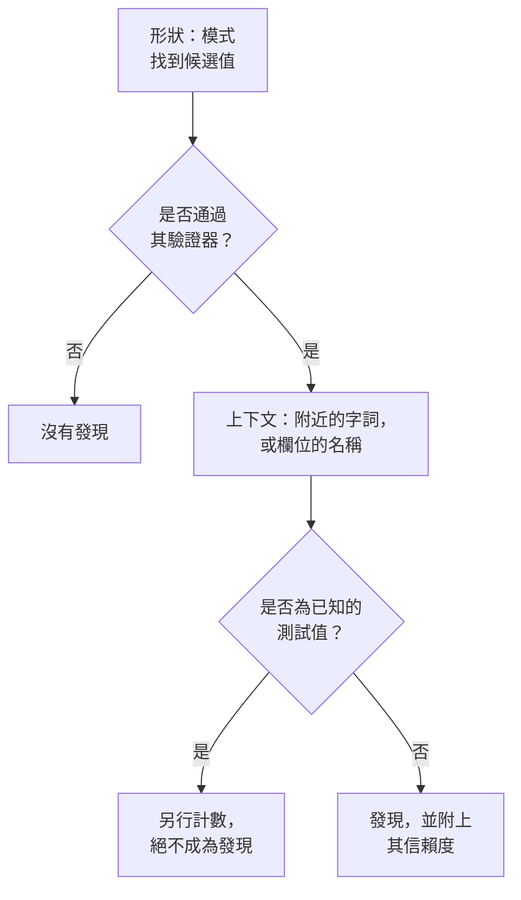

# 敏感資料類型

資料安全認得 143 種敏感資料：卡號、銀行帳戶、43 個國家的國民身分證號碼、健康識別碼、API 金鑰和權杖，以及特殊類別的個人資料。每種都有類別和敏感度，如果它屬於某個國家，還會標明該國家。本頁說明如何找到一個值，並列出每種資料類型，讓你能判斷某項內容為何被找到，並決定如何處理。

:::cards
- [如何找到一個值](#如何找到一個值): 形狀、驗證器、上下文、測試值、信賴度。
- [欄位和資料欄](#欄位和資料欄): 如何判斷整個資料欄或屬性。
- [每種資料類型](#內建資料類型): 全部 143 種，依類別列出。
- [你自己的資料類型](#你自己的資料類型): 員工編號、保單號碼，以及「測試」方塊。
:::

## 如何找到一個值

每次掃描（無論是日誌行、CSV 儲存格、資料庫列，還是物件的前幾個位元組）都會執行相同的步驟：

1. **形狀。** 每種資料類型都有用來找出候選值的模式：十六位數字、`AKIA` 加上十六個字母、一個字詞加上 `@` 和網域。模式絕不會比對到較長字串的其中一段，因此不會在更長的一串數字中找到卡號。
2. **驗證器。** 候選值必須通過其類型自身的規則：總和檢查碼（卡號用 Luhn、IBAN 用 mod 97、Aadhaar 號碼用 Verhoeff，以及大多數國民身分證號碼的檢查碼）、真實存在的日期、已知的前綴，或對祕密而言足夠的隨機性。未通過的候選值根本不會成為發現。`000000000` 和 `123456789` 這類預留位置值在每種數值類型中都無法通過。
3. **上下文。** 候選值附近（預設為其前 64 個字元和其後 32 個字元以內）說明它是什麼的字詞，會將其信賴度提高一級，名稱指向該類型的欄位也是如此。說明它是其他東西（例如訂單號碼或追蹤號碼）的字詞，會將信賴度降低一級。沒有總和檢查碼且形狀常見的數字（例如護照號碼或銀行帳戶）只有在旁邊有指明它的字詞時才會計入。
4. **已知的測試值。** 公開的測試卡號（例如 Stripe 的 `4242 4242 4242 4242`）、範例 IBAN、`example.com` 和其他保留網域上的地址、文件用的 IP 位址、政府文件中印出的範例身分證號碼、`sk_test_` 這類測試模式金鑰以及預留位置金鑰，都會另行計數。它們絕不會產生發現，因此充滿這些值的資料儲存區會被視為測試環境，而不是外洩事件。
5. **信賴度。** 剩下的就是發現，其確定程度取決於證據所能支持的程度。

| 信賴度 | 意義 |
| --- | --- |
| **高** | 值通過了其驗證器，且其周圍的字詞或其所在的欄位說明了它是什麼；或者，對欄位而言，其大部分值都是該類型。 |
| **中** | 值通過了其驗證器，但周圍沒有任何內容可以確認它；或者欄位的名稱說明了它保存什麼，且部分值與之相符。 |
| **低** | 形狀相符，但沒有任何內容可以確認它。 |

只有信賴度為「高」和「中」的發現才會計入：它們會使資料儲存區被視為敏感，並且可能開啟問題。信賴度為「低」的發現會以摺疊方式列在資料儲存區上，供人工判斷。

當兩種資料類型都認定同一段字元時，較確定的發現勝出：先比較信賴度，再看哪個偵測器自身的規則證明得更多，最後看哪個比對結果較長。

較長的值會以 64 KB 的視窗讀取，相鄰視窗重疊 4 KB，因此無論值位於何處都能完整找到，且單一值最多讀取 4 MB。

## 欄位和資料欄

資料欄、JSON 欄位或日誌屬性會作為一個整體來判斷。它的名稱暗示一種資料類型，而它的取樣值則加以證明。包含該類型的值所占的比例，決定了發現的確定程度：

| 包含該類型的值 | 信賴度 |
| --- | --- |
| 60% 以上 | 高 |
| 25% 以上 | 欄位名稱指向該類型時為高，否則為中 |
| 更少 | 欄位名稱指向該類型時為中，否則為低：例如其他內容的資料欄中夾雜的幾個電子郵件 |

值的平均長度超過 80 個字元的欄位屬於自由文字（備註、訊息、描述），預期不會只保存一種類型。它的發現會保留每個符合項目自身獲得的信賴度，並註明它們是在自由文字中找到的。每個欄位最多分類 1,000 個值，每個值最多 16 KB。

欄位的名稱會拆分成字詞（`customerEmail`、`customer_email` 和 `customer-email` 都是「customer email」），當類型的名稱提示中的字詞以相同順序相鄰出現時，就會比對成功：「date of birth」會比對到 `customer_date_of_birth`，而不會比對到 `birth_city`。以點分隔的路徑中，只有最後一部分是欄位自己的名稱；當最後一部分是 `number`、`id` 或 `value` 這類通用字詞時，還會加上它前面的部分：`customer.address.city` 不是街道地址，而 `card.number` 仍然是卡號。

有些資料類型無法從其值判斷：沒有任何模式能區分人名和街道名，或區分宗教和其他任何字詞。這些類型只在欄位有值時，單憑欄位的名稱找出：人名、使用者名稱、性別、國籍、健康資訊、種族或族裔出身、宗教信仰、性傾向、政治觀點、工會會員身分、生物特徵資料、基因資料和犯罪紀錄。此時，如果 60% 以上的值看起來像人名、使用者名稱、性別或國籍，信賴度就是高，否則為中。

名稱表明保存密碼的欄位（`password`、`passwordHash`、`pwd`，但不包括 `password_changed_at`）應該保存雜湊：bcrypt、argon2、scrypt、PBKDF2，或資料儲存區可能使用的其他方案。空值、`********` 這類預留位置值和已加密的值會被排除。在其餘的值中，如果不是雜湊的值多於雜湊，該欄位保存的就是密碼本身，這是任何模式都看不出來的，而該資料儲存區會無法通過 [密碼以純文字儲存](/docs/data-security/checks-and-issues#資料衛生)。

## 敏感度

| 敏感度 | 意義 |
| --- | --- |
| **受限** | 一旦外洩就會造成損害：祕密、卡號、健康紀錄、政府身分證件號碼。 |
| **機密** | 個人資料，以及標示為機密的文件。 |
| **內部** | 企業自身的資料，不供外部人士使用。 |
| **公開** | 沒有找到任何敏感內容。 |

資料儲存區的敏感度，等於其中以至少「中」信賴度找到的最敏感資料類型的敏感度。測試值和標記為不敏感的發現完全不計入，沒有找到任何內容的資料儲存區則為「公開」。若要讓資料儲存區的敏感度高於或低於其發現所顯示的程度，請在資料儲存區的 **設定** 中自行設定其敏感度：之後檢查就會使用該設定。

## 類別

| 類別 | 涵蓋範圍 | 個人資料 |
| --- | --- | --- |
| 祕密和認證資訊 | 能解鎖其他系統的密碼、API 金鑰、權杖和私密金鑰。 | 否 |
| 金融 | 卡號、銀行帳戶、IBAN 和加密貨幣錢包。 | 是 |
| 健康 | 病歷號碼、健康識別碼、診斷和處方。 | 是 |
| 政府身分證件 | 國民身分證、稅籍、護照和社會安全號碼。 | 是 |
| 特殊類別 | GDPR 第 9 條給予最嚴格保護的資料：族裔、宗教、性傾向、政治、工會會員身分、生物特徵資料和基因資料。 | 是 |
| 聯絡和身分 | 某人是誰以及如何聯絡對方：電子郵件、電話、地址、出生日期、IP 位址。 | 是 |
| 商業機密 | 標示為機密、僅限內部或受特權保護的文件。 | 否 |

個人資料是指 GDPR、CCPA、LGPD 和 DPDP 所定義的、與某個人有關的資料。只保存祕密和商業文件的資料儲存區不在隱私框架的範圍內，但絕不會不在安全框架的範圍內（請參閱 [資料安全合規性](/docs/data-security/compliance)）。

## 內建資料類型

屬於某個國家的資料類型會以 ISO 3166-1 代碼標明該國家：資料落地規則和與國家相關的合規框架會讀取它（請參閱 [資料落地](/docs/data-security/flows-access-residency#資料落地規則)）。ID 是 API 和發現用來指稱該類型的名稱。

### 聯絡和身分

| 資料類型 | ID | 說明 | 敏感度 | 國家 |
| --- | --- | --- | --- | --- |
| 電子郵件地址 | `email-address` | 個人的電子郵件地址。 | 機密 | — |
| 電話號碼 | `phone-number` | 國際或國內格式的電話號碼。 | 機密 | — |
| 人名 | `person-name` | 個人的名字、姓氏或全名，依欄位的名稱找出。 | 機密 | — |
| 街道地址 | `postal-address` | 街道地址：門牌號碼、街道名稱和街道類型。 | 機密 | — |
| 郵遞區號 | `postal-code` | 郵遞區號。單憑它就能縮小某人的居住範圍。 | 內部 | — |
| 出生日期 | `date-of-birth` | 旁邊有字詞表明其為某人出生日期的日期。 | 機密 | — |
| IP 位址 | `ip-address` | 公用 IPv4 或 IPv6 位址，GDPR 將其視為個人資料。 | 機密 | — |
| MAC 位址 | `mac-address` | 網路卡的硬體位址，可識別一台裝置。 | 機密 | — |
| 廣告 ID | `advertising-id` | 追蹤單一裝置的行動廣告 ID（IDFA、GAID、AAID）。 | 機密 | — |
| 精確位置 | `geolocation` | 精確到足以找出一棟建築物的緯度和經度。 | 機密 | — |
| 使用者名稱 | `username` | 個人的登入名稱或帳戶名稱，依欄位的名稱找出。 | 機密 | — |
| 性別 | `gender` | 個人的社會性別或生理性別，依欄位的名稱找出。 | 機密 | — |
| 國籍 | `nationality` | 個人的國籍或公民身分，依欄位的名稱找出。 | 機密 | — |
| 車輛識別號碼 | `vehicle-identification-number` | 具有有效檢查碼的 17 字元 VIN。 | 機密 | — |

### 政府身分證件

| 資料類型 | ID | 說明 | 敏感度 | 國家 |
| --- | --- | --- | --- | --- |
| 美國社會安全號碼 | `us-ssn` | 美國社會安全號碼。 | 受限 | US |
| 美國納稅人識別號碼（ITIN） | `us-itin` | 美國個人納稅人識別號碼。 | 受限 | US |
| 美國雇主識別號碼（EIN） | `us-ein` | 美國雇主識別號碼，旁邊須有字詞加以指明。 | 機密 | US |
| 美國護照號碼 | `us-passport` | 美國護照號碼，旁邊須有字詞加以指明。 | 受限 | US |
| 美國駕照號碼 | `us-drivers-license` | 美國駕照號碼，旁邊須有字詞加以指明。 | 受限 | US |
| 英國國民保險號碼 | `uk-nino` | 英國國民保險號碼。 | 受限 | GB |
| 英國護照號碼 | `uk-passport` | 英國護照號碼，旁邊須有字詞加以指明。 | 受限 | GB |
| 英國駕照號碼 | `uk-driving-licence` | 16 字元的英國駕照號碼。 | 受限 | GB |
| 加拿大社會保險號碼 | `ca-sin` | 具有有效檢查碼的加拿大社會保險號碼。 | 受限 | CA |
| 墨西哥 CURP | `mx-curp` | 墨西哥 Clave Única de Registro de Población。 | 受限 | MX |
| 墨西哥 RFC | `mx-rfc` | 墨西哥 Registro Federal de Contribuyentes 稅籍編號。 | 受限 | MX |
| 巴西 CPF | `br-cpf` | 巴西 Cadastro de Pessoas Físicas 號碼。 | 受限 | BR |
| 巴西 CNPJ | `br-cnpj` | 巴西公司登記號碼（CNPJ）。 | 機密 | BR |
| 阿根廷 CUIT / CUIL | `ar-cuit` | 阿根廷稅務或勞動識別碼。 | 受限 | AR |
| 智利 RUT | `cl-rut` | 具有有效檢查碼的智利 Rol Único Tributario。 | 受限 | CL |
| 西班牙 DNI | `es-dni` | 附有檢查字母的西班牙國民身分證件號碼。 | 受限 | ES |
| 西班牙 NIE | `es-nie` | 附有檢查字母的西班牙外國人身分號碼。 | 受限 | ES |
| 葡萄牙 NIF | `pt-nif` | 葡萄牙稅籍識別號碼。 | 受限 | PT |
| 法國社會安全號碼（NIR） | `fr-nir` | 附有兩位數檢查碼的法國 INSEE 號碼。 | 受限 | FR |
| 德國稅籍編號 | `de-tax-id` | 德國 Steuerliche Identifikationsnummer。 | 受限 | DE |
| 義大利 codice fiscale | `it-codice-fiscale` | 具有有效檢查字元的義大利稅務代碼。 | 受限 | IT |
| 荷蘭 BSN | `nl-bsn` | 通過十一檢驗的荷蘭公民服務號碼。 | 受限 | NL |
| 比利時國民號碼 | `be-national-number` | 比利時國民登記號碼。 | 受限 | BE |
| 波蘭 PESEL | `pl-pesel` | 波蘭國民識別號碼。 | 受限 | PL |
| 瑞典個人身分號碼 | `se-personnummer` | 具有有效檢查碼的瑞典 personnummer。 | 受限 | SE |
| 挪威國民身分號碼 | `no-fodselsnummer` | 附有兩個檢查碼的挪威 fødselsnummer。 | 受限 | NO |
| 丹麥 CPR 號碼 | `dk-cpr` | 丹麥民事登記號碼，旁邊須有字詞加以指明。 | 受限 | DK |
| 芬蘭個人身分代碼 | `fi-hetu` | 附有檢查字元的芬蘭 henkilötunnus。 | 受限 | FI |
| 愛爾蘭 PPS 號碼 | `ie-ppsn` | 愛爾蘭個人公共服務號碼。 | 受限 | IE |
| 瑞士 AHV 號碼 | `ch-ahv` | 瑞士社會安全號碼（AHV / AVS）。 | 受限 | CH |
| 羅馬尼亞 CNP | `ro-cnp` | 羅馬尼亞個人數字代碼。 | 受限 | RO |
| 保加利亞 EGN | `bg-egn` | 保加利亞統一公民號碼。 | 受限 | BG |
| 克羅埃西亞 OIB | `hr-oib` | 克羅埃西亞個人識別號碼。 | 受限 | HR |
| 希臘 AMKA | `gr-amka` | 希臘社會安全號碼。 | 受限 | GR |
| 土耳其身分號碼 | `tr-tckn` | 土耳其 T.C. Kimlik 號碼。 | 受限 | TR |
| 以色列身分號碼 | `il-teudat-zehut` | 以色列 Teudat Zehut 號碼。 | 受限 | IL |
| 南非身分證號碼 | `za-id` | 具有有效日期和檢查碼的南非身分號碼。 | 受限 | ZA |
| 阿聯 Emirates ID | `ae-emirates-id` | 阿拉伯聯合大公國身分證號碼。 | 受限 | AE |
| 沙烏地阿拉伯國民身分證 | `sa-national-id` | 沙烏地阿拉伯國民身分證號碼或 iqama 號碼。 | 受限 | SA |
| 印度 Aadhaar 號碼 | `in-aadhaar` | 通過 Verhoeff 檢查的 12 位數 Aadhaar 號碼。 | 受限 | IN |
| 印度 PAN | `in-pan` | 印度永久帳戶號碼。 | 受限 | IN |
| 中國居民身分證號碼 | `cn-resident-id` | 18 字元的中國居民身分證號碼。 | 受限 | CN |
| 日本 My Number | `jp-my-number` | 具有有效檢查碼的日本個人編號。 | 受限 | JP |
| 南韓居民登記號碼 | `kr-rrn` | 韓國居民登記號碼。 | 受限 | KR |
| 新加坡 NRIC / FIN | `sg-nric` | 新加坡身分證號碼或外國人識別號碼。 | 受限 | SG |
| 香港身分證號碼 | `hk-hkid` | 附有檢查碼的香港身分證號碼。 | 受限 | HK |
| 台灣國民身分證號碼 | `tw-national-id` | 台灣國民身分證統一編號。 | 受限 | TW |
| 泰國國民身分證號碼 | `th-national-id` | 泰國公民識別號碼。 | 受限 | TH |
| 馬來西亞 MyKad 號碼 | `my-mykad` | 馬來西亞身分證號碼。 | 受限 | MY |
| 印尼 NIK | `id-nik` | 印尼人口身分號碼。 | 受限 | ID |
| 澳洲稅籍編號 | `au-tfn` | 通過有效檢查的澳洲稅籍編號。 | 受限 | AU |
| 紐西蘭 IRD 號碼 | `nz-ird` | 具有有效檢查碼的紐西蘭稅務局號碼。 | 受限 | NZ |
| 俄羅斯 SNILS | `ru-snils` | 附有檢查號碼的俄羅斯保險帳戶號碼。 | 受限 | RU |
| 俄羅斯 INN | `ru-inn` | 俄羅斯納稅人識別號碼。 | 受限 | RU |
| 護照號碼 | `passport-number` | 任何國家的護照號碼，旁邊須有字詞加以指明。 | 受限 | — |

### 金融

| 資料類型 | ID | 說明 | 敏感度 | 國家 |
| --- | --- | --- | --- | --- |
| 卡號 | `credit-card-number` | 通過 Luhn 檢查且屬於某個卡片品牌的支付卡號碼。 | 受限 | — |
| 卡片安全碼 | `card-verification-code` | CVV 或 CVC，PCI DSS 禁止在付款授權後保留它。 | 受限 | — |
| 卡片到期日 | `card-expiration-date` | 卡片的到期日，旁邊須有字詞加以指明。 | 機密 | — |
| IBAN | `iban` | 通過 mod-97 檢查的國際銀行帳戶號碼。 | 受限 | — |
| 銀行帳戶號碼 | `bank-account-number` | 銀行帳戶號碼，旁邊須有字詞加以指明。 | 受限 | — |
| SWIFT / BIC 代碼 | `swift-bic` | 銀行的 SWIFT 或 BIC 代碼，旁邊須有字詞加以指明。 | 內部 | — |
| 美國銀行匯款路徑號碼 | `us-bank-routing-number` | 具有有效總和檢查碼的 ABA 匯款路徑號碼，旁邊須有字詞加以指明。 | 內部 | US |
| 英國銀行分行代碼 | `uk-sort-code` | 英國銀行分行代碼，旁邊須有字詞加以指明。 | 內部 | GB |
| 印度 IFSC | `in-ifsc` | 標明銀行分行的印度金融系統代碼。 | 內部 | IN |
| 澳洲 BSB | `au-bsb` | 澳洲銀行-州-分行號碼，旁邊須有字詞加以指明。 | 內部 | AU |
| Bitcoin 地址 | `bitcoin-address` | 具有有效總和檢查碼的 Bitcoin 地址。 | 機密 | — |
| Ethereum 地址 | `ethereum-address` | Ethereum 地址，旁邊須有字詞加以指明。 | 機密 | — |

### 健康

| 資料類型 | ID | 說明 | 敏感度 | 國家 |
| --- | --- | --- | --- | --- |
| 英國 NHS 號碼 | `uk-nhs-number` | 具有有效檢查碼的英國國民保健署號碼。 | 受限 | GB |
| 美國 Medicare 受益人 ID | `us-medicare-mbi` | 美國 Medicare 受益人識別碼。 | 受限 | US |
| 澳洲 Medicare 號碼 | `au-medicare-number` | 具有有效檢查碼的澳洲 Medicare 卡號碼。 | 受限 | AU |
| 德國健康保險號碼 | `de-health-insurance-number` | 具有有效檢查碼的德國 Krankenversichertennummer。 | 受限 | DE |
| 病歷號碼 | `medical-record-number` | 病患的病歷號碼，旁邊須有字詞加以指明。 | 受限 | — |
| 健康保險會員 ID | `health-plan-id` | 健康保險的會員號碼或保單號碼，旁邊須有字詞加以指明。 | 受限 | — |
| 診斷代碼（ICD-10） | `diagnosis-code` | ICD-10 診斷代碼，旁邊須有字詞加以指明。 | 受限 | — |
| 藥品代碼（NDC） | `drug-code` | 美國國家藥品代碼，旁邊須有字詞加以指明。 | 機密 | — |
| 美國 DEA 號碼 | `us-dea-number` | 具有有效檢查碼的處方開立者緝毒局號碼。 | 機密 | US |
| 美國醫療提供者 ID（NPI） | `us-npi` | 國家醫療提供者識別碼。它指的是醫療提供者，而不是病患。 | 內部 | US |
| 健康資訊 | `health-information` | 診斷、病況、用藥和其他健康細節，依欄位的名稱找出。 | 受限 | — |

### 祕密和認證資訊

| 資料類型 | ID | 說明 | 敏感度 | 國家 |
| --- | --- | --- | --- | --- |
| AWS 存取金鑰 ID | `aws-access-key-id` | AWS 存取金鑰的公開部分。搭配其祕密即可簽署 AWS 請求。 | 受限 | — |
| AWS 祕密存取金鑰 | `aws-secret-access-key` | AWS 存取金鑰的祕密部分，旁邊須有字詞加以指明。 | 受限 | — |
| Google API 金鑰 | `google-api-key` | Google Cloud 或 Maps 的 API 金鑰。 | 受限 | — |
| Google 服務帳戶金鑰 | `google-service-account-key` | 包含私密金鑰的 Google Cloud 服務帳戶金鑰檔案。 | 受限 | — |
| Google OAuth 用戶端密碼 | `google-oauth-client-secret` | Google OAuth 用戶端密碼。 | 受限 | — |
| Azure 儲存體帳戶金鑰 | `azure-storage-account-key` | Azure 儲存體帳戶金鑰，或包含此金鑰的連線字串。 | 受限 | — |
| Azure SAS 權杖 | `azure-sas-token` | Azure 共用存取簽章，無須登入即可授予存取權。 | 受限 | — |
| Azure 用戶端密碼 | `azure-client-secret` | Microsoft Entra ID 應用程式的用戶端密碼。 | 受限 | — |
| GitHub 權杖 | `github-token` | GitHub 個人存取權杖、OAuth 權杖、應用程式權杖或細微權限權杖。 | 受限 | — |
| GitLab 權杖 | `gitlab-token` | GitLab 個人存取權杖。 | 受限 | — |
| Slack 權杖 | `slack-token` | Slack 機器人、使用者或應用程式權杖。 | 受限 | — |
| Slack Webhook URL | `slack-webhook-url` | Slack 傳入 Webhook，任何人都能透過它張貼到頻道。 | 受限 | — |
| Stripe 祕密金鑰 | `stripe-secret-key` | Stripe 正式環境的祕密金鑰或受限金鑰，可以轉移資金。 | 受限 | — |
| Twilio API 金鑰 | `twilio-api-key` | 附有祕密的 Twilio API 金鑰 SID。 | 受限 | — |
| SendGrid API 金鑰 | `sendgrid-api-key` | SendGrid API 金鑰。 | 受限 | — |
| Mailgun API 金鑰 | `mailgun-api-key` | Mailgun API 金鑰。 | 受限 | — |
| Mailchimp API 金鑰 | `mailchimp-api-key` | Mailchimp API 金鑰。 | 受限 | — |
| OpenAI API 金鑰 | `openai-api-key` | OpenAI API 金鑰，會花費帳戶的點數。 | 受限 | — |
| Anthropic API 金鑰 | `anthropic-api-key` | Anthropic API 金鑰。 | 受限 | — |
| Hugging Face 權杖 | `huggingface-token` | Hugging Face 權杖。 | 受限 | — |
| npm 權杖 | `npm-token` | npm 存取權杖，可以發布套件。 | 受限 | — |
| PyPI 權杖 | `pypi-token` | PyPI 上傳權杖。 | 受限 | — |
| Docker Hub 權杖 | `docker-hub-token` | Docker Hub 個人存取權杖。 | 受限 | — |
| Shopify 權杖 | `shopify-token` | Shopify 存取權杖或應用程式權杖。 | 受限 | — |
| Square 權杖 | `square-token` | Square 存取權杖或祕密。 | 受限 | — |
| Braintree 存取權杖 | `braintree-access-token` | Braintree 正式環境存取權杖。 | 受限 | — |
| DigitalOcean 權杖 | `digitalocean-token` | DigitalOcean 個人存取權杖。 | 受限 | — |
| New Relic API 金鑰 | `new-relic-api-key` | New Relic 使用者 API 金鑰。 | 受限 | — |
| Datadog API 金鑰 | `datadog-api-key` | Datadog API 金鑰或應用程式金鑰，旁邊須有字詞加以指明。 | 受限 | — |
| HashiCorp Vault 權杖 | `vault-token` | HashiCorp Vault 服務權杖。 | 受限 | — |
| Terraform Cloud 權杖 | `terraform-cloud-token` | Terraform Cloud 或 Enterprise API 權杖。 | 受限 | — |
| Atlassian API 權杖 | `atlassian-api-token` | Atlassian API 權杖。 | 受限 | — |
| Linear API 金鑰 | `linear-api-key` | Linear API 金鑰。 | 受限 | — |
| JSON Web 權杖 | `json-web-token` | 已簽署的 JWT，通常是工作階段權杖或存取權杖。 | 受限 | — |
| 私密金鑰 | `private-key` | PEM、OpenSSH 或 PGP 私密金鑰區塊。 | 受限 | — |
| URL 中的密碼 | `password-in-url` | 帶有使用者名稱和密碼的 URL，例如資料庫連線字串。 | 受限 | — |
| 連線字串中的密碼 | `connection-string-password` | 連線字串中的 Password= 或 Pwd= 值。 | 受限 | — |
| Authorization 標頭 | `authorization-header` | 從 HTTP Authorization 標頭複製的 Basic 或 Bearer 認證資訊。 | 受限 | — |
| 密碼或祕密 | `generic-secret` | 指派給密碼、祕密、API 金鑰或權杖的值，且看起來足夠隨機，像是真實的值。 | 受限 | — |
| Bitcoin 私密金鑰 | `bitcoin-private-key` | 錢包匯入格式的 Bitcoin 私密金鑰，具有有效的總和檢查碼。 | 受限 | — |

### 特殊類別

| 資料類型 | ID | 說明 | 敏感度 | 國家 |
| --- | --- | --- | --- | --- |
| 種族或族裔出身 | `racial-or-ethnic-origin` | 種族或族裔，依欄位的名稱找出。 | 受限 | — |
| 宗教信仰 | `religious-belief` | 宗教或信仰，依欄位的名稱找出。 | 受限 | — |
| 性傾向 | `sexual-orientation` | 性傾向，依欄位的名稱找出。 | 受限 | — |
| 政治觀點 | `political-opinion` | 政治觀點或政黨黨籍，依欄位的名稱找出。 | 受限 | — |
| 工會會員身分 | `trade-union-membership` | 工會會員身分，依欄位的名稱找出。 | 受限 | — |
| 生物特徵資料 | `biometric-data` | 指紋、臉部範本、聲紋和其他生物特徵，依欄位的名稱找出。 | 受限 | — |
| 基因資料 | `genetic-data` | DNA 和基因體資料，依欄位的名稱找出。 | 受限 | — |
| 犯罪紀錄 | `criminal-record` | 刑事定罪和犯罪行為（GDPR 第 10 條），依欄位的名稱找出。 | 受限 | — |

### 商業機密

| 資料類型 | ID | 說明 | 敏感度 | 國家 |
| --- | --- | --- | --- | --- |
| 受法律特權保護的文件 | `privileged-document` | 標示為受律師與委託人特權保護或受法律特權保護的文件。 | 受限 | — |
| 標示為機密的文件 | `confidential-document` | 標示為機密、極機密或營業祕密的文件。 | 機密 | — |
| 標示為內部的文件 | `internal-document` | 標示為僅供內部使用或不得散布的文件。 | 內部 | — |

## 你自己的資料類型

為只有你的公司才有的資料新增資料類型：員工編號、保單號碼、專案代碼。前往 **資料安全 → 設定 → 資料類型**，並在 **您的資料類型** 下新增它。從下一次掃描起，它會在儲存貯體、資料庫和遙測中以與內建類型完全相同的方式被掃描。

:::steps
### 說明它是什麼

為它提供 **名稱**（例如員工編號）、**類別** 和 **敏感度**：即保存它的資料儲存區有多敏感。**描述** 會向閱讀其發現的人說明它是什麼。

### 說明如何找到它

輸入 **模式**：比對單一值的 JavaScript 規則運算式，例如 `EMP-\d{6}`。新增保存它的 **欄位名稱**（例如 `employee id`），以及出現在值附近時可確認它屬於此類型的 **關鍵字**。將模式留空，即可只依欄位名稱找出此類型。

### 測試它

將範例文字貼到 **測試** 中，即可查看你的資料類型在其中找到什麼。它會在你的瀏覽器中，對文字執行掃描器本身的程式碼：文字永遠不會傳送到 OneUptime，且只會測試其前 64 KB。
:::

在 **更多欄位** 下，**忽略大小寫** 會不分字母大小寫比對模式，**需要關鍵字** 只在值附近有關鍵字或欄位名稱表明它屬於此類型時才計入該值，**總和檢查碼** 則要求值通過一項檢查：**無**、**Luhn**（卡號所帶的檢查碼）、**Mod97**（IBAN 的檢查碼）或 **Verhoeff**（Aadhaar 號碼的檢查碼）。

模式會在你儲存時接受檢查：它必須能夠編譯、不比對空白文字，且執行時間必須與文字長度成正比。它由絕不回溯的比對器執行，因此無論模式如何撰寫，都不會拖住掃描。一個類型最多可有 50 個關鍵字和 50 個欄位名稱。

當你的類型有總和檢查碼且值通過時，該值單獨出現時為「中」，附近有關鍵字時為「高」；沒有總和檢查碼時，該值單獨出現時為「低」，附近有關鍵字時為「中」。在資料欄中，與所有類型一樣，由符合的值所占的比例決定。

## 不敏感與絕不敏感

掃描可能會找到看似敏感、實則不然的內容：一欄通過 Luhn 檢查的訂單號碼，或每一行日誌中都有的你自己的支援地址。告訴 OneUptime 這一點，它就會停止計入：

- **將發現標記為不敏感。** 在資料儲存區的 **內容** 頁面上，在該發現上選擇 **標記為不敏感** 並說明原因。它將不再計入資料儲存區的敏感度或其檢查，資料儲存區也會立即重新檢查。該發現會連同標記和你的原因保留在資料儲存區上，讓下一個人看到已做出的決定。
- **將值新增到「絕不視為敏感」**，此設定位於資料安全的設定中，適用於在任何地方都永遠不應成為發現的值，例如 `support@yourcompany.com`。值會在掃描器將其正規化之後進行比較，且不區分大小寫。
- **關閉內建資料類型。** 在 **資料安全 → 設定 → 資料類型** 的 **內建資料類型** 下，每種資料類型都有一個開關，切換後會立即儲存。專案的任何掃描都不會尋找已關閉的類型。

## 後續步驟

:::cards
- [資料安全檢查與問題](/docs/data-security/checks-and-issues): 資料儲存區的敏感度會如何影響其問題。
- [遙測中的敏感資料](/docs/data-security/telemetry): 在你的日誌、追蹤和提示中找到的資料類型。
- [資料安全合規性](/docs/data-security/compliance): 每種資料類型會使哪些合規框架適用。
:::
