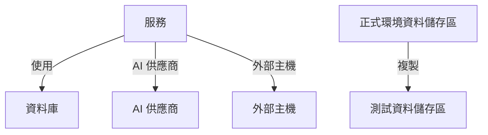

# 資料流、存取與資料落地

知道資料儲存區裡有什麼只是一半。資料安全還會找出這些資料流向何處（哪些服務使用該資料儲存區、資料到達哪些 AI 供應商和外部主機，以及它被複製到哪裡）、誰可以存取每個資料儲存區，以及它是否存放在允許的地區。這一切都來自 OneUptime 已經擁有的證據：你的追蹤、你的雲端自己的存取設定，以及掃描結果的指紋。

:::cards
- [資料流](#資料流): 服務、AI 供應商、外部主機和副本。
- [誰可以存取資料儲存區](#誰可以存取資料儲存區): 你的雲端回報的每項授權，以及資料儲存區的暴露程度。
- [資料落地規則](#資料落地規則): 每種資料可以存放的地區。
:::

## 資料流

| 資料流 | 意義 | 來源 |
| --- | --- | --- |
| **使用** | 服務與資料儲存區通訊。 | 服務地圖，由 OneUptime 每十分鐘根據你的服務的用戶端 span 推算出來。其中的每個資料庫都會依名稱、位址或端點對應到它的資料儲存區，因此沒有其他來源列出的資料庫會成為獨立的資料儲存區。 |
| **AI 供應商** | 服務把資料傳送給 AI 供應商。 | 該服務過去 7 天追蹤中的 AI 呼叫，這些呼叫會指出它們到達的供應商。 |
| **外部主機** | 服務呼叫你的系統之外的主機。 | 服務地圖中的遠端服務，依呼叫它們所用的位址識別。 |
| **複製** | 一個資料儲存區含有另一個資料儲存區的值。 | 每次掃描找到的值的指紋：當兩個資料儲存區對同一資料類型的指紋重疊一半或以上時，它們就共有資料。 |

資料流帶有其來源所含的資料類型及其敏感度。當掃描證明資料確實存在，而不只是有一條通往它的路徑時，資料流即為已確認：副本一律是已確認的，而 AI 供應商資料流在該服務的 AI 對話含有機密或受限資料時為已確認。30 天內未再出現的資料流會被移除。

有兩項檢查會讀取資料流。[正式環境資料被複製到非正式環境的資料儲存區](/docs/data-security/checks-and-issues#資料衛生) 會在副本的目的地上失敗。當兩者中只有一個位於正式環境時，副本從正式環境的資料儲存區出發，否則從 OneUptime 先找到的資料儲存區出發。[敏感資料正被傳送給 AI 供應商](/docs/data-security/checks-and-issues#ai) 會在服務的 AI 對話含有敏感資料時於其上失敗，並指出它們到達的供應商。

### 指紋如何保持私密

找出副本不需要任何一個資料儲存區的值。對於掃描以高信賴度找到的每個資料類型，它會把讀取到的值摘要為一個 MinHash：128 個槽位，每個槽位是某個雜湊函式在這些值上的最小值，且只保留其低 16 位元。兩個摘要相符的槽位比例，大約等於兩組值的重疊比例，因此比較摘要即可估計一個資料儲存區有多少內容存在於另一個之中。

- **值會以專案自己的金鑰進行雜湊**（HMAC-SHA256），因此沒有金鑰的人無法拿已知的值與摘要比對，兩個專案的摘要也永遠無法互相比較。
- **每個最小值只有 16 位元會離開掃描。** 無法從摘要讀回任何值，也無法讀回任何值的雜湊。
- **摘要針對的是資料類型，而不是欄位。** 資料儲存區中每個以高信賴度找到的資料類型各有一個摘要，除此之外沒有別的。

## 誰可以存取資料儲存區

設定讀取會把每個雲端自己的存取設定（儲存貯體政策和 ACL、Azure 角色指派、Google Cloud IAM 繫結、快照共用）整理成一份誰可以存取該資料儲存區的清單，顯示在它的 **誰可以存取** 頁面上：

| 欄 | 說明 |
| --- | --- |
| **主體** | 誰或什麼具有存取權，依雲端的命名方式：`*`、帳戶 ID、ARN、電子郵件、服務帳戶。 |
| **主體類型** | 公開、帳戶、角色、使用者、群組、服務主體、服務帳戶或服務。 |
| **存取層級** | 讀取、寫入或管理員。 |
| **授予方式** | 授予它的來源：儲存貯體政策、ACL、角色指派、IAM 繫結或快照共用。 |
| **外部** | 主體位於連線到 OneUptime 的帳戶、訂用帳戶和專案之外。 |
| **公開** | 主體是網際網路上的任何人。 |

每次讀取設定時都會重新讀取這份清單，雲端不再回報的授權會被移除。[超過 25 個身分可以讀取受限資料](/docs/data-security/checks-and-issues#存取) 會計算其中的讀取者。使用資料儲存區的服務就是它的 **使用** 資料流。

根據讀取到的內容，每個資料儲存區都會得到一個暴露程度：

| 暴露 | 意義 |
| --- | --- |
| **公開** | 網際網路上的任何人都可以讀取它。 |
| **其他帳戶** | 你已連線帳戶以外的帳戶可以存取它。 |
| **可從網際網路存取** | 它的網路端點接受來自網際網路的連線。 |
| **私人** | 只有你自己的帳戶和網路可以存取它。 |
| **未知** | OneUptime 無法讀取足夠的設定來判斷。 |

公開優先於共用，共用優先於可存取：同時與另一個帳戶共用的公開儲存貯體，其暴露為公開。暴露會增加問題的 [風險分數](/docs/data-security/checks-and-issues#風險分數)。

## 資料落地規則

資料落地規則規定某種資料可以存放在哪裡。請在 **資料安全 → 設定 → 資料落地規則** 中新增：

| 欄位 | 作用 |
| --- | --- |
| **名稱** | 規則是什麼，例如「歐盟個人資料留在歐盟」。 |
| **允許的地區** | 資料可以儲存和複製到的地區，依你的雲端的命名方式書寫。沒有任何地區的規則不會檢查任何內容。 |
| **資料類別** | 它涵蓋的資料類別。留空則涵蓋所有種類的個人資料。 |
| **資料主體所在地** | 只涵蓋關於這些國家的人的資料，以 ISO 3166-1 代碼表示，例如 `DE` 或 `IN`。留空則涵蓋關於任何地方的人的資料。 |
| **描述** | 規則的用途，例如「我們歐盟客戶的資料只儲存在歐盟」。 |
| **已啟用** | 是否依此規則檢查資料儲存區。 |

當資料儲存區含有規則涵蓋的資料，而且它自己的地區，或其資料被複製到的某個地區，不符合任何允許的地區時，它就違反了該規則。副本是指資料儲存區的資料被複寫到的地區：S3 複寫、儲存體帳戶的異地備援副本、資料庫的複本。此時該資料儲存區會在 [資料儲存在其允許的地區之外](/docs/data-security/checks-and-issues#資料落地) 上失敗，並附上地區和它違反的規則。

### 地區和萬用字元

允許的地區中的 `*` 代表任意字元，大小寫視為相同，而且模式必須符合整個地區：

| 允許的地區 | 符合 | 不符合 |
| --- | --- | --- |
| `eu-*`（AWS） | `eu-west-1`、`eu-central-1` | `us-east-1`、`us-eu-1` |
| `europe-*`（Google Cloud） | `europe-west1`、`europe-north1` | `us-central1` |
| `westeurope`（Azure） | `westeurope` | `northeurope` |

為你使用的每個雲端各列出一個模式：`eu-*`、`europe-*`、`westeurope` 和 `northeurope` 合在一起，就能在三個雲端上都把資料留在歐洲。

### 資料儲存區保存誰的資料

OneUptime 從資料本身判斷資料儲存區保存的是誰的資料。屬於某個國家的資料類型表示其當事人位於該國：德國稅號表示 `DE`，印度 Aadhaar 號碼表示 `IN`，英國 NHS 號碼表示 `GB`。資料儲存區會把這些國家列為其資料主體所在國家，而僅限於某些國家人士的規則，只涵蓋保存這些人資料的資料儲存區。[敏感資料類型](/docs/data-security/data-types#內建資料類型) 列出每個有所屬國家的資料類型的國家。

## 後續步驟

:::cards
- [資料安全檢查與問題](/docs/data-security/checks-and-issues): 這些資料流、授權和規則所提供資料的每項檢查。
- [資料安全合規性](/docs/data-security/compliance): 資料落地和存取如何計入 GDPR、LGPD 和 DPDP。
- [拓撲](/docs/telemetry/topology): 資料流所來自的服務地圖。
:::
