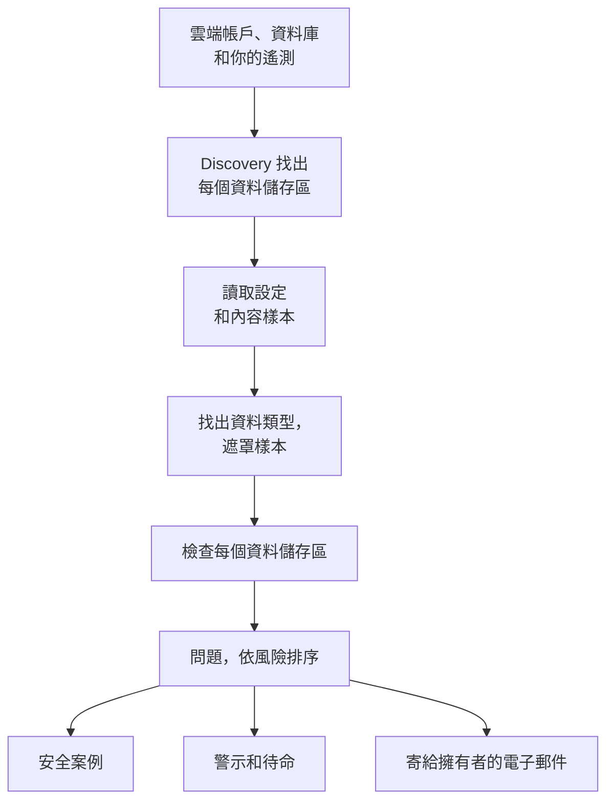

# 資料安全

資料安全會找出你的公司所保存的敏感資料，包括雲端儲存貯體、資料庫和資料倉儲中的資料，以及你傳送給 OneUptime 的遙測，並告訴你這些資料的保存方式有哪些缺失。它會自行找出資料儲存區，讀取每個資料儲存區的設定方式，對其中保存的內容取樣，並為每個缺失開啟一個問題，依風險排序。

它能回答四個疑問：

:::cards
- [我們的敏感資料在哪裡？](/docs/data-security/data-types): 143 種資料類型，從卡號、國民身分證號碼到 API 金鑰，可在儲存貯體、資料表和遙測中找到。
- [資料是否暴露在外？](/docs/data-security/checks-and-issues): 對每個資料儲存區進行 32 項檢查：公開存取、加密、備份、日誌記錄、祕密和複本。
- [誰可以存取它，它又流向哪裡？](/docs/data-security/flows-access-residency): 誰可以讀取每個資料儲存區、哪些服務使用它，以及它的資料會到達哪些 AI 供應商和主機。
- [它符合我們的規定嗎？](/docs/data-security/compliance): 資料落地規則，以及根據掃描結果評分的九個合規框架。
:::

## 運作方式

1. **Discovery** 會找出 OneUptime 已經知道的資料儲存區：你的雲端資源清單、Database 產品所監控的資料庫、服務地圖上你的服務所連線的資料庫，以及每個服務的遙測。只有在沒有任何來源列出某個資料儲存區時，你才需要手動新增它。
2. **設定讀取** 會向每個雲端詢問其中每個資料儲存區的設定方式：誰可以存取它，以及它如何加密、備份和記錄日誌。它只讀取設定，從不讀取資料。
3. **內容樣本** 會在你允許的地方，讀取資料儲存區所保存內容的一小部分：儲存貯體中每種物件的少數幾個、每個資料表的部分列，以及每個服務遙測中最新的記錄。
4. **分類** 會在樣本中找出敏感值，只保留計數和遮罩樣本，從不保留值本身。
5. **檢查** 會判斷每個資料儲存區有哪些缺失，以及對其保存的資料而言有多嚴重。每個未通過的檢查都會開啟一個問題，問題會在檢查通過後自行關閉。

## 有何不同

- **你的遙測也是資料儲存區。** 每個服務的日誌、追蹤、例外、工作階段重播和 AI 對話，都會像儲存貯體一樣每小時檢查一次。日誌行中的電子郵件地址就是一項發現，而 **清除** 會從那時起在擷取時將它遮罩。請參閱 [遙測中的敏感資料](/docs/data-security/telemetry)。
- **資料流來自真實流量。** 服務地圖會說明哪個服務使用哪個資料庫，AI 呼叫會指明它們連到的供應商，正式環境資料的複本則是透過比對指紋找到的。請參閱 [資料流、存取與資料落地](/docs/data-security/flows-access-residency)。
- **證據一律經過遮罩。** 一項發現只保留計數和最多三個遮罩樣本，例如 `j***@e******.com`，這些樣本在離開掃描器之前就已在掃描器內部完成遮罩。關閉樣本後，它只保留計數。
- **掃描器是開放原始碼的。** 每種資料類型的模式、總和檢查碼、上下文字詞和測試值都在 OneUptime 的原始碼中，因此你可以確切了解一項發現是如何產生的。同一套程式碼在 OneUptime 的工作程序、探測器以及 **測試** 方塊中執行。
- **它與 OneUptime 的其他部分協同運作。** 「嚴重」問題會針對該資料儲存區開啟安全案例，讓 [Security Operations](/docs/telemetry/security-cases) 像處理任何其他威脅一樣處理它。它可以發出警示來呼叫正在待命的人員，並以電子郵件通知資料儲存區的擁有者。請參閱 [資料安全整合](/docs/data-security/integrations)。
- **OneUptime AI 協助修正。** **用 AI 說明** 會告訴資料儲存區的擁有者哪裡不對，以及如何在其雲端上修正，**用 AI 修正** 則會在你的基礎架構程式碼中開啟提取要求。

## 開始之前

- **能設定它的角色。** Project Owner、Project Admin 和 Security Admin 可以變更資料安全的設定。Security Member 可以處理問題和掃描資料儲存區，Security Viewer 可以讀取它找到的內容。除非其團隊被授予相應的權限，否則其他角色什麼也看不到：哪些儲存貯體保存了卡號，正是攻擊者想知道的事。請參閱 [角色](/docs/permissions/reference#角色)。
- **一個要讀取的雲端帳戶，或一個資料庫。** 資料安全透過 [雲端連線](/docs/telemetry/cloud-accounts) 讀取雲端帳戶，並透過唯讀連線字串讀取你自行執行的資料庫。遙測不需要任何設定：它每小時掃描一次。

## 快速入門

:::steps
### 連線雲端帳戶

前往 **雲端 → 連線**，然後選擇你的雲端。如果帳戶已經連線，請改為在其連線上選擇 **編輯**。[連線雲端帳戶](/docs/telemetry/cloud-accounts) 會逐一介紹每種雲端。

### 選擇資料安全層級

在 **更多欄位** 下，將 **資料安全** 設為 **僅設定** 以檢查每個資料儲存區的設定方式，或設為 **設定和內容樣本** 以同時找出其中的敏感資料。表單顯示的指令會隨你的選擇而改變：請依表單的說明，在你的雲端的終端機中執行它。[設定資料安全](/docs/data-security/setup) 列出了每個層級確切授予的權限，[連線雲端帳戶](/docs/telemetry/cloud-accounts#資料安全) 則顯示了每個層級的指令。

### 檢閱問題

開啟 **資料安全**。探索每 15 分鐘執行一次，找到的資料儲存區會出現在 **資料儲存區** 下，而連線的設定會在一小時內讀取。讀取或掃描一完成，問題就會在 **問題** 下開啟，每個都附有風險分數，**概覽** 則會顯示風險最高的五個。每個問題都會說明哪裡不對、為什麼重要以及如何修正，並附上適用於你的雲端的指令。
:::

## 哪些算是資料儲存區

| 位置 | 資料儲存區 | 內容樣本 |
| --- | --- | --- |
| AWS | AWS S3 Bucket、AWS RDS Instance、AWS Aurora Cluster、AWS RDS Snapshot、AWS DynamoDB Table、AWS Redshift Cluster、AWS DocumentDB Cluster、AWS OpenSearch Domain、AWS ElastiCache Cluster、AWS EFS File System | AWS S3 Bucket |
| Azure | Azure Storage Account、Azure SQL Database、Azure Cosmos DB Account、Azure PostgreSQL Server、Azure MySQL Server | Azure Storage Account |
| Google Cloud | Google Cloud Storage Bucket、Google Cloud SQL Instance、Google BigQuery Dataset、Google Firestore Database、Google Spanner Instance、Google Bigtable Instance | Google Cloud Storage Bucket、Google BigQuery Dataset |
| 你自行執行的資料庫 | PostgreSQL、MySQL、MongoDB、SQL Server、Oracle、Redis、Elasticsearch | PostgreSQL、MySQL |
| OneUptime | 日誌、追蹤、例外、工作階段重播、AI 對話 | 日誌、追蹤、例外、工作階段重播、AI 對話 |

每個資料儲存區都會執行適用於其種類的檢查。無法對內容取樣的資料儲存區仍會接受檢查：公開的儲存貯體或未加密的資料庫，無論其中保存什麼，都是缺失。

一旦來源不再列出某個資料儲存區，它就會連同其歷程一起封存，其未解決的問題也會變為已解決：資料安全選單末端的 **已封存的資料儲存區** 會保留它。如果來源再次列出它，它會自行恢復，而檢查仍未通過的問題會重新開啟。

資料儲存區的 **時間軸** 會說明它發生了什麼事，以及是誰做的：它何時被找到或新增、對其設定和擁有者的每次變更、它何時被封存或恢復，以及每次從問題或劇本關閉的暴露。

## 執行頻率

| 項目 | 時間 |
| --- | --- |
| 找出新的資料儲存區 | 每 15 分鐘 |
| 讀取雲端連線的設定 | 每天一次，以及在 CloudTrail 記錄到 AWS 資料儲存區的存取、加密、備份或共用發生變更後的一小時內 |
| 對資料儲存區的內容取樣 | 每 24 小時，或依 **掃描間隔（小時）** 設定的頻率 |
| 對每個服務的遙測取樣 | 每小時一次，取樣最近一小時的遙測 |
| 重新檢查每個資料儲存區 | 每次讀取和掃描之後、你變更任何檢查所依賴的內容之後，以及每天一次 |

資料儲存區上的 **立即掃描** 會立即對其內容取樣，**立即檢查** 則會重新讀取其設定。

## 後續步驟

:::cards
- [設定資料安全](/docs/data-security/setup): 三個層級、每個層級授予的權限，以及掃描你自己的資料庫。
- [敏感資料類型](/docs/data-security/data-types): 如何找到一個值，以及資料安全所知的每種資料類型。
- [資料安全檢查與問題](/docs/data-security/checks-and-issues): 每項檢查、風險分數，以及問題會經歷什麼。
- [資料安全整合](/docs/data-security/integrations): 安全案例、警示、擁有者、工作流程和 OneUptime AI。
:::
