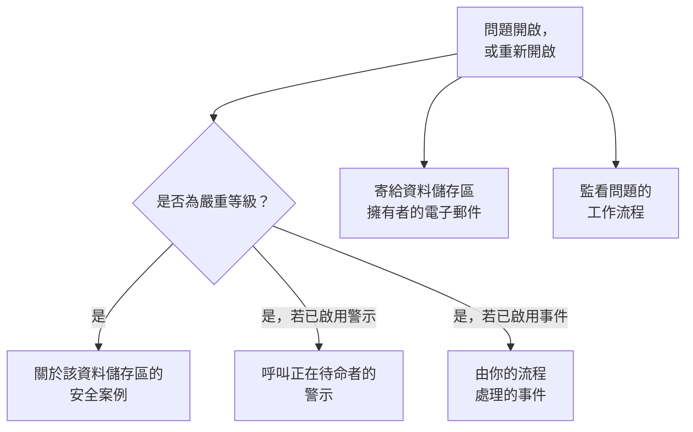

# 資料安全整合

資料安全沒有自己的呼叫系統或安全佇列。它把發現的內容交給 OneUptime 中已經負責這些工作的部分：嚴重問題會成為安全案例，也可以呼叫正在待命的人或宣告事件，而每個新問題都會以電子郵件寄給資料儲存區的擁有者。工作流程、OneUptime AI、API、Terraform 和 MCP 伺服器都能存取它保存的一切。

:::cards
- [安全營運](#安全營運): 為每個有嚴重問題的資料儲存區開啟一個安全案例。
- [警示與待命](#警示與待命): 嚴重問題開啟時，呼叫正在待命的人。
- [事件](#事件): 為應由事件流程處理的資料外洩宣告事件。
- [擁有者](#擁有者): 每個資料儲存區由誰擁有（手動設定或由規則設定），以及他們收到的電子郵件。
- [OneUptime AI](#oneuptime-ai): 說明問題、開啟修正它的提取要求，或向「詢問 AI」詢問你的資料。
- [消除暴露](#消除暴露): 從問題或劇本封鎖公開存取或停止共用。
:::

## 運作方式

評估開啟問題或重新開啟問題時，這些動作都會執行。每一項都是盡力而為：問題已經開啟並記錄在其時間軸上，因此失敗的整合會被記錄並略過，絕不會因重試而產生第二個案例或第二次呼叫。每一項做了什麼都會寫入問題的 **時間軸**，問題的頁面也會連結到它所啟動的案例、警示和事件。

| 設定 | 預設值 | 作用 |
| --- | --- | --- |
| **開啟安全案例** | 開啟 | 嚴重問題會開啟一個安全案例，依資料儲存區分組。 |
| **發出警示** | 關閉 | 嚴重問題會發出警示，呼叫正在待命的人。 |
| **警示嚴重性** | 空白 | 這些警示的嚴重性。空白表示專案中最嚴重的等級。 |
| **宣告事件** | 關閉 | 嚴重問題會宣告事件，由你的事件流程處理。 |
| **事件嚴重性** | 空白 | 這些事件的嚴重性。空白表示專案中最嚴重的等級。 |
| **通知擁有者** | 開啟 | 每個新問題都會以電子郵件寄給其資料儲存區的擁有者。 |

## 安全營運

每個資料儲存區在安全營運中都是一個獨立的實體，類型為 **資料儲存區**。啟用 **開啟安全案例** 時，嚴重問題會作為關於該資料儲存區的偵測傳送到安全營運：

- 它的來源是 **資料安全**，它的規則以檢查命名，例如 `Data Security: public-read`；
- 它是嚴重等級，因此它開啟的案例使用專案的嚴重優先順序；
- 它依資料儲存區分組：同一資料儲存區上的第二個嚴重問題會加入關於它的未結案例，而不會另外開啟一個。

之後，案例會像其他案例一樣被處理：被指派、加上備註、關閉，並由專案的劇本回應。資料儲存區的偵測會像任何實體的偵測一樣，計入它在 [實體風險](/docs/telemetry/security-entity-risk) 上的風險。請參閱 [安全案例與劇本](/docs/telemetry/security-cases)。

## 警示與待命

啟用 **發出警示** 時，嚴重問題會發出一個警示，名稱為「Data Security:」加上問題的標題和資料儲存區。警示會像其他警示一樣，透過它自己的規則呼叫正在待命的人（請參閱 [警示](/docs/alerts/index) 和 [待命](/docs/on-call/index)）。無論問題被評估多少次，一個問題同一時間最多只有一個未解決的警示。**警示嚴重性** 設定警示的嚴重性；留空時為專案中最嚴重的等級。

警示隨其問題結束：一旦問題不再是未解決狀態（它的檢查通過，或有人將它標記為已解決、接受其風險或表示它不是問題），警示就會被解決，問題的 **時間軸** 也會記錄這一點。重新開啟的問題會發出新的警示。

警示預設為關閉，因為大多數團隊希望資料安全的發現先進入安全案例。當一個存有卡號的公開儲存貯體應該把某人叫醒時，請啟用警示。

## 事件

啟用 **宣告事件** 時，嚴重問題會宣告一個與其警示同樣命名的事件，用於應由你的事件流程處理的資料外洩：待命、工作區頻道、狀態頁面和事後分析（請參閱 [事件](/docs/incidents/index)）。一個問題同一時間最多只有一個未解決的事件。**事件嚴重性** 設定事件的嚴重性；留空時為專案中最嚴重的等級。

即使問題已解決，資料安全也絕不會解決事件：事件可能帶有狀態頁面和事後分析，因此由負責處理它的人來關閉。安全案例是通往事件的另一條路：案例上的 **宣告事件** 會開啟一個與它連結的事件（請參閱 [宣告事件](/docs/telemetry/security-cases#宣告事件)）。

## 擁有者

資料儲存區的擁有者是人員和團隊，列在資料儲存區的 **擁有者** 頁面上。問題是為他們而開的：他們會收到電子郵件，而 **此敏感資料儲存區沒有擁有者** 會在沒有擁有者的敏感資料儲存區上失敗。

啟用 **通知擁有者** 時，每次在資料儲存區上開啟問題的評估都會寄一封電子郵件給它的擁有者（擁有它的人，以及擁有它的團隊的成員，最多 50 人），標題說明資料儲存區有多少個新問題，例如「Data Security: 2 new issues on orders-db」。郵件列出每個新問題的嚴重性和標題，以及資料儲存區的敏感度，並連結到該資料儲存區。郵件絕不包含樣本。

### 擁有者規則和標籤規則

規則會在找到資料儲存區時，替你設定擁有者和標籤：

| 規則 | 位置 | 作用 |
| --- | --- | --- |
| **擁有者規則** | **資料安全 → 規則 → 擁有者規則** | 為每個符合的資料儲存區新增擁有者使用者和團隊 |
| **標籤規則** | **資料安全 → 規則 → 標籤規則** | 為每個符合的資料儲存區新增標籤 |

規則可依資料儲存區的標籤、依其名稱或描述的模式，或依 **雲端標記模式** 比對資料儲存區：這個模式會與資料儲存區的每個雲端標記逐一比對，標記寫作 `key=value`。`^team=payments$` 符合每個標記為 `team=payments` 的資料儲存區，`^env=` 符合每個帶有 `env` 標記的資料儲存區。新的資料儲存區一被找到就會套用專案的規則，而擁有者規則的 **通知擁有者** 決定是否通知它所新增的擁有者。[標籤與擁有者規則](/docs/configuration/label-and-owner-rules) 說明每條規則如何比對，以及規則何時執行。

## 工作流程

**資料儲存區** 和 **資料安全問題** 是工作流程觸發器，各有 **建立時**、**更新時**、**建立或更新時** 和 **刪除時**。請在 **新增觸發器** 面板的 **OneUptime 資源** 下選擇它們。

- **資料安全問題 → 建立時** 會在問題第一次開啟時執行。在 **If / Else** 區塊中讀取它的嚴重性，把嚴重的問題張貼到頻道，或在你的追蹤系統中開立工單。
- **資料安全問題 → 更新時**，在 **要監看的欄位** 設為其狀態時，會在問題被解決、被接受或重新開啟時執行。
- **資料儲存區 → 建立時** 會在探索找到資料儲存區時執行，例如用來把每個新的儲存貯體告知某個團隊。

每個觸發器傳遞的欄位，請參閱 [工作流程觸發器](/docs/workflows/triggers)。

## OneUptime AI

問題上有兩個動作會請 OneUptime AI 協助。兩者都會把問題的標題和嚴重性、資料儲存區的名稱、種類、地區和雲端 ID、它的敏感度和資料類型、證據、這項檢查為何重要，以及針對資料儲存區所在雲端的修正方法傳送給 OneUptime AI，但絕不傳送發現的樣本。兩者都受專案的 OneUptime AI 開關和限制約束。

- **用 AI 說明** 會為資料儲存區的擁有者寫出哪裡有問題、可能發生什麼，以及在其雲端上修正它的確切步驟。說明會保存在問題的 **時間軸** 上。任何能讀取資料安全的人都可以要求。
- **用 AI 修正** 會請 OneUptime AI 以能讓檢查通過的最小變更，在你的基礎架構程式碼（Terraform、CloudFormation、Bicep 等）中修正問題，並開啟提取要求。它需要在 **程式碼** 下連線保存資料儲存區基礎架構程式碼的儲存庫：專案有多個儲存庫時，請在 **儲存庫** 下選擇。提取要求會出現在 **程式碼** 下（請參閱 [程式碼](/docs/ai/ai-agent)）。Security Member 及以上的角色可以要求。

### 詢問 AI

**詢問 AI** 也會讀取資料安全。在任何資料安全頁面上，你可以詢問哪些資料儲存區保存卡號、應該先修正什麼，或某個角色外洩時能存取哪些資料儲存區；在資料儲存區或問題的頁面上，它會先讀取該記錄。它使用三個讀取工具回答，並以你自己的權限執行：

| 工具 | 讀取的內容 |
| --- | --- |
| `query_data_stores` | 資料儲存區，風險最高的在前，可依敏感度、資料類型、暴露、供應商或名稱查詢；或單一資料儲存區，包括在哪裡找到了什麼、誰可以存取它，以及它的未解決問題 |
| `query_data_security_issues` | 問題，風險最高的在前，可依狀態、嚴重性、資料儲存區或檢查查詢；或單一問題，包括它的證據和針對其雲端的修正方法 |
| `query_data_store_access` | 誰可以存取某個資料儲存區，或某個主體可以存取的每個資料儲存區 |

它們讀取資料類型、位置和計數，絕不讀取發現的樣本，無論是否已遮罩。詢問 AI 不會變更資料安全中的任何內容。

## 消除暴露

有兩種變更可以消除雲端資料儲存區的暴露，兩者都透過已開啟 **資料安全回應** 的資料儲存區雲端連線進行（請參閱 [設定資料安全](/docs/data-security/setup#讓資料安全關閉暴露)）：

- **封鎖公開存取**，適用於 S3 儲存貯體、Azure 儲存體帳戶或 Cloud Storage 儲存貯體。
- **撤銷共用**，適用於 RDS 快照，或 RDS 資料庫、Aurora 叢集或 DocumentDB 叢集的共用手動快照。

人員可以在它所修正的未解決問題上，用 **在此修正** 執行其中一種（請參閱 [資料安全檢查與問題](/docs/data-security/checks-and-issues#在此修正)）。安全營運的劇本會把它們作為 **遏制** 類別的步驟執行，即 **封鎖資料儲存區的公開存取** 和 **撤銷資料儲存區共用**：作用於案例涉及的每個資料儲存區，最多 10 個，每個步驟一開始都開啟 **需要核准**。標記為 **刻意公開** 的資料儲存區永遠不會被封鎖。無論哪種方式，資料儲存區的動態都會說明做了什麼，並且會立即重新檢查該資料儲存區，因此變更生效後問題就會解決。

## API、Terraform 和 MCP

資料安全保存的一切都是 OneUptime API 的記錄，讀取時使用與儀表板相同的權限（請參閱 [API 參考](/docs/api-reference/api-reference)）：

| 記錄 | API 路徑 |
| --- | --- |
| 資料儲存區、其時間軸、其發現以及誰可以存取它們 | `/data-store`、`/data-store-feed`、`/data-store-finding`、`/data-store-access` |
| 問題、其時間軸和資料流 | `/data-security-issue`、`/data-security-issue-feed`、`/data-security-flow` |
| 掃描 | `/data-security-scan` |
| 自訂資料類型、檢查設定和資料落地規則 | `/data-security-custom-data-type`、`/data-security-check-setting`、`/data-security-residency-rule` |
| 專案的設定 | `/data-security-setting` |
| 擁有者、擁有者規則和標籤規則 | `/data-store-owner-user`、`/data-store-owner-team`、`/data-store-owner-rule`、`/data-store-label-rule` |

有幾項回應是在請求時才計算，而不是預先儲存。每一項都是 `POST`：

| 路徑 | 作用 |
| --- | --- |
| `/data-security/overview` | 概覽的數據：依敏感度和類別劃分的資料儲存區、依嚴重性劃分的未解決問題、風險最高的問題，以及最近 30 天的問題 |
| `/data-security/compliance` | 每個框架的分數和要求 |
| `/data-security/record-of-processing` | GDPR 處理活動記錄，每個保存個人資料的資料儲存區一列 |
| `/data-store/<id>/scan-now` | **立即掃描**：立即對資料儲存區的內容抽樣 |
| `/data-store/<id>/check-now` | **立即檢查**：重新讀取資料儲存區的設定並執行其檢查 |
| `/data-store-finding/<id>/scrub` | 遙測發現上的 **清除** |
| `/data-security-issue/<id>/explain` | 問題上的 **用 AI 說明** |
| `/data-security-issue/<id>/fix-with-ai` | 問題上的 **用 AI 修正** |
| `/data-store/<id>/response-actions` | 資料儲存區目前可以執行哪些回應動作，以及不能執行的原因 |
| `/data-store/<id>/respond` | 對資料儲存區執行 **封鎖公開存取** 或 **撤銷共用**，並附上執行它的問題 |

[Terraform 提供者](/docs/terraform/index) 為你建立的每種記錄（你自己新增的資料儲存區、自訂資料類型、檢查設定、資料落地規則、擁有者規則和標籤規則）都提供一個以該記錄命名的資源，例如 `oneuptime_residency_rule`。

[MCP 伺服器](/docs/ai/mcp-server) 為這些記錄提供建立、取得、列出、更新、刪除和計數工具：Data Store、Data Store Finding、Data Store Access Entry、Data Flow、Data Security Issue、Data Security Scan、Custom Data Type、Check Setting、Residency Rule 和 Data Security Setting。如此一來，AI 助理就能以你的權限詢問哪些資料儲存區保存卡號，或某個儲存貯體上有哪些未解決的問題。

## 後續步驟

:::cards
- [安全案例與劇本（SOAR）](/docs/telemetry/security-cases): 處理資料安全開啟的案例。
- [標籤與擁有者規則](/docs/configuration/label-and-owner-rules): 規則如何比對，以及何時執行。
- [工作流程觸發器](/docs/workflows/triggers): 在問題開啟或找到資料儲存區時執行工作流程。
- [資料安全檢查與問題](/docs/data-security/checks-and-issues): 每個問題的意義，以及如何修正。
:::
