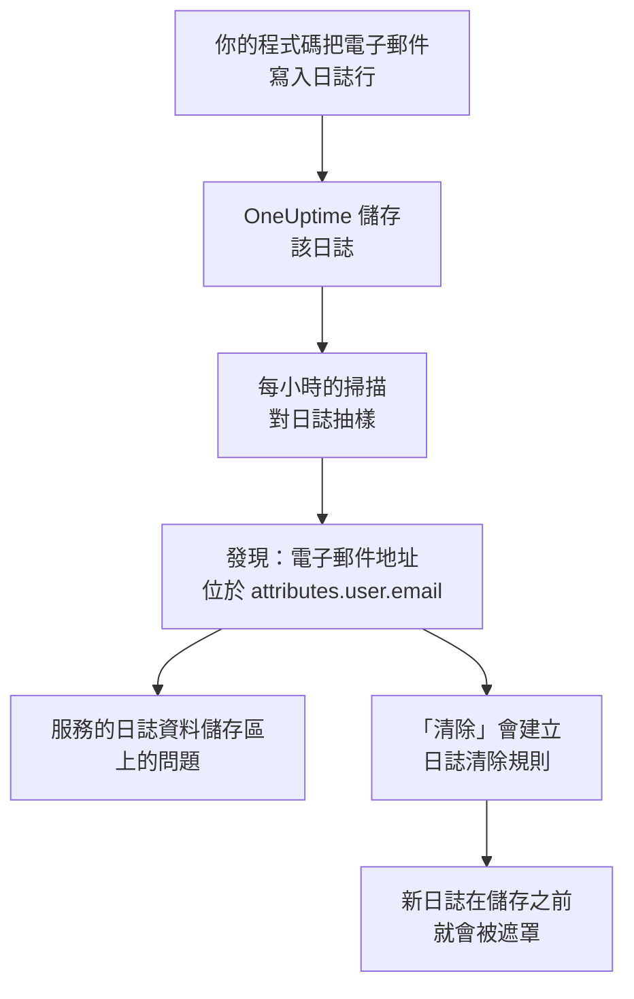

# 遙測中的敏感資料

遙測會保存你的程式碼寫入的任何內容：日誌行中的電子郵件地址、span 屬性中的卡號、堆疊追蹤中的權杖、提示中的客戶問題、指標標籤中使用者的 IP 位址。資料安全把每個服務的日誌、追蹤、指標、例外和 AI 對話，以及每個 RUM 應用程式的工作階段，各自視為獨立的資料儲存區。它每小時對它們抽樣，像在儲存貯體中一樣在其中找出敏感資料，而 **清除** 會把發現轉為規則，從此在發現它的服務中於擷取時隱藏這些資料。

不需要任何設定：每個服務的遙測每小時都會被掃描，除非專案設定中的 **掃描遙測** 已關閉。若要排除某個服務的日誌、追蹤或其他訊號，請在該資料儲存區的 **設定** 中關閉 **掃描內容**：從下一次掃描起，其中的任何內容都不會被讀取。

:::cards
- [讀取的內容](#讀取的內容): 每種訊號的屬性、本文、訊息和提示。
- [掃描如何抽樣](#掃描如何抽樣): 每個服務最新的記錄，每小時一次。
- [清除](#清除): 在發現它的服務中，於擷取時隱藏發現。
- [自行遏制](#自行遏制): 在已證明安全的情況下，無需任何人按下任何項目即可隱藏機密。
- [在程式碼中修正](#在程式碼中修正): 一個提取要求，讓服務不再寫入它的所有洩漏。
- [捨棄此指標](#捨棄此指標): 停止儲存名稱中含有敏感資料的指標。
- [怎樣算已清除](#怎樣算已清除): 清除規則何時已涵蓋某個發現。
:::

## 運作方式

清除規則涵蓋的發現會被標記為已清除：OneUptime 儲存的那些資料是等待保留期結束的舊資料。但程式碼仍在寫入它們，因此兩項遙測檢查會把它算作已遏制，而不是已修正：一旦每個發現都已清除，它們的問題就會以 **已在擷取時遏制** 解決；只有當程式碼修正的新版本不再寫入該資料時，才會以 **已在程式碼中修正** 解決（請參閱 [問題會經歷什麼](/docs/data-security/checks-and-issues#問題會經歷什麼)）。

## 讀取的內容

| 資料儲存區 | 讀取的內容 | 發現指向的位置 |
| --- | --- | --- |
| 日誌 | 每個屬性，以及本文 | `attributes.<key>`、`body` |
| 追蹤 | 每個 span 屬性，以及每個 span 事件的屬性 | `attributes.<key>`、`events.<event>.<key>` |
| 例外 | 訊息、堆疊追蹤和屬性 | `message`、`stackTrace`、`attributes.<key>` |
| AI 對話 | 每次 AI 呼叫中位於 GenAI 慣例所用鍵下的提示和回答，以及其他所有屬性 | 它們所在的鍵，例如 `gen_ai.input.messages` 或 `gen_ai.prompt[].content` |
| 工作階段重播 | RUM 應用程式的 span 和日誌的屬性、其工作階段的屬性、`identify()` 賦予其使用者的特徵，以及告知它的使用者參照 | `spans.attributes.<key>`、`logs.attributes.<key>`、`sessions.attributes.<key>`、`sessions.identifiedUserTraits.<key>`、`sessions.identifiedUserLabel` |
| 指標 | 資料點的每個屬性（包括其資源的屬性），以及指標的名稱 | `attributes.<key>`、`attributes.resource.<key>`、`name` |

帶編號的鍵會合併為同一個位置：`gen_ai.prompt.3.content` 就是 `gen_ai.prompt[].content`，因此一段聊天中的二十則訊息是一個發現，而不是二十個。OneUptime 自己新增的屬性（以 `oneuptime.` 開頭）不會被讀取。

### 指標

指標的屬性就是其序列的標籤。它們在一個序列的每個資料點上都相同，因此一個每分鐘寫入一千個資料點的指標可能只有三個值，而一個洩漏使用者電子郵件的標籤增加的是一條序列，而不是一個資料點。因此，指標是依序列抽樣，而不是依資料點抽樣：

- **每條序列一個資料點。** 每個指標都會在它過去一小時內寫入資料的最新一分鐘被讀取：從該分鐘最多 100 條序列中，每條讀取一個資料點，無論該指標傳送得多頻繁，因此繁忙的序列永遠不會擠掉安靜的序列。無論有多少條序列重複同一個值，該值都只分類一次，因此發現計算的是其所在位置上互不相同的值。
- **新指標優先，其餘的輪流讀取。** 服務寫入了哪些指標，以及每個指標在過去一天內何時首次寫入，都來自指標資料表保存的每分鐘彙總，而從不來自其資料點。每次掃描都會讀取服務最繁忙的指標（它們最可能有很多序列）。接著讀取它在過去 2 小時內開始寫入的指標，因為新的外洩通常來自新程式碼；然後按固定順序，從上次掃描停下的位置開始，讀取它其他指標中的下一批。新指標最多占用這些名額的一半，因此其他指標總能保有自己的名額。
- **每個指標都在固定時間內讀到。** 每次掃描為每個服務分配 10 次讀取，專案的服務超過 10 個時會更少。服務因指標較少而用不完的讀取，會逐一分給仍有指標在等待輪次的服務，因此不會浪費任何讀取，也沒有服務會少於它應得的份額。每個服務最繁忙的 5 個指標占用其中 5 次讀取，其餘讀取輪流讀取它的其他指標：一個有 M 個指標、輪流取得 r 次讀取的服務，其每個指標至少每 M ÷ r 小時（無條件進位）被讀取一次。有 300 個指標的服務只取得自己的 5 次時為 60 小時；當另外兩個有 300 個指標的服務與它共用一個專案時，每個服務會取得 28 或 29 次，因此為 11 小時。只要它每小時都在開始寫入新指標，這個時間最多加倍。
- **每個指標各自的範圍。** 這些指標會一起讀取，每個指標依它在該資料表主鍵中各自的範圍讀取。最新一分鐘包含超過 16,384 個資料點的指標（例如以每個使用者的電子郵件作為標籤的指標）會單獨讀取，而且讀取會在它的前幾個資料點處停止，因此它的成本不會超過任何其他指標。

發現會指出屬性，例如 `attributes.user.email`；對於指標名稱中的資料，則指出 `name`。它的記錄就是發現它的那些資料點：每筆記錄都會顯示它的指標和該屬性的值（已遮罩），並會在 **指標** 中開啟該指標，依該屬性分組。當指標名稱含有敏感資料時，名稱也會被遮罩，記錄則改為開啟該服務的指標。

### 為什麼從不讀取重播的錄製內容

工作階段重播的錄製內容包含人們看到的頁面文字。觀看它需要專屬的權限，而從中讀出的發現會把遮罩後的頁面文字顯示給每個能讀取資料安全的人。因此重播只會透過其屬性讀取：錄製內容旁的 span、日誌和工作階段詳細資料。錄製器在瀏覽器中錄製時就已經遮罩內容，日誌清除規則也會套用到錄製內容（請參閱 [工作階段重播](/docs/telemetry/session-replay)）。

### AI 對話

AI 呼叫的提示帶有使用者最新訊息之前的整段聊天，因此 AI 呼叫的每個值最多會讀取 16,384 個字元。當 AI 對話含有敏感資料時，還會帶來兩個結果：呼叫所送往的 AI 供應商會成為這些資料的一個資料流，而 [敏感資料正被傳送給 AI 供應商](/docs/data-security/checks-and-issues#ai) 會在該資料儲存區上失敗。

[公司 AI 工具](/docs/telemetry/ai-company-tools) 的對話不在讀取範圍內。只有專案擁有者和專案管理員可以讀取它們，而發現會出現在每個能讀取資料安全的人都看得到的地方，因此這些服務的 span 從不被讀取，它們的 AI 對話會被回報為未讀取。

## 掃描如何抽樣

每小時會讀取每種訊號在過去一小時內最新的記錄，並像其他資料儲存區一樣逐欄位分類（請參閱 [欄位和資料欄](/docs/data-security/data-types#欄位和資料欄)）：

| 限制 | 值 |
| --- | --- |
| 每個服務和訊號的記錄數 | **遙測樣本大小**，預設為 500，最多 1,000 |
| 每種訊號讀取的服務或 RUM 應用程式 | 最繁忙的 200 個 |
| 單次讀取的記錄數 | 5,000，由各服務共用；AI 呼叫為 500 |
| 日誌本文、例外訊息或堆疊追蹤的字元數 | 8,192 |
| 屬性值的字元數 | 4,096 |
| AI 呼叫的值的字元數 | 16,384 |
| 單筆記錄的屬性數 | 128；AI 呼叫為 64 |
| 單個 span 的事件數，以及單個事件的屬性數 | 16 和 32 |
| 單個資料儲存區的位置數 | 500 |
| 單次掃描讀取的指標數 | 100，由各服務共用，每個服務至少一個；每個服務 10 個，一半是它最繁忙的指標，一半是輪流讀取的新指標和其他指標，服務用不完的讀取會輪流分給其他服務 |
| 新指標 | 過去 24 小時內的第一個資料點出現在過去 2 小時內的指標 |
| 單個指標的序列數 | 其最新一分鐘內每條序列一個資料點，最多 100 條 |

每個值都會在資料庫中截短，因此不會有任何長值離開資料庫，而且每次讀取在 30 秒後停止。失敗的讀取會成為其目標資料儲存區上的警告；掃描會繼續進行下一次讀取。

若要排除某些內容，請把它新增到資料儲存區的 **掃描排除項目**：完整指名的位置（`attributes.http.url`）、某個位置下的所有內容（`attributes.http`），或單獨指名的屬性鍵（`http.url`）。

## 清除

發現上的 **清除** 會建立一條規則，從此在該位置隱藏該資料類型，或者指向已經這樣做的已啟用規則：

:::steps
### 開啟發現

開啟問題（**發現位置** 會列出其背後的每個發現），或開啟 **資料安全 > 遙測中**，在那裡，**顯示記錄** 會在清單旁開啟發現所在的記錄。

### 按下清除

按一下 **清除**。在建立任何內容之前，對話方塊會說明規則將做什麼：它會變更誰的記錄、如何處理找到的內容，以及哪些項目讀取它將隱藏的值。在對話方塊中按一下 **清除** 即可建立規則。OneUptime 會針對發現所在的記錄部分，為日誌和 RUM 應用程式的日誌建立日誌清除規則，為 span、例外和 AI 呼叫建立追蹤清除規則，並為指標的屬性建立指標管道規則。

### 同時修正程式碼

規則會在新資料儲存之前將其隱藏。已儲存的資料會保留到保留期結束，所以請修正寫入它的程式碼：發現會指出服務和屬性。 在問題上使用 **用 AI 修正** 會為該服務的所有洩漏開啟一個提取要求：請參閱 [在程式碼中修正](#在程式碼中修正)。
:::

規則依它隱藏的內容命名，例如「Data Security: Email address in log attributes of checkout」，若規則指明其屬性，則如「Data Security: Password or secret in db.password of checkout」，並與你的其他清除規則列在一起（請參閱 [丟棄篩選器與清除規則](/docs/telemetry/drop-filters-and-scrub-rules#清理敏感資料)）。它是能隱藏該發現資料的最窄規則，也就是下列各項中第一個適用的：

| 發現 | 「清除」建立的規則 |
| --- | --- |
| 電子郵件地址、卡號、美國社會安全號碼、電話號碼或 IP 位址 | 該類型的內建模式，會被遮罩。IP 位址會被塗銷；在 [安全性事件](/docs/telemetry/security-events) 讀取這些記錄的地方則會被雜湊，讓它仍能指出要封鎖的位址。 |
| 模式本身就能找出的任何其他資料類型，例如 GitHub 權杖 | 一條以該資料類型自己的模式建立的 **自訂 Regex** 規則。機密會被塗銷。 |
| 你自己的、帶有模式的資料類型 | 該模式，僅限於發現它的屬性 |
| 靠周圍字詞區分的資料類型，例如銀行路由號碼 | 它的形式，僅限於發現它的屬性 |
| 從欄位名稱找到的資料類型，例如 `customer_name` 下或 URL 的 `full_name` 參數下的人名，或位於指明機密的鍵下的值 | 一條 **指定屬性** 規則，它會隱藏該屬性的整個值 |
| 看起來敏感的鍵下的值，且沒有更窄的規則能隱藏它 | 一條 **敏感屬性鍵** 規則，它會塗銷每個這類屬性的整個值 |
| 指標屬性中的任何資料類型 | 針對該服務的一條 **遮蔽屬性** 指標管道規則，它會把該屬性中含有該資料類型的值替換為 `[REDACTED]`。對於 IP 位址、電子郵件地址、卡號、電話號碼或美國社會安全號碼，它的篩選條件是針對該類型的 **符合模式類型**，找出的內容與該 **模式類型** 的日誌或追蹤規則找出的相同，其中包括 IPv6 位址，經過百分比編碼、以其他文字書寫或以全形輸入的值，以及旁邊有指明它的詞的號碼，或單獨位於鍵名指明它的屬性下的號碼。對於其他資料類型，它是該類型自己的模式；如果沒有任何模式能找出該資料類型，則該規則替換該屬性的每個值 |

### 在發現它的記錄上驗證

在對話方塊說明規則會做什麼之前，OneUptime 會用擷取時執行的同一段程式碼，在發現所在的記錄上，以及其服務中在該位置有值的最新記錄上，逐一執行它可能建立的每條規則，並詢問掃描器還剩下什麼。第一條能在每個含有該資料的值中隱藏資料、且對那裡其他值的變更不超過每 100 個中的 5 個的規則，就是選中的規則。對話方塊會說明它在多少筆記錄上執行過、多少個值含有該資料，以及它變更了多少個其他值。會變更更多內容的模式永遠不會被提供：提供的是指明該屬性的規則，並說明它還會變更什麼。

驗證結果會與規則一起儲存，在規則被變更之前，清除規則清單會在其所在列顯示 **已驗證**。例外的規則會在發現該資料的例外上執行，就像擷取時清除 Span 所記錄的例外一樣。如果沒有剩餘記錄可用來執行規則，例如工作階段重播的記錄，或超過保留期的記錄，規則會依計畫建立，對話方塊也會如此說明。

日誌或追蹤規則針對發現所在的服務：它清除該服務的日誌或跨度，其他服務的維持不變，因此讀取它們的任何項目都不會改變。清除規則清單的 **範圍** 欄會顯示規則針對哪個服務。在 RUM 應用程式的工作階段重播中找到的發現，會為專案中的所有服務和應用程式建立規則，因為日誌規則也會清除重播，對話方塊也會這樣說明。如果服務已不存在，**清除** 會說明這一點，並且不建立規則。

對話方塊會以連結逐一列出讀取規則將隱藏之值的監測器、附有其小工具的儀表板、已儲存的檢視、記錄規則和 SLO，並說明它們會受到什麼影響：針對隱藏值的篩選將不再相符，依其分組將不再顯示真實值。它也會說明讀取這些記錄的 [安全性事件](/docs/telemetry/security-events) 將失去什麼：IP 位址被隱藏後，其事件無法指出要封鎖的位址。你無權檢視的項目只計數，不顯示名稱。對話方塊從不阻止規則：它只說明，由你決定。清除規則表單在儲存或啟用規則之前也會顯示同樣的內容。

有些發現無法用規則清除，**清除** 會說明原因。指標的屬性則一定可以清除，因為它的規則可以隱藏該屬性的每個值：

- 在日誌內文中僅從欄位名稱找到的資料類型，例如人名：沒有任何規則能把它與訊息的其餘部分區分開來。請把它當作屬性傳送，由 **指定屬性** 規則隱藏，或停止傳送它。
- 嘗試過的每條規則隱藏的內容都遠遠超過該資料：每條規則都在發現它的記錄上執行過，並變更了太多其他內容。請在寫入它的程式碼中停止傳送它。
- 文件標記：隱藏這個字詞並不會隱藏文件。
- 工作階段本身的詳細資料（`sessions.*`）：工作階段重播的擷取不會執行任何清除規則。
- 指標的名稱（`name`）：它由建立該指標的程式碼設定，而管道規則只能將指標整個重新命名。請重新命名該指標，並改為把名稱中會變動的部分作為屬性傳送。在此之前，**捨棄此指標** 可以停止儲存這些指標。

**清除** 會以你的身分、在你自己的權限下建立規則：專案擁有者和專案管理員可以按下它，可以建立日誌清除規則的團隊也可以；對於 span、例外和 AI 呼叫，團隊則需要能建立追蹤清除規則；對於指標，則需要能建立指標管道規則。

## 自行遏制

在 OneUptime AI 處理資料安全問題期間（請參閱 [資料安全中的 OneUptime AI](/docs/data-security/ai)），只要已證明安全，遙測問題就會在無人按下任何項目的情況下被遏制。對於問題計算的每個位置，OneUptime AI 會規劃 **清除** 將建立的規則，並以同樣的方式加以驗證，只有在下列各項全部成立時才會自行建立：

- **資料是機密**，例如密碼、權杖或金鑰。
- **規則已驗證**：在發現該資料的記錄上，它在每個含有該資料的值中隱藏了資料。
- **它不會變更那裡的其他任何內容**：不會變更其位置上的任何其他值。
- **沒有任何項目讀取它隱藏的內容**：沒有監測器、儀表板、已儲存的檢視、記錄規則或 SLO，也沒有安全性事件需要的內容。
- **它針對發現該資料的服務**。

其他一切都會改為提議，顯示在 **資料安全 → 人工智慧** 和問題頁面上，並說明規則是如何驗證的，以及什麼讀取它將隱藏的內容：個人資料、有項目讀取的規則、會變更其他值的規則、沒有剩餘記錄可執行的規則、針對所有服務的規則，以及任何有人復原或忽略過先前規則的位置。為某個問題把 **遏制** 設為 **自動** 的資料安全 AI 規則，也會讓已驗證的個人資料自行隱藏。沒有任何規則會讓未證明安全的變更自行執行。

指標的屬性也適用同樣的條件。它的規則會透過擷取時執行的指標管道，在發現該資料的資料點上，以及其服務中在該屬性上有值的最新資料點上執行；讀取它的，是讀取該服務在過去一天中帶有該屬性的任一指標的每個監測器、儀表板、記錄規則與 SLO。

當 **清除** 的所有規則都無法隱藏該資料時，例如你自己的資料類型沒有模式，OneUptime AI 會撰寫一條：該資料的模式，或要整個隱藏的屬性。它得知的是資料類型、資料所在位置、旁邊屬性的名稱以及值的形式，例如 `AB-1234` 對應 `AA-9999`，從不得知任何值；它撰寫的規則在被提議或建立之前，會像其他任何規則一樣在記錄上驗證。每個位置只詢問它一次：它撰寫的內容，或它無法撰寫任何內容這個結果，會與該發現一起儲存，因此再次處理該問題時，它撰寫的內容會在最新記錄上重新驗證，不會消耗 AI 點數。當要告訴它的內容改變時，會再次詢問它：資料類型、資料所在位置、旁邊的名稱或值的形式。失敗的呼叫不會儲存任何內容，因此下次會再次詢問該位置。

OneUptime AI 自行做出的變更：

- **顯示在問題的時間軸上**，附有它建立的規則、每條規則的驗證方式，以及刪除這些規則的 **復原**。**資料安全 → 人工智慧** 上也有同樣的 **復原**。你復原了其規則的位置，永遠不會再被自行遏制：OneUptime AI 會改為提議。
- **透過電子郵件寄送** 給資料儲存區的擁有者和服務的擁有者。
- **提示輪替機密。** 隱藏機密只能阻止新的副本：機密仍然有效，規則生效前儲存的記錄會一直保留它，直到保留期結束。時間軸和電子郵件會說明在哪裡看到了它。

在問題已處於開啟狀態的服務中出現的新發現，一旦每小時的掃描找到它們，也會以同樣的方式被遏制。

## 在程式碼中修正

清除規則會在擷取時隱藏新資料，但程式碼仍在寫入它。在遙測問題上使用 **用 AI 修正**，會請 OneUptime AI 開啟一個提取要求，讓服務不再寫入 OneUptime 仍能在其遙測中看到的任何洩漏：包括這個問題的洩漏和該服務的其他洩漏，也包括在擷取時已被遏制的洩漏。在任何作業開始之前，對話方塊會顯示提取要求將做什麼，**開啟提取要求** 會嚴格依此提出要求。

:::steps
### 找出每個洩漏的寫入位置

在 OneUptime AI 開始之前，資料安全會在 OneUptime 內部重新讀取發現每個洩漏的記錄，只保留程式碼寫入它們的位置：

- **跨度或 AI 呼叫**：其 `code.*` 屬性指出的檔案、行和函式，以及跨度的名稱。
- **例外**：它自身最上層的框架，也就是服務程式碼中的那些框架。
- **日誌行**：其屬性指出的檔案、行和函式（如果有）、它的記錄器，以及作為範本的這一行，其中每個值都替換為其類型名稱，例如 `User <Email address> signed up`，而不是程式碼寫日誌行所用字詞的每個字詞（例如人名或使用者名稱），無論該行有多少筆記錄共有這個字詞，都替換為 `<value>`：`Payment declined for Maria Gonzalez` 會變成 `Payment declined for <value>`，而從該行的每筆記錄中讀到的 `Ticket assigned to jdoe` 會變成 `Ticket assigned to <value>`。跨度的名稱和指標的名稱也以同樣的方式讀取。
- **指標**：指標的名稱。
- **任何洩漏**：它的屬性鍵，例如 `user.email`，程式碼通常照原樣寫入它。

### 選擇儲存庫

提取要求會送往包含記錄所指檔案的儲存庫，檔案的比對方式與堆疊追蹤中的檔案相同。記錄未指出任何檔案的洩漏，會送往該服務其他洩漏所在的儲存庫，否則送往與服務同名的儲存庫，或專案唯一的儲存庫。在包含多個服務的儲存庫中，OneUptime AI 會在服務的資料夾中工作：也就是這些檔案共有的資料夾，否則是該服務的生產審查所用的資料夾。當無法判斷時，由你從可以讓 OneUptime AI 工作的儲存庫中選擇。

### 開啟提取要求

對話方塊會說明程式碼將如何變更，列出每個洩漏及其寫入位置，並說明儲存庫、選擇它的原因，以及 OneUptime AI 從哪些檔案開始。**開啟提取要求** 會嚴格依該計畫提出要求：如果自你開啟對話方塊以來發現或修正了某個洩漏，則不會啟動任何作業，並會再次顯示計畫。
:::

程式碼如何變更取決於寫入資料的位置有多少：

| 資料寫入的位置 | 提取要求做什麼 |
| --- | --- |
| 三處或更少 | 修改每一處的程式碼：省略該值，或在傳送前對其遮罩或雜湊 |
| 超過三處 | 在服務設定遙測的地方新增一個附帶測試的去識別化步驟，而不是修改每一處 |
| 你的清除規則已在擷取時隱藏它的地方 | 也為這些鍵新增該去識別化步驟，讓程式碼做擷取所做的事 |

一個提取要求修正一個儲存庫中的一個服務：洩漏寫入兩個儲存庫的服務，會在每個儲存庫中各得到一個。在撰寫期間，在該服務的任何問題上使用 **用 AI 修正** 都會指向它，不會再啟動第二個。

OneUptime AI 收到的是位置、鍵、資料類型和範本，絕不會收到你的資料的值、遮罩樣本或記錄；程式設計代理在工作時也不會讀取你的任何遙測。提取要求的描述會列出這些洩漏並連結到它修正的問題，絕不會引用任何記錄。

提取要求修正的每個問題都會保留它：問題的 **修正方式** 卡片會顯示它正在撰寫、已開啟、已合併還是已關閉，並附有指向提取要求和工作的連結；合併後還會顯示生產環境的結果。問題的時間軸會顯示它何時開啟。一旦服務的新版本不再寫入這些資料，問題就會以 **已在程式碼中修正** 解決（請參閱 [問題會經歷什麼](/docs/data-security/checks-and-issues#問題會經歷什麼)）。

密鑰需要的不只是程式碼修正：程式碼只能阻止新的副本，密鑰仍然有效。提取要求、問題的時間軸及其 **修正方式** 卡片都會提醒你輪替它，卡片還會列出它出現過的位置。

開啟 **處理新問題** 後，OneUptime AI 還會自行提議每個服務的修正，從風險最高的服務開始，顯示在 **資料安全 → 人工智慧** 和該服務風險最高的問題上。預設情況下，它會等待你處理。為該服務風險最高的問題把 **修正** 設為 **自動** 的資料安全 AI 規則，會在有依據決定的儲存庫中直接開啟提取要求，無需詢問。儲存庫的 **開啟中修正 Pull Request 的上限** 對兩者都有限制：達到上限時，規則本會開啟的提取要求會等待你處理，並且在有一個被合併或關閉之前，不會開啟新的修正提取要求。

### RUM 應用程式的前端

在工作階段重播問題上使用 **用 AI 修正**，會為 RUM 應用程式做同樣的事：一個提取要求，讓其前端程式碼不再傳送 OneUptime 仍能在其瀏覽器日誌、瀏覽器跨度和工作階段詳細資料中看到的每一處洩漏。每處洩漏寫在哪裡，來自在 OneUptime 內部重新讀取、看到它的那些記錄：

- **瀏覽器日誌或跨度**：其 JavaScript 堆疊透過你的建置上傳的原始碼對應解析到的檔案、行和函式（請參閱 [Source Maps](/docs/telemetry/source-maps)），否則是其 `code.*` 屬性；日誌的行或跨度的名稱作為範本；以及寫入它的頁面，只取其路徑，其中每個 ID 和值都會被遮蔽。
- **工作階段的使用者詳細資料**：提供它們的工作階段錄製器 `identify()` 呼叫，以及工作階段開始的頁面。

提取要求會送往包含這些檔案的存放庫；否則送往包含最新版本原始碼對應所指檔案最多的存放庫；再否則送往名稱與應用程式 **App 識別碼** 相同的存放庫，或專案中唯一的存放庫；無法決定時由你選擇。它會修改每處的瀏覽器程式碼（工作階段的使用者以不透明的 ID 而非電子郵件來識別），或在應用程式設定瀏覽器遙測的地方新增一個去識別化步驟。工作階段的錄製永遠不會被讀取，程式設計代理也不會讀取你的任何遙測。一旦應用程式的新版本不再傳送這些資料，每個問題都會以 **已在程式碼中修正** 解決。OneUptime AI 目前還不會自行提出應用程式的修正：請用 **用 AI 修正** 要求。

## 捨棄此指標

沒有任何規則能把資料從指標名稱中移除，因此在為指標命名的程式碼修正之前，資料會一直傳入。在指標名稱中的發現上使用 **捨棄此指標**，會停止儲存名稱中含有該資料的指標，代價是失去它們的資料，因此只有在你要求時才會執行：

- **一個服務的指標。** 它會為發現所屬的服務建立一條 **捨棄** 指標管道規則：名稱中含有該資料類型的指標，其每個新資料點都會在儲存之前被捨棄。它的篩選條件就是該資料類型自己作用於指標名稱的模式，因此任何模式都找不到的類型（例如人名）無法捨棄，對話方塊會說明原因。
- **執行前先說明。** 對話方塊會說明：這些資料點將永久遺失；該服務過去一天寫入的指標中有多少個具有這樣的名稱；哪些項目讀取這些指標，因而不再取得新資料；已儲存的內容會保留到保留期結束；以及如何復原。在你勾選表示了解之前，不會捨棄任何內容。
- **讀取它們的項目，以及它們會怎樣。** 對話方塊會以連結列出每個監測器、每個儀表板及其讀取這些指標的小工具、該服務的每個指標 SLO，以及讀取這些指標的每條指標記錄規則。監測器將無法再根據其值發出警示，小工具不再顯示新資料，SLO 不再計算這些指標的新事件，記錄規則的輸出指標也不再包含這些指標。在每條記錄規則下，它還會列出讀取該規則輸出指標的項目，以及再讀取它們輸出指標的項目，沿鏈條最多三個輸出指標。小工具的連結會在該小工具處開啟其儀表板。你無法檢視的項目只會計數，絕不顯示名稱。
- **以你的身分，並留下紀錄。** 規則會依你自己建立指標管道規則的權限建立：專案擁有者和專案管理員可以建立，能建立指標管道規則的團隊也可以。稽核日誌會記錄是誰建立的。
- **刪除規則即可復原。** 規則以它捨棄的內容命名，例如「Data Security: drop metrics named with Email address」，並與你的其他指標管道規則一起列在 **指標 → 設定 → 管道規則** 下。刪除或停用它之後，這些指標從那時起會重新被儲存。在此期間捨棄的內容不會回來。

之後該發現會標示為 **已捨棄**，並算作已清除：這些資料不會再被儲存。

## 怎樣算已清除

只有當擷取會對發現執行一條已啟用的規則，而且該規則會找出它的資料類型時，發現才會被標記為已清除：

- **正確的記錄。** 日誌規則涵蓋日誌和 RUM 應用程式的日誌。追蹤規則涵蓋 span、例外和 AI 呼叫：例外是其 span 例外事件的副本，因此清除事件的規則也會清除它。
- **正確的部分。** 規則的 **要清除的欄位** 包含發現所在的記錄部分，或者規則將其保留為預設值。
- **正確的服務。** 針對某個服務的日誌或追蹤規則只涵蓋該服務的發現。沒有服務的規則涵蓋所有服務的發現。
- **能找出該類型的模式。** 內建的 **模式類型** 會找出它自己的資料類型：**電子郵件地址** 找出電子郵件地址，**信用卡號碼** 找出卡號，**SSN（社會安全號碼）** 找出美國社會安全號碼，**電話號碼** 找出電話號碼，**IP 位址** 找出 IP 位址。**電話號碼** 或 **SSN（社會安全號碼）** 規則會像資料安全讀取欄位那樣讀取屬性鍵下的值，因此也涵蓋單獨位於指明它們的鍵下的國內號碼或九位數字，例如 `user.phone` 或 `customer.ssn`。**敏感屬性鍵** 涵蓋看起來敏感的鍵下的每個值，無論值是什麼。
- **在發現的記錄上驗證過的規則。** OneUptime 在發現所在的記錄上建立並驗證的規則，無論其模式為何，只要它仍是被驗證的那條規則，就涵蓋該發現：變更它的模式、屬性、動作、欄位或服務後，它就不再涵蓋。
- **指定屬性規則** 涵蓋其指定的屬性中的發現，或巢狀於該屬性下的屬性中的發現。
- **除此之外，你自己的自訂模式永遠不算。** 只有當你自己撰寫的 **自訂 Regex** 與 **清除** 為該類型建立的模式完全相同時，它才涵蓋發現。發現只保留遮罩樣本，無法在上面測試任何模式，因此 OneUptime 無法證明你的模式能隱藏這些資料，而被誤判為已清除的發現，就是一個沒有人會去查看的外洩。
- **指標的屬性。** 針對該屬性鍵的 **遮蔽屬性** 或 **移除屬性** 指標管道規則，無論針對的是發現所屬的服務還是整個專案，只要它沒有篩選條件，或其篩選條件與 **清除** 建立的完全相同，就涵蓋該發現。基於同樣的理由，你自己撰寫的篩選條件永遠不算。在篩選條件改為 **符合模式類型** 之前由 **清除** 為 IP 位址、電子郵件地址、卡號、電話號碼或美國社會安全號碼建立的規則，會在升級時改用該篩選條件，因此也會隱藏 IPv6 位址、以全形輸入的號碼和旁邊有指明它的詞的號碼，並涵蓋其發現。
- **指標的名稱。** 針對發現所屬服務或整個專案的 **捨棄** 指標管道規則，只要其篩選條件與 **捨棄此指標** 建立的完全相同，或根本沒有篩選條件（此時它不儲存該服務的任何指標），就涵蓋該發現。這樣一條沒有篩選條件的規則會涵蓋這些指標中的每個發現。

已關閉的規則，或什麼也不清除的規則，永遠不算。涵蓋情況會在每次掃描後重新計算，因此你手動新增或移除的規則，會在一小時內改變哪些發現被標記為已清除。

## 後續步驟

:::cards
- [丟棄篩選器與清除規則](/docs/telemetry/drop-filters-and-scrub-rules): 每個清除規則選項，以及你自己撰寫的規則。
- [資料安全檢查與問題](/docs/data-security/checks-and-issues): 兩項遙測檢查和 AI 檢查。
- [資料流、存取與資料落地](/docs/data-security/flows-access-residency): 你的服務傳送資料的 AI 供應商和主機。
:::
