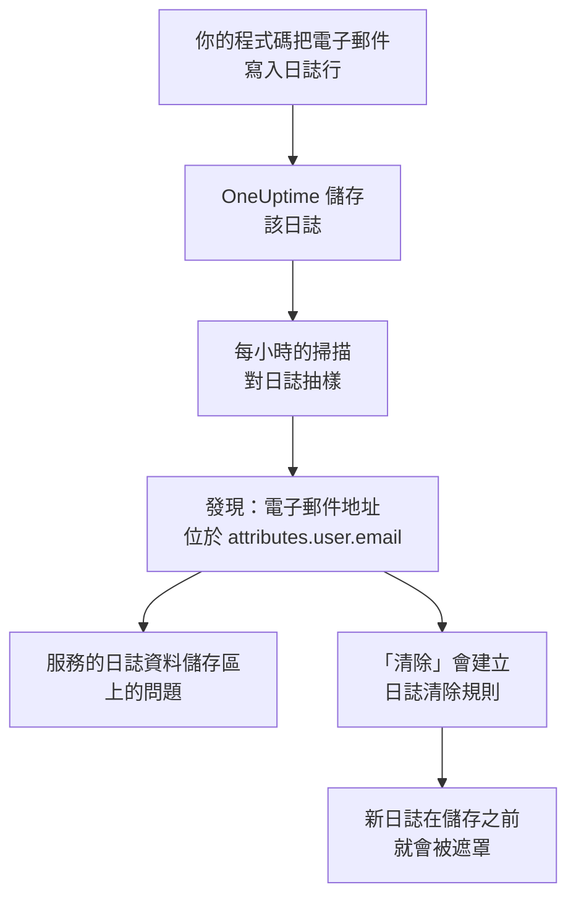

# 遙測中的敏感資料

遙測會保存你的程式碼寫入的任何內容：日誌行中的電子郵件地址、span 屬性中的卡號、堆疊追蹤中的權杖、提示中的客戶問題。資料安全把每個服務的日誌、追蹤、例外和 AI 對話，以及每個 RUM 應用程式的工作階段，各自視為獨立的資料儲存區。它每小時對它們抽樣，像在儲存貯體中一樣在其中找出敏感資料，而 **清除** 會把發現轉為清除規則，從此在擷取時遮罩這些資料。

不需要任何設定：每個服務的遙測每小時都會被掃描，除非專案設定中的 **掃描遙測** 已關閉。

:::cards
- [讀取的內容](#讀取的內容): 每種訊號的屬性、本文、訊息和提示。
- [掃描如何抽樣](#掃描如何抽樣): 每個服務最新的記錄，每小時一次。
- [清除](#清除): 一鍵在擷取時遮罩發現。
- [怎樣算已清除](#怎樣算已清除): 清除規則何時已涵蓋某個發現。
:::

## 運作方式

清除規則涵蓋的發現會被標記為已清除：剩下的那些資料是等待保留期結束的舊資料，而不是仍在持續的外洩。兩項遙測檢查只計算沒有任何規則涵蓋的部分，因此一旦每個發現都已清除，它們的問題就會解決（請參閱 [遙測檢查](/docs/data-security/checks-and-issues#遙測)）。

## 讀取的內容

| 資料儲存區 | 讀取的內容 | 發現指向的位置 |
| --- | --- | --- |
| 日誌 | 每個屬性，以及本文 | `attributes.<key>`、`body` |
| 追蹤 | 每個 span 屬性，以及每個 span 事件的屬性 | `attributes.<key>`、`events.<event>.<key>` |
| 例外 | 訊息、堆疊追蹤和屬性 | `message`、`stackTrace`、`attributes.<key>` |
| AI 對話 | 每次 AI 呼叫中位於 GenAI 慣例所用鍵下的提示和回答，以及其他所有屬性 | 它們所在的鍵，例如 `gen_ai.input.messages` 或 `gen_ai.prompt[].content` |
| 工作階段重播 | RUM 應用程式的 span 和日誌的屬性、其工作階段的屬性、`identify()` 賦予其使用者的特徵，以及告知它的使用者參照 | `spans.attributes.<key>`、`logs.attributes.<key>`、`sessions.attributes.<key>`、`sessions.identifiedUserTraits.<key>`、`sessions.identifiedUserLabel` |

帶編號的鍵會合併為同一個位置：`gen_ai.prompt.3.content` 就是 `gen_ai.prompt[].content`，因此一段聊天中的二十則訊息是一個發現，而不是二十個。OneUptime 自己新增的屬性（以 `oneuptime.` 開頭）不會被讀取。

### 為什麼從不讀取重播的錄製內容

工作階段重播的錄製內容包含人們看到的頁面文字。觀看它需要專屬的權限，而從中讀出的發現會把遮罩後的頁面文字顯示給每個能讀取資料安全的人。因此重播只會透過其屬性讀取：錄製內容旁的 span、日誌和工作階段詳細資料。錄製器在瀏覽器中錄製時就已經遮罩內容，日誌清除規則也會套用到錄製內容（請參閱 [工作階段重播](/docs/telemetry/session-replay)）。

### AI 對話

AI 呼叫的提示帶有使用者最新訊息之前的整段聊天，因此 AI 呼叫的每個值最多會讀取 16,384 個字元。當 AI 對話含有敏感資料時，還會帶來兩個結果：呼叫所送往的 AI 供應商會成為這些資料的一個資料流，而 [敏感資料正被傳送給 AI 供應商](/docs/data-security/checks-and-issues#ai) 會在該資料儲存區上失敗。

[公司 AI 工具](/docs/telemetry/ai-company-tools) 的對話不在讀取範圍內。只有 Project Owner 和 Project Admin 可以讀取它們，而發現會出現在每個能讀取資料安全的人都看得到的地方，因此這些服務的 span 從不被讀取，它們的 AI 對話會被回報為未讀取。

## 掃描如何抽樣

每小時會讀取每種訊號在過去一小時內最新的記錄，並像其他資料儲存區一樣逐欄位分類（請參閱 [欄位和資料欄](/docs/data-security/data-types#欄位和資料欄)）：

| 限制 | 值 |
| --- | --- |
| 每個服務和訊號的記錄數 | **遙測樣本大小**，預設為 500，最多 1,000 |
| 每種訊號讀取的服務或 RUM 應用程式 | 最繁忙的 200 個 |
| 單次讀取的記錄數 | 5,000，由各服務共用；AI 呼叫為 500 |
| 日誌本文、例外訊息或堆疊追蹤的字元數 | 8,192 |
| 屬性值的字元數 | 4,096 |
| AI 呼叫的值的字元數 | 16,384 |
| 單筆記錄的屬性數 | 128；AI 呼叫為 64 |
| 單個 span 的事件數，以及單個事件的屬性數 | 16 和 32 |
| 單個資料儲存區的位置數 | 500 |

每個值都會在資料庫中截短，因此不會有任何長值離開資料庫，而且每次讀取在 30 秒後停止。失敗的讀取會成為其目標資料儲存區上的警告；掃描會繼續進行下一次讀取。

若要排除某些內容，請把它新增到資料儲存區的 **掃描排除項目**：完整指名的位置（`attributes.http.url`）、某個位置下的所有內容（`attributes.http`），或單獨指名的屬性鍵（`http.url`）。

## 清除

發現上的 **清除** 會建立一條清除規則，從此在該位置隱藏該資料類型，或者指向已經這樣做的已啟用規則：

:::steps
### 開啟發現

開啟遙測資料儲存區（例如某個服務的 **日誌**），然後開啟該發現。

### 按下清除

按一下 **清除**。OneUptime 會針對發現所在的記錄部分，為日誌和 RUM 應用程式的日誌建立日誌清除規則，為 span、例外和 AI 呼叫建立追蹤清除規則。

### 同時修正程式碼

規則會在新資料儲存之前將其遮罩。已儲存的資料會保留到保留期結束，所以請修正寫入它的程式碼：發現會指出服務和屬性。
:::

規則依它隱藏的內容命名，例如「Data Security: Email address in attributes.user.email」，並與你的其他清除規則列在一起（請參閱 [丟棄篩選器與清除規則](/docs/telemetry/drop-filters-and-scrub-rules#清理敏感資料)）。它是下列其中一種：

| 發現 | 「清除」建立的規則 |
| --- | --- |
| 電子郵件地址、卡號、美國社會安全號碼、電話號碼或 IP 位址 | 該類型的內建模式。卡號、社會安全號碼和電話號碼會被遮罩，其餘的會被塗銷。 |
| 看起來敏感的鍵（例如 `password` 或 `token`）下的值 | 一條 **Sensitive Attribute Keys** 規則，它會塗銷每個這類屬性的整個值 |
| 模式能找出的任何其他資料類型 | 一條以該資料類型自己的模式建立的 **自訂 Regex** 規則，它會塗銷每個符合其形式的值 |

有些發現無法用規則清除，**清除** 會說明原因：

- 僅從欄位名稱找到的資料類型，例如人名：沒有任何模式能找出它。請把屬性重新命名為敏感鍵規則會隱藏的鍵，或停止傳送它。
- 只能靠周圍字詞與其他值區分的資料類型，例如銀行路由號碼：規則隱藏的內容會遠遠超過該資料類型。
- 文件標記：隱藏這個字詞並不會隱藏文件。
- 你自己的資料類型：請自行用它的模式新增自訂清除規則。
- 工作階段本身的詳細資料（`sessions.*`）：工作階段重播的擷取不會執行任何清除規則。

**清除** 會以你的身分、在你自己的權限下建立規則：Project Owner 和 Project Admin 可以按下它，可以建立日誌清除規則的團隊也可以；對於 span、例外和 AI 呼叫，團隊則需要能建立追蹤清除規則。

## 怎樣算已清除

只有當擷取會對發現執行一條已啟用的規則，而且該規則會找出它的資料類型時，發現才會被標記為已清除：

- **正確的記錄。** 日誌規則涵蓋日誌和 RUM 應用程式的日誌。追蹤規則涵蓋 span、例外和 AI 呼叫：例外是其 span 例外事件的副本，因此清除事件的規則也會清除它。
- **正確的部分。** 規則的 **要清除的欄位** 包含發現所在的記錄部分，或者規則將其保留為預設值。
- **能找出該類型的模式。** 內建的 **模式類型** 會找出它自己的資料類型：**電子郵件地址** 找出電子郵件地址，**信用卡號碼** 找出卡號，**SSN（社會安全號碼）** 找出美國社會安全號碼，**電話號碼** 找出電話號碼，**IP 位址** 找出 IP 位址。**Sensitive Attribute Keys** 涵蓋看起來敏感的鍵下的每個值，無論值是什麼。
- **你自己的自訂模式永遠不算。** 只有當 **自訂 Regex** 與 **清除** 為該類型建立的模式完全相同時，它才涵蓋發現。發現只保留遮罩樣本，無法在上面測試任何模式，因此 OneUptime 無法證明你的模式能隱藏這些資料，而被誤判為已清除的發現，就是一個沒有人會去查看的外洩。

已關閉的規則，或什麼也不清除的規則，永遠不算。涵蓋情況會在每次掃描後重新計算，因此你手動新增或移除的規則，會在一小時內改變哪些發現被標記為已清除。

## 後續步驟

:::cards
- [丟棄篩選器與清除規則](/docs/telemetry/drop-filters-and-scrub-rules): 每個清除規則選項，以及你自己撰寫的規則。
- [資料安全檢查與問題](/docs/data-security/checks-and-issues): 兩項遙測檢查和 AI 檢查。
- [資料流、存取與資料落地](/docs/data-security/flows-access-residency): 你的服務傳送資料的 AI 供應商和主機。
:::
