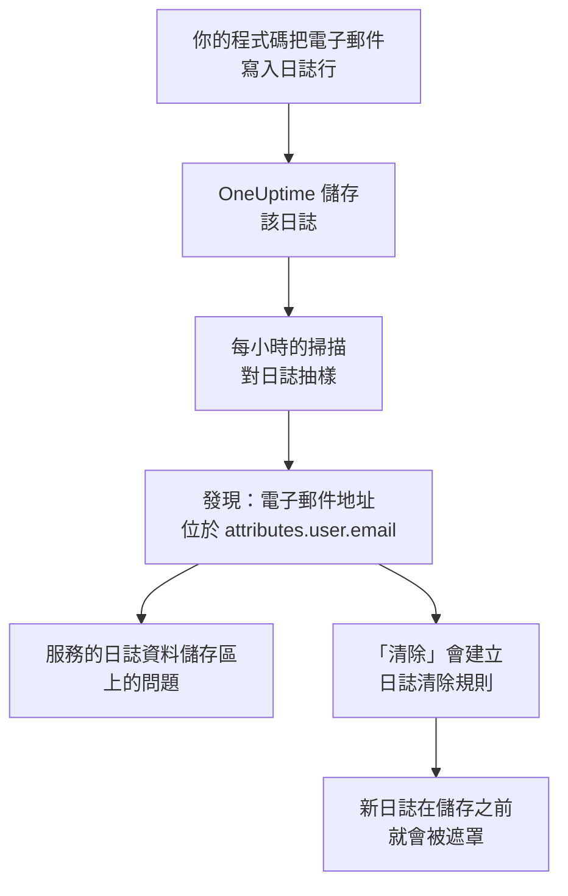

# 遙測中的敏感資料

遙測會保存你的程式碼寫入的任何內容：日誌行中的電子郵件地址、span 屬性中的卡號、堆疊追蹤中的權杖、提示中的客戶問題、指標標籤中使用者的 IP 位址。資料安全把每個服務的日誌、追蹤、指標、例外和 AI 對話，以及每個 RUM 應用程式的工作階段，各自視為獨立的資料儲存區。它每小時對它們抽樣，像在儲存貯體中一樣在其中找出敏感資料，而 **清除** 會把發現轉為規則，從此在擷取時遮罩這些資料。

不需要任何設定：每個服務的遙測每小時都會被掃描，除非專案設定中的 **掃描遙測** 已關閉。若要排除某個服務的日誌、追蹤或其他訊號，請在該資料儲存區的 **設定** 中關閉 **掃描內容**：從下一次掃描起，其中的任何內容都不會被讀取。

:::cards
- [讀取的內容](#讀取的內容): 每種訊號的屬性、本文、訊息和提示。
- [掃描如何抽樣](#掃描如何抽樣): 每個服務最新的記錄，每小時一次。
- [清除](#清除): 一鍵在擷取時遮罩發現。
- [捨棄此指標](#捨棄此指標): 停止儲存名稱中含有敏感資料的指標。
- [怎樣算已清除](#怎樣算已清除): 清除規則何時已涵蓋某個發現。
:::

## 運作方式

清除規則涵蓋的發現會被標記為已清除：剩下的那些資料是等待保留期結束的舊資料，而不是仍在持續的外洩。兩項遙測檢查只計算沒有任何規則涵蓋的部分，因此一旦每個發現都已清除，它們的問題就會解決（請參閱 [遙測檢查](/docs/data-security/checks-and-issues#遙測)）。

## 讀取的內容

| 資料儲存區 | 讀取的內容 | 發現指向的位置 |
| --- | --- | --- |
| 日誌 | 每個屬性，以及本文 | `attributes.<key>`、`body` |
| 追蹤 | 每個 span 屬性，以及每個 span 事件的屬性 | `attributes.<key>`、`events.<event>.<key>` |
| 例外 | 訊息、堆疊追蹤和屬性 | `message`、`stackTrace`、`attributes.<key>` |
| AI 對話 | 每次 AI 呼叫中位於 GenAI 慣例所用鍵下的提示和回答，以及其他所有屬性 | 它們所在的鍵，例如 `gen_ai.input.messages` 或 `gen_ai.prompt[].content` |
| 工作階段重播 | RUM 應用程式的 span 和日誌的屬性、其工作階段的屬性、`identify()` 賦予其使用者的特徵，以及告知它的使用者參照 | `spans.attributes.<key>`、`logs.attributes.<key>`、`sessions.attributes.<key>`、`sessions.identifiedUserTraits.<key>`、`sessions.identifiedUserLabel` |
| 指標 | 資料點的每個屬性（包括其資源的屬性），以及指標的名稱 | `attributes.<key>`、`attributes.resource.<key>`、`name` |

帶編號的鍵會合併為同一個位置：`gen_ai.prompt.3.content` 就是 `gen_ai.prompt[].content`，因此一段聊天中的二十則訊息是一個發現，而不是二十個。OneUptime 自己新增的屬性（以 `oneuptime.` 開頭）不會被讀取。

### 指標

指標的屬性就是其序列的標籤。它們在一個序列的每個資料點上都相同，因此一個每分鐘寫入一千個資料點的指標可能只有三個值，而一個洩漏使用者電子郵件的標籤增加的是一條序列，而不是一個資料點。因此，指標是依序列抽樣，而不是依資料點抽樣：

- **每條序列一個資料點。** 每個指標都會在它過去一小時內寫入資料的最新一分鐘被讀取：從該分鐘最多 100 條序列中，每條讀取一個資料點，無論該指標傳送得多頻繁，因此繁忙的序列永遠不會擠掉安靜的序列。無論有多少條序列重複同一個值，該值都只分類一次，因此發現計算的是其所在位置上互不相同的值。
- **新指標優先，其餘的輪流讀取。** 服務寫入了哪些指標，以及每個指標在過去一天內何時首次寫入，都來自指標資料表保存的每分鐘彙總，而從不來自其資料點。每次掃描都會讀取服務最繁忙的指標（它們最可能有很多序列）。接著讀取它在過去 2 小時內開始寫入的指標，因為新的外洩通常來自新程式碼；然後按固定順序，從上次掃描停下的位置開始，讀取它其他指標中的下一批。新指標最多占用這些名額的一半，因此其他指標總能保有自己的名額。
- **每個指標都在固定時間內讀到。** 每次掃描為每個服務分配 10 次讀取，專案的服務超過 10 個時會更少。服務因指標較少而用不完的讀取，會逐一分給仍有指標在等待輪次的服務，因此不會浪費任何讀取，也沒有服務會少於它應得的份額。每個服務最繁忙的 5 個指標占用其中 5 次讀取，其餘讀取輪流讀取它的其他指標：一個有 M 個指標、輪流取得 r 次讀取的服務，其每個指標至少每 M ÷ r 小時（無條件進位）被讀取一次。有 300 個指標的服務只取得自己的 5 次時為 60 小時；當另外兩個有 300 個指標的服務與它共用一個專案時，每個服務會取得 28 或 29 次，因此為 11 小時。只要它每小時都在開始寫入新指標，這個時間最多加倍。
- **每個指標各自的範圍。** 這些指標會一起讀取，每個指標依它在該資料表主鍵中各自的範圍讀取。最新一分鐘包含超過 16,384 個資料點的指標（例如以每個使用者的電子郵件作為標籤的指標）會單獨讀取，而且讀取會在它的前幾個資料點處停止，因此它的成本不會超過任何其他指標。

發現會指出屬性，例如 `attributes.user.email`；對於指標名稱中的資料，則指出 `name`。它的記錄就是發現它的那些資料點：每筆記錄都會顯示它的指標和該屬性的值（已遮罩），並會在 **指標** 中開啟該指標，依該屬性分組。當指標名稱含有敏感資料時，名稱也會被遮罩，記錄則改為開啟該服務的指標。

### 為什麼從不讀取重播的錄製內容

工作階段重播的錄製內容包含人們看到的頁面文字。觀看它需要專屬的權限，而從中讀出的發現會把遮罩後的頁面文字顯示給每個能讀取資料安全的人。因此重播只會透過其屬性讀取：錄製內容旁的 span、日誌和工作階段詳細資料。錄製器在瀏覽器中錄製時就已經遮罩內容，日誌清除規則也會套用到錄製內容（請參閱 [工作階段重播](/docs/telemetry/session-replay)）。

### AI 對話

AI 呼叫的提示帶有使用者最新訊息之前的整段聊天，因此 AI 呼叫的每個值最多會讀取 16,384 個字元。當 AI 對話含有敏感資料時，還會帶來兩個結果：呼叫所送往的 AI 供應商會成為這些資料的一個資料流，而 [敏感資料正被傳送給 AI 供應商](/docs/data-security/checks-and-issues#ai) 會在該資料儲存區上失敗。

[公司 AI 工具](/docs/telemetry/ai-company-tools) 的對話不在讀取範圍內。只有專案擁有者和專案管理員可以讀取它們，而發現會出現在每個能讀取資料安全的人都看得到的地方，因此這些服務的 span 從不被讀取，它們的 AI 對話會被回報為未讀取。

## 掃描如何抽樣

每小時會讀取每種訊號在過去一小時內最新的記錄，並像其他資料儲存區一樣逐欄位分類（請參閱 [欄位和資料欄](/docs/data-security/data-types#欄位和資料欄)）：

| 限制 | 值 |
| --- | --- |
| 每個服務和訊號的記錄數 | **遙測樣本大小**，預設為 500，最多 1,000 |
| 每種訊號讀取的服務或 RUM 應用程式 | 最繁忙的 200 個 |
| 單次讀取的記錄數 | 5,000，由各服務共用；AI 呼叫為 500 |
| 日誌本文、例外訊息或堆疊追蹤的字元數 | 8,192 |
| 屬性值的字元數 | 4,096 |
| AI 呼叫的值的字元數 | 16,384 |
| 單筆記錄的屬性數 | 128；AI 呼叫為 64 |
| 單個 span 的事件數，以及單個事件的屬性數 | 16 和 32 |
| 單個資料儲存區的位置數 | 500 |
| 單次掃描讀取的指標數 | 100，由各服務共用，每個服務至少一個；每個服務 10 個，一半是它最繁忙的指標，一半是輪流讀取的新指標和其他指標，服務用不完的讀取會輪流分給其他服務 |
| 新指標 | 過去 24 小時內的第一個資料點出現在過去 2 小時內的指標 |
| 單個指標的序列數 | 其最新一分鐘內每條序列一個資料點，最多 100 條 |

每個值都會在資料庫中截短，因此不會有任何長值離開資料庫，而且每次讀取在 30 秒後停止。失敗的讀取會成為其目標資料儲存區上的警告；掃描會繼續進行下一次讀取。

若要排除某些內容，請把它新增到資料儲存區的 **掃描排除項目**：完整指名的位置（`attributes.http.url`）、某個位置下的所有內容（`attributes.http`），或單獨指名的屬性鍵（`http.url`）。

## 清除

發現上的 **清除** 會建立一條規則，從此在該位置隱藏該資料類型，或者指向已經這樣做的已啟用規則：

:::steps
### 開啟發現

開啟問題（**發現位置** 會列出其背後的每個發現），或開啟 **資料安全 > 遙測中**，在那裡，**顯示記錄** 會在清單旁開啟發現所在的記錄。

### 按下清除

按一下 **清除**。OneUptime 會針對發現所在的記錄部分，為日誌和 RUM 應用程式的日誌建立日誌清除規則，為 span、例外和 AI 呼叫建立追蹤清除規則，並為指標的屬性建立指標管道規則。

### 同時修正程式碼

規則會在新資料儲存之前將其遮罩。已儲存的資料會保留到保留期結束，所以請修正寫入它的程式碼：發現會指出服務和屬性。
:::

規則依它隱藏的內容命名，例如「Data Security: Email address in attributes.user.email」，並與你的其他清除規則列在一起（請參閱 [丟棄篩選器與清除規則](/docs/telemetry/drop-filters-and-scrub-rules#清理敏感資料)）。它是下列其中一種：

| 發現 | 「清除」建立的規則 |
| --- | --- |
| 電子郵件地址、卡號、美國社會安全號碼、電話號碼或 IP 位址 | 該類型的內建模式。卡號、社會安全號碼和電話號碼會被遮罩，其餘的會被塗銷。 |
| 看起來敏感的鍵（例如 `password` 或 `token`）下的值 | 一條 **敏感屬性鍵** 規則，它會塗銷每個這類屬性的整個值 |
| 模式能找出的任何其他資料類型 | 一條以該資料類型自己的模式建立的 **自訂 Regex** 規則，它會塗銷每個符合其形式的值 |
| 指標屬性中的任何資料類型 | 針對該服務的一條 **遮蔽屬性** 指標管道規則，它會把該屬性中符合該資料類型形式的值替換為 `[REDACTED]`；如果沒有任何模式能找出該資料類型，則替換該屬性的每個值 |

有些發現無法用規則清除，**清除** 會說明原因。指標的屬性則一定可以清除，因為它的規則可以隱藏該屬性的每個值：

- 僅從欄位名稱找到的資料類型，例如人名：沒有任何模式能找出它。請把屬性重新命名為敏感鍵規則會隱藏的鍵，或停止傳送它。
- 只能靠周圍字詞與其他值區分的資料類型，例如銀行路由號碼：規則隱藏的內容會遠遠超過該資料類型。
- 文件標記：隱藏這個字詞並不會隱藏文件。
- 你自己的資料類型：請自行用它的模式新增自訂清除規則。
- 工作階段本身的詳細資料（`sessions.*`）：工作階段重播的擷取不會執行任何清除規則。
- 指標的名稱（`name`）：它由建立該指標的程式碼設定，而管道規則只能將指標整個重新命名。請重新命名該指標，並改為把名稱中會變動的部分作為屬性傳送。在此之前，**捨棄此指標** 可以停止儲存這些指標。

**清除** 會以你的身分、在你自己的權限下建立規則：專案擁有者和專案管理員可以按下它，可以建立日誌清除規則的團隊也可以；對於 span、例外和 AI 呼叫，團隊則需要能建立追蹤清除規則；對於指標，則需要能建立指標管道規則。

## 捨棄此指標

沒有任何規則能把資料從指標名稱中移除，因此在為指標命名的程式碼修正之前，資料會一直傳入。在指標名稱中的發現上使用 **捨棄此指標**，會停止儲存名稱中含有該資料的指標，代價是失去它們的資料，因此只有在你要求時才會執行：

- **一個服務的指標。** 它會為發現所屬的服務建立一條 **捨棄** 指標管道規則：名稱中含有該資料類型的指標，其每個新資料點都會在儲存之前被捨棄。它的篩選條件就是 **清除** 用於該類型的模式，因此任何模式都找不到的類型（例如人名）無法捨棄，對話方塊會說明原因。
- **執行前先說明。** 對話方塊會說明：這些資料點將永久遺失；該服務過去一天寫入的指標中有多少個具有這樣的名稱；哪些項目讀取這些指標，因而不再取得新資料；已儲存的內容會保留到保留期結束；以及如何復原。在你勾選表示了解之前，不會捨棄任何內容。
- **讀取它們的項目，以及它們會怎樣。** 對話方塊會以連結列出每個監測器、每個儀表板及其讀取這些指標的小工具、該服務的每個指標 SLO，以及讀取這些指標的每條指標記錄規則。監測器將無法再根據其值發出警示，小工具不再顯示新資料，SLO 不再計算這些指標的新事件，記錄規則的輸出指標也不再包含這些指標。在每條記錄規則下，它還會列出讀取該規則輸出指標的項目，以及再讀取它們輸出指標的項目，沿鏈條最多三個輸出指標。小工具的連結會在該小工具處開啟其儀表板。你無法檢視的項目只會計數，絕不顯示名稱。
- **以你的身分，並留下紀錄。** 規則會依你自己建立指標管道規則的權限建立：專案擁有者和專案管理員可以建立，能建立指標管道規則的團隊也可以。稽核日誌會記錄是誰建立的。
- **刪除規則即可復原。** 規則以它捨棄的內容命名，例如「Data Security: drop metrics named with Email address」，並與你的其他指標管道規則一起列在 **指標 → 設定 → 管道規則** 下。刪除或停用它之後，這些指標從那時起會重新被儲存。在此期間捨棄的內容不會回來。

之後該發現會標示為 **已捨棄**，並算作已清除：這些資料不會再被儲存。

## 怎樣算已清除

只有當擷取會對發現執行一條已啟用的規則，而且該規則會找出它的資料類型時，發現才會被標記為已清除：

- **正確的記錄。** 日誌規則涵蓋日誌和 RUM 應用程式的日誌。追蹤規則涵蓋 span、例外和 AI 呼叫：例外是其 span 例外事件的副本，因此清除事件的規則也會清除它。
- **正確的部分。** 規則的 **要清除的欄位** 包含發現所在的記錄部分，或者規則將其保留為預設值。
- **能找出該類型的模式。** 內建的 **模式類型** 會找出它自己的資料類型：**電子郵件地址** 找出電子郵件地址，**信用卡號碼** 找出卡號，**SSN（社會安全號碼）** 找出美國社會安全號碼，**電話號碼** 找出電話號碼，**IP 位址** 找出 IP 位址。**敏感屬性鍵** 涵蓋看起來敏感的鍵下的每個值，無論值是什麼。
- **你自己的自訂模式永遠不算。** 只有當 **自訂 Regex** 與 **清除** 為該類型建立的模式完全相同時，它才涵蓋發現。發現只保留遮罩樣本，無法在上面測試任何模式，因此 OneUptime 無法證明你的模式能隱藏這些資料，而被誤判為已清除的發現，就是一個沒有人會去查看的外洩。
- **指標的屬性。** 針對該屬性鍵的 **遮蔽屬性** 或 **移除屬性** 指標管道規則，無論針對的是發現所屬的服務還是整個專案，只要它沒有篩選條件，或其篩選條件與 **清除** 建立的完全相同，就涵蓋該發現。基於同樣的理由，你自己撰寫的篩選條件永遠不算。
- **指標的名稱。** 針對發現所屬服務或整個專案的 **捨棄** 指標管道規則，只要其篩選條件與 **捨棄此指標** 建立的完全相同，或根本沒有篩選條件（此時它不儲存該服務的任何指標），就涵蓋該發現。這樣一條沒有篩選條件的規則會涵蓋這些指標中的每個發現。

已關閉的規則，或什麼也不清除的規則，永遠不算。涵蓋情況會在每次掃描後重新計算，因此你手動新增或移除的規則，會在一小時內改變哪些發現被標記為已清除。

## 後續步驟

:::cards
- [丟棄篩選器與清除規則](/docs/telemetry/drop-filters-and-scrub-rules): 每個清除規則選項，以及你自己撰寫的規則。
- [資料安全檢查與問題](/docs/data-security/checks-and-issues): 兩項遙測檢查和 AI 檢查。
- [資料流、存取與資料落地](/docs/data-security/flows-access-residency): 你的服務傳送資料的 AI 供應商和主機。
:::
