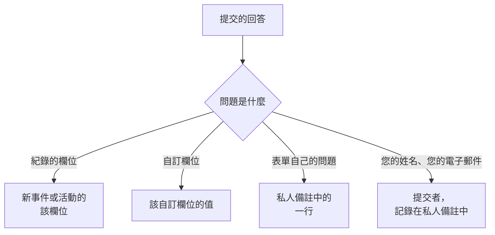

# 建構表單

表單的 **建構** 頁面用於決定表單詢問什麼，以及其頁面的外觀。問題位於左側，依公開頁面顯示的順序排列；右側的 **新增問題** 列出您可以新增的所有內容。問題上方摺疊著表單的 [品牌](#品牌)：它的標誌和網站圖示。人們可以作為表單起點的具名答案集（每個答案集還可以針對自己的情況把問題設為必填、選填或隱藏）位於表單的 **範本** 頁面：請參閱 [範本](#範本)。

:::cards
- [建構器](#建構器): 新增、編輯、移動和儲存問題。
- [可以新增的內容](#可以新增的內容): 您自己的問題、紀錄的欄位、自訂欄位和提交者。
- [隱藏的問題](#隱藏的問題): 由範本回答，從不由提交的人回答。
- [範本](#範本): 為團隊經常回報的每種情況提供一個表單和一個連結。
:::

## 每個回答的去向

每個回答也會隨提交紀錄一起保存在表單的 **提交紀錄** 頁面上。表單沒有詢問的欄位，或留空的欄位，會由表單的 [提交時設定](/docs/forms/on-submit) 填寫。

## 建構器

:::steps
### 新增問題

在 **新增問題** 中選擇要新增的內容。新問題會插入到所選問題之後（或最後面），並處於選取狀態。

### 就地編輯

選取一張卡片進行編輯：問題、說明文字、回答類型和選項、是否必填或隱藏，以及複製和刪除按鈕。 **完成** 會關閉它。

### 放到合適的位置

拖曳卡片的把手來移動它，或在所選卡片上使用 **上移** 和 **下移** ——在手機上或透過鍵盤也可以。

### 儲存表單

**儲存變更** 會一次儲存所有變更。在您儲存之前，建構器會顯示 **未儲存的變更** 並提供 **捨棄變更**，而且瀏覽器會在您離開頁面前進行確認。
:::

- **表單的頁首** 會像公開頁面那樣顯示表單的名稱和描述。 **編輯名稱和描述** 用於變更它們。
- **問題** 是一張張卡片。每張卡片都依人們將看到的樣子顯示問題，並帶有說明其關聯對象的徽章—— **事件 · 嚴重程度**、 **自訂欄位 · Region**、 **提交者 · 電子郵件**，對於表單自己的問題則是其回答類型。紅色星號標記必填問題， **隱藏** 徽章標記 [隱藏的](#隱藏的問題) 問題。
- **限制。** 一個表單最多可以有 50 個問題。可以讀取但不能編輯表單的人會以唯讀方式看到建構器。

## 品牌

摺疊在問題上方的 **品牌** 決定表單頁面的外觀：頁面頂端、表單名稱上方的標誌，以及表單開啟期間瀏覽器分頁中的網站圖示。在您上傳自己的之前，表單會顯示 OneUptime 的標誌和網站圖示。

摺疊時，該區段會列出 **標誌** 和 **Favicon** （表單有自己的圖像後會顯示為已設定），並說明哪些 OneUptime 的圖像仍在使用。展開它即可依頁面顯示的樣子檢視兩者：標誌在頁面頂端的樣子，以及網站圖示在瀏覽器分頁中、位於表單名稱（即分頁標題）旁邊的樣子。

**編輯品牌** 在一個對話方塊中變更它們：

| 欄位 | 說明 |
| --- | --- |
| **標誌** | 顯示在表單頁面頂端、名稱上方，取代 OneUptime 標誌。不超過 512 KB 的 PNG、JPEG、GIF、WebP 或 SVG 圖像。移除後恢復為 OneUptime 標誌。 |
| **Logo Alt Text** | 螢幕閱讀器朗讀的標誌內容：通常是您組織的名稱。有標誌時會詢問。留空時螢幕閱讀器會略過標誌——反正表單名稱會緊接在後。移除標誌也會清空它。 |
| **Favicon** | 表單開啟期間瀏覽器分頁中的圖示，取代 OneUptime 網站圖示。不超過 128 KB 的 PNG、JPEG、GIF、WebP、SVG 或 ICO 圖像；正方形的 PNG、SVG 或 ICO 效果最好。移除後恢復為 OneUptime 網站圖示。 |

標誌會維持其所取代的 OneUptime 標誌的高度，較寬的標誌會配合頁面的寬度。每張圖像都會在儲存時檢查（無論來自儀表板、API、Terraform 還是工作流程）：它必須是在表單自己的專案中上傳的，屬於上述類型之一，並且不超過其限制。不屬於這些圖像的標誌會被以 "The logo must be a PNG, JPEG, GIF, WebP or SVG image." 拒絕，過大的標誌會被以 "The logo must be 512 KB or smaller." 拒絕，上傳已不存在（或在其他專案中上傳）的標誌會被以 "The logo's file could not be found. Upload the logo again." 拒絕。網站圖示也會以同樣的方式被拒絕： "The favicon must be a PNG, JPEG, GIF, WebP, SVG or ICO image."、 "The favicon must be 128 KB or smaller." 和 "The favicon's file could not be found. Upload the favicon again."。

**預覽** 會像頁面一樣顯示標誌。可以讀取但不能編輯表單的人會看到其品牌，但沒有 **編輯品牌**。標誌和網站圖示只會在表單本身之內到達表單頁面——請參閱 [分享與安全](/docs/forms/sharing-and-security#什麼在保護表單)。

## 可以新增的內容

**新增問題** 列出四組：表單自己的 **問題**、表單所建立內容的 **事件欄位** 或 **排定維護欄位**、 **自訂欄位** 以及 **提交者**。

### 表單自己的問題

| 回答類型 | 提交者提供的內容 |
| --- | --- |
| **簡短回答** | 一行文字。 |
| **段落** | 多行文字。 |
| **格式化文字** | 附格式和連結的文字。 |
| **數字** | 一個數字。 |
| **下拉式選單** | 從清單中選擇一項。 |
| **多選** | 從清單中選擇任意多項。 |
| **核取方塊** | 一個用於勾選的方塊，例如用於確認。 |
| **日期** | 一個日期。 |
| **日期和時間** | 一個日期和時間。 |

下拉式清單或多選會列出您提供的 **選項**，每個選項可以帶一個選用的顏色（選項旁的按鈕會開啟一組具名顏色，使用 **自訂顏色** 可以指定精確的代碼），數量在 1 到 100 個之間。在 **下拉式選單** 和 **多選** 之間切換問題會保留其選項；變為其中一種類型的問題會以兩個可以重新命名的選項開始，不再是這些類型的問題則會捨棄選項。 **複製** 會將表單自己的問題複製到其正下方。

對這些問題的回答會隨提交紀錄一起保存，並列在表單所建立內容的私人備註中——它們不會填寫任何欄位。要填寫欄位，請從接下來的兩組中新增該欄位本身。

### 表單所建立內容的欄位

提交者可以回答的事件或排定維護活動的欄位。回答會成為該欄位的值。

| 事件欄位 | 回答內容 |
| --- | --- |
| **標題** | 一行，最多 500 個字元。 |
| **描述** | 格式化文字，最多 20,000 個字元。 |
| **嚴重程度** | 您的事件嚴重程度之一。 |
| **監測器** | 您提供的任何監測器——事件受影響的監測器。 |
| **標籤** | 您提供的任何標籤。 |
| **影響開始時間** | 日期和時間：提交者記得的問題開始時間。 |

| 排定維護欄位 | 回答內容 |
| --- | --- |
| **標題** | 一行，最多 100 個字元。 |
| **描述** | 格式化文字，最多 20,000 個字元。 |
| **開始** | 日期和時間。一律詢問，並且一律必填。 |
| **結束** | 晚於 **開始** 的日期和時間。一律詢問，並且必填。 |
| **監測器** | 您提供的任何監測器。 |
| **狀態頁面** | 您提供的任何狀態頁面。 |
| **標籤** | 您提供的任何標籤。 |

每個欄位只能詢問一次；清單會將已在表單上的欄位標記為 **已新增**。表單沒有詢問的欄位（或留空的欄位）會由表單的 [提交時設定](/docs/forms/on-submit) 填寫。

**提供的選項。** 公開頁面不能向陌生人列出您的整個專案，因此透過選擇紀錄來回答的欄位只提供您選擇的紀錄。 **監測器**、 **標籤** 和 **狀態頁面** 只列出您提供的選項，並且在您至少提供一個之前不會詢問。由於嚴重程度並不保密， **嚴重程度** 會提供所有事件嚴重程度，除非您縮小範圍。超出所提供選項的回答會被拒絕。

### 自訂欄位

您的事件自訂欄位（對於維護表單，則是排定維護自訂欄位），每個都是一個問題，其回答會成為該欄位的值。問題從自訂欄位取得類型和選項，並以其名稱作為問題、以其描述作為說明文字開始，這些都可以變更。

無論 **建立時顯示** 如何設定，表單只詢問您新增到其中的自訂欄位：表單詢問的每個欄位都會向任何擁有連結的人顯示其名稱、描述和選項。刪除自訂欄位後，其問題會留在表單上但不再被詢問，並且其卡片會說明這一點——請刪除該問題。以相同名稱重新建立的欄位是一個新欄位：請再次新增它。

從監測器自訂欄位複製值的自訂欄位會在其卡片上說明這一點：當事件或活動的監測器在該欄位的值上一致時，該值會取代提交者的回答。

### 提交者

**你的姓名** 和 **你的電子郵件** 詢問是誰在提交。它們會隨提交紀錄一起保存並寫入私人備註，以便您的團隊後續追蹤，而且永遠不會顯示在事件或活動本身上。OneUptime 從不寄送電子郵件給提交者。省略它們或將其設為選填，即可接受匿名提交。

電子郵件必須是一個一般地址，例如 `ada@example.com` ——不能是帶角括號地址的名字，也不能是地址清單。姓名和電子郵件各自最多 100 個字元。

## 新表單的問題

新表單以它幾乎總是應該詢問的問題開始，因此建立後立即可用：必填的 **標題**；**描述**；對於維護表單，還有 **開始** 和 **結束**；以及必填的 **你的姓名** 和 **你的電子郵件**。它們的措辭使用您儀表板的語言。您可以隨意變更、隱藏或移除它們——維護活動的開始和結束除外，沒有它們就無法排定任何活動。當您自己的問題已經說明了一切時，請隱藏 **描述**，而不是留下一個不應有人填寫的輸入框：請參閱 [隱藏的問題](#隱藏的問題)。

## 必填問題

**必填** 表示沒有回答就無法提交表單。只包含空格、定位字元或換行的回答視為沒有回答，必填的 **核取方塊** 必須勾選。提交表單時，伺服器會再次檢查每個必填問題，因此不經過頁面發出的請求同樣受其約束。

非必填的問題可以留空：其欄位隨後會由提交時設定填寫，就像表單沒有詢問它一樣。

## 隱藏的問題

在卡片上開啟 **隱藏**，問題就不再顯示在表單上。不會有人被詢問，因此它永遠不是必填的，提交也無法回答它——甚至不會從請求中讀取它。只有提交所起始的 [範本](#範本) 會回答它；當提交者不從任何範本開始，或從將其留空的範本開始時，它會維持未回答。範本也可以為自己的情況詢問隱藏的問題：請參閱 [範本如何詢問每個問題](#範本如何詢問每個問題)。

當回答應由您的團隊而不是提交者決定時，請隱藏問題：

- **事件的描述**，當您新增的問題已經說明了一切時。隱藏後，它不再邀請任何人在那裡填寫；為每個範本提供您針對其情況送出的標準文字，或讓事件在沒有描述的情況下開始。
- **您的工作流程或規則讀取的自訂欄位**，例如由每個範本設定的通知類型。
- **表單自己的問題**，其回答只有您的團隊需要在私人備註中看到。

隱藏的問題會保留其位置、標籤和設定，因此您可以隨時再次顯示它。表單目標在缺少時無法建立的欄位——維護活動的 **開始** 和 **結束** ——不能被隱藏。隱藏問題的回答會與輸入的回答完全一樣地被檢查和儲存，並隨提交紀錄一起保存。

## 範本

表單的 **範本** 頁面保存人們可以作為表單起點的具名答案集——為團隊經常回報的每種情況各準備一個，例如 **應用程式故障**、 **計畫性維護** 或 **服務已還原** ——這樣一個表單和一個連結就能滿足所有情況。

:::steps
### 新增範本

按一下 **新增範本**。編輯器分為兩部分。 **問題** 列出表單的每個問題以及此範本詢問它的方式——請參閱 [範本如何詢問每個問題](#範本如何詢問每個問題)。 **回答** 再次列出這些問題，包括隱藏的問題，並且都不是必填的：填寫範本應回答的內容，其餘的留給提交的人。對範本不詢問的問題的回答會在其下方註明——它會依原樣使用。

### 選擇預設範本

**預設** 會使其成為表單開啟時使用的範本。只有一個範本可以是預設範本，而唯一範本就是預設範本的表單，其實就是一個預先填寫好的表單。

### 分享其連結

**複製連結** 會複製範本自己的連結，該連結會開啟已用此範本填寫好的表單。請參閱 [分享與安全](/docs/forms/sharing-and-security#每個範本的連結)。
:::

每個範本會列出它填寫的內容以及它以自己的方式詢問的問題，例如 **排定維護日期 · 隱藏**，並有 **編輯**、 **複製** （緊接在後建立一個副本，名稱類似 **應用程式故障 2** ）、用於調整表單中排列順序的 **上移** 和 **下移**，以及 **刪除**。

在公開頁面上，帶有範本的表單會在其問題上方、 **從範本開始** 下列出這些範本。選擇一個範本會填寫表單，並依該範本的方式詢問問題；提交者在提交前仍可變更任何回答，選擇另一個範本則會從該範本重新開始表單。頁面會以其連結指定的範本開啟，否則以預設範本開啟，否則不使用範本。 **預覽** 也會列出範本，並以預設範本開啟。

> [!IMPORTANT]
> 開啟連結的每個人都能看到每個範本的名稱，以及它對其所詢問問題的回答——頁面正是這樣自動填寫的。範本對其不詢問的問題的回答永遠不會離開伺服器，因此請將任何內部資訊放在隱藏的問題中。

儲存範本時，每個範本的每個回答都會與其問題進行核對——問題提供的選項、表單提供的紀錄、合適的文字——範本以自己的方式詢問的每個問題也是如此；無論來自儀表板、API 還是 Terraform，儲存都會被拒絕，並顯示指明範本和問題的訊息。範本名稱最多 100 個字元且在表單內唯一，一個表單最多可以有 50 個範本。如果您之後變更了問題，範本對已移除問題或不再適用問題的回答只是不再被使用，下次儲存該範本時會將其捨棄。儲存其他範本絕不會因此被拒絕：範本已有的內容不會被再次檢查。

### 範本如何詢問每個問題

不同的情況需要不同的問題：故障需要受影響的應用程式，而不需要維護時段；計畫性維護則需要維護時段。與其為每種情況建構一個表單，不如讓每個範本以自己的方式詢問表單的問題。在範本的 **問題** 中，每個問題都有以下設定之一：

| 設定 | 有人從該範本開始時 |
| --- | --- |
| **表單預設** | 問題依表單的方式詢問——必填、選填或隱藏，與其在建構器中的卡片一致。選擇器會顯示是哪一種，例如 **表單預設（隱藏）** ，並在您變更卡片時隨之變化。 |
| **必填** | 會詢問該問題，沒有回答就無法提交表單。 |
| **選填** | 會詢問該問題，並且可以留空。 |
| **隱藏** | 不會詢問該問題。如果範本有自己的回答，就以它為回答，與表單隱藏的問題一樣。 |

這樣，一個事件表單就能同時滿足兩種情況：

| 問題 | 應用程式故障 | 計畫性維護 |
| --- | --- | --- |
| 應用程式名稱 | 必填 | 必填 |
| 受影響的設施 | 必填 | 選填 |
| 排定維護日期 | 隱藏 | 必填 |

每個問題都從 **表單預設** 開始，之後新增到表單的每個問題在每個範本中也是如此。維護活動的 **開始** 和 **結束** 一律詢問且一律必填：任何範本都無法變更它們。範本可以隱藏其他所有問題並自行回答：這樣它的連結就成了只有一個按鈕 **提交** 的表單——適用於 **服務已還原** 這樣的情況。

頁面會跟隨提交者選擇的範本：選擇另一個範本會用該範本的問題重新繪製表單， **預覽** 也是如此。無論由什麼送出，伺服器都會依提交所指定的範本詢問的問題來約束每個提交：範本要求必填的問題必須回答，範本隱藏的問題不會從請求中讀取——而是使用範本自己的回答。未指定範本，或指定了之後已被刪除的範本的提交，會依表單自己的設定來約束。表單隱藏的問題只有在範本詢問它時才會顯示給公開頁面。

## 建構器標記問題時

有問題的卡片會以琥珀色說明問題所在：

| 卡片顯示 | 問題所在 |
| --- | --- |
| **此自訂欄位已被刪除，因此不會詢問此問題。請刪除該問題。** | 公開頁面會省略該問題。 |
| **請至少選擇一個要提供的選項，否則不會詢問此問題。** | 透過選擇紀錄來回答的欄位沒有提供任何紀錄：請選擇它提供的監測器、標籤或狀態頁面。 |
| **請至少新增一個選項。** | 下拉式清單或多選沒有可選擇的內容。 |
| **請填寫問題。** | 問題沒有文字。 |

只要有問題帶有後三種情況之一，表單就無法儲存： **儲存變更** 會說明是哪個問題以及問題所在，預覽會省略這樣的問題。儲存時還會整體檢查問題，並在例如兩個問題詢問同一個欄位，或維護表單沒有詢問維護何時開始和結束時，以指明問題的訊息拒絕儲存——無論問題來自建構器、API、Terraform 還是工作流程。

## 預覽

**預覽** 會完全依人們透過連結看到的樣子開啟表單——相同的標誌、問題、輸入欄位、選項和檢查、其範本清單，並且只顯示所選範本詢問的問題——並讓您填寫。您在那裡輸入的任何內容都不會被提交： **提交** 只檢查您的回答， **重新填寫** 會重新開始。預覽會依建構器中的樣子顯示問題，無論是否已儲存，並在省略被標記的問題時加以說明。

## 提交者看到的內容

公開頁面會顯示表單的標誌（在您上傳自己的之前是 OneUptime 標誌），然後是表單的名稱和描述、其範本（如果有）、它詢問的問題（依所選範本的方式詢問；未選擇範本時則是它未隱藏的問題），以及 **提交**，瀏覽器分頁則會顯示表單的名稱和網站圖示。當 OneUptime 支援提交者的語言時，頁面使用該語言（也就是提交者在該瀏覽器上最後一次在 OneUptime 中選擇的語言，否則為其瀏覽器要求的語言），否則使用英文。您的問題、選項和說明文字會依您撰寫的樣子顯示。

提交後，頁面會顯示 "謝謝——您的回覆已提交。"，並提供所建立內容的編號—— "您的參考編號是 INC-42。" ——接著是表單的感謝訊息（如果您在 **分享** 頁面上寫了的話）。 **提交另一份回覆** 會開啟一個空白表單。提交者不會收到電子郵件，也無法回到事件或活動。

## 大小限制

| 回答 | 限制 |
| --- | --- |
| 事件的 **標題** | 500 個字元，不計兩端的空格。 |
| 維護活動的 **標題** | 100 個字元。 |
| **描述** | 20,000 個字元。 |
| 其他任何文字回答 | 10,000 個字元。 |
| 多選回答 | 100 個選項。 |
| **你的姓名**、 **你的電子郵件** | 各 100 個字元。 |

超出限制、遺漏必填回答或提供不符合其問題的回答的提交，會被拒絕並顯示說明原因的訊息，並且不會建立任何內容。對表單未詢問的問題的回答會被忽略。

## 後續步驟

:::cards
- [提交會建立什麼](/docs/forms/on-submit): 回答和提交時設定如何成為事件或維護活動。
- [分享與安全](/docs/forms/sharing-and-security): 分享連結、每個範本的連結，以及保護它們的機制。
- [事件設定與自動化](/docs/incidents/settings): 事件自訂欄位和範本。
:::
