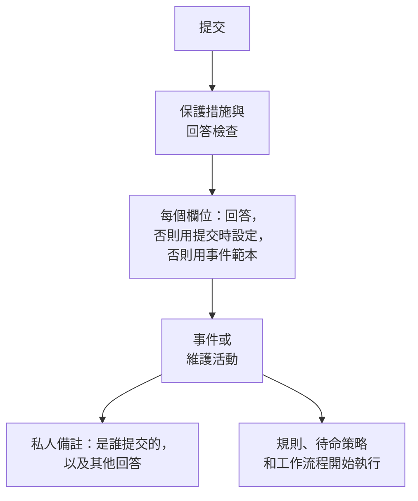

# 提交會建立什麼

透過表單的每次提交都會在您的專案中建立一筆紀錄： **事件** 或 **排定維護活動**。表單的 **提交時** 頁面會顯示建立的是哪一種，以及新紀錄的每個欄位如何填寫——來自回答、來自預設值、來自一律適用的設定，或來自事件範本。 **編輯設定** 用於變更預設值和一律適用的內容。

:::cards
- [提交如何成為事件](#提交如何成為事件): 新事件的每個欄位，以及其值的來源。
- [提交如何成為排定維護活動](#提交如何成為排定維護活動): 維護請求的情況也一樣。
- [提交時設定](#提交時設定): 預設值、一律附加的內容、擁有者和發布。
- [私人備註](#私人備註): 是誰提交的，以及沒有任何欄位保存的回答。
:::

## 提交時會發生什麼

未通過檢查的提交不會建立任何內容。請參閱 [什麼在保護表單](/docs/forms/sharing-and-security#什麼在保護表單)。

## 每次提交會建立什麼

**每次提交建立的內容** 卡片保存著您建立表單時所做的選擇：

- **事件** ——每次提交都會宣告一個事件，因此您的待命團隊會立即收到通知。用於問題回報。
- **排定維護** ——每次提交都會排定一個維護活動。用於變更和維護請求。

選擇另一種會要求您確認，因為表單會隨之改變：

- 標題、描述、監測器和標籤維持關聯：兩種紀錄都有它們。
- 其他所有關聯的問題（嚴重程度、狀態頁面選擇、舊類型的自訂欄位）都會變成表單自己的問題，措辭不變，其回答會列在私人備註中。
- 提交時設定會重新開始，因為事件和活動的設定不同。
- 現在建立維護活動的表單會詢問維護何時開始和結束。

問題會隨變更一起立即儲存。請在 **建構** 頁面上檢查它們。

## 提交如何成為事件

卡片會列出新事件的每個欄位及其值的來源：

| 欄位 | 來源 |
| --- | --- |
| **標題** | 對 **標題** 問題的回答。表單未詢問或回答留空時：使用 **預設標題**，否則使用表單的名稱。 |
| **描述** | 對 **描述** 問題的回答。未詢問或留空時，如果表單有範本，則使用事件範本的描述。 |
| **嚴重程度** | 表單詢問時為提交者的選擇。否則使用表單的 **嚴重程度** 設定，再否則使用事件範本的嚴重程度。 |
| **監測器** | 提交者選擇的監測器，以及設定一律附加的監測器。兩者都沒有時，使用事件範本的。 |
| **標籤** | 提交者選擇的標籤，以及設定一律新增的標籤。兩者都沒有時，使用事件範本的。 |
| **影響開始時間** | 表單詢問時，對 **影響開始時間** 的回答。 |
| **事件 範本** | 表單的 **事件 範本** 設定。它會填寫回答和設定未決定的所有內容。 |
| **待命策略** | 設定中指定的策略，會為表單宣告的每個事件執行。沒有時，使用事件範本的。 |
| **擁有者** | 設定中指定的人員和團隊，以及範本的擁有者。他們會收到每個事件的通知。 |
| **自訂欄位** | 每個自訂欄位問題的回答——除非該欄位從監測器自訂欄位複製其值，並且事件的監測器具有該值；其餘由範本填寫。 |
| **狀態頁面** | 在您團隊中有人發布之前，永遠不會顯示在狀態頁面上，訂閱者也不會收到通知。 |
| **其他回答** | 連同提交者一起列在事件的私人備註中。 |

> [!IMPORTANT]
> **沒有嚴重程度，就沒有事件。** 事件需要嚴重程度。當表單沒有詢問嚴重程度，其設定也沒有指定（或指定的已被刪除），並且其範本也沒有設定時， **嚴重程度** 列會向您發出警告，並且每次提交都會被以 "此表單未設定嚴重程度，因此無法建立事件。請通知分享此表單的團隊。" 拒絕。請在 **編輯設定** 中選擇一個嚴重程度，或選擇一個設定了嚴重程度的範本。

### 事件範本

在設定中選擇一個 **事件 範本**，表單宣告的每個事件都會以它為基礎宣告，方式與伺服器在任何地方套用範本相同——請參閱 [範本如何被套用](/docs/incidents/settings#範本如何被套用)。回答和表單的設定優先，範本會填寫其餘所有內容：初始狀態、描述、嚴重程度、受影響的資源、待命策略、擁有者、標籤、自訂欄位值以及監測器狀態變更。

> [!WARNING]
> **留意監測器。** 透過表單在監測器上宣告事件，對監測器的影響與手動在其上宣告事件完全相同：監測器的主動監控會暫停，直到事件解決；範本的 **將監測器狀態變更為** 會立即變更監測器的狀態——在列出該監測器的每個狀態頁面上都會變更，即使事件本身處於隱藏狀態。有了表單，任何擁有連結的人都能做到這一點。只有當每次提交都應暫停監測器時，才透過表單附加監測器。

### 事件的樣子

透過表單宣告的事件是一個一般的事件，只是有幾項自己的設定：

- **在狀態頁面上隱藏。** **於狀態頁面可見** 處於關閉狀態， **通知狀態頁面訂閱者** 也是。在應變人員發布它之前，事件的任何內容都不會到達狀態頁面或訂閱者——上文所述範本的監測器狀態變更除外。
- **無人宣告。** 提交者不是 OneUptime 使用者，因此不會有使用者被記錄為宣告該事件的人。
- **會通知其擁有者。** 設定和範本指定的擁有者會在事件的 Slack 和 Microsoft Teams 頻道建立後立即被新增，並收到通知——事件的 **事件已建立** 通知會等到他們成為擁有者後才發出，因此會發給他們，而不是專案的擁有者。
- **私人備註會記錄提交** ——請參閱 [私人備註](#私人備註)。

為新事件執行的所有內容也會為這些事件執行：隱私、擁有者、標籤、待命和操作手冊規則、待命策略，以及 **On Create Incident** 工作流程。待命規則會像比對其他事件一樣比對表單的事件——包括依提交者寫的標題和描述比對。

:::steps
#### 閱讀提交者寫的內容

事件發布後，標題和描述會顯示在狀態頁面上。

#### 發布事件

在事件的 **設定** 頁面上開啟 **於狀態頁面可見**。

#### 如果訂閱者需要知道，就通知他們

由於事件是在 **通知狀態頁面訂閱者** 關閉的情況下宣告的，發布它不會傳送「事件已建立」通知。要通知訂閱者，請發布一則勾選了 **通知狀態頁面訂閱者** 的公開備註——請參閱 [發布公開備註](/docs/incidents/notes-owners-and-feed#發布公開備註)。
:::

## 提交如何成為排定維護活動

| 欄位 | 來源 |
| --- | --- |
| **標題** | 對 **標題** 問題的回答。表單未詢問或回答留空時：使用 **預設標題**，否則使用表單的名稱。 |
| **描述** | 對 **描述** 問題的回答。 |
| **開始**、 **結束** | 對 **開始** 和 **結束** 的回答，每個維護表單都會詢問並要求必填。結束時間必須晚於開始時間。 |
| **監測器** | 提交者選擇的監測器，以及設定一律附加的監測器。 |
| **狀態頁面** | 提交者選擇的狀態頁面，以及設定中指定的狀態頁面。 |
| **標籤** | 提交者選擇的標籤，以及設定一律新增的標籤。 |
| **擁有者** | 設定中指定的人員和團隊。他們是表單排定的每個活動的擁有者。 |
| **在狀態頁面上顯示** | 除非設定開啟，否則為 **否**。 |
| **通知訂閱者** | 除非設定開啟，否則為 **否**。 |
| **自訂欄位** | 每個自訂欄位問題的回答——除非該欄位從監測器自訂欄位複製其值，並且活動的監測器具有該值。 |
| **其他回答** | 連同提交者一起列在活動的私人備註中。 |

活動從您專案的 **Scheduled** 狀態開始，並像其他活動一樣推進：開始時變為進行中，結束時隨之結束。

提交是某人的請求，而請求在發布前要經過審查。因此，除非您變更設定，否則在您團隊中有人顯示該活動之前，它不會出現在其狀態頁面上，並且在它建立、開始或結束時也不會通知其訂閱者。設定中 **發布** 步驟裡的 **在狀態頁面上顯示** 和 **通知訂閱者** 可以為表單排定的每個活動變更這一點——只有在您信任每個擁有連結的人時才開啟它們。

## 提交時設定

**編輯設定** 會分步驟開啟設定： **下一步** 進入下一步， **儲存變更** 位於最後一步。每一步都已填好，因此表單旁邊的步驟清單可以開啟其中任意一步，包括最後一步：在對應的步驟中變更設定，然後開啟最後一步並儲存。

| 步驟 | 事件表單 | 維護表單 |
| --- | --- | --- |
| **預設值** | **預設標題**、 **嚴重程度**、 **事件 範本** | **預設標題** |
| **一律附加** | **監測器**、 **標籤**、 **待命策略** | **監測器**、 **狀態頁面**、 **標籤** |
| **擁有者** | **擁有者** | **擁有者** |
| **發布** | — | **在狀態頁面上顯示**、 **通知訂閱者** |

**擁有者** 是用於人員和團隊的同一個選擇器： **新增擁有者** 會開啟一個同時包含兩者的搜尋清單，每個選擇都會顯示為一個可以移除的標籤。設定中指定的所有內容都必須屬於表單的專案，擁有者必須是該專案的成員。選擇之後被刪除的紀錄會在建立提交時被略過，其餘部分仍然適用。

## 私人備註

每次提交都會在其建立的內容上留下私人備註：

> Submitted through the form **Report a Problem** by Ada Lovelace (<ada@example.com>).
>
> **Which office are you in?**\
> Berlin

它會寫明表單和提交者（當表單沒有詢問提交者是誰時，為 "Submitted anonymously through the form **Report a Problem**." ），然後，當提交從表單的某個範本開始時，寫明是哪個範本（ "Started from the template **Application Outage**." ），接著依表單的順序列出對表單自己問題的回答，每個回答位於其問題之下。對關聯問題的回答已經在紀錄上：其標題、嚴重程度、自訂欄位。由於是私人的，該備註永遠不會到達狀態頁面，但它會像其他備註一樣發布到紀錄的 Slack 和 Microsoft Teams 頻道。

地址是一個連結，會準確地寫信給該地址——在儀表板、Slack 以及寄給擁有者的電子郵件中都是如此。

## 隱藏的問題和範本

[隱藏的問題](/docs/forms/building#隱藏的問題) 由提交所起始的 [範本](/docs/forms/building#範本) 回答——從不由請求回答——其回答的去向與輸入的回答完全相同：隱藏的 **描述** 會成為事件的描述，隱藏的自訂欄位會成為其值，表單自己的隱藏問題會成為私人備註中的一行。沒有從任何範本開始的提交會讓隱藏的問題維持未回答，其欄位會像任何留空的問題一樣由提交時設定填寫。在有人開啟表單期間刪除的範本不會阻止其提交：提交會依其回答建立，但不包含範本的隱藏回答。

範本可以 [以自己的方式](/docs/forms/building#範本如何詢問每個問題) 詢問表單的問題，伺服器會依提交所指定範本的詢問方式來約束提交。範本隱藏的問題會像隱藏問題一樣由範本回答，即使表單詢問了它；範本詢問的問題會從請求中讀取，即使表單隱藏了它；範本要求必填的問題必須回答，否則提交會被拒絕，並且不會建立任何內容。

範本在頁面上填寫的回答，一旦提交就歸提交者所有：無論範本寫了什麼，伺服器都會採用請求為頁面所詢問問題送出的回答。

## 提交者寫的文字

提交會直接進入文字可以自行起作用的地方——Slack 和 Microsoft Teams 頻道、每位應變人員的瀏覽器、擁有者的電子郵件——而且沒有人會事先閱讀。因此，在建立紀錄之前：

| 提交者寫的內容 | 儲存的內容 |
| --- | --- |
| 標題、描述或任何文字回答中的提及，例如 \<!channel\>、 \<!here\> 或 \<@U0123ABC\> | **提及不會通知任何人。** Slack 視為提及的任何內容都會在其左括號之後加入一個不可見字元。它在任何地方讀起來都一樣，但沒有聊天工具會對其作出反應。 |
| 描述或 **格式化文字** 回答中的圖像 | **圖像會變成連結。** 每張圖像都會變成指向同一地址的連結，因此在應變人員按一下之前，不會從提交者選擇的地方載入任何內容。 |
| 語言為 `mermaid` 的程式碼區塊（無論如何書寫） | **圖表會變成程式碼。** 它會以純程式碼儲存，因此顯示的是其文字，而不是繪製圖表。 |
| 標題中的圖像語法或圖表程式碼區塊 | **標題是純文字。** 它們同樣會加入不可見字元，因此無論標題出現在哪裡——片段、聊天訊息、備註範本——都不會載入任何內容，也不會繪製任何內容。不可見字元計入標題的限制。 |

其他所有內容——連結、其餘的 Markdown、下拉式清單選擇、數字、日期、已勾選的核取方塊——都會依提交者提供的樣子儲存，提交也會保留提交者輸入的姓名和電子郵件。

## 後續步驟

:::cards
- [建構表單](/docs/forms/building): 填寫這些欄位的問題、隱藏的問題和範本。
- [事件設定與自動化](/docs/incidents/settings): 事件範本和自訂欄位。
- [事件備註、負責人與動態](/docs/incidents/notes-owners-and-feed): 私人備註、公開備註和擁有者。
- [分享與安全](/docs/forms/sharing-and-security): 誰可以提交，以及提交的頻率。
:::
