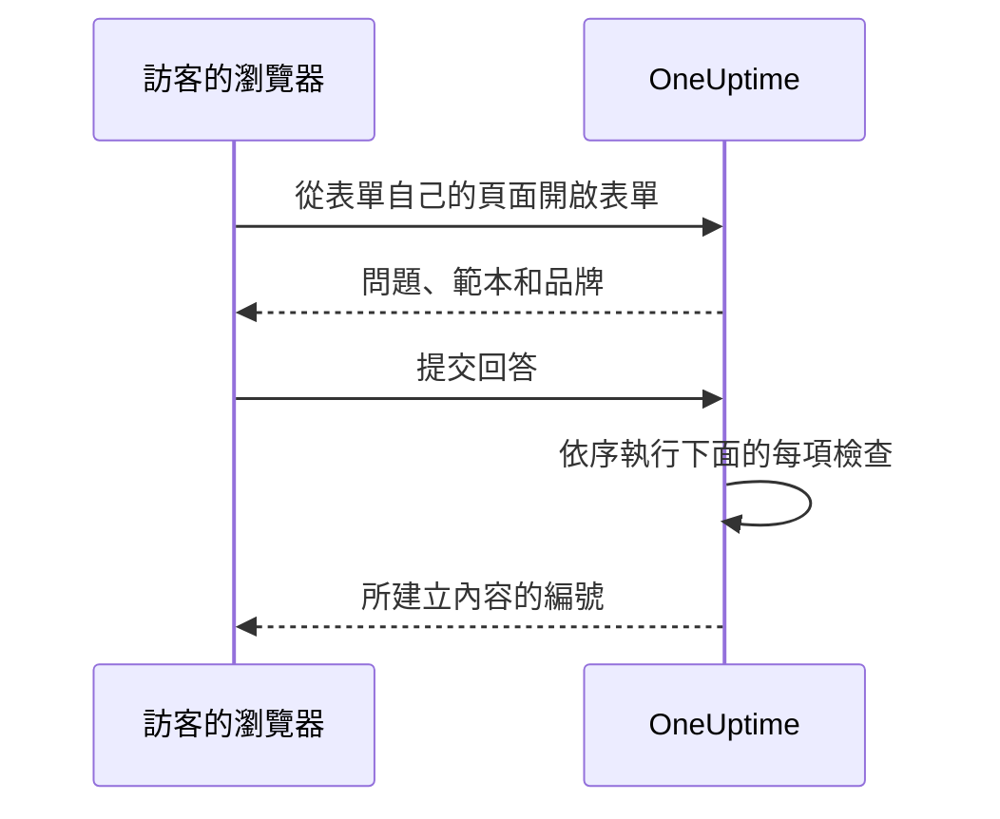

# 分享與安全

表單對任何擁有其連結的人開放，每次提交都可能呼叫您的待命團隊，或在您的行事曆上排入一個維護時段。本頁介紹表單的 **分享** 頁面——連結、關閉表單、提交後的訊息以及 IP 允許清單——以及請求一路上要通過的其他所有檢查。

:::cards
- [分享連結](#分享連結): 複製它、開啟它，並在流傳過廣時重設它。
- [每個範本的連結](#每個範本的連結): 每種情況一個書籤，背後都是同一個表單。
- [什麼在保護表單](#什麼在保護表單): 依序列出請求要通過的每項檢查。
- [疑難排解](#疑難排解): 表單頁面上每則訊息的含義，以及該怎麼做。
:::

## 分享頁面

| 卡片 | 包含的內容 |
| --- | --- |
| **狀態** | **接受提交** ——表單的連結是否可用。 |
| **分享連結** | 連結，附有 **複製連結**、 **開啟表單** 和 **重設連結**。 |
| **提交之後** | 人們提交後在表單所建立內容的編號下方看到的 **感謝訊息**。 |
| **存取** | **IP 允許清單**。 |

## 分享連結

**分享連結** 卡片顯示表單的連結，例如 `https://oneuptime.com/accounts/form/<share-key>`：

- **複製連結** 複製它。
- **開啟表單** 在新分頁中依人們看到的樣子開啟表單。
- **重設連結** 在您確認後為表單產生新連結。舊連結會立即失效並顯示無法使用的訊息，因此您分享過的每個人都需要新連結。當連結流傳得比應有的更廣時使用它。

任何擁有連結的人都可以開啟並提交表單，不需要 OneUptime 帳戶，也不需要登入。登入與否沒有任何差別：OneUptime 只能從表單中輸入的姓名和電子郵件得知是誰提交的。因此，請像對待待命團隊的電話號碼一樣對待這個連結。把它分享到應該使用它的人找得到的地方——內部網路頁面、支援操作手冊、聊天中的置頂訊息——而不要放在公開網站上，除非您希望接受任何人的提交。

連結帶有自己的隨機金鑰，而不是表單的 ID。在自行託管的安裝中，它由您自己的 OneUptime 主機提供，並且只在 `HTTP_PROTOCOL` 和 `HOST` 設定的地址上有效：如果用伺服器的其他名稱或其 IP 位址開啟，表單的請求會被當作來自其他網站而遭到拒絕。

指向舊事件表單的連結 `/accounts/incident-form/<share-key>` 會在新地址開啟同一個表單。

### 每個範本的連結

表單的每個 [範本](/docs/forms/building#範本) 都有自己的連結：表單的連結加上 `?template=` 和範本的 ID，例如 `https://oneuptime.com/accounts/form/<share-key>?template=<template-id>`。表單 **範本** 頁面上的 **複製連結** 會複製它。它會開啟已用該範本填寫好的表單，因此團隊可以為每種情況儲存一個書籤，而您只需維護一個表單。當提交者選擇另一個範本時，其瀏覽器中的地址會隨之改變，因此他們複製的連結就是他們所看到的表單。

範本的連結就是表單的連結：只要表單處於 **接受提交**，它就有效，並且 **重設連結** 會連同其餘連結一起將其作廢。指向已刪除範本的連結會像沒有指定範本一樣開啟表單——如果有預設範本，則使用預設範本。

### 關閉表單

要在不刪除表單的情況下停止接受提交，請關閉 **接受提交**。此時連結會顯示 "此表單無法使用。它可能已被關閉，或連結已過期。"，並且 **分享連結** 卡片會提醒您表單已關閉。重新開啟後，同一個連結會再次生效。

### 感謝訊息

提交後，頁面會顯示 "謝謝——您的回覆已提交。" 並提供所建立內容的編號，然後顯示您用 Markdown 撰寫的 **感謝訊息**。用它說明接下來會發生什麼，以及遇到緊急情況時該找誰。沒有填寫時，頁面只顯示標準訊息。

表單描述或感謝訊息中的圖像，在表單處於 **接受提交** 期間會顯示給每個開啟連結的人。關閉表單或移除圖像後，該圖像會再次成為私人的，除非所有人都看得到的其他內容中仍然包含它。

## 什麼在保護表單

每個請求都會依以下順序通過這些檢查：

1. 請求必須來自表單自己的頁面，而不是其他網站——請參閱 [來自其他網站的請求](#來自其他網站的請求)。
2. 它必須在速率限制之內。
3. 表單必須存在、處於 **接受提交**，並且屬於方案包含表單的專案。
4. 當表單有 **IP 允許清單** 時，請求必須來自其中的地址。
5. 當執行個體開啟了驗證碼時，提交必須通過驗證碼。
6. 每個回答都必須在大小限制之內並符合其問題——請參閱 [建構表單](/docs/forms/building#大小限制)。
7. 由回答和設定組成的內容必須可以建立：事件需要嚴重程度，活動需要晚於開始時間的結束時間。
8. 提交必須在表單的每小時額度之內——請參閱 [速率限制](#速率限制)。

表單的標誌和網站圖示是表單的一部分：只有在請求通過前四項檢查之後，它們才會以 base64 形式包含在開啟表單的回應中傳送，並且從不透過它們自己的地址傳送。沒有表單就無法取得它們，也無法透過表單依 ID 取得任何檔案；檔案本身維持私人。表單只顯示在其自己的專案中上傳的圖像：其他專案的檔案會在儲存表單時被拒絕，並且永遠不會傳送到其頁面。

### IP 允許清單

要將表單限制在您自己的網路中：

:::steps
1. 開啟表單的 **分享** 頁面。
2. 在 **存取** 卡片上，按一下 **編輯 IP 允許清單**。
3. 每行輸入一個網路，然後儲存。之後卡片會在 **IP 允許清單** 下列出它們。
:::

每一行是以下其中之一：

| 項目 | 範例 | 說明 |
| --- | --- | --- |
| IPv4 位址 | `203.0.113.7` | |
| IPv6 位址 | `2001:db8::7` | 無論如何書寫都能比對，大寫或完整寫出零皆可。 |
| CIDR 表示法的 IPv4 範圍 | `10.0.0.0/8` | 不支援 IPv6 範圍——請將每個 IPv6 位址單獨寫在一行。 |

IPv4 位址必須依 IPv4 的方式書寫：如果依 IPv6 的方式書寫，例如 `::ffff:203.0.113.7`，會被拒絕。每次儲存清單時（無論來自儀表板、API、Terraform 還是工作流程）都會檢查它，永遠無法相符的行會被拒絕，並顯示指明該行的訊息。將清單留空即可允許所有網路。一旦清單中有項目，無法判定地址的請求就會被拒絕。

在 OneUptime Cloud 上，設定 IP 允許清單需要 **Scale** 方案——透過 API 建立附有允許清單的表單時和編輯表單時都是如此——與 [公開儀表板](/docs/dashboards/sharing) 的 IP 允許清單相同。清空清單在任何方案上都可以進行。

### 來自其他網站的請求

瀏覽器會告訴伺服器是哪個頁面送出了請求。當其他網站的頁面讓訪客的瀏覽器開啟或提交表單時，請求會被以 "This form can only be used from its own page." 拒絕——這發生在任何速率限制計數之前，並且與連結無關，因此回應不會透露存在哪些表單。

當請求的 `Sec-Fetch-Site` 標頭存在且其值不是 `same-origin` 或 `none` 時，或其 `Origin` 標頭存在且不是您的 OneUptime 地址（ `HTTP_PROTOCOL` 和 `HOST`，如果 `HOST` 帶有連接埠則包括連接埠）時，請求會被拒絕。提交還必須以 JSON（ `application/json` ）傳送；以網頁表單欄位或純文字傳送的提交會被以 "The request must be a JSON object holding the form's answers in "data"." 拒絕。讀取表單還需要表單頁面加到其發出的每個請求中的標頭 `X-OneUptime-Form: 1`：頁面無法在沒有指令碼的情況下讓瀏覽器加入標頭，而加入該標頭的其他網站的指令碼會透過其 `Origin` 暴露自己。

### 速率限制

開啟表單和提交表單都依網路地址進行限制，提交還會依表單進行限制：

- **開啟表單** ——依來自同一地址的每個表單，以及依跨所有表單的每個地址進行限制，並保留讓整個辦公室同時開啟連結的餘裕。超過其中任何一個時，頁面會顯示 "請求過多。請稍後再試。" 如果無法連線到速率限制器，表單仍然可以開啟。
- **提交（依地址）** ——依來自同一地址的每個表單，以及依跨所有表單的每個地址進行限制。超過其中任何一個時，提交者會看到 "來自您網路的提交次數過多。請稍候幾分鐘再試一次。" 同一地址背後的所有人（辦公室網路、VPN 閘道）共用這些限制，並且每次提交都會計數，即使之後因回答錯誤而被拒絕的提交也是如此。
- **提交（依表單）** ——一個表單在一小時內可以建立的紀錄數，所有地址合計，因此即使同時來自許多地址的提交，每小時也只能呼叫您有限的次數。只有通過所有其他檢查的提交才會計數，計數發生在其紀錄建立之前。超過後，在時間範圍結束之前，每個人都會看到 "此表單目前收到的提交過多。請稍後再試。" **重設連結** 會讓新連結以全新的額度開始。

每項限制都會以 `429` 回應，並附上以秒為單位的 `Retry-After` 標頭，頁面會告訴提交者何時重試。時間範圍是固定的，而不是滾動的。如果無法連線到速率限制器，提交會被拒絕，而不是不計數地放行：API 會以 `503` 回應，提交者會看到 "目前無法接受提交。請幾分鐘後再試。"

在自行託管的安裝中，OneUptime 應用程式的以下環境變數用於變更限制：

| 變數 | 預設值 | 設定的內容 |
| --- | --- | --- |
| `FORM_RATE_LIMIT_WINDOW_SECONDS` | `60` | 開啟表單的時間範圍，以秒為單位。 |
| `FORM_RATE_LIMIT_PER_FORM_AND_IP_PER_WINDOW` | `120` | 一個地址在每個時間範圍內開啟一個表單的次數。 |
| `FORM_RATE_LIMIT_PER_IP_PER_WINDOW` | `600` | 一個地址在每個時間範圍內開啟表單的次數，所有表單合計。 |
| `FORM_SUBMIT_RATE_LIMIT_WINDOW_SECONDS` | `900` | 依地址的提交限制的時間範圍，以秒為單位。 |
| `FORM_SUBMIT_RATE_LIMIT_PER_FORM_AND_IP_PER_WINDOW` | `10` | 每個時間範圍內從一個地址向一個表單的提交次數。 |
| `FORM_SUBMIT_RATE_LIMIT_PER_IP_PER_WINDOW` | `30` | 每個時間範圍內來自一個地址的提交次數，所有表單合計。 |
| `FORM_SUBMIT_RATE_LIMIT_PER_FORM_WINDOW_SECONDS` | `3600` | 依表單限制的時間範圍，以秒為單位。 |
| `FORM_SUBMIT_RATE_LIMIT_PER_FORM_PER_WINDOW` | `60` | 一個表單在每個時間範圍內可以建立的紀錄數，所有地址合計。 |

每個變數也會讀取其舊名稱，也就是前綴為 `INCIDENT_FORM_` 而不是 `FORM_` 的名稱——例如 `INCIDENT_FORM_SUBMIT_RATE_LIMIT_PER_FORM_PER_WINDOW` ——因此調整過事件表單的安裝會保留其限制；兩者都設定時以新名稱為準。 `config.env` 和 Helm chart 的值都不會傳遞它們：請自行將它們加入 `app` 容器的環境中——在 Helm chart 中使用 `app.extraEnv` 或 chart 層級的 `extraEnv`，對於 Docker Compose 則使用 `docker-compose.override.yml`。 `TRUSTED_PROXY_HOPS` 決定依地址的限制計算的是哪個地址。

### 驗證碼

當您的 OneUptime 執行個體開啟了 hCaptcha 時，表單會顯示驗證碼，未通過驗證碼的提交會被拒絕。沒有依表單的設定。自行託管的安裝透過 `CAPTCHA_ENABLED`、 `CAPTCHA_SITE_KEY` 和 `CAPTCHA_SECRET_KEY` 開啟驗證碼——與保護註冊的設定相同。沒有驗證碼時，由速率限制和 IP 允許清單承擔負載。

## 疑難排解

:::details 連結提示表單無法使用
"此表單無法使用。它可能已被關閉，或連結已過期。" 無論原因是什麼，頁面都會給出相同的回答，因此它永遠不會告訴陌生人某個表單是否存在：

- **分享** 頁面上的 **接受提交** 已關閉。
- 連結已透過 **重設連結** 被取代。請分享新連結。
- 表單已被刪除。
- 在 OneUptime Cloud 上，專案低於 **Growth** 方案，或其訂閱未付款。
- 複製連結時連結被截斷了。
:::

:::details 只能從允許的網路開啟表單
"此表單只能從允許的網路開啟。" 提交者的地址不在表單的 **IP 允許清單** 中：新增其網路，或清空清單。在位於 Proxy 或負載平衡器之後的自行託管安裝中，請檢查 `TRUSTED_PROXY_HOPS` ——當它過小時，OneUptime 看到的是您 Proxy 的地址，而不是提交者的地址。當表單在您 OneUptime 自己的地址以外的地址上開啟時，頁面也會顯示同樣的內容：請完全依 **分享連結** 卡片顯示的樣子開啟連結。
:::

:::details 提交過多
"來自您網路的提交次數過多。請稍候幾分鐘再試一次。" 同一地址背後的所有人共用依地址的限制，這在大規模故障期間、許多人同時回報時特別重要。頁面會說明何時重試。 "此表單目前收到的提交過多。請稍後再試。" 則是依表單的額度：它與提交者的網路無關，時間範圍結束後會再次接受回報。如果由於連結流傳過廣而出現不真實的提交， **重設連結** 會立即停用舊連結。
:::

:::details 現在無法接受提交
"目前無法接受提交。請幾分鐘後再試。" 無法連線到速率限制器，因此提交會被拒絕，而不是不計數地放行。開啟表單仍然可用。在自行託管的安裝中，請檢查速率限制器用於計數的快取 Valkey 是否正在執行，並且可以從 OneUptime 應用程式存取。
:::

:::details 此表單無法建立事件，因為它沒有嚴重程度
表單沒有詢問嚴重程度，其設定也沒有指定（或指定的已被刪除），並且其事件範本也沒有設定。請在表單的 **提交時** 頁面上選擇一個嚴重程度。請參閱 [沒有嚴重程度，就沒有事件](/docs/forms/on-submit#提交如何成為事件)。
:::

:::details 提交被拒絕
訊息會說明問題所在：缺少必填回答或回答只有空格、回答過長或不符合其問題、電子郵件地址不是單一的一般地址，或維護時段在開始之前就結束了。 "驗證碼驗證失敗。請再試一次。" 表示驗證碼未通過或已過期：請重新完成驗證。在每次提交都無法通過驗證碼的自行託管安裝中，請檢查 `CAPTCHA_SITE_KEY` 和 `CAPTCHA_SECRET_KEY` 是否都已設定。
:::

:::details 問題不在表單上
建構器會標記它從公開表單中省略的問題（例如已被刪除的自訂欄位），並且 **預覽** 會在省略問題時加以說明。請參閱 [建構器標記問題時](/docs/forms/building#建構器標記問題時)。帶有 **隱藏** 徽章的問題是刻意省略的：只有範本會回答它。請參閱 [隱藏的問題](/docs/forms/building#隱藏的問題)。一個問題也可能對某個範本在表單上，對另一個範本則不在：每個範本都可以隱藏問題，或詢問表單隱藏的問題。開啟範本的 **編輯** 並檢查其 **問題**。請參閱 [範本如何詢問每個問題](/docs/forms/building#範本如何詢問每個問題)。
:::

:::details 範本沒有填寫某個問題
只有當範本的回答仍然符合其問題時才會被使用：問題仍然提供的選項、表單仍然提供的紀錄、不過長的文字。編輯範本，重新回答該問題並儲存。請參閱 [範本](/docs/forms/building#範本)。
:::

:::details 事件或活動沒有出現在狀態頁面上
這是刻意的設計：來自表單的事件以隱藏狀態宣告，而維護活動會維持隱藏，除非表單的 **發布** 設定另有規定。請參閱 [提交會建立什麼](/docs/forms/on-submit)。
:::

:::details 沒有呼叫任何人
表單的事件會像其他事件一樣，執行其設定和範本指定的待命策略，以及您的待命規則新增的內容。如果這些都沒有，就不會呼叫任何人。請在表單的 **提交時** 頁面上新增待命策略，或撰寫一條比對其事件的待命規則——例如依表單一律新增的標籤比對。
:::

## 後續步驟

:::cards
- [表單概覽](/docs/forms/index): 表單的用途、權限和 API。
- [建構表單](/docs/forms/building): 問題、隱藏的問題和範本。
- [提交會建立什麼](/docs/forms/on-submit): 每次提交所建立的事件或活動。
:::
