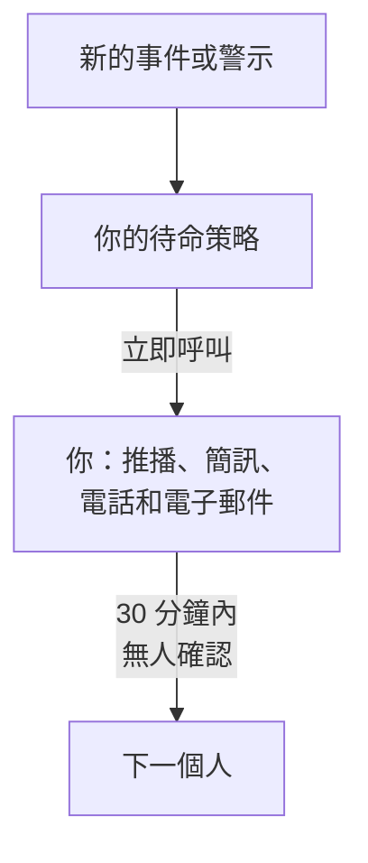

# 透過電話、簡訊或推播接收呼叫

完成本指南後，專案中的每個新事件和警示都會透過推播通知、簡訊或電話在你的手機上呼叫你，30 分鐘內無人確認時會呼叫下一個人，而一次由你確認的測試呼叫證明這一切都能正常運作。本指南依照引導式設定 **出問題時呼叫合適的人** 進行，大約需要 10 分鐘。

## 你需要什麼

- 一個你擁有的專案：開啟簡訊和電話需要專案擁有者，建立待命策略需要擁有者或管理員。
- 你的手機。
- 你想呼叫的團隊成員，他們必須是專案成員：[邀請成員](/docs/permissions/inviting-people) 說明了如何邀請。

:::tabs
@tab OneUptime Cloud
推播通知在所有方案中都免費。簡訊和電話從專案的餘額中支付，餘額一開始為 0.00 USD；新增電話號碼時會傳送一則簡訊，因此餘額必須先高於 1.00 USD。儲值會從專案的卡片扣款。Free 方案只限一人和一條上報規則：只有你會被呼叫，呼叫會重複進行，不會轉給其他人。
@tab 自行託管
你的伺服器必須能寄送電子郵件、傳送簡訊並撥打電話。伺服器的主管理員會在 `/admin/setup` 中設定它們，每一項都附有測試，如 [自架部署指南](/docs/installation/self-hosting-guide) 所述。推播通知透過 OneUptime 推播中繼送達應用程式，不需要任何設定。
:::

## 步驟

:::steps
### 開啟引導式設定

在專案的 **首頁** 上，點選 **歡迎使用 OneUptime 👋** 清單中的 **設定待命政策**。新專案的首頁會先問 **您想先做什麼？**：勾選 **出問題時呼叫合適的人** 並點選 **繼續**。如果清單中沒有這一步，或這一步已經完成，請按 `Ctrl+K`（Mac 上為 `Cmd+K`），輸入 `get paged` 並選擇 **出問題時呼叫合適的人**。

### 在手機上安裝應用程式

從 App Store 或 Google Play 安裝 OneUptime On-Call 並登入：應用程式會為你的手機註冊推播通知。回到引導式設定中，點選 **重新檢查**：**我們該如何聯絡你？** 下的 **行動應用程式或瀏覽器** 現在會列出你的手機。

### 開啟簡訊和電話

新專案中的簡訊和電話預設關閉。如果你是專案擁有者，請點選 **開啟簡訊和電話**；其他人會看到誰可以開啟。在 OneUptime Cloud 上，如果餘額不超過 1.00 USD，請點選 **儲值餘額**，在 **金額（USD）** 下輸入 20 到 1,000 USD，然後點選 **儲值**。

### 新增你的電話號碼

在 **你的電話號碼** 中輸入含國碼的手機號碼，例如 `+15551234567`，然後點選 **透過簡訊傳送驗證碼**。輸入簡訊中的驗證碼並點選 **驗證**：呼叫時也會撥打這個號碼。點選 **繼續**。如果只想透過應用程式和電子郵件接收呼叫，請不要填寫號碼，直接點選 **繼續**。

### 選擇還要呼叫誰

在 **還有誰待命？** 下，你已經在 **首先呼叫** 中。點選 **新增團隊成員**，讓其他人和你一起被呼叫，然後點選 **儲存並繼續**。在還沒有待命策略的專案中，這會建立 `Default on-call policy`，它會在每個新事件和警示發生時呼叫他們。在已有待命策略的專案中，請改為在 **待命策略** 下選擇它，並在 **新增到第一條上報規則** 下新增人員。如果暫時還聯絡不到某人，這一步會停留在 **呼叫能聯絡到他們嗎？**：為他們點選 **傳送設定提醒**，然後點選 **繼續**。

### 決定無人回應時怎麼辦

在 **如果無人回應怎麼辦？** 下，保留 **呼叫其他人**，在 **接著呼叫** 下選擇要呼叫的人，並將 **等待分鐘數** 保留為 `30` 或修改它。點選 **儲存並繼續**。在 Free 方案中，這一步會改為提供 **再次呼叫同一批人**，**重新呼叫次數** 為 `2`。

### 傳送測試呼叫

在 **傳送測試呼叫** 下，點選 **測試此策略**。選擇 **嚴重程度** 並點選 **傳送測試呼叫**。策略第一條上報規則中的人員會像真實事件發生時那樣被呼叫，每則訊息都會註明 TEST。不會建立事件，也不會通知任何狀態頁面或訂閱者。

### 確認測試呼叫

開啟簡訊或電子郵件中的連結，在那裡確認呼叫，或者在通話中按 1。應用程式會顯示呼叫已送達，但無法確認測試呼叫。然後在對話方塊中點選 **完成**，再點選 **繼續**。
:::

## 檢查是否生效

- 測試步驟會顯示誰確認了呼叫、透過什麼方式以及花了多少時間。
- 引導式設定會以 **呼叫已設定** 結束，其中的內容來自實際記錄：**呼叫對象**、**如果無人回應** 和 **已測試**。策略本身的問題，例如有它聯絡不到的人，會列在 **需要注意** 下。
- 在 **首頁** 上，清單會把 **設定待命政策** 標示為已完成。如果這是最後一步，清單就會消失。

如果策略還會呼叫其他人，你也可以觀察上報過程：在摘要中點選 **開啟待命策略**，然後點選 **測試此策略**。開啟 **逐一經過每個升級層級**，傳送測試，並且不要確認第一次呼叫：最多 2 分鐘後，下一個人就會被呼叫。

## 可能發生的問題

:::details 沒有「透過簡訊傳送驗證碼」按鈕
簡訊已關閉或無法傳送，這一步會說明原因。只有專案擁有者或管理帳單的人才會看到 **開啟簡訊和電話**。在 OneUptime Cloud 上，餘額不超過 1.00 USD 時，該欄位會被隱藏。在無法傳送簡訊的自行託管伺服器上，伺服器的主管理員會看到 **設定簡訊和電話**，它會開啟 Admin Dashboard 以新增 Twilio，如 [Twilio 整合](/docs/self-hosted/twilio-integration) 所述。
:::

:::details 儲值餘額時提示找不到付款方式
儲值會從專案的卡片扣款。請在 **專案設定 → 帳單與發票 → 帳單** 中透過 **新增付款方式** 新增一張卡片，然後再次儲值。在此之前，應用程式和電子郵件仍會呼叫你。
:::

:::details 自行託管：因為未設定 Twilio 帳戶，號碼被拒絕
只有主管理員會事先收到伺服器無法傳送簡訊的提醒。請主管理員在 `/admin/setup` 中設定簡訊和電話。在此期間，點選 **繼續**：應用程式和電子郵件仍會呼叫你。
:::

:::details 一直收不到驗證碼或測試呼叫
先檢查號碼的國碼。測試呼叫之後，用 **完成** 關閉對話方塊，並點選 **我沒有收到**：它會說明要檢查什麼，而 **開啟我的通知方式** 會列出可以聯絡到你的所有方式。在自行託管的伺服器上，從 `/admin/setup` 傳送一則測試簡訊，並在伺服器上執行 `npm run doctor`。
:::

## 後續步驟

:::cards
- [待命排程](/docs/on-call/schedules): 輪流待命，讓每次呼叫都送到正在待命的人。在 Cloud 上，從 Growth 方案起提供。
- [上報規則](/docs/on-call/escalation-rules): 為策略新增級別、團隊和待命排程。
- [如何聯絡我](/docs/notifications/on-call-rules): 選擇先用哪種方式聯絡你，以及何時聯絡。
- [發布狀態頁面](/docs/guides/status-page): 在你自己的網域上告訴客戶正在發生什麼。
:::
