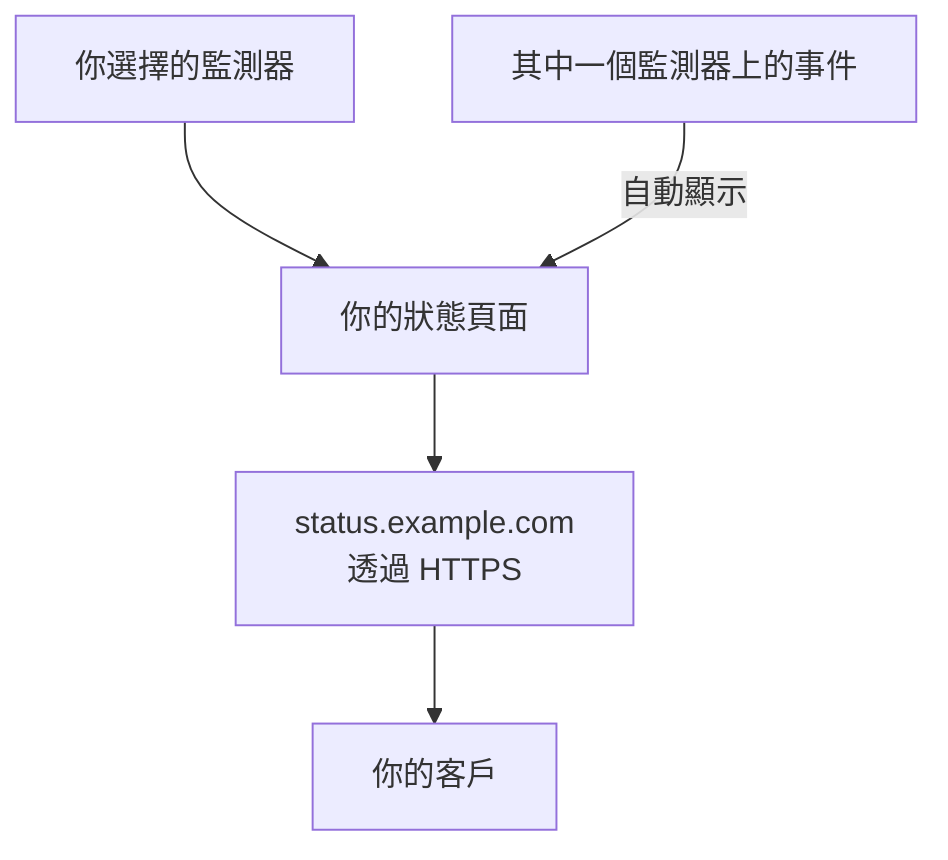

# 發布狀態頁面

完成本指南後，你的客戶可以透過 HTTPS 在你自己的位址（例如 `status.example.com`）上開啟狀態頁面。頁面會顯示你選擇的監測器及其狀態和正常運作時間，其中任何一個監測器上的事件都會自動顯示在頁面上。本指南依照引導式設定 **發布狀態頁面** 進行，然後在頁面的 **自訂網域** 中新增你的網域：大約需要 15 分鐘，另加 DNS 供應商所需的時間。

## 你需要什麼

- 至少一個監測器：狀態頁面顯示的就是監測器。如果還沒有，引導式設定會先提供 **設定監測器**。
- 專案擁有者或管理員角色：建立頁面需要建立狀態頁面的權限，新增你的網域需要新增和驗證專案網域的權限。
- 一個由你控制的網域，並能在 DNS 供應商處管理它的 DNS 記錄。

:::tabs
@tab OneUptime Cloud
所有方案都包含自訂網域及其免費的 SSL 憑證。Free 方案每個專案只有一個狀態頁面：如果你已經有一個，請開啟它的 **自訂網域**，從新增網域的那一步開始。新的狀態頁面是公開的；若要設為私人，需要 Growth 方案。
@tab 自行託管
你的伺服器需要一個專屬的主機名稱，例如 `oneuptime.example.com`，它有一筆指向伺服器的 A 記錄，並在 80 和 443 連接埠上回應。在 `config.env` 中把它設為 `STATUS_PAGE_CNAME_RECORD`（在 Helm chart 中為 `statusPage.cnameRecord`），取代那裡的範例值。免費憑證還需要 `LETS_ENCRYPT_ACCOUNT_KEY`（`letsEncrypt.accountKey`）：一把用 openssl 產生並以 base64 編碼的私密金鑰。修改後請重新啟動 OneUptime。**新增自訂網域** 會先檢查伺服器，並列出仍然缺少的項目。
:::

## 步驟

:::steps
### 開啟引導式設定

在專案的 **首頁** 上，點選 **歡迎使用 OneUptime 👋** 清單中的 **發布狀態頁面**。新專案的首頁會先問 **您想先做什麼？**：勾選 **用狀態頁面告知我的客戶** 並點選 **繼續**。如果清單中沒有這一步，或這一步已經完成，請按 `Ctrl+K`（Mac 上為 `Cmd+K`），輸入 `status page` 並選擇 **發布狀態頁面**。

### 命名並選擇要顯示的內容

在 **命名並選擇要顯示的內容** 下，保留它建議的 **狀態頁面名稱**，或輸入你自己的名稱。在 **顯示的內容** 下，勾選客戶應該看到的監測器，或點選 **全選**。點選 **建立狀態頁面**。從這一刻起，頁面就可以透過它的連結公開存取，只顯示你勾選的監測器。

### 查看客戶看到的內容

在 **這是客戶看到的內容** 下，開啟 **公開連結** 下的位址：你的監測器會連同各自的狀態一起列出。回到引導式設定中，點選 **看起來不錯**。

### 開啟自訂網域

引導式設定會以一個摘要結束。在 **打造專屬風格（選填）** 下，點選 **您自己的網域**。狀態頁面的 **自訂網域** 隨即開啟。

### 新增你的網域

點選 **新增自訂網域**。在 **網域** 中輸入客戶將要開啟的位址，例如 `status.example.com`，然後點選 **繼續**。**DNS 設定** 隨即開啟，列出要新增的記錄。

### 新增 DNS 記錄

在你的 DNS 供應商處，新增 **DNS 設定** 列出的每筆記錄，包括它的 **類型**、**名稱** 和 **值**：一筆把該位址指向 OneUptime 的 CNAME 記錄，以及在專案第一次使用此網域時，一筆證明專案擁有該網域的 TXT 記錄。如果你的供應商會自動在每個名稱後面加上網域，請只輸入網域前面的部分，例如 `status`；網域本身則輸入 `@`。

### 檢查記錄

保持 **DNS 設定** 開啟，然後點選 **立即檢查**。它會在每筆記錄下方說明查詢了什麼、得到了什麼。TXT 記錄最先檢查：找到它之前，網域不會被新增，因此請再次點選 **立即檢查**，直到找到為止。找到 CNAME 記錄後，對話方塊會顯示 **您的 CNAME 記錄已驗證。** 接著會核發免費的 SSL 憑證，通常在 15 分鐘內完成。
:::

## 檢查是否生效

- 開啟 `https://status.example.com`（換成你自己的位址）：你的狀態頁面會開啟，而且沒有憑證警告。
- 在 **自訂網域** 上，網域的 **狀態** 顯示 **憑證已核發，將自動續約。** 在頁面已經能開啟後的一段時間內，它仍可能顯示 **正在核發免費憑證，通常會在 15 分鐘內完成。**
- 在 **首頁** 上，清單會把 **發布狀態頁面** 標示為已完成：只要有狀態頁面顯示了監測器，這一步就算完成。如果這是最後一步，清單就會消失。

不需要其他操作：OneUptime 會自動續約憑證。網域一旦新增成功，OneUptime 就會每 15 分鐘檢查一次它的 CNAME 記錄，並在記錄生效時完成驗證，即使你已經關閉了 **DNS 設定** 也是如此。

## 可能發生的問題

:::details 關閉 DNS 設定後，網域不在清單中
**DNS 設定** 在找到 TXT 記錄之前就被關閉了，因此網域從未被新增。點選 **新增自訂網域**，輸入同一個位址，點選 **繼續**，然後點選 **立即檢查**，直到對話方塊找到兩筆記錄。
:::

:::details 網域一直停留在「等待 DNS」
從網域所在的列開啟 **DNS 設定** 並點選 **立即檢查**：它會說明找到了什麼。檢查記錄的名稱是否為完整位址，例如 `status.example.com`，以及它的值是否與 **DNS 設定** 顯示的一致。如果該名稱以位址回應，表示它有一筆 A 記錄，或是你的 DNS 供應商對它進行了代理：請取代 A 記錄，或把該名稱設為「僅限 DNS」。對於根網域，例如 `example.com`，請使用你的供應商提供的 ALIAS、ANAME 或扁平化的 CNAME 記錄。
:::

:::details 狀態顯示無法核發免費憑證
如果你的網域上有一筆未包含 `letsencrypt.org` 的 CAA 記錄，它會阻擋憑證核發。在自行託管的伺服器上，Let's Encrypt 必須能透過 80 連接埠連到伺服器。修正原因即可：OneUptime 會自行不斷重試，**DNS 設定** 中的 **立即檢查** 也會重新訂購憑證，每個網域每 15 分鐘最多一次。
:::

:::details 自行託管：伺服器尚未準備好使用自訂網域
**新增自訂網域** 會顯示 **此伺服器尚未準備好使用自訂網域**，並為每個仍缺少的項目列出一行，說明要修改什麼：也就是 [你需要什麼](#你需要什麼) 中的設定。沒有 `LETS_ENCRYPT_ACCOUNT_KEY` 時，已驗證的網域會顯示 **已驗證。正在使用您自己的 Proxy 提供的 HTTPS。** 這時請透過你自己的 Proxy 為它提供 HTTPS。[狀態頁品牌與網域](/docs/status-pages/branding-and-domains#開始之前) 中有詳細說明。
:::

## 後續步驟

:::cards
- [狀態頁品牌與網域](/docs/status-pages/branding-and-domains): 你的標誌、色彩、頁首連結和頁尾。
- [訂閱者與公告](/docs/status-pages/subscribers): 讓客戶訂閱，並發布公告。
- [排定維護概觀](/docs/scheduled-maintenance/index): 在排定的工作開始前告知客戶。
- [透過電話、簡訊或推播接收呼叫](/docs/guides/paging): 在其中某個監測器當機時收到呼叫。
:::
