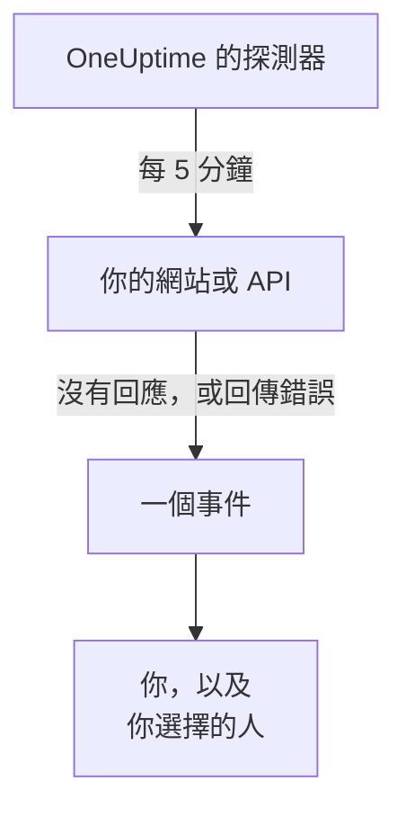

# 在網站或 API 停擺時收到通知

完成本指南後，OneUptime 會每 5 分鐘檢查一次你的網站或 API，在它停止回應或回傳錯誤時建立事件並通知你，而一次由你確認的測試呼叫證明訊息能夠送達你。本指南依照引導式設定 **在我的網站或 API 停擺時得知** 進行，大約需要 5 分鐘。

## 你需要什麼

- 一個你可以在其中建立監測器的 OneUptime 專案：擁有者、管理員或成員都可以建立。若要建立帳戶和專案，請依照 [快速開始](/docs/introduction/quickstart#建立專案) 的第一部分操作。
- 要檢查的位址，例如 `https://example.com`。對於 API，請選擇一個不需要金鑰、用一般的 `GET` 請求即可回應的端點，例如健康檢查：像 `401` 這樣的回應會被視為停擺。

:::tabs
@tab OneUptime Cloud
位於多個區域的探測器會檢查該位址，因此必須能從網際網路連到它。Free 方案包含 10 個作用中監測器。
@tab 自行託管
該位址由你伺服器自己的探測器檢查，因此必須能從那裡連到它。若要透過電子郵件收到通知，伺服器必須能寄送電子郵件：伺服器的主管理員會在 `/admin/setup` 中設定，如 [自架部署指南](/docs/installation/self-hosting-guide) 所述。主管理員不會成為自己所建立項目的擁有者，因此他們需要在監測器的 **擁有者** 頁面上新增自己，才能收到電子郵件。
:::

## 步驟

:::steps
### 開啟引導式設定

新專案的 **首頁** 會先問 **您想先做什麼？**：勾選 **在我的網站或 API 停擺時得知** 並點選 **繼續**。然後點選 **歡迎使用 OneUptime 👋** 清單中的 **建立您的第一個監測器**。如果清單中沒有這一步，請按 `Ctrl+K`（Mac 上為 `Cmd+K`），輸入 `website down` 並選擇 **在我的網站或 API 停擺時得知**。

### 輸入位址

在 **我們要檢查什麼？** 下，在 **網站或 API 位址** 中輸入位址。如果是 API 端點，請勾選 **這是一個 API 端點**。點選 **開始檢查**：探測器會立即檢查它，並用一句話說明發現了什麼。點選 **繼續**。

### 選擇要通知誰

在 **要通知誰？** 下，你看到的內容取決於專案：

- 如果還沒有待命策略或待命規則，你已經在 **呼叫對象** 中。點選 **新增團隊成員**，新增已在專案中的人員，然後點選 **儲存並繼續**。這會建立 `Default on-call policy`，它會在專案中每個新事件和警示發生時呼叫他們。
- 如果已有待命策略或規則，則由專案自己的規則決定呼叫誰：點選 **繼續**。
- 身為成員，你無法設定呼叫，這一步會告訴你將以監測器擁有者的身分收到電子郵件：點選 **繼續**。

### 傳送測試給自己

在 **傳送測試** 下，點選 **傳送測試呼叫給我**。選擇 **嚴重程度** 並點選 **傳送測試呼叫**。測試會像真實呼叫那樣送達你，每則訊息都會註明 TEST。不會建立事件。

### 確認測試呼叫

開啟電子郵件中的連結，在那裡確認呼叫。在專案開啟簡訊和電話後，也可以使用已驗證的電話號碼：開啟簡訊中的連結，或者在通話中按 1。然後在對話方塊中點選 **完成**，再點選 **繼續**。
:::

## 檢查是否生效

- 引導式設定會以摘要結束，其中的內容來自實際記錄：**檢查時間**、**當機時**、**會通知誰** 和 **已測試**。
- 點選 **開啟監控器**，然後點選其 **停機時** 卡片上的 **顯示通知鏈**：它會顯示從監測器到它能聯絡到的人員的整條通知鏈，並在沒有任何因素會中斷這條鏈時顯示 **沒有任何因素會中斷通知鏈。**
- 在 **首頁** 上，收到第一次檢查結果後，清單會把 **建立您的第一個監測器** 標示為已完成。如果這是最後一步，清單就會消失。

之後若要設定另一個位址，請再次開啟引導式設定並點選 **檢查其他位址**。

## 可能發生的問題

:::details 第一次檢查一直沒有結果
如果那句話說沒有任何位置在檢查該位址，表示監測器沒有探測器；如果它一直說正在檢查，表示它的探測器沒有連線。開啟 **監測器 → 設定 → 探測器** 查看每個探測器的狀態。在自行託管的伺服器上，由主管理員在 `/admin/setup` 中檢查伺服器的探測器。然後開啟監測器，為它新增一個已連線的探測器，再重新開啟引導式設定。
:::

:::details 網站正常，但監測器顯示它已停擺
監測器會把沒有回應，或回應狀態碼不在 200 到 399 之間的情況視為停擺。封鎖探測器的防火牆看起來就像沒有回應：在 OneUptime Cloud 上，請允許 [IP 位址](/docs/configuration/ip-addresses) 中列出的位址；在自行託管的伺服器上，請允許執行探測器的機器。若要變更這條規則，請參閱 [網站監控](/docs/monitor/website-monitor) 或 [API 監控](/docs/monitor/api-monitor)。
:::

:::details 無法確認測試呼叫
沒有收到任何可用來確認呼叫的訊息。在自行託管的伺服器上，這通常表示伺服器還無法寄送電子郵件：這一步會說明這一點，伺服器的主管理員會看到 **設定電子郵件**。設定好之後，點選 **再傳送一次測試**，或者點選 **略過測試**，稍後再回來。測試之後，用 **完成** 關閉對話方塊，並點選 **我沒有收到**：它會說明要檢查什麼。
:::

## 後續步驟

:::cards
- [透過電話、簡訊或推播接收呼叫](/docs/guides/paging): 在手機上接收呼叫，並在無人回應時呼叫下一個人。
- [發布狀態頁面](/docs/guides/status-page): 在你自己的網域上向客戶展示這個監測器。
- [條件與狀態](/docs/monitor/criteria-and-statuses): 精確決定監測器何時算是停擺。
:::
