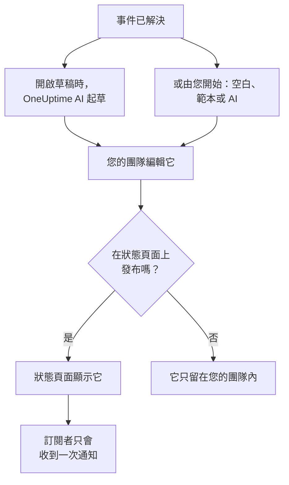

# 事後分析

事後分析是事件之後的檢討：發生了什麼、為什麼發生、對使用者造成了什麼損失，以及接下來要改變什麼。在 OneUptime 中，您直接在事件上撰寫它。它可以從您自己的範本或 OneUptime AI 的草稿開始，也可以作為事件的收尾更新發布到您的狀態頁面上。

:::cards
- [撰寫事後分析](#撰寫事後分析): 在事件的事後分析頁面上，分五個步驟完成。
- [從範本或 AI 草稿開始](#從範本或-ai-草稿開始): 使用您的大綱，或由 OneUptime AI 填寫的大綱。
- [發布到狀態頁面](#發布到狀態頁面): 展示給客戶，並只通知訂閱者一次。
- [片段的事後分析](#片段的事後分析): 為一組事件寫一份檢討。
:::

## 事後分析如何組成

事後分析由三個部分組成，都在事件上：以 Markdown 撰寫的備註；附件，例如螢幕截圖和報告；以及它是否顯示在您的狀態頁面上。它們位於事件側邊選單 **調查** 之下的 **事後分析** 頁面上。

## 撰寫事後分析

:::steps
### 開啟事後分析

開啟事件，然後點選其側邊選單中 **調查** 之下的 **事後分析**。**事後檢討備註** 卡片會顯示備註、附件，以及事後分析是否顯示在狀態頁面上。

### 點選編輯事後檢討備註

**編輯事後檢討備註** 對話方塊會在第一個步驟 **事後分析** 上開啟。

### 撰寫備註並附加檔案

以 Markdown 撰寫 **事後檢討備註**：發生了什麼、影響、如何解決以及後續行動。在 **事後檢討附件** 之下新增螢幕截圖、報告或時間軸。

### 選擇是否發布

點選 **下一步**。在 **狀態頁面** 步驟中，**在狀態頁面上發布** 預設是關閉的，因此事後分析只留在您的團隊內。若要展示給客戶，請參閱 [發布到狀態頁面](#發布到狀態頁面)。

### 儲存事後分析

點選 **儲存變更**。卡片會顯示備註和附件。
:::

對備註的每次變更都會記錄在事件的動態中，如果事件有 Slack 或 Microsoft Teams 頻道，也會發布到該頻道。只要事後分析尚未發布，狀態頁面訂閱者就不會收到任何相關消息。

撰寫事後分析需要 Project Owner、Project Admin、Project Member、Incident Admin 或 Incident Member 角色，或擁有 Edit Incident 權限的自訂角色。任何能讀取事件的人都能讀取它的事後分析。

## 從範本或 AI 草稿開始

卡片上的兩個按鈕可以為您填寫備註：**Generate with AI**，以及在專案有事後分析範本後出現的 **套用範本**。兩者都會開啟與 **編輯事後檢討備註** 相同的編輯器，備註已填好，事後分析的其餘部分保持原樣。在您點選 **儲存變更** 之前不會儲存任何內容，所以請先閱讀並修改備註。

### 套用範本

專案有事後分析範本後，就會出現 **套用範本**。您可以在 **事件 → 設定 → 事後分析範本** 之下建立範本：請參閱 [事後分析範本](/docs/incidents/settings#事後分析範本)。在 OneUptime Cloud 上，範本需要 Growth 方案。

點選 **套用範本**，在 **套用事後檢討範本** 對話方塊的 **選擇範本** 之下選擇一個範本，然後點選 **套用範本**。如果專案只有一個範本，它已經被選取。

### 用 AI 產生

點選 **Generate with AI**。**Generate Postmortem with AI** 對話方塊會在 **選擇範本** 之下提供大綱：**Standard Postmortem**、**Detailed Technical Postmortem** 或 **Brief Postmortem**，然後是您自己的事後分析範本。**Template Preview** 會顯示大綱，您可以在產生之前修改它。

點選對話方塊底部的 **Generate with AI**。OneUptime AI 會讀取事件（它的描述、根本原因和修復、狀態時間軸、公開和私人備註、其 Slack 或 Microsoft Teams 頻道中的訊息，以及 [其通話](/docs/workspace-connections/video-calls#通話逐字稿) 中說過的內容），並依照您的大綱撰寫事後分析。接著編輯器會開啟並顯示結果。

產生需要在 **專案設定 → 人工智慧 → AI Features** 之下為專案開啟 AI，並需要一個 LLM 提供者：請參閱 [LLM 提供者](/docs/ai/llm-provider)。它還需要 Project Owner 或 Project Admin 角色，或擁有 Edit Incident 權限的自訂角色：其他角色可以撰寫事後分析，但不能產生。

### 讓 OneUptime AI 在事件解決時起草

開啟 **事件解決後起草事後分析** 後，每當事件被解決，OneUptime AI 都會起草事後分析，將其儲存為備註，並發布到事件的動態中供您的團隊審閱。該開關位於 **事件 → 人工智慧 → 設定**，新專案預設為開啟。

- 它從不取代已經寫好的備註。
- 它從不寫入已經發布的事後分析，否則草稿會未經審閱就出現在狀態頁面上。
- 它需要為專案開啟 AI，而且一旦專案達到每日 AI 限額，當天就會停止。請參閱 [自動事後分析](/docs/ai/ai-sre#自動事後分析)。
- 如果事件解決時其通話的逐字稿仍在途中，它會等待 OneUptime AI 讀取逐字稿，讓草稿納入通話中說過的內容：在 Zoom 或 Google Meet 準備逐字稿期間最多等待六小時。請參閱 [錄製並轉錄每次通話](/docs/workspace-connections/video-calls#錄製並轉錄每次通話)。

## 發布到狀態頁面

已發布的事後分析是事件面向客戶的收尾更新：狀態頁面會顯示備註，在事件時間軸中醒目呈現，並附上可下載的附件。

:::steps
### 開啟狀態頁面步驟

點選 **編輯事後檢討備註**，然後點選 **下一步** 進入 **狀態頁面** 步驟。

### 開啟在狀態頁面上發布

開啟 **在狀態頁面上發布**。會再出現兩個欄位：預設開啟的 **通知訂閱者**，以及預設為目前時間的 **事後檢討發布時間**。

### 決定通知誰以及顯示的時間

關閉 **通知訂閱者** 即可發布而不通知訂閱者。變更 **事後檢討發布時間** 可以在事後分析旁顯示另一個時間。

### 發布

點選 **儲存變更**。卡片現在會顯示 **事後檢討在狀態頁面上可見嗎？**、**通知訂閱者**、**訂閱者通知狀態** 和 **事後檢討發布時間**。
:::

以下因素決定客戶能否看到它、能否收到通知：

- **事件必須顯示在狀態頁面上。** 狀態頁面只會在它顯示的事件上顯示事後分析：**於狀態頁面可見** 已開啟，且事件不是私人的。
- **備註必須有內容。** 以空白備註發布的事後分析不會顯示，也不會通知任何人。
- **訂閱者只會收到一次通知**，也就是狀態頁面第一次顯示該事後分析時。再次儲存，或在發布狀態下編輯它，會更新頁面但不通知任何人。取消發布後再次發布，會再次通知他們。在事件隱藏時發布的事後分析，會在事件變為可見時傳送。
- **「通知訂閱者」在通知發出時才讀取。** 在事後分析發布後再開啟它，不會傳送任何內容。

**訂閱者通知狀態** 會顯示通知是否已發出，失敗時提供 **重試**。每種情況請參閱 [事後分析](/docs/status-pages/subscribers#事後分析)，另請參閱 [重試與重新傳送](/docs/status-pages/subscribers#重試與重新傳送)。

**事後檢討發布時間** 也是 **事後分析用時** 測量中事後分析被視為發布的時間：請參閱 [現成的測量](/docs/incidents/settings#現成的測量)。

## 片段的事後分析

事件片段也有一個 **事後分析** 頁面，位於 **調查** 之下：為片段中的所有事件寫一份檢討。點選 **編輯事後檢討** 來撰寫它。**套用範本** 和 **Generate with AI** 的作用與在事件上相同，AI 會讀取片段及其成員事件。

片段的事後分析只有備註：它沒有附件，也沒有狀態頁面會顯示它。片段解決時，OneUptime AI 不會自動起草。產生需要 Project Owner 或 Project Admin 角色，或擁有 Edit Incident Episode 權限的自訂角色。

警示和排定維護事件沒有事後分析。

## 透過 API

事後分析是事件上的一組欄位，與事件的其他部分一樣透過 `/api/incident` 讀寫：

| 欄位 | 含義 |
| --- | --- |
| `postmortemNote` | 備註，使用 Markdown。 |
| `showPostmortemOnStatusPage` | 事後分析是否已發布到您的狀態頁面。初始為 `false`。 |
| `notifySubscribersOnPostmortemPublished` | 發布時是否通知訂閱者。初始為 `true`。 |
| `postmortemPostedAt` | 狀態頁面在它旁邊顯示的時間。 |

在已寫好的 `postmortemNote` 上將 `showPostmortemOnStatusPage` 寫為 `true` 會發布事後分析，與對話方塊的效果相同。

## 疑難排解

:::details 卡片上沒有套用範本
專案還沒有事後分析範本，或者您的角色無法讀取範本。請在 **事件 → 設定 → 事後分析範本** 之下建立一個。在 OneUptime Cloud 上，範本需要 Growth 方案。
:::

:::details Generate with AI 提示 AI 已關閉，或您沒有權限
請在 **專案設定 → 人工智慧 → AI Features** 之下開啟 AI。產生需要 Project Owner 或 Project Admin 角色，或擁有 Edit Incident 權限的自訂角色，即使對能編輯事後分析的人也是如此。
:::

:::details 事後分析沒有顯示在狀態頁面上
檢查三件事：**在狀態頁面上發布** 已開啟，備註不是空白的，而且事件顯示在狀態頁面上（**於狀態頁面可見** 已開啟，且不是私人的）。
:::

:::details 訂閱者沒有收到事後分析的通知
發布時 **通知訂閱者** 是關閉的，或者事件是隱藏的：這種情況下，事件一變為可見就會傳送。卡片上的 **訂閱者通知狀態** 會說明是哪種情況。
:::

:::details 事件解決時沒有出現 AI 草稿
事件已經有備註、事後分析已經發布，或者 **事件解決後起草事後分析** 是關閉的。專案必須開啟 AI，而且專案不能已達到每日 AI 限額。如果事件的通話有逐字稿正在途中，草稿會在 OneUptime AI 讀取逐字稿之後出現。
:::

## 後續步驟

:::cards
- [事件概觀](/docs/incidents/index): 事件的其他頁面，從宣告到解決。
- [事件設定與自動化](/docs/incidents/settings): 事後分析範本和事後分析用時測量。
- [訂閱者與公告](/docs/status-pages/subscribers): 狀態頁面告訴訂閱者的一切。
- [AI SRE](/docs/ai/ai-sre): 事件之後 OneUptime AI 會自動做什麼。
:::
