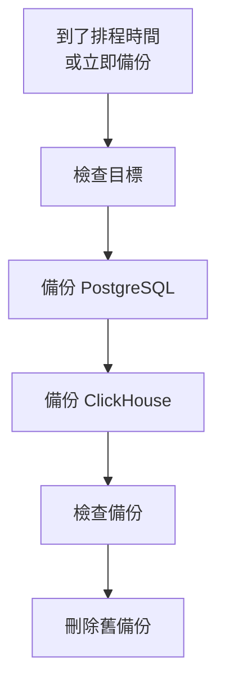

# 備份

依排程將自行託管的 OneUptime 備份到你自己的儲存空間，並從 Admin Dashboard 還原。備份包含 PostgreSQL（你的專案、監控器、事件、狀態頁和使用者）和 ClickHouse（你的日誌、追蹤和指標）。備份會依你選擇的天數保留，較舊的備份會自動刪除，任何備份都可以就地還原。備份是企業版的功能。

:::cards
- [設定備份](#設定備份)：選擇目標、測試它，並設定排程。
- [目標](#目標)：每個建議目標需要提供什麼。
- [還原備份](#還原備份)：哪些內容會被取代，以及如何保護目前的資料。
- [移轉到新伺服器](#移轉到新伺服器)：在另一個安裝中還原某個安裝的備份。
:::

## 備份的運作方式



- **一致。** PostgreSQL 在單一交易中匯出，因此傾印就是 OneUptime 持續運作期間某一時刻的資料庫。ClickHouse 會依讀取每個資料表的資料部分時的狀態備份該資料表。
- **直達目標。** `pg_dump` 的輸出會邊寫邊串流到儲存空間，ClickHouse 則會自行將備份寫入儲存空間。無論資料多大，都不會寫入伺服器的磁碟。
- **經過檢查。** 在備份算作完成之前，`pg_restore` 會從目標讀回傾印，並在那裡找到 ClickHouse 為其備份留下的記錄。傾印的 SHA-256 會與備份一起保存，還原在取代任何內容之前都會先檢查它。失敗或被取消的備份會刪除它已寫入的內容，因此目標中只會有完整的備份。
- **經過加密。** 備份會透過 HTTPS 傳到儲存空間，除非您輸入的是 `http://` 端點。Amazon S3、Google Cloud Storage、Azure Blob Storage 與 Cloudflare R2 會加密其儲存的所有內容；在其他儲存空間上，請為儲存貯體開啟靜態加密。目標的認證資訊會以加密形式保存，且不會再次顯示。
- **一次一個。** 整個安裝同一時間只會執行一個備份或還原。其他的會排隊等候。

每個備份都是目標資料夾（除非你另選，否則為 `oneuptime/backups/`）中的獨立資料夾，以其開始時間（UTC）命名：

```text
oneuptime/backups/20261024T020000Z-3f2a9c1b/manifest.json
oneuptime/backups/20261024T020000Z-3f2a9c1b/postgres.dump
oneuptime/backups/20261024T020000Z-3f2a9c1b/clickhouse/
```

`manifest.json` 最後寫入：它說明備份包含什麼，以及由哪個版本的 OneUptime 建立。

## 開始之前

- **企業版**，以及包含備份功能的授權。試用期和寬限期內會執行備份。沒有授權時不會建立新的備份，但還原和刪除備份仍可使用。請參閱[企業版](/docs/self-hosted/enterprise)。
- **主要管理員。** 備份在 Admin Dashboard 中設定。
- **專用於備份的儲存貯體或容器**，以及可以在其中讀取、寫入、列出和刪除的認證資訊。
- **ClickHouse 也能連到的目標。** ClickHouse 會自行將備份寫入儲存空間，因此它的網路必須能連到儲存空間，就像 OneUptime 的網路一樣。
- **要還原 PostgreSQL，需要一個可以建立資料庫的資料庫使用者。** 還原會在運作中的資料庫旁邊建立新的資料庫並寫入。OneUptime 隨附的 PostgreSQL 以超級使用者身分連線，具備此權限。

## 設定備份

:::steps
### 開啟備份頁面

在 Admin Dashboard 中，前往 **設定 → 備份**，然後點選 **設定備份**。

### 選擇備份存放的位置

選擇一個建議的目標。每個目標需要提供的內容請見[目標](#目標)。

### 填寫連線資訊

填寫目標要求的內容。資料夾、地區以及大多數人維持不變的設定位於 **更多欄位** 下，**設定指南** 會開啟本頁上該目標的段落。

### 測試目標

點選 **測試目標**。OneUptime 會寫入、讀取、列出並刪除一個小型測試檔案，檢查 `pg_dump` 能否備份你的 PostgreSQL，並請 ClickHouse 寫入其資料表定義的測試備份。不會儲存任何內容，未通過的檢查會說明需要變更什麼。

### 選擇備份執行的時間

選擇 **頻率** 和 **時間 (UTC)** 中的時間，每週備份還需選擇 **星期幾**。除非你變更，**備份保留天數** 為 30。關閉 **同時備份 ClickHouse** 即可只備份 PostgreSQL。

### 開始備份

點選 **開始備份**。第一次備份會在下一個排程時間執行，**立即備份** 則會立即開始一次備份。
:::

接著頁面會顯示備份的狀況：上次備份何時執行、大小和耗時，以及下次備份何時執行。進行中的備份會顯示目前所在的步驟，**檢視步驟** 會在執行時顯示每個步驟。

## 目標

| 目標 | 儲存空間 | 登入方式 |
| --- | --- | --- |
| [Amazon S3](#amazon-s3) | Amazon S3 | 存取金鑰 |
| [Cloudflare R2](#cloudflare-r2) | S3 相容儲存空間 | R2 API 權杖 |
| [Backblaze B2](#backblaze-b2) | S3 相容儲存空間 | 應用程式金鑰 |
| [Wasabi](#wasabi) | S3 相容儲存空間 | 存取金鑰 |
| [MinIO](#minio) | S3 相容儲存空間 | 存取金鑰 |
| [Google Cloud Storage](#google-cloud-storage) | Google Cloud Storage | HMAC 金鑰 |
| [Azure Blob Storage](#azure-blob-storage) | Azure Blob Storage | SAS 權杖或存取金鑰 |
| [其他 S3 相容儲存空間](#其他-s3-相容儲存空間) | S3 相容儲存空間 | 存取金鑰 |

Amazon S3 或其他 S3 相容儲存空間的金鑰需要對該資料夾具有 `s3:PutObject`、`s3:GetObject`、`s3:ListBucket`、`s3:DeleteObject` 和 `s3:AbortMultipartUpload` 權限，不需要其他權限：

```json
{
  "Version": "2012-10-17",
  "Statement": [
    {
      "Effect": "Allow",
      "Action": "s3:ListBucket",
      "Resource": "arn:aws:s3:::my-backups"
    },
    {
      "Effect": "Allow",
      "Action": [
        "s3:PutObject",
        "s3:GetObject",
        "s3:DeleteObject",
        "s3:AbortMultipartUpload"
      ],
      "Resource": "arn:aws:s3:::my-backups/oneuptime/backups/*"
    }
  ]
}
```

### Amazon S3

| 欄位 | 填寫內容 |
| --- | --- |
| **儲存貯體** | 寫入備份的儲存貯體。請僅將其用於備份。 |
| **地區** | 儲存貯體所在地區。一開始為 `us-east-1`。 |
| **存取金鑰 ID** | 具有上述權限的存取金鑰。 |
| **秘密存取金鑰** | 金鑰的密碼。 |
| **資料夾** | 位於 **更多欄位** 下。留空時，備份會存放在 `oneuptime/backups/`。 |

Amazon S3 會加密它儲存的每個檔案，OneUptime 也會為寫入的每個檔案要求加密（SSE-S3）。

### Cloudflare R2

在 **端點** 中輸入你帳戶的 S3 API 位址 `https://<account-id>.r2.cloudflarestorage.com`，可在 R2 的儲存貯體設定中找到。接著輸入 **儲存貯體**，以及可以在其中讀寫物件的 R2 API 權杖的 **存取金鑰 ID** 和 **秘密存取金鑰**。從 R2 讀回備份不收費。

### Backblaze B2

在 **端點** 中輸入儲存貯體的 S3 端點，它顯示在 Backblaze 中該儲存貯體的 Buckets 頁面上，例如 `https://s3.us-west-004.backblazeb2.com`。接著輸入 **儲存貯體**，並將應用程式金鑰的金鑰 ID 和金鑰分別填入 **存取金鑰 ID** 和 **秘密存取金鑰**。地區會從端點讀取。

### Wasabi

在 **端點** 中輸入儲存貯體所在地區的服務 URL，例如 `https://s3.us-east-1.wasabisys.com`，接著輸入 **儲存貯體** 和存取金鑰。地區會從端點讀取。

### MinIO

在 **端點** 中輸入你的 MinIO 伺服器的 S3 API 位址，例如 `https://minio.example.com:9000`，接著輸入 **儲存貯體** 和一個存取金鑰，其原則允許在其中讀取、寫入、列出和刪除。OneUptime 和 ClickHouse 都必須能連到該位址。

### Google Cloud Storage

輸入 **儲存貯體**，以及對該儲存貯體具有 Storage Object Admin 角色的服務帳戶的 **HMAC 存取金鑰** 和 **HMAC 密碼**。在 Cloud Storage 設定的「互通性」分頁中建立該金鑰。OneUptime 和 ClickHouse 透過 Cloud Storage 的 S3 相容 API 存取儲存貯體。

### Azure Blob Storage

輸入 **儲存體帳戶** 和 **容器**，並在 **登入方式** 中選擇登入方式：對該容器具有讀取、新增、建立、寫入、刪除和列出權限的 **SAS 權杖**，或儲存體帳戶的 **存取金鑰**。SAS 權杖可以限定於該容器，因此是較安全的選擇。**雲端** 和 **資料夾** 位於 **更多欄位** 下。

### 其他 S3 相容儲存空間

對於 Ceph、DigitalOcean Spaces、Hetzner Object Storage 以及任何提供 S3 API 的儲存空間，在 **端點** 中輸入其 S3 位址，接著輸入 **儲存貯體** 和存取金鑰。位於 **更多欄位** 下的 **地區** 只在儲存空間要求時才需要。留空時會從端點讀取，否則為 `us-east-1`。

## 排程與保留

| 設定 | 作用 |
| --- | --- |
| **頻率** | **每小時**、**每 6 小時**、**每 12 小時**、**每天** 或 **每週**。大多數安裝每天備份就夠了。 |
| **時間 (UTC)** | 備份開始的時間（UTC），旁邊會顯示你的當地時間。每 6 或 12 小時從此時間開始計算：設為 `02:00` 時，每 6 小時的備份在 02:00、08:00、14:00 和 20:00 執行。每小時的備份在整點執行。 |
| **星期幾** | 每週備份執行的日子。 |
| **備份保留天數** | 1 到 3650 天。除非你變更，否則為 30 天。 |
| **同時備份 ClickHouse** | 除非你關閉，否則為開啟。PostgreSQL 一律會備份。 |

每次備份完成後，開始於 **備份保留天數** 之前的備份會從目標和清單中刪除，但最新的成功備份除外，無論它有多舊都會保留。因此，關閉備份或授權到期都不會讓你沒有可還原的備份。

狀態卡片選單中的 **關閉排程備份** 會停止排程。**立即備份** 仍可使用，也不會刪除任何備份。**開啟** 會重新開始排程。

## 還原備份

:::warning 還原會取代什麼
還原會以備份中的資料取代目前的資料。除非先備份目前的資料，否則自備份以來變更的所有內容都會遺失。
:::

:::steps
### 選擇備份

在 **備份** 表格中，點選要回到的備份上的 **還原**。OneUptime 會先檢查備份：其檔案是否在目標中且未遭變更、由哪個版本的 OneUptime 建立，以及此伺服器能否還原它。

### 選擇要還原的內容

勾選 **PostgreSQL：專案、監控器、事件、使用者**、**ClickHouse：日誌、追蹤、指標** 或兩者。對話方塊會顯示備份中有多少專案、使用者和監控器，以及目前有多少。

### 保護目前的資料

**先備份目前的資料** 已勾選：還原會先備份它將取代的資料，讓你可以回到這些資料。只有在你有其他副本時才取消勾選，因為沒有它，還原將無法復原。

### 確認

輸入 `restore` 並點選 **還原**。
:::

還原會逐步執行，頁面會顯示每一步：

| 步驟 | 發生的事 |
| --- | --- |
| **檢查備份** | 備份的檔案都在，而且此安裝可以還原它。 |
| **備份目前的資料** | 備份目前的資料，除非你取消了勾選。 |
| **還原 PostgreSQL** | 將備份還原到運作中資料庫旁邊的新資料庫，並進行檢查。 |
| **還原 ClickHouse** | 將運作中的遙測資料移到一旁，並在原位置還原備份中的遙測資料。 |
| **切換到還原後的資料** | 還原後的資料庫在片刻之間接手運作中資料庫的名稱。 |
| **將還原的資料更新到最新** | 在還原後的資料上執行此版本的資料庫移轉。 |
| **清理** | 刪除被移到一旁的內容。 |

在切換之前，OneUptime 會繼續使用目前的資料運作，在此之前它使用的任何東西都不會改變。在切換前失敗或被取消的還原會維持一切原樣，在切換期間失敗的還原會把移到一旁的內容放回原處。還原 ClickHouse 期間收到的遙測資料不會被儲存。PostgreSQL 還原後你可能會被登出：請使用備份中存在的帳戶登入。

:::details 還原顯示備份是以另一個 ENCRYPTION_SECRET 建立的
OneUptime 儲存的認證資訊（例如目標的金鑰）以 `ENCRYPTION_SECRET` 加密。還原之前，請設定建立該備份時使用的 `ENCRYPTION_SECRET`，否則之後將無法讀取這些認證資訊。
:::

## 移轉到新伺服器

:::steps
### 在新伺服器上安裝 OneUptime

安裝企業版，版本應為建立這些備份的版本或更新的版本。

### 設定相同的目標

在 **設定 → 備份** 中，設定備份所在的目標。頁面會找到那裡已有的備份並列出，隨時可以還原。狀態卡片選單中的 **尋找備份** 會重新尋找。

### 還原最新的備份

依上述步驟還原。由較舊版本的 OneUptime 建立的備份會升級到此版本。由較新版本建立的備份，在你更新後即可還原。
:::

## 備份失敗時

狀態卡片會顯示 **上次備份失敗** 以及錯誤訊息，**檢視步驟** 會顯示它停在哪一步以及原因。每位主要管理員也會收到一封電子郵件，在備份持續失敗期間最多每 12 小時一封。還原失敗時一律會寄送電子郵件。

## 疑難排解

:::details ClickHouse 無法連到目標
ClickHouse 會自行連線到儲存空間。請讓它的網路能連到目標的位址，就像 OneUptime 的網路一樣，然後重新測試目標。
:::

:::details pg_dump 不存在或版本過舊
企業版映像檔包含 `pg_dump` 和 `pg_restore` 16、17 和 18，可以備份 PostgreSQL 18 及之前的所有版本。在其他映像檔上，請安裝 PostgreSQL 用戶端工具，或將 `BACKUP_POSTGRES_BIN_DIR` 設為包含這些工具的目錄。`pg_dump` 的版本必須不低於你的 PostgreSQL 伺服器。
:::

:::details 還原 PostgreSQL 需要一項變更
還原會建立資料庫，OneUptime 的資料庫使用者必須有此權限。以超級使用者身分在 PostgreSQL 上執行以下命令（將 `oneuptime` 換成你的 `DATABASE_USERNAME`），然後重新還原：

```sql
ALTER USER oneuptime CREATEDB;
```
:::

:::details 備份位於先前的目標
變更目標後，在舊目標中建立的備份仍會留在清單中，並標示為 **位於先前的目標**。重新設定該目標即可還原其中一個，也可以將其從清單中刪除：它的檔案會留在原處。
:::

## 後續步驟

:::cards
- [企業版](/docs/self-hosted/enterprise)：授權，以及企業版新增的功能。
- [升級](/docs/installation/upgrading)：每次升級前都先備份。
- [Docker Compose](/docs/installation/docker-compose)：在一台伺服器上執行 OneUptime。
:::
