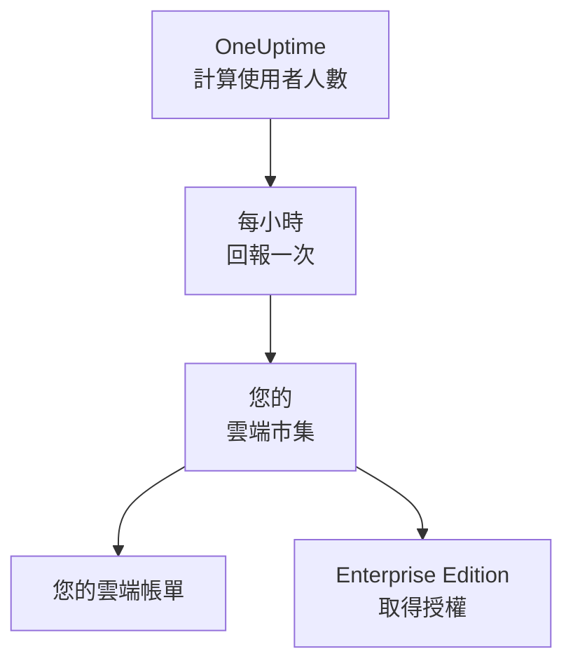

# 雲端市集

在 AWS Marketplace、Microsoft Marketplace 或 Google Cloud Marketplace 上購買 OneUptime Enterprise，並在您自己的 Kubernetes 叢集中執行它。雲端市集會按小時為您的安裝中的每位使用者計費，費用計入您的雲端帳單；您的訂閱即是 Enterprise Edition 的授權，不需要啟用任何授權金鑰。

:::cards
- [安裝 OneUptime](#安裝-oneuptime): 安裝在 Amazon EKS、Azure Kubernetes Service 或 Google Kubernetes Engine 上。
- [計費方式](#計費方式): 每位使用者每小時 USD 0.10，每小時回報一次。
- [升級](#升級): 您的叢集如何取得新版本。
- [疑難排解](#疑難排解): 版本標籤發出與雲端市集有關的警告時。
:::

## 運作方式

OneUptime 每 15 分鐘計算一次使用者人數，並把每個小時回報給您購買它的雲端市集：每個小時只回報一次，以該小時內計算到的最多使用者人數為準。雲端市集會把這個小時計入您的雲端帳單。雲端市集接受的每次回報也會告訴 OneUptime 您的訂閱仍然有效，讓 Enterprise Edition 持續取得授權。



| | AWS | Microsoft | Google Cloud |
| --- | --- | --- | --- |
| 商品頁面 | 尚未公開：[聯絡我們](https://oneuptime.com/enterprise/demo) | [OneUptime Enterprise](https://marketplace.microsoft.com/en-us/product/oneupitme.oneuptime-enterprise) | 尚未公開：[聯絡我們](https://oneuptime.com/enterprise/demo) |
| 執行平台 | Amazon EKS | Azure Kubernetes Service (AKS) | Google Kubernetes Engine (GKE) |
| 安裝方式 | Helm，從該商品的映像檔登錄庫安裝 | Azure 入口網站 | Google Cloud 主控台 |
| OneUptime 回報時使用 | 其 Kubernetes 服務帳戶的 IAM 角色 | Azure 為該安裝提供的受控識別 | Google Cloud Marketplace 為該部署建立的回報用 Secret |
| 新版本 | 由您使用 Helm 升級 | 次要版本會自動為您安裝 | 由您手動升級 |

## 開始之前

- **一個 Kubernetes 叢集**，位於該雲端市集所屬的雲端上，至少有 3 個節點，每個節點 4 個 vCPU、16 GiB 記憶體，具備預設的 StorageClass，並支援 `LoadBalancer` 類型的服務。OneUptime 會在叢集中執行自己的 PostgreSQL、ClickHouse 和 Valkey；請參閱[規模與容量規劃](/docs/installation/sizing)來決定它們的規模。
- **一個供 OneUptime 使用的網域名稱**，例如 `oneuptime.example.com`，而且您能把它指向叢集的負載平衡器。
- **對外 HTTPS**，讓叢集能連到雲端市集，以便 OneUptime 回報使用者人數：AWS 上為 `metering.marketplace.<region>.amazonaws.com` 和 `sts.<region>.amazonaws.com`，Azure 上為 `marketplaceapi.microsoft.com`，Google Cloud 上為 `servicecontrol.googleapis.com` 和 `oauth2.googleapis.com`。

## 安裝 OneUptime

### AWS Marketplace

在 AWS 上，OneUptime 使用 EKS 賦予其 Kubernetes 服務帳戶的 IAM 角色回報使用者人數（也就是「服務帳戶的 IAM 角色」功能）。對於來自 EKS 的用量，AWS Marketplace 只接受以這種方式簽署的回報。

:::steps
1. 在 AWS Marketplace 上訂閱 OneUptime Enterprise，接著選擇 **Continue to Configuration**，選取版本，再選擇 **Continue to Launch**。
2. 如果叢集還沒有 IAM OIDC 提供者，請為它建立一個，然後用下方的指令建立 `oneuptime` 服務帳戶，以及具有 `AWSMarketplaceMeteringFullAccess` 政策的 IAM 角色。請用這些指令取代啟動頁面 **General launch instructions** 第 1 步中的 `eksctl` 指令：那個指令關聯的是一個您得先自行建立的角色。
3. 使用 **General launch instructions** 第 2 步中的指令，讓 Helm 登入該商品的映像檔登錄庫並安裝 chart。在 `helm install` 指令中，將 `serviceAccount.name` 設為 `oneuptime`，將 `host` 設為您的網域名稱；如果 OneUptime 前面有憑證，再將 `httpProtocol` 設為 `https`。
4. [開啟 OneUptime](#開啟-oneuptime)。
:::

```bash
eksctl utils associate-iam-oidc-provider --cluster <cluster> --approve
eksctl create iamserviceaccount --name oneuptime --namespace oneuptime --cluster <cluster> \
  --attach-policy-arn arn:aws:iam::aws:policy/AWSMarketplaceMeteringFullAccess \
  --approve --override-existing-serviceaccounts
```

請將第 3 步的這些值保存在一個檔案中，每次執行 `helm upgrade` 時都傳入它：

```yaml title="values.yaml"
host: oneuptime.example.com
httpProtocol: https
serviceAccount:
  name: oneuptime
```

### Microsoft Marketplace

在 Azure 上，OneUptime 是一個 Kubernetes 應用程式：AKS 會將它安裝為叢集擴充功能，並為它提供用來回報使用者人數的受控識別。

:::steps
1. 在 Azure 入口網站中開啟 Microsoft Marketplace 上的 OneUptime Enterprise，或開啟您的 AKS 叢集並選取 **Extensions + applications** > **Add**，然後選擇方案，再選取 **Create**。
2. 選擇訂閱和資源群組，並選擇要安裝到現有的 AKS 叢集，還是建立新的叢集。
3. 在 **OneUptime** 步驟中，輸入安裝的名稱、您的網域名稱及其通訊協定。
4. 選取 **Review + create**，然後選取 **Create**。安裝需要幾分鐘；當 **Extensions + applications** 顯示其佈建狀態為 **Succeeded** 時，安裝即完成。
5. [開啟 OneUptime](#開啟-oneuptime)。
:::

自訂計量適用於 AKS 叢集，而不適用於已啟用 Azure Arc 的 Kubernetes，因此 Microsoft Marketplace 上的 OneUptime Enterprise 只能安裝在 AKS 上。

### Google Cloud Marketplace

在 Google Cloud 上，Marketplace 會執行一個部署程式，把 OneUptime 連同它用來回報使用者人數的回報用 Secret 一起安裝到您選擇的命名空間中。

:::steps
1. 在 Google Cloud 主控台中開啟 Google Cloud Marketplace 上的 OneUptime Enterprise，然後選取 **Configure**。
2. 選擇 GKE 叢集和命名空間，然後輸入安裝的名稱、您的網域名稱及其通訊協定。
3. 選取 **Deploy**。部署需要幾分鐘；當該應用程式在 **Kubernetes Engine** > **Applications** 下顯示為就緒時，部署即完成。
4. [開啟 OneUptime](#開啟-oneuptime)。
:::

## 開啟 OneUptime

OneUptime 啟動時會先移轉資料庫，在新安裝上這需要幾分鐘。接著把您的網域名稱指向它的負載平衡器：

```bash
kubectl get service --namespace <namespace>
```

名稱以 `-nginx` 結尾的服務會有一個 `EXTERNAL-IP`：請為您的網域名稱建立一筆指向它的 DNS 記錄。開啟該網域名稱並註冊。新安裝上的第一個帳號會成為它的主管理員，可以在 `/admin` 開啟管理員儀表板。

一小時內，版本標籤就會顯示 Enterprise Edition，並註明透過您的雲端市集取得授權。主管理員可以在管理員儀表板的頁首與 Dashboard 的頁尾看到版本標籤。

## 計費方式

| 項目 | 說明 |
| --- | --- |
| 價格 | 每位使用者每小時 USD 0.10，約合每位使用者每月 USD 73。 |
| 計入的使用者 | 在該安裝上擁有 OneUptime 登入帳號的每個人。狀態頁面訂閱者，以及登入私人狀態頁面的人，都不計入。 |
| 計費時間 | OneUptime 每 15 分鐘計算一次使用者人數，每個小時只回報一次，以該小時內計算到的最多使用者人數為準。OneUptime 沒有執行的小時不計費。 |
| 計費位置 | 透過雲端市集，計入您的 AWS、Azure 或 Google Cloud 帳單。 |
| 不包含 | 叢集本身：您的雲端會照常對它的節點、磁碟和負載平衡器計費。 |

每個安裝都單獨計費，因此預備環境的安裝也會計費。如需年度定價、大量採購折扣或非正式環境安裝的價格，請向 [sales@oneuptime.com](mailto:sales@oneuptime.com) 索取私人報價，再到雲端市集上接受該報價。

如果因為網路問題或雲端市集服務中斷而無法傳送回報，OneUptime 會在下一次執行時重新傳送。每次回報都帶有代表該小時的唯一識別碼，因此同一個小時絕不會被計費兩次。

## 授權方式

您的雲端市集訂閱就是您的授權。雲端市集接受的每次回報，都會在接下來的 72 小時內，為所有使用者授權所有企業功能。OneUptime 提供的授權金鑰同樣可用於同一個安裝：安裝會依兩者中較好的那一個執行。

| 發生的情況 | 版本標籤顯示的內容 |
| --- | --- |
| 雲端市集接受每小時的回報 | Enterprise Edition，並註明透過您的雲端市集取得授權。 |
| 72 小時內沒有任何回報被接受 | **Enterprise Edition (Marketplace Reports Failing)**：所有企業功能會在 30 天寬限期內繼續運作。 |
| 雲端市集表示該安裝沒有訂閱，或寬限期結束 | **Enterprise Edition (Marketplace Subscription Ended)**：企業功能會停止，與[授權失效](/docs/self-hosted/enterprise#授權到期或缺少時)時相同。 |

雲端市集拒絕的是已取消或已暫停的訂閱，以及並非您所購買的那個安裝。監控、警示、事件、待命與狀態頁面在任何情況下都會繼續運作，也不會刪除任何內容。重新訂閱後，下一次被接受的回報會再次為 Enterprise Edition 授權，無需重新啟動。

## 升級

| 雲端市集 | 您的叢集如何取得新版本 |
| --- | --- |
| AWS Marketplace | 每個版本都是該商品的一個新版本。使用該商品映像檔登錄庫中的 chart、新的版本和您的 values 檔案執行 `helm upgrade`。 |
| Microsoft Marketplace | AKS 會為您安裝新的次要版本和修補版本。新的主要版本會等到您接受後才安裝。您可以在 **Extensions + applications** 中該安裝的頁面上關閉自動升級。 |
| Google Cloud Marketplace | Google Cloud Marketplace 會讓部署維持在它安裝時的版本，從不更新它。將部署移到新版本之前，請先聯絡[支援團隊](https://oneuptime.com/support)。 |

新版本啟動時，OneUptime 會移轉資料庫。升級到新的主要版本之前，請先閱讀[升級說明](/docs/installation/upgrading)。

請透過雲端市集升級。從雲端市集安裝的執行個體不會與 GitHub 上的 OneUptime 版本進行比較：您的雲端市集提供的版本，就是應升級到的版本。

## 設定與規模調整

您的帳單不會隨規模改變：OneUptime 是按使用者計費的。更多的複本或更大的節點，只會改變您的雲端為叢集收取的費用。

| 雲端市集 | 設定所在的位置 |
| --- | --- |
| AWS Marketplace | 您的 values 檔案。[Helm chart](https://artifacthub.io/packages/helm/oneuptime/oneuptime) 的每項設定都能使用，內建的 operator 除外。 |
| Microsoft Marketplace | 該安裝的組態設定，位於它在 **Extensions + applications** 中的頁面上，也可以使用 `az k8s-extension update --configuration-settings` 變更。每項設定都是一個 chart 值，例如 `autoscaling.enabled=true`。 |
| Google Cloud Marketplace | 部署表單中的欄位。其他任何設定請使用 `kubectl` 在該部署自己的資源上變更。 |

- **調整 OneUptime 的規模**：使用 chart 的複本和自動調整規模設定（`deployment.replicaCount`、`autoscaling.enabled`，以及每個服務自己的覆寫設定），節點則交給叢集的自動調整器。
- **不要變更商品所設定的雲端市集設定**：`enterpriseMarketplace`，以及 AWS 上的 `serviceAccount`。少了它們，OneUptime 就無法回報，Enterprise Edition 也不會取得授權。
- **不包含 KEDA、CloudNativePG 和 Altinity ClickHouse operator**，因為雲端市集只會交付其商品上列出的映像檔。如需高可用性的資料儲存，請使用 `externalPostgres`、`externalRedis` 和 `externalClickhouse` 讓 OneUptime 指向代管服務。

計費與執行多少個複本無關：同一時間只有一次執行會回報，而每個小時只有一筆回報。

## 疑難排解

:::details 版本標籤顯示 Enterprise Edition (Marketplace Reports Failing)
OneUptime 無法向雲端市集回報。它為此記錄的每一行日誌都以 `OneUptime Enterprise marketplace billing` 開頭；表示用量「cannot be reported」的那一行會指出缺少什麼。常見原因：

- **AWS：** `oneuptime` 服務帳戶沒有 IAM 角色，或該角色沒有 `AWSMarketplaceMeteringFullAccess` 政策（只有 `AWSMarketplaceMeteringRegisterUsage` 不夠）。請將該政策關聯到這個角色，或使用 [AWS Marketplace](#aws-marketplace) 中的 `eksctl` 指令建立角色，然後以 `kubectl rollout restart deployment --namespace oneuptime` 重新啟動 OneUptime 的 Pod。
- **Azure：** 該安裝不是 Microsoft Marketplace 應用程式，例如它是用 Helm 安裝的，因此沒有可用來回報的識別或方案。請從 Azure 入口網站安裝它。
- **Google Cloud：** 該部署的回報用 Secret 已被刪除或取代。
- **所有雲端市集：** 防火牆或代理伺服器封鎖了[開始之前](#開始之前)中列出的對外 HTTPS。

在您修正問題期間，用量會被保留，並在 OneUptime 能再次回報後計費。超過 30 天的用量不會計費。
:::

:::details 版本標籤顯示 Enterprise Edition (Marketplace Subscription Ended)
雲端市集拒絕了該安裝：訂閱已被取消或暫停，或該安裝不是在雲端市集上購買的那一個。請在雲端市集上檢查訂閱並重新訂閱；下一次被接受的回報會再次為 Enterprise Edition 授權。如果回報在整個寬限期內持續失敗，也會顯示同樣的標籤。
:::

:::details 安裝後 Pod 一直停留在 Pending 狀態
OneUptime 的資料庫需要持久性磁碟區。請為叢集設定預設的 StorageClass：在 Amazon EKS 上，請安裝 Amazon EBS CSI 驅動程式附加元件。
:::

## 後續步驟

:::cards
- [企業版](/docs/self-hosted/enterprise): Enterprise Edition 加入了什麼，以及授權失效時會停止什麼。
- [升級](/docs/installation/upgrading): 每個版本的升級說明。
- [規模與容量規劃](/docs/installation/sizing): 依您的遙測資料決定資料儲存的規模。
- [架構](/docs/self-hosted/architecture): 您的叢集中執行了什麼。
- [Kubernetes 代理程式](/docs/telemetry/kubernetes-agent#作為-amazon-eks-附加元件安裝): 也能以 Amazon EKS 附加元件的形式在 AWS Marketplace 上免費取得，適用於將資料傳送到 OneUptime 的叢集。
:::
