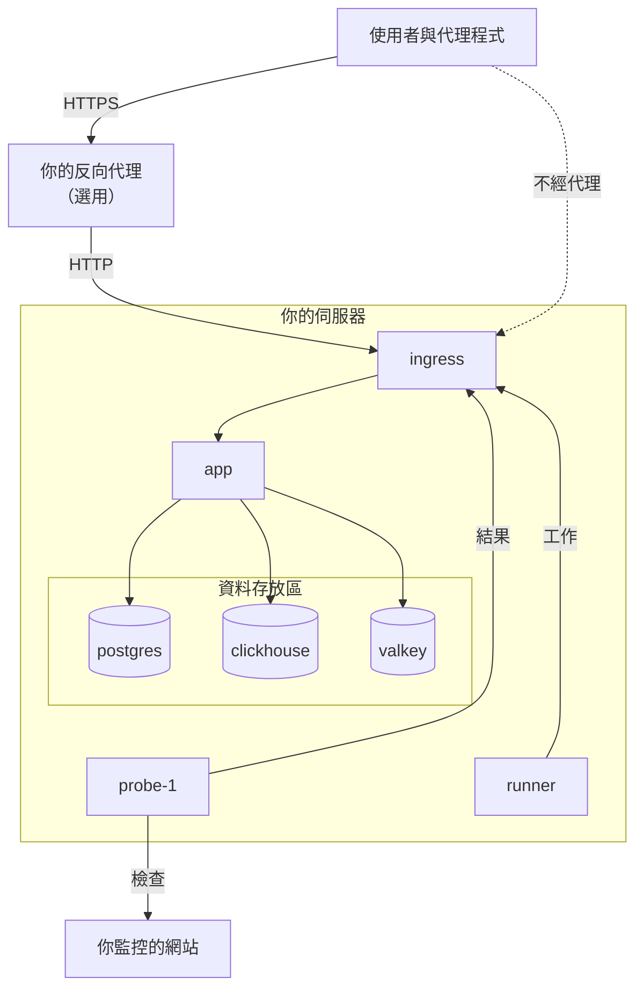

# Docker Compose

使用 Docker Compose 在一台 Linux 伺服器上執行完整、免費的 OneUptime 執行個體。本頁帶你從一台全新的伺服器走到一個執行中的執行個體，接著說明 HTTPS、正式環境強化、備份、更新與移除。如果要開發 OneUptime 本身的程式碼，請參閱 [本機開發](/docs/installation/local-development)。

:::cards
- [安裝 OneUptime](#安裝-oneuptime): 從全新伺服器到第一個帳號，共五個步驟。
- [設定 HTTPS](#設定-https): 讓 OneUptime 取得憑證，或在前面放置你自己的代理。
- [正式環境檢查清單](#正式環境檢查清單): 真實流量進來前需要確定的事項。
- [更新 OneUptime](#更新-oneuptime): 升級到最新版本。
:::

## 運作方式

Docker Compose 會把 OneUptime 的每個部分當作容器在你的伺服器上執行。所有流量都從 `ingress` 容器進入，再由它轉送到 `app`。應用程式把資料保存在 PostgreSQL、ClickHouse 和 Valkey 中。內建的探針會執行監控的檢查，並透過 ingress 回報結果。



| 服務 | 映像檔 | 作用 |
| --- | --- | --- |
| `ingress` | `oneuptime/nginx` | 接收連接埠 80 和 443 上的所有流量，並轉送到應用程式。當 OneUptime 管理憑證時提供 HTTPS。 |
| `app` | `oneuptime/app` | 儀表板、API、狀態頁面、遙測資料接收與背景工作程序。 |
| `probe-1` | `oneuptime/probe` | 執行監控檢查的全域探針。它使用主機的網路。 |
| `runner` | `oneuptime/runner` | 執行個體的 Runner，負責執行 AI 程式碼修正。它使用主機的網路。 |
| `postgres` | `postgres:15` | 設定與狀態：監控、事件、使用者。儲存在 `postgres` 磁碟區中。 |
| `clickhouse` | `clickhouse/clickhouse-server:26.7` | 遙測資料：日誌、指標、追蹤與例外。儲存在 `clickhouse` 磁碟區中。 |
| `valkey` | `valkey/valkey:9.1-alpine` | 快取與佇列。它不在磁碟上保存任何資料。 |

> [!NOTE]
> `valkey` 服務執行 [Valkey](https://valkey.io)，也就是 Redis 7.2 的 BSD 授權分支，透過 `config.env` 中的 `VALKEY_*` 設定來設定。任何支援 Redis 協定的伺服器都能使用——如果你偏好，可以把 `VALKEY_HOST` 指向代管的 Redis。這些設定在 13.0.0 之前名為 `REDIS_*`；舊名稱仍會被讀取，容器仍會回應主機名稱 `redis`，而且 `npm run update` 不會改寫它們，因此較舊的 `config.env` 不需要修改。

對於大規模的正式環境，或需要高可用性時，請改用 Kubernetes 上的 [Helm chart](https://artifacthub.io/packages/helm/oneuptime/oneuptime)：Docker Compose 在一台伺服器上為每個服務只執行一份。

## 需求

依照要在伺服器上執行的內容選擇伺服器規格。決定記憶體與磁碟用量的是遙測資料（日誌、指標、追蹤）；知道你的資料量後，請參閱 [規模與容量規劃](/docs/installation/sizing)。

| | 建議 | 家庭實驗室最低配置 |
| --- | --- | --- |
| **記憶體** | 16 GB | 8 GB |
| **CPU** | 8 核心 | 4 核心 |
| **磁碟** | 400 GB | 20 GB |
| **系統** | Ubuntu 22.04，或其他以 Debian、Ubuntu 或 RHEL 為基礎的 Linux | 相同 |
| **架構** | x86-64（`amd64`）或 ARM（`arm64`） | 相同 |

家庭實驗室最低配置適合個人與實驗用途——有些使用者在 Raspberry Pi 上執行 OneUptime。

你還需要：

- **Docker** 以及 **Docker Compose v2** 外掛程式（也就是 `docker compose` 指令）。
- **Git**，用來取得 OneUptime。
- **Node.js 和 npm**，用來執行包裝 Docker Compose 的 `npm start` 與 `npm run update` 指令碼。
- 伺服器上**未被占用的連接埠 80 和 443**。下表列出 OneUptime 在主機上使用的每個連接埠。

| 主機連接埠 | 使用者 | 設定 | 用途 |
| --- | --- | --- | --- |
| 80 | `ingress` | `ONEUPTIME_HTTP_PORT` | 儀表板、API、遙測資料接收與 Let's Encrypt 驗證。 |
| 443 | `ingress` | `STATUS_PAGE_HTTPS_PORT` | 當 OneUptime 管理憑證時，為執行個體提供 HTTPS，並為自訂網域上的狀態頁面與儀表板提供 HTTPS。 |
| 5400 | `postgres` | 在 `docker-compose.yml` 中設定 | 讓 `npm run backup` 和 `restore.sh` 從伺服器本機連到 PostgreSQL。它只發布在 `127.0.0.1` 上。 |
| 3874 | `probe-1` | `GLOBAL_PROBE_1_PORT` | 探針本身的伺服器。伺服器以外不需要連到它。 |
| 3876 | `runner` | `ONEUPTIME_RUNNER_PORT` | Runner 本身的伺服器。伺服器以外不需要連到它。 |

另有一段安裝過程的 [影片導覽](https://youtu.be/j1SWmMW2oL4)。

## 安裝 OneUptime

在全新的 Ubuntu、Debian 或以 RHEL 為基礎的伺服器上，一個指令就能替你完成下面的步驟：它會安裝缺少的 Docker、Git 與 Node.js，把 release 分支複製到 `oneuptime` 資料夾，詢問大家將使用的位址，然後執行 `npm start`：

```bash
curl -fsSL https://oneuptime.com/install.sh | bash
```

:::steps
### 複製 release 分支

`release` 分支包含最新版本的檔案。

```bash
git clone --depth 1 --single-branch --branch release https://github.com/OneUptime/oneuptime.git
cd oneuptime
```

### 建立 config.env

OneUptime 的所有設定都在 `config.env` 中。從範例檔案開始：

```bash
cp config.example.env config.env
```

### 設定主機名稱

開啟 `config.env`，把 `HOST` 設為大家連到 OneUptime 時使用的網域名稱或 IP 位址，不要加上 `http://`。只有在自己的電腦上試用 OneUptime 時才保留 `localhost`。

```ini title="config.env"
HOST=oneuptime.example.com
```

### 啟動 OneUptime

:::tabs
@tab npm
```bash
npm start
```
@tab Docker CLI
```bash
(export $(grep -v '^#' config.env | xargs) && docker compose up --remove-orphans -d)
```
第一次啟動前，請依照 [產生隨機密鑰](#產生隨機密鑰) 中的說明自行替換預留位置密鑰：只有 `npm start` 會替你完成這一步。
:::

`npm start` 會先檢查伺服器：Docker、記憶體、磁碟空間、OneUptime 使用的連接埠以及 `HOST`。遇到任何會讓 OneUptime 無法運作的問題，它都會停下來並說明要改什麼。接著它為 `config.env` 中的每個預留位置密鑰產生各自的隨機值，啟動 OneUptime，並等待每個部分都有回應。第一次啟動需要幾分鐘，因為 Docker 要下載映像檔，OneUptime 要建立資料庫。最後它輸出 **OneUptime is up!** 與要開啟的位址。

### 建立第一個帳號

開啟 `http://` 加上你的 `HOST`（例如 `http://localhost`）並註冊。新執行個體上的第一個帳號會成為它的主要管理員，可以在 `/admin` 開啟 Admin Dashboard。

在你之後，任何能連到該頁面的人都可以註冊。若要阻止這種情況，請開啟 Admin Dashboard，前往 **設定 > 驗證**，並關閉 **允許註冊**。你邀請加入專案的人仍然可以建立帳號。
:::

### 產生隨機密鑰

`config.example.env` 中的每個密鑰都是預留位置，而這些預留位置在 GitHub 上是公開的。`npm start` 會在啟動任何內容之前為每一個產生各自的隨機值，並列出它填入的設定：

| 設定 | 保護的內容 |
| --- | --- |
| `ONEUPTIME_SECRET` | OneUptime 自身服務之間的呼叫。 |
| `ENCRYPTION_SECRET` | OneUptime 儲存的密鑰（例如整合權杖與 SMTP 密碼），以及它簽發的登入權杖。 |
| `DATABASE_PASSWORD`、`CLICKHOUSE_PASSWORD`、`VALKEY_PASSWORD` | 三個資料存放區。 |
| `REGISTER_PROBE_KEY` | 向你的執行個體註冊探針。 |
| `GLOBAL_PROBE_1_KEY`、`GLOBAL_PROBE_2_KEY` | Docker Compose 可以執行的全域探針（預設執行 `probe-1`）。 |
| `ONEUPTIME_RUNNER_KEY` | 內建的 Runner。 |
| `GLOBAL_RUNNER_KEY` | 內建的全域 Runner，執行所有專案的 JavaScript 步驟。 |

> [!IMPORTANT]
> OneUptime 啟動後，請保持這些密鑰不變。PostgreSQL 只在建立資料庫時採用密碼，而之後變更 `ENCRYPTION_SECRET` 會讓所有以舊密鑰加密的值都無法讀取。因此 `npm start` 只在全新安裝、PostgreSQL 建立資料庫之前設定 `DATABASE_PASSWORD` 與 `ENCRYPTION_SECRET`。

如果使用 Docker CLI，請在第一次啟動前自行替換預留位置：

```bash
while grep -q "please-change-this-to-random-value" config.env; do
  sed -i "0,/please-change-this-to-random-value/{s/please-change-this-to-random-value/$(openssl rand -hex 32)/}" config.env
done
grep -c "please-change-this" config.env
```

最後一個指令會輸出 `0`：表示沒有剩下任何預留位置。這個迴圈使用 GNU `sed`，每台 Linux 伺服器都有。

## 設定 HTTPS

在你選擇以下兩種新增 HTTPS 的方式之一前，OneUptime 只提供一般的 HTTP：

| | 讓 OneUptime 取得憑證 | 使用你自己的反向代理 |
| --- | --- | --- |
| **TLS 終止於** | OneUptime 的 `ingress`，使用它自行更新的免費 Let's Encrypt 憑證 | 你的代理：Caddy、Nginx 或負載平衡器 |
| **你需要** | 一個指向該伺服器的公開網域名稱，以及能從網際網路連到的連接埠 80 和 443 | 一個代理，以及你網域的憑證 |
| **設定** | `PROVISION_SSL=true`、`HTTP_PROTOCOL=https` | `PROVISION_SSL=false`、`HTTP_PROTOCOL=https`、`TRUSTED_PROXY_HOPS=2` |
| **自訂網域上的狀態頁面** | 不需額外設定即可運作 | 你的代理也必須為這些網域提供服務 |

如果你把狀態頁面或儀表板放在自訂網域上，讓 OneUptime 處理 TLS 是比較簡單的做法：ingress 會自行申請並提供這些網域的憑證。

設定 `HTTP_PROTOCOL=https` 後，OneUptime 會產生 HTTPS 連結，把登入 Cookie 留在 HTTPS 上，並告訴瀏覽器只透過 HTTPS 存取你的 `HOST`。瀏覽器會在一年內、在這個名稱的所有連接埠上遵守這一點；所以如果 `HOST` 將來需要重新透過一般的 HTTP 回應，請提前一段時間把 `HSTS_MAX_AGE_SECONDS=0` 寫進 `config.env`：瀏覽器會在下次造訪時忘掉這條規則。

### 讓 OneUptime 取得憑證

:::steps
#### 將網域指向伺服器

為你的網域建立一筆 DNS `A` 記錄（IPv6 用 `AAAA`），值為伺服器的公開 IP 位址。如果新增了 `AAAA` 記錄，也要為 OneUptime 開啟 IPv6：請參閱[訪客位址](#訪客位址)。

#### 開啟憑證申請

在 `config.env` 中設定以下值：

```ini title="config.env"
HOST=oneuptime.example.com
PROVISION_SSL=true
HTTP_PROTOCOL=https
```

`HOST` 必須是網域名稱：OneUptime 無法為 IP 位址或 `localhost` 取得憑證。

#### 使用新設定重新啟動

```bash
npm start
```

#### 透過 HTTPS 開啟你的執行個體

開啟 `https://oneuptime.example.com`。OneUptime 會在啟動時申請憑證，之後每小時檢查一次，並在剩餘效期少於 30 天時更新。在第一張憑證到來之前（通常在幾分鐘內），ingress 會提供一張暫時的自我簽署憑證，瀏覽器會發出警告。
:::

### 使用你自己的反向代理

以下步驟在與 OneUptime 相同的伺服器上執行代理。如果你的代理執行在另一台機器上，請略過第一個步驟，把代理指向這台伺服器的連接埠 80，並用雲端供應商的防火牆只讓代理連到連接埠 80 和 443：繞過代理連到 OneUptime 的訪客，可以自己選擇 OneUptime 用來計算他的位址。

:::steps
#### 將 ingress 移出連接埠 80 和 443

代理需要連接埠 80 和 443，所以要把 ingress 移到其他連接埠，並且只發布在這台伺服器的回送位址 `127.0.0.1` 上，讓訪客只能透過你的代理連到 OneUptime：

```ini title="config.env"
ONEUPTIME_HTTP_PORT=127.0.0.1:8080
STATUS_PAGE_HTTPS_PORT=127.0.0.1:8443
```

探針與 Runner 使用主機的網路，透過 `http://localhost` 連到 OneUptime。`npm start` 會把它們改到 ingress 的新連接埠 `http://localhost:8080`，並加以說明。

#### 告訴 OneUptime 它位於代理之後

```ini title="config.env"
HOST=oneuptime.example.com
HTTP_PROTOCOL=https
PROVISION_SSL=false
TRUSTED_PROXY_HOPS=2
```

`HTTP_PROTOCOL=https` 會讓 OneUptime 產生的連結使用 HTTPS。`TRUSTED_PROXY_HOPS=2` 會把你的代理和 OneUptime 的 ingress 都算進去，讓 OneUptime 在 IP 允許清單與速率限制中讀取訪客的真實位址。每多一層會附加 `X-Forwarded-For` 的代理（例如 CDN 或負載平衡器），就再加一。

#### 在新連接埠上重新啟動 OneUptime

```bash
npm start
```

`npm start` 會在新連接埠 `localhost:8080` 上檢查 OneUptime，最後輸出 **OneUptime is up!**

#### 設定代理

:::tabs
@tab Caddy
```text title="Caddyfile"
oneuptime.example.com {
	reverse_proxy localhost:8080
}
```
Caddy 會自行取得並更新憑證、把 HTTP 重新導向到 HTTPS，並放行 WebSocket 連線。修改檔案後請重新載入 Caddy，例如使用 `sudo systemctl reload caddy`。
@tab Nginx
```nginx title="/etc/nginx/conf.d/oneuptime.conf"
map $http_upgrade $oneuptime_connection_upgrade {
    default upgrade;
    ""      close;
}

server {
    listen 80;
    server_name oneuptime.example.com;
    return 301 https://$host$request_uri;
}

server {
    listen 443 ssl;
    server_name oneuptime.example.com;

    ssl_certificate     /etc/letsencrypt/live/oneuptime.example.com/fullchain.pem;
    ssl_certificate_key /etc/letsencrypt/live/oneuptime.example.com/privkey.pem;

    # The limits OneUptime's own ingress uses.
    client_max_body_size 50M;
    proxy_read_timeout 300s;
    proxy_send_timeout 300s;

    proxy_http_version 1.1;
    proxy_set_header Host $host;
    proxy_set_header X-Forwarded-For $proxy_add_x_forwarded_for;
    proxy_set_header X-Forwarded-Proto $scheme;
    proxy_set_header Upgrade $http_upgrade;
    proxy_set_header Connection $oneuptime_connection_upgrade;

    location / {
        proxy_pass http://127.0.0.1:8080;
    }

    # MCP clients keep a stream open.
    location /mcp {
        proxy_pass http://127.0.0.1:8080;
        proxy_buffering off;
        proxy_read_timeout 86400s;
        proxy_send_timeout 86400s;
    }
}
```
憑證路徑是 Certbot 存放 Let's Encrypt 憑證的位置；如果你的憑證來自其他地方，請使用它自己的路徑。使用 `sudo nginx -t && sudo systemctl reload nginx` 檢查檔案並重新載入 Nginx。
:::

兩者都會傳送 `X-Forwarded-Proto`，它告訴 OneUptime 訪客是透過 HTTPS 來的。其他任何代理也必須傳送它，否則你自訂網域上的狀態頁面與儀表板的登入 Cookie 不會被留在 HTTPS 上。

#### 透過代理開啟你的執行個體

開啟 `https://oneuptime.example.com`。你應該會看到 OneUptime 的登入頁面，使用的是你代理的憑證。
:::

> [!NOTE]
> 在你自己的代理之後，請透過 OTLP/HTTP（`/otlp`）傳送遙測資料。只有當 OneUptime 自己的 ingress 終止 TLS 時（`PROVISION_SSL=true`），透過 gRPC 的 OTLP 才能抵達 OneUptime。

## 訪客位址

OneUptime 依訪客連線時所用的位址來計算每位訪客：登入限制、其他依位址的限制，以及狀態頁和儀表板的 IP 允許清單，都會讀取這個位址。有兩種部署需要一項設定，才能讓這個位址是訪客自己的位址：

| 部署 | 設定 |
| --- | --- |
| 有人透過 IPv6 存取 OneUptime，例如透過 `AAAA` 記錄 | 在 `docker-compose.override.yml` 中為 OneUptime 的網路開啟 IPv6 |
| OneUptime 前面有你自己的反向代理 | `TRUSTED_PROXY_HOPS=2`，並且 ingress 發布在 `127.0.0.1` 上（請參閱[使用你自己的反向代理](#使用你自己的反向代理)） |

OneUptime 的網路沒有開啟 IPv6 時，Docker 會用它自己的一個位址把每位透過 IPv6 來的訪客轉交給 OneUptime，OneUptime 就會把他們全部算作同一位訪客：一個人的登入失敗可能會把其他人鎖在外面。開啟 IPv6 需要 Docker Engine 27 或更新版本（`docker version` 會顯示你的版本）。

:::steps
### 開啟 IPv6

建立 `docker-compose.override.yml`（放在 `docker-compose.yml` 旁邊），或把以下內容加到你已有的檔案中；`npm start` 和 `npm run update` 會讀取它：

```yaml title="docker-compose.override.yml"
networks:
  oneuptime:
    enable_ipv6: true
```

### 重新啟動 OneUptime

```bash
npm stop
npm start
```

OneUptime 會先停止，再於網路開啟 IPv6 的情況下重新啟動。你的資料會保留。如果你自己的容器（例如反向代理）仍連接在 OneUptime 的網路上，Docker 無法刪除這個網路：請先把它從 OneUptime 的網路中斷連線，之後再連接回來。如果 `npm start` 因 `has active endpoints` 而停止，請中斷它的連線，然後再次執行 `npm stop` 和 `npm start`。

### 檢查網路

```bash
docker network ls --quiet --filter name=_oneuptime | xargs docker network inspect | grep EnableIPv6
```

它會輸出 `"EnableIPv6": true,`。
:::

當多人從同一個私人網路位址登入時，Admin Dashboard 的 **OneUptime 健康狀態** 頁面會指出這一點，並列出可以改變它的設定。

## 正式環境檢查清單

Docker Compose 在一台伺服器上為每個服務只執行一份，適合小型團隊與家庭實驗室。在依賴它之前，請逐項檢查這份清單。

| 面向 | 要做的事 |
| --- | --- |
| **密鑰** | `config.env` 中沒有任何值仍是 `please-change-this-to-random-value` 預留位置。請參閱 [產生隨機密鑰](#產生隨機密鑰)。對於以預留位置 `DATABASE_PASSWORD` 啟動過的安裝，請參閱 [變更資料庫密碼](#變更資料庫密碼)。 |
| **HTTPS** | 大家透過 HTTPS 連到 OneUptime，且已設定 `HTTP_PROTOCOL=https`。請參閱 [設定 HTTPS](#設定-https)。 |
| **註冊** | 團隊成員都有帳號後，在 Admin Dashboard 的 **設定 > 驗證** 下關閉 **允許註冊**。 |
| **防火牆** | 只有連接埠 80 和 443（以及 SSH）對網際網路開放。OneUptime 只在 `127.0.0.1` 上發布 PostgreSQL 的連接埠 5400。你自己發布的其他連接埠，請用雲端供應商的防火牆關閉：`ufw` 規則不適用於 Docker 發布的連接埠。 |
| **訪客位址** | Admin Dashboard 的 **OneUptime 健康狀態** 頁面沒有提示多人從同一個位址登入。請參閱[訪客位址](#訪客位址)。 |
| **備份** | 每天備份 PostgreSQL，並把副本移出伺服器。請參閱 [備份與還原](#備份與還原)。 |
| **電子郵件** | 已在 Admin Dashboard 的 **設定 > 通知 > 電子郵件** 下設定郵件伺服器，讓 OneUptime 能傳送邀請與通知。請參閱 [SMTP](/docs/emails/smtp)。 |
| **磁碟** | 持續留意剩餘空間。ClickHouse 會隨保留的遙測資料成長（請參閱 [規模與容量規劃](/docs/installation/sizing)）；每個容器的日誌上限為 1000 MB。 |
| **更新** | 至少每週更新一次 OneUptime。新版本發布頻繁。請參閱 [更新 OneUptime](#更新-oneuptime)。 |
| **高可用性** | 如果需要，請改用 Kubernetes 上的 [Helm chart](https://artifacthub.io/packages/helm/oneuptime/oneuptime)。 |

### 變更資料庫密碼

PostgreSQL 會一直使用建立時的密碼，所以只變更 `config.env` 中的 `DATABASE_PASSWORD` 會讓 OneUptime 無法連到自己的資料庫。要為以預留位置啟動過的安裝設定專屬密碼，請同時在 PostgreSQL 和 `config.env` 中變更它，然後重新啟動 OneUptime：

```bash
NEW_PASSWORD=$(openssl rand -hex 32) &&
  (export $(grep -v '^#' config.env | xargs) && docker compose exec -T postgres psql -U "$DATABASE_USERNAME" -d "$DATABASE_NAME" -c "ALTER USER \"$DATABASE_USERNAME\" PASSWORD '$NEW_PASSWORD'") &&
  sed -i "s/^DATABASE_PASSWORD=.*/DATABASE_PASSWORD=$NEW_PASSWORD/" config.env
npm start
```

如果你設定了 `DATABASE_BACKUP_PASSWORD` 和 `DATABASE_RESTORE_PASSWORD`，也請為它們填入新值。

## 備份與還原

PostgreSQL 保存你設定的一切：監控、事件、狀態頁面、使用者。`npm run backup` 會把它傾印到 `Backups` 資料夾中的一個檔案。

:::steps
### 為備份指令碼提供資料庫密碼

在 `config.env` 中，把 `DATABASE_BACKUP_PASSWORD` 設為 `DATABASE_PASSWORD` 的值。指令碼把 `config.env` 當作純文字讀取，因此它附帶的 `${DATABASE_PASSWORD}` 永遠不會被替換。

### 執行備份

```bash
npm run backup
```

它會詢問你的 sudo 密碼，並寫入 `Backups/db-<day of the month>.backup`，因此每天的備份會取代一個月前的備份。請至少每天執行一次。

### 把備份複製到伺服器以外

與資料庫位於同一顆磁碟上的備份，無法在這顆磁碟損毀後保存下來。
:::

只有伺服器本機能連到 PostgreSQL：它在 `127.0.0.1` 的連接埠 5400 上回應。要從另一台機器備份它，請在那台機器上開一條 SSH 通道，然後連到那台機器自己的連接埠 5400：

```bash
ssh -N -L 5400:127.0.0.1:5400 you@oneuptime.example.com
```

:::details 在私有網路位址上發布 PostgreSQL
如果私有網路中的某個工具必須不經通道連到 PostgreSQL，請同時把它發布在伺服器於該網路中的位址上，並使用獨立的連接埠。在 `docker-compose.yml` 旁邊建立 `docker-compose.override.yml`；`npm start` 和 `npm run update` 會讀取它：

```yaml title="docker-compose.override.yml"
services:
  postgres:
    ports:
      - "10.0.0.5:5401:5432"
```

把 `10.0.0.5` 換成伺服器自己的私有位址，絕不要使用公開位址，並先為 PostgreSQL 設定專屬密碼（請參閱 [變更資料庫密碼](#變更資料庫密碼)）。然後執行 `npm start`，PostgreSQL 也會在該位址的連接埠 5401 上回應。
:::

ClickHouse 把遙測資料保存在 Docker 磁碟區 `oneuptime_clickhouse` 中，沒有任何指令碼會備份它。如果需要保留這些遙測資料，請使用 [clickhouse-backup](https://github.com/Altinity/clickhouse-backup) 等 ClickHouse 工具備份該磁碟區，或在 OneUptime 停止時複製它。

若要還原 PostgreSQL，請在 `config.env` 中設定 `DATABASE_RESTORE_*` 值：與備份時一樣，把 `DATABASE_RESTORE_PASSWORD` 設為 `DATABASE_PASSWORD` 的值，並把 `DATABASE_RESTORE_FILENAME` 設為要還原的備份，例如 `db-31.backup`。然後執行 `bash restore.sh`。它還原的目標資料庫必須已經存在；在執行中的安裝上，它是存在的。

> [!CAUTION]
> `restore.sh` 會先從目標資料庫刪除備份中的每個物件，再重新建立它們。它在開始前會進行確認；請核對它顯示的資料庫名稱。

## 更新 OneUptime

先備份，然後執行：

```bash
git checkout release
git pull
npm run update
```

`npm run update` 會把 `config.example.env` 中的新設定加入你的 `config.env`（你自己的值保持不變），下載新映像檔並重新啟動 OneUptime。與 `npm start` 一樣，它最後輸出 **OneUptime is up!**

升級到新的主要版本（例如從 13 到 14）可能需要更多步驟：開始前請閱讀 [升級 OneUptime](/docs/installation/upgrading)。

`config.env` 中的 `APP_TAG=release` 一律下載 Community Edition 的最新版本。若要固定在某個版本，請把 `APP_TAG` 設為該版本號碼，例如 `14.0.22`。Enterprise Edition 的標籤則是 `enterprise-release` 和 `enterprise-14.0.22`。

## 移除 OneUptime

停止 OneUptime 並移除它的容器與網路：

```bash
npm run down
```

你的資料會保留在 `oneuptime_postgres` 和 `oneuptime_clickhouse` 磁碟區中，`oneuptime` 資料夾也會保留 `config.env` 和你的備份。若也要刪除資料：

```bash
(export $(grep -v '^#' config.env | xargs) && docker compose down --volumes --remove-orphans)
```

然後刪除 `oneuptime` 資料夾。

> [!CAUTION]
> `--volumes` 會永久刪除所有監控、事件、使用者與全部遙測資料。如果你可能還需要其中任何內容，請先備份。

## 疑難排解

:::details npm start 在啟動 OneUptime 之前停止
`npm start` 會先檢查伺服器，遇到任何會讓 OneUptime 無法運作的問題都會停下來：缺少 Docker 或其 Compose 外掛程式、Docker 未執行或你的使用者無權使用、某個連接埠被其他程式占用，或是 `HOST` 為任何瀏覽器都開不了的位址。每一行標有 ✗ 的內容都說明了要改什麼。改好後再次執行 `npm start`。如果某項檢查對你的伺服器判斷有誤，可以略過檢查啟動：

```bash
ONEUPTIME_SKIP_PREFLIGHT=true npm start
```
:::

:::details 執行 npm start 時 Docker 顯示 "permission denied"
你的使用者無法連到 Docker 精靈程序。把該使用者加入 `docker` 群組，然後登出再重新登入：

```bash
sudo usermod -aG docker $USER
```
:::

:::details ingress 無法啟動，因為連接埠 80 或 443 已被占用
伺服器上的另一個程式（通常是網頁伺服器）占用了該連接埠。`npm start` 會在啟動任何內容之前檢查連接埠，如果占用連接埠的是 Docker 執行的容器，還會列出它的名稱。停止該程式，或把 ingress 移到其他連接埠，並依照 [使用你自己的反向代理](#使用你自己的反向代理) 中的說明把該程式放在 OneUptime 前面。
:::

:::details npm start 以 "Maximum retries reached" 結束
`npm start` 最後的檢查在 OneUptime 回應之前就放棄了。第一次啟動時要下載映像檔與建立資料庫，所需時間可能比檢查等待的時間還長。查看正在執行的內容並閱讀日誌：

```bash
npm run ps
npm run logs
```

所有容器都執行後，用 `npm run status-check` 再次執行檢查。它會在 `ONEUPTIME_HTTP_PORT` 設定的連接埠上檢查 ingress。
:::

:::details 瀏覽器顯示 "此位址未設定 OneUptime"
你是用 `HOST` 以外的位址開啟 OneUptime 的，例如在 `HOST` 仍為 `localhost` 時使用了伺服器的 IP 位址。頁面會顯示與你開啟的位址對應的 `HOST` 行，並提供複製按鈕：把這一行寫入 `config.env`，然後執行 `npm start`。如果你開啟的就是 `HOST` 中的位址，而頁面指出你的代理伺服器沒有傳遞該位址，請讓代理伺服器原樣傳遞瀏覽器要求的主機名稱：Caddy 預設就會這樣做，Nginx 要用 `proxy_set_header Host $host;`，Apache 要用 `ProxyPreserveHost On`。
:::

:::details 部分頁面能載入，但即時更新或上傳失敗
請透過 `HOST` 中的位址開啟 OneUptime。ingress 依主機名稱轉送請求：只有 `HOST` 和 `localhost` 能連到整個應用程式，其他任何名稱（例如伺服器的 IP 位址）都會被當作狀態頁面的網域。把 `HOST` 設為大家實際使用的名稱，然後執行 `npm start`。
:::

:::details 註冊或登入失敗，顯示 "Page not found"
註冊頁面能載入，但註冊失敗並顯示 `Page not found - /identity/signup`，登入失敗並顯示 `Page not found - /identity/login`。請求以 `HOST` 以外的主機名稱到達 OneUptime，所以 ingress 把它當作狀態頁面的自訂網域來轉送，而那裡不提供 OneUptime 本身的註冊和登入。請檢查以下兩項：

- `HOST` 是大家開啟的位址；如果使用連接埠，就要帶上連接埠，例如 `oneuptime.example.com:8080`。修改後執行 `npm start`。
- OneUptime 前面的代理伺服器原樣傳遞瀏覽器要求的主機名稱。Caddy 預設就會這樣做，Nginx 要用 `proxy_set_header Host $host;`（見[使用你自己的反向代理](#使用你自己的反向代理)），Apache 要用 `ProxyPreserveHost On`。
:::

:::details 設定 PROVISION_SSL 後瀏覽器對憑證發出警告
在 Let's Encrypt 簽發憑證之前，ingress 會提供一張暫時的自我簽署憑證。如果警告持續超過幾分鐘，請檢查：

- `HOST` 是網域名稱，而不是 IP 位址或 `localhost`。
- 網域的 DNS 記錄指向這台伺服器。
- 連接埠 80 能從網際網路連到，讓 Let's Encrypt 驗證該網域。

當申請失敗時，應用程式會記錄一則以 `CoreSSL:EnsurePrimaryHostCertificate` 開頭、後面接著原因的錯誤：

```bash
(export $(grep -v '^#' config.env | xargs) && docker compose logs app) | grep -A 5 CoreSSL
```
:::

:::details 移動 ingress 連接埠後，內建探針顯示已中斷連線
Admin Dashboard 在 **設定 > 監控 > 全域探針** 下列出該探針。它透過 `GLOBAL_PROBE_1_ONEUPTIME_URL` 連到 OneUptime，預設值為 `http://localhost`（連接埠 80）。只要它與 `ONEUPTIME_RUNNER_ONEUPTIME_URL` 指向 `localhost`，`npm start` 就會把它們改到 ingress 的連接埠。如果你把它們設成其他位址，或是以 Docker CLI 啟動 OneUptime，請把兩者都設為 ingress 的新連接埠，例如 `http://localhost:8080`，然後重新啟動 OneUptime。
:::

## 後續步驟

:::cards
- [升級 OneUptime](/docs/installation/upgrading): 每個主要版本需要你做的事。
- [規模與容量規劃](/docs/installation/sizing): 為你的遙測資料規劃記憶體與磁碟。
- [自行託管架構](/docs/self-hosted/architecture): 各元件如何搭配運作。
- [企業版](/docs/self-hosted/enterprise): Enterprise 映像檔增加了什麼，以及它的授權。
:::
