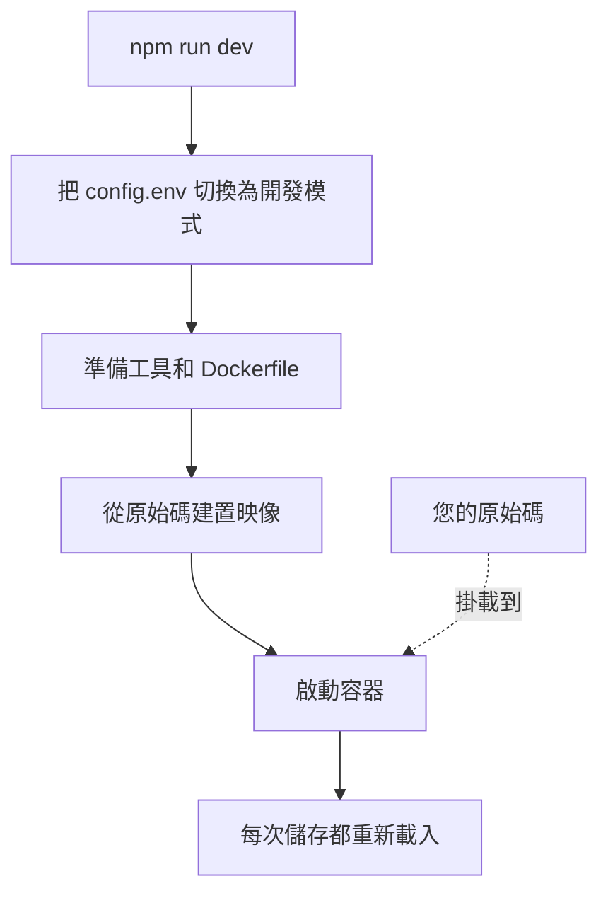

# 本機開發

在您自己的電腦上從原始碼執行 OneUptime，以便開發它。開發環境會用您簽出的程式碼建置每個服務，把原始碼掛載進容器，並在您儲存檔案時重新載入。

若要執行已發布的版本，請使用 [Docker Compose](/docs/installation/docker-compose)。

## 開發環境的運作方式

`npm run dev` 會先準備您簽出的程式碼，然後啟動 `Scripts/Dev/docker-compose.dev.yml` 中定義的服務堆疊：



| 階段 | 發生了什麼 |
| --- | --- |
| 切換到開發模式 | 在 `config.env` 中設定 `ENVIRONMENT=development`。 |
| 準備 | 詢問您的 sudo 密碼，安裝缺少的工具（Git、curl、Node.js、Docker、gomplate、ts-node），在目前的分支上執行 `git pull`，把 `config.example.env` 中的新設定加入 `config.env`，並把每個 `Dockerfile.tpl` 轉換成 `Dockerfile`。 |
| 建置 | 從原始碼為每個服務建置映像。第一次建置需要一些時間。 |
| 執行 | 啟動掛載了您原始碼的容器。 |
| 重新載入 | 伺服器檔案變更時，App 會重新啟動其 API；您編輯儀表板時，它會重新建置儀表板。 |

如果存放庫中有 `ee/` 資料夾，App 會從中載入 Enterprise Edition。在 `config.env` 中設定 `ONEUPTIME_EDITION=community` 即可改為執行 Community Edition。

## 開始之前

| 您需要 | 說明 |
| --- | --- |
| **Docker** | macOS 和 Windows 上使用 Docker Desktop，Linux 上使用附 Docker Compose v2 外掛的 Docker Engine。 |
| **Node.js 26 或更新版本，以及 npm** | 存放庫的 `package.json` 要求的版本，也是 CI 使用的版本。 |
| **Git** | 用來複製存放庫。 |
| **sudo 權限** | `npm run dev` 在安裝任何東西之前都會詢問您的密碼。 |
| **連接埠 80 和 443 未被占用** | 服務堆疊在 `http://localhost`（連接埠 80）上提供 OneUptime，並在連接埠 443 上提供 HTTPS。 |

## 啟動開發環境

:::steps
### 複製存放庫

```bash
git clone https://github.com/OneUptime/oneuptime.git
cd oneuptime
```

### 建立 config.env

```bash
cp config.example.env config.env
```

範例值可以直接用於開發。您可以修改它們，但並非必要。

### 啟動服務堆疊

```bash
npm run dev
```

它會詢問您的 sudo 密碼，接著建置映像並在背景啟動容器。用 `docker logs -f oneuptime-app-1` 查看 App 的啟動過程。

### 開啟 OneUptime

開啟 `http://localhost` 並註冊。第一個帳號會成為主管理員，可以在 `http://localhost/admin` 開啟 Admin Dashboard。
:::

## 修改程式碼

編輯 `packages/` 下的檔案並儲存：容器會接收這些變更。

在開啟提取要求之前，請在您的電腦上、容器之外檢查您的變更。為此只需安裝一次相依套件：在存放庫根目錄執行 `npm install`（用於 ESLint 和移轉工具），然後執行 `npm run install-modules`，它會刪除並重新安裝每個套件的 `node_modules`，需要一些時間。

:::steps
### 編譯您修改的部分

在您修改過的每個套件中執行編譯器，例如 App：

```bash
cd packages/App
npm run compile
```

### 只對您的檔案執行 lint

在存放庫根目錄傳入您修改過的檔案：

```bash
npx eslint --fix packages/App/path/to/File.ts
```

不要使用 `npm run lint` 和 `npm run fix-lint`：它們會對整個存放庫執行 lint。

### 執行涵蓋您變更的測試

在套件目錄中，只執行相關的測試檔案，而不是整個測試套件：

```bash
cd packages/App
npx jest Tests/path/to/YourChange.test.ts
```
:::

### 資料庫移轉

| 資料庫 | 如何新增移轉 |
| --- | --- |
| PostgreSQL | 修改模型，然後執行 `npm run generate-postgres-migration`，不要手寫移轉。在 `packages/Common/Server/Infrastructure/Postgres/SchemaMigrations/Index.ts` 中註冊新檔案：在列入那裡之前，它不會執行。`npm run check-postgres-schema-drift` 會列出仍然缺少的陳述式。 |
| ClickHouse | 參照既有的移轉，在 `packages/App/FeatureSet/Workers/DataMigrations` 中手寫移轉。 |

## 參考

### 命令

在存放庫根目錄執行這些命令。

| 工作 | 命令 |
| --- | --- |
| 啟動服務堆疊，或套用對 `config.env` 的變更 | `npm run dev` |
| 相依套件變更後重新建置映像 | `npm run build`，然後 `npm run dev` |
| 從頭重新建置映像 | `npm run force-build-dev`，然後 `npm run dev` |
| 列出執行中的容器 | `docker ps` |
| 追蹤某個服務的日誌 | `docker logs -f oneuptime-app-1` |
| 停止服務堆疊並移除其容器 | `npm run down` |

`npm run down` 會保留您的資料：PostgreSQL 和 ClickHouse 的磁碟區不會被刪除。

### 連接埠

開發環境會公開資料儲存，方便您用自己的工具連線。密碼在 `config.env` 中。

| 服務 | 位址 | 登入方式 |
| --- | --- | --- |
| OneUptime | `http://localhost` | 您建立的帳號 |
| PostgreSQL | `localhost:5400` | 使用者 `postgres`，資料庫 `oneuptimedb`，密碼 `DATABASE_PASSWORD` |
| ClickHouse | `localhost:8189`（HTTP），`localhost:9034`（原生） | 使用者 `default`，資料庫 `oneuptime`，密碼 `CLICKHOUSE_PASSWORD` |
| Valkey | `localhost:6310` | 密碼 `VALKEY_PASSWORD` |

## 疑難排解

:::details npm run dev 停在 git pull
`npm run dev` 在建置之前會在目前的分支上執行 `git pull`。如果分支沒有上游，或 pull 會覆寫您尚未提交的變更，Git 會拒絕執行。請為分支設定上游（例如用 `git push -u origin <branch>` 推送它），或提交您的工作，然後再次執行 `npm run dev`。
:::

:::details npm run dev 在安裝工具時停止
請自行安裝該工具，例如 gomplate 或 ts-node，然後再次執行 `npm run dev`：它會略過所有已安裝的工具。
:::

:::details 變更相依套件後某個服務失敗
映像中仍然是舊的相依套件。用 `npm run build` 重新建置映像，然後用 `npm run dev` 再次啟動服務堆疊。如果還是不行，就用 `npm run force-build-dev` 從頭重新建置。
:::

:::details 連接埠 80 或 443 已被占用
您電腦上的另一個程式（通常是本機 Web 伺服器）占用了該連接埠。停止它，然後再次執行 `npm run dev`。
:::

## 後續步驟

:::cards
- [自行託管架構](/docs/self-hosted/architecture): 您剛啟動的服務如何協同運作。
- [Docker Compose](/docs/installation/docker-compose): 在伺服器上執行已發布的版本。
- [API 參考](/docs/api-reference/api-reference): 呼叫您本機執行個體的 API。
:::
