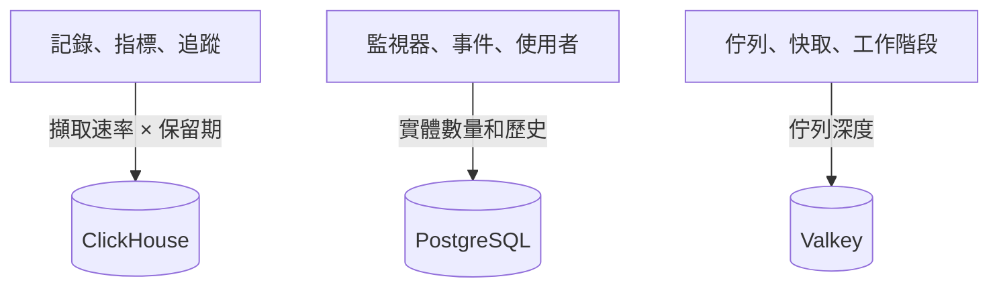

# 規模與容量規劃

為使用 [Helm Chart](https://artifacthub.io/packages/helm/oneuptime/oneuptime) 在 Kubernetes 上自行託管的 OneUptime 規劃 CPU、記憶體和磁碟。分別為三個資料儲存（**ClickHouse**、**PostgreSQL** 和 **Valkey**）以及應用程式決定規模，從下面的某個級別開始，取得真實數據後再調整。

> [!IMPORTANT]
> Chart 的預設值不是正式環境的規模。它預設執行的服務 **沒有設定任何 CPU 或記憶體的要求與限制**，PostgreSQL 和 ClickHouse 只有 **25 Gi** 的小磁碟區，這樣 Chart 才能安裝到任何叢集上。只要不是試用，就請依照本頁的數字自行設定資源和儲存空間。

如果您改用單台伺服器上的 Docker Compose 安裝，決定規模會更簡單：請參閱[需求](/docs/installation/docker-compose#requirements)（建議 16 GB 記憶體、8 核心和 400 GB 磁碟）。

:::cards
- [每個資料儲存的成長因素](#what-drives-each-datastore): 三個儲存隨三種不同的東西成長。
- [起步級別](#starting-tiers): 小、中、大三種起點。
- [高可用性](#high-availability): 每個資料儲存的複本與容錯移轉。
- [保留期](#retention-and-how-it-affects-storage): 讓磁碟成倍成長的設定。
:::

## 決定安裝規模

:::steps
1. 弄清楚您傳送多少遙測資料：每天多少 GB 的記錄、指標和追蹤。如果可以，在小型安裝上測量。
2. 決定保留多少天。保留期會讓 ClickHouse 的磁碟成倍成長（請參閱[保留期](#retention-and-how-it-affects-storage)）。
3. 用[儲存公式](#storage-formula)算出 ClickHouse 的磁碟，再依各自的章節算出 PostgreSQL 和 Valkey 的磁碟。
4. 選擇最接近您數據的[起步級別](#starting-tiers)，在 Helm values 中設定它的 CPU、記憶體和儲存空間。
5. 為需要的資料儲存開啟[高可用性](#high-availability)，然後觀察實際用量並調整。
:::

## 每個資料儲存的成長因素

OneUptime 在正式環境中需要三個資料儲存。它們各自隨不同的東西成長，因此要分別決定規模。



| 資料儲存 | 儲存的內容 | 決定其大小的因素 |
| --- | --- | --- |
| **ClickHouse** | 所有遙測資料（記錄、指標、追蹤、例外、效能分析） | 遙測的 **擷取速率 × 保留期**。這約占您儲存空間的 95%，是最主要的成本。 |
| **PostgreSQL** | 設定和狀態（監視器、事件、警示、使用者、團隊、專案、工作流程、狀態頁面、儀表板） | **實體數量和歷史**，而不是遙測資料量。成長緩慢。 |
| **Valkey** | 快取、工作佇列和工作階段 | **佇列深度和使用中的工作階段**。受記憶體限制，規模不大。不是權威資料來源。 |

OneUptime 執行時從不需要物件儲存（S3、MinIO），也不會把較舊的遙測資料移到物件儲存。只有當您選擇備份到物件儲存時才需要它：CloudNativePG 的 Barman Cloud 外掛，或 ClickHouse 的 [clickhouse-backup](https://github.com/Altinity/clickhouse-backup)。Chart 自帶的 CloudNativePG 備份（`postgresOperator.cnpg.backup`）會建立磁碟區快照，不需要物件儲存。CloudNativePG 從不刪除舊快照：請自行清理，否則它們會不斷增加。

## ClickHouse：最主要的因素

幾乎所有儲存空間和大部分記憶體都用在 ClickHouse 上，因為每一行記錄、每個指標點、每個追蹤 span 和每個例外都存放在那裡。

### 儲存公式

```text
ClickHouse disk ≈ (daily raw telemetry GB ÷ compression) × retention days × replicas × 1.3 (headroom)
```

壓縮率取決於訊號類型：

| 訊號 | 典型壓縮率 | 影響因素 |
| --- | --- | --- |
| 記錄 | 約 5:1 | 記錄的壓縮效果很好。 |
| 指標 | 約 2:1 | 標籤的 **基數** 高時，磁碟和記憶體的成長會比原始資料量更快。請保持較低的標籤基數。 |
| 追蹤 | 介於兩者之間 | 取決於您傳送的 span 屬性。 |

### 計算範例

一個由 **10 個叢集** 組成的叢集群，每個叢集約有 10 個節點和 100 個以 INFO 層級記錄的 Pod，大致會產生 **每個叢集 30 天 50–150 GB 的原始記錄**（每個叢集每天約 1.7–5 GB）。在整個叢集群範圍內，加上指標和追蹤並壓縮之後，大致按 **每天 5–15 GB 的壓縮遙測資料** 編列預算。

| 保留期 | 單一複本 | 2 個複本 + 30% 餘裕 |
| --- | --- | --- |
| 30 天 | ~150–450 GB | **~0.4–1.2 TB** |
| 90 天 | ~0.45–1.35 TB | **~1.2–3.5 TB** |

儲存空間 **與保留期成正比** 成長：90 天的時間範圍成本約為 30 天的三倍。

### 記憶體與磁碟類型

- **使用 NVMe 或 SSD。** 遙測以寫入為主，並伴隨突發的彙總讀取；在傳統硬碟上 ClickHouse 會力不從心。
- **給 ClickHouse 充足的記憶體。** 彙總查詢非常耗記憶體。根據經驗，按 *熱* 資料（最近查詢過的壓縮資料）的 25–50% 配置記憶體，對於任何真正的正式叢集群，實際下限為 16 GB。
- **控制指標的基數。** 它是影響 ClickHouse 記憶體和磁碟的最大單一因素。在收集指標的地方推行低基數的標籤規範，並留意使用中序列的數量。

## PostgreSQL：設定與狀態

PostgreSQL 儲存的是您的設定和運作狀態，而不是遙測資料，因此成長緩慢，與 ClickHouse 相比始終很小。即使是大型部署，通常也只有幾十 GB。預設的 **25 Gi** 磁碟區適合小型安裝；較大的安裝請規劃 50–100 GB，並為事件和警示歷史留出餘裕。

當應用程式、worker 和探測器的複本很多時，資料庫連線可能會先於儲存空間耗盡。每個 Pod 預設最多開啟 50 個連線，而內建的 PostgreSQL 允許 500 個。Chart 正是為此提供了選用的連線集區 **PgBouncer**（`pgbouncer.enabled`）：複本很多的部署請開啟它。

## Valkey：快取、佇列與工作階段

快取層執行 [Valkey](https://valkey.io)（Redis 7.2 的 BSD 授權分支），用作快取、工作佇列和工作階段儲存。任何支援 Redis 通訊協定的伺服器都可以取代它，下面的規模建議同樣適用。它 **受記憶體限制**，持久化 **預設關閉**：它不是權威資料來源，可以重建。請依佇列深度和同時工作階段數決定規模；大多數部署有 2–8 GB 記憶體就夠了。它的逐出原則是 `noeviction`，因此在持續負載下佇列積壓時要留意它的記憶體。

## 應用程式的運算資源

除了資料儲存，還要為無狀態工作負載決定規模。在您設定之前，每個工作負載都 **沒有資源要求或限制**，且只有一個複本，只有遙測寫入器有兩個。

| 工作負載 | values 鍵 | 隨什麼成長 |
| --- | --- | --- |
| App：儀表板、API 和擷取 | `app` | 使用者、API 呼叫和傳入的遙測資料 |
| Worker（與應用程式拆分時） | `worker` | 遙測資料和背景工作處理 |
| 探測器 | `probes` | 使用中監視器的數量 |
| 輸入閘道 | `nginx` | 要求量 |
| 遙測寫入器（開啟時） | `telemetryWriter` | 不隨負載成長：它把每次遙測插入批次寫入 ClickHouse，因此依 ClickHouse 能承受的量決定規模 |

Chart 內建 **KEDA**，因此應用程式、worker、探測器和 Runner 可以依佇列積壓自動調整規模。請同時開啟 `keda.enabled` 和每個服務自己的 `keda.enabled`（例如 `app.keda.enabled`）。在尚未安裝 KEDA 的叢集上，第一次安裝需要額外執行一輪：請參閱 Chart 的 [KEDA 指南](https://github.com/OneUptime/oneuptime/blob/master/HelmChart/Docs/Keda.md)。KEDA 不管理的服務可以改用以 CPU 或記憶體為依據的自動調整器（`autoscaling`）。

## 起步級別

選擇最接近您環境的級別作為起點，然後觀察實際用量（`kubectl top pods`、ClickHouse 和 PostgreSQL 的磁碟成長）並調整。

- **小型 / PoC**：1–3 個叢集，≤30 個節點，每天 ≤5 GB 原始遙測資料，保留 30 天。
- **中型 / 正式叢集群**：約 10 個叢集，約 100 個節點，每天 10–30 GB 原始遙測資料，保留 30–90 天。
- **大型 / 多叢集群**：50 個以上叢集，500 個以上節點，每天 100 GB 以上原始遙測資料，保留 90 天。

| | 小型 / PoC | 中型 / 正式叢集群 | 大型 / 多叢集群 |
| --- | --- | --- | --- |
| **ClickHouse** | 4 vCPU / 16 GB / 200 GB NVMe | 8 vCPU / 32 GB / 1–3 TB NVMe | 16+ vCPU / 64–128 GB / 5–15 TB NVMe，**分片** |
| **PostgreSQL** | 2 vCPU / 4 GB / 50 GB SSD | 4 vCPU / 8 GB / 100 GB SSD | 8 vCPU / 16–32 GB / 250 GB SSD (+ PgBouncer) |
| **Valkey** | 1 vCPU / 2 GB | 2 vCPU / 4 GB | 4 vCPU / 8–16 GB |
| **假設的保留期** | 30 天 | 30–90 天 | 90 天 |

這些級別用於決定 OneUptime 後端的規模。在每個受監控叢集上安裝的代理程式請參閱 [Kubernetes 代理程式](/docs/telemetry/kubernetes-agent)頁面，那裡也介紹如何減少它傳送的資料量。

## 高可用性

Chart 內建的資料儲存預設以 **單一執行個體** 執行。要在正式環境實現高可用性：

| 資料儲存 | 實現高可用性 |
| --- | --- |
| **PostgreSQL** | 開啟內建的 [CloudNativePG](https://cloudnative-pg.io) operator（`postgresOperator.cnpg.enabled`），使用 **3 個執行個體**（`postgresOperator.cnpg.instances`）：一個主要執行個體和兩個熱待命執行個體，並自動容錯移轉。 |
| **ClickHouse** | 開啟內建的 [Altinity](https://github.com/Altinity/clickhouse-operator) operator（`clickhouseOperator.altinity.enabled`），使用 **每個分片 2 個或更多複本**（`clickhouseOperator.altinity.cluster.replicasCount`）。它內建的 ClickHouse Keeper 執行 **3 個節點** 以形成仲裁。當單一節點的磁碟或記憶體成為瓶頸時，再新增分片（`shardsCount`）。 |
| **Valkey** | Chart 不會複寫它。請讓 OneUptime 指向具備自動容錯移轉的外部代管 Redis 或 Valkey（`externalValkey`）。OneUptime 只連線到單一主機和連接埠，因此請使用服務的主要端點，而不是叢集模式的端點。 |

> [!WARNING]
> 為現有安裝開啟任一 operator 都會啟動一個新的空白資料庫：兩者都不會複製被取代的單一執行個體資料庫中的資料。請依照 Chart 指南移轉資料：[PostgreSQL](https://github.com/OneUptime/oneuptime/blob/master/HelmChart/Docs/MigratePostgresStandaloneToOperator.md) 和 [ClickHouse](https://github.com/OneUptime/oneuptime/blob/master/HelmChart/Docs/MigrateClickhouseStandaloneToOperator.md)。

## 保留期及其對儲存空間的影響

遙測保留期是 **以天計算的 ClickHouse TTL**。每個版本都有專案的預設值，位於 **專案設定 > 遙測與 APM > 資料保留**（**預設保留期（天）**）；未設定時為 15 天。[Enterprise Edition](/docs/self-hosted/enterprise) 增加了覆寫設定：依訊號（記錄、追蹤、指標、效能分析）、依記錄嚴重性和追蹤狀態，以及依服務或資源。

記錄和指標在保留期結束後的第一個午夜（ClickHouse 伺服器時間）按天刪除，這樣 ClickHouse 不必在資料到期期間每隔幾小時重寫每一天的資料。在午夜之前，磁碟上最多還會多保留一天的資料：請按 **保留天數 + 1** 為記錄和指標決定規模。

由於保留期會讓 ClickHouse 的儲存空間成倍成長，請在決定磁碟規模之前先決定保留期。OneUptime **不會** 封存舊的遙測資料，也不會把它們移到物件儲存。如果出於合規需要保留多年，請延長保留時間範圍並相應地決定 ClickHouse 儲存規模，或匯出到您選擇的外部封存。

## 先測量再決定

遙測資料量會因應用程式記錄的詳細程度、命名空間數量、擷取間隔以及是否在某處開啟了 DEBUG 記錄而相差極大。請把上面的級別當作起點：**從您的環境中至少收集四週的資料**，測量每種訊號每天的實際 GB 數，再根據真實資料決定保留期和儲存規模。

## 後續步驟

:::cards
- [Docker Compose](/docs/installation/docker-compose): 單一伺服器安裝的需求。
- [自行託管架構](/docs/self-hosted/architecture): 各元件如何協同運作。
- [Kubernetes 代理程式](/docs/telemetry/kubernetes-agent): 傳送叢集遙測資料的收集器。
- [Enterprise Edition](/docs/self-hosted/enterprise): 保留期覆寫設定和其他 Enterprise 功能。
:::
