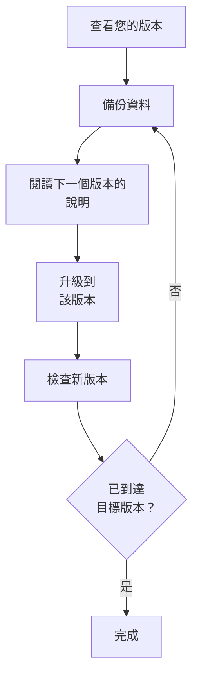

# 升級

將自行託管的 OneUptime 安裝（使用 Docker Compose，或使用 Kubernetes 和 Helm）升級到較新的版本。請依照下面的步驟操作，並閱讀從您正在執行的版本到目標版本之間每個主要版本的說明。

:::cards
- [如何升級](#如何升級): 適用於 Docker Compose 和 Kubernetes 的步驟。
- [各版本的說明](#查找您的版本的說明): 每個主要版本需要您做什麼，一目了然。
- [Community Edition 與 Enterprise Edition 映像檔](#community-edition-與-enterprise-edition-映像檔): 從 14 起應執行哪個映像檔。
- [從 OneUptime 13 → 14 升級](#從-oneuptime-13-14-升級): 最新的主要版本。
:::

## 如何升級

遵守三條規則，升級就是安全的：

- **一次只升級一個主要版本**（例如 6 → 7 → 8）。不要跳過任何主要版本。
- **次要版本和修補版本可以隨意跳過**（例如 8.1 → 8.4），只要遵循它們的版本資訊即可。
- **每次升級前都要備份**，並確認您能夠還原它。



:::steps
### 查看目前的版本

以主管理員身分開啟管理員儀表板頁首中的版本標籤：**This installation** 會顯示您正在執行的版本。執行個體也會在 `/version` 上回報它：

```bash
curl http://localhost/version
```

將 `http://localhost` 替換為您的執行個體位址。回應是 JSON，例如 `{"version":"14.0.22","commit":"..."}`。

### 備份資料

備份 PostgreSQL；如果您需要 ClickHouse 中的遙測資料，也請備份 ClickHouse。使用 Docker Compose 時，請參閱 [備份與還原](/docs/installation/docker-compose#備份與還原)。在 Kubernetes 上，請使用您的磁碟區快照或 chart 的 CloudNativePG 備份。

### 閱讀下一個主要版本的說明

說明在 [下表](#查找您的版本的說明) 中。升級前請先完成說明中要求的事項：有些步驟（例如重新命名 Helm 值）必須先做。

### 執行升級

:::tabs
@tab Docker Compose
```bash
git checkout release
git pull
npm run update
```
`npm run update` 會把新設定加入您的 `config.env`，而不變更您已有的設定，接著拉取新的映像檔並重新啟動 OneUptime。
@tab Kubernetes
```bash
helm repo update
helm upgrade my-oneuptime oneuptime/oneuptime -f values.yaml
```
請使用您自己的發行名稱和 values 檔案。chart 會在新的 Pod 處理流量之前，在一個獨立的 Job 中執行資料庫移轉。
:::

### 檢查新版本

使用 Docker Compose 時，`npm run update` 會以 **OneUptime is up!** 結束。在 Kubernetes 上，請等待每個 Pod 都處於 `Running` 並且就緒：

```bash
kubectl get pods -n <namespace>
```

然後像第一步那樣再次檢查您的版本。如果還沒有到達目標版本，請回到 [備份資料](#備份資料)，繼續下一個主要版本。
:::

### 查找您的版本的說明

| 升級 | 您需要做什麼 |
| --- | --- |
| [13 → 14](#從-oneuptime-13-14-升級) | 選擇一個版本。設定了 `IS_ENTERPRISE_EDITION=true` 的 Docker Compose 安裝改用 `APP_TAG=enterprise-release`。在 Enterprise Edition 上啟用授權。重新儲存 IPv6 的 Ping、Port 和 SSL 監測器。 |
| [12 → 13](#從-oneuptime-12-13-升級) | 通常不需要做什麼：Redis 換成 Valkey，舊的設定名稱仍然有效。手動執行 Docker Compose？請加上 `--remove-orphans`。使用自己的快取？請閱讀 [如果您執行自己的快取](#如果您執行自己的快取)。 |
| [11 → 12](#從-oneuptime-11-12-升級) | 將 Runbook Agent 重新部署為 Runner。使用 Docker Compose 時設定 `ONEUPTIME_RUNNER_KEY`。使用 Helm 時將 `aiAgent:` 重新命名為 `runner:`。重新授予 API 金鑰曾直接擁有的 Runner 權限。 |
| [10 → 11](#從-oneuptime-10-11-升級) | SCIM 和團隊合規設定需要 Enterprise Edition。若要保留遙測歷史，請在升級前重新命名舊的 ClickHouse 資料表。 |
| [9 → 10](#從-oneuptime-9-10-升級) | 無。 |
| [8 → 9](#從-oneuptime-8-9-升級) | 使用 Helm 時，從您的 values 中移除 `oneuptimeIngress` 覆寫。 |
| [7 → 8](#從-oneuptime-7-8-升級) | 使用 Helm 時，改用 Postgres、Redis 和 ClickHouse 的新 values 結構。請先備份。 |

## Community Edition 與 Enterprise Edition 映像檔

OneUptime 現在以兩個映像檔提供應用程式。**Community Edition** 是採用 Apache 2.0 授權的開源版本，包含 SAML 和 OIDC 單一登入、全域 SSO 以及「Require SSO for login」。**Enterprise Edition** 加入了存放庫 `ee/` 目錄中的企業模組：SCIM、團隊合規、稽核日誌，以及管理員儀表板的企業版 Health 儀表板。在這項變更之前，兩個版本執行相同的程式碼，由 `IS_ENTERPRISE_EDITION` 決定啟用哪些功能。現在由映像檔決定，Community 映像檔中不包含 `ee/` 目錄。

完整的功能比較、授權詳細資訊以及切換版本時會發生什麼，請參閱 [企業版](/docs/self-hosted/enterprise) 頁面。

### 升級前要做什麼

- **不使用 SCIM 的 Community Edition:** 無需任何操作。照常升級。
- **使用 `image.type: enterprise-edition` 的 Helm:** 無需任何操作。chart 已經會拉取 `enterprise-` 映像檔，這些映像檔現在包含企業模組。
- **使用 `IS_ENTERPRISE_EDITION=true` 的 Docker Compose:** 升級時在 `config.env` 中設定 `APP_TAG=enterprise-release`（或 `enterprise-<version>`），切換到 Enterprise 映像檔。`APP_TAG=release` 是 Community 映像檔，而 `IS_ENTERPRISE_EDITION=true` 不再開啟任何功能。只要 `IS_ENTERPRISE_EDITION=true`，`npm run update` 就會替您完成這項變更（`release` 變成 `enterprise-release`，固定的 `13.0.7` 變成 `enterprise-13.0.7`），並輸出它所做的變更。現在，當在 Community 映像檔上設定了 `IS_ENTERPRISE_EDITION=true` 時，應用程式會 **拒絕啟動**，而不是悄悄停止 SCIM 佈建和稽核日誌記錄。錯誤訊息會說明要設定什麼：若要保留 Enterprise Edition，請設定 `APP_TAG=enterprise-<version>`；若要執行 Community Edition，請設定 `IS_ENTERPRISE_EDITION=false`。
- **已設定 SCIM 的 Community 映像檔:** 這次升級後 SCIM 佈建會停止，包括取消佈建。若要繼續使用，請切換到 Enterprise 映像檔。否則，請在升級前閱讀 [從 Enterprise 切換到 Community](/docs/self-hosted/enterprise#從-enterprise-切換到-community)。它說明了哪些功能會停止，以及應先移除哪些人。若要執行 Community Edition，還要設定 `IS_ENTERPRISE_EDITION=false`。單一登入不受影響：Community 映像檔同樣提供它。

您的設定永遠不會被刪除，無論朝哪個方向切換版本都不需要移轉。

### 升級後的授權

Enterprise Edition 現在會檢查自己的授權：

- **有授權金鑰的安裝** 會繼續運作。它在啟動時以及每天一次向 OneUptime 檢查授權。如果授權到期，在 30 天的寬限期內一切照常運作，之後會發生與沒有授權的安裝相同的情況。
- **沒有授權的安裝**（例如只透過 `IS_ENTERPRISE_EDITION=true` 執行 Enterprise Edition 的安裝）從首次啟動此版本起獲得 14 天的試用期。**如果您使用 SCIM 或稽核日誌記錄，請在試用期結束前啟用授權。** 試用期結束後，SCIM 佈建會停止，稽核日誌記錄也會停止記錄。企業設定也會變為唯讀，企業版 Health 儀表板會被鎖定。單一登入不受影響。只要您啟用授權，一切都會立即恢復，無需重新啟動。試用期用於評估：在正式環境中使用 Enterprise Edition 需要 OneUptime Enterprise 訂閱。請參閱 [授權到期或缺少時](/docs/self-hosted/enterprise#授權到期或缺少時)。
- **與網路隔離的安裝** 可以使用簽署的授權權杖而不是金鑰來啟用。請參閱 [離線啟用](/docs/self-hosted/enterprise#離線啟用與網路隔離的安裝)。

### OneUptime Cloud 客戶

對您來說沒有任何變化。OneUptime Cloud 執行 Enterprise Edition，您能使用哪些功能仍由您的方案決定：SSO、OIDC、SCIM 和團隊合規從 Scale 方案起提供，稽核日誌在 Enterprise 方案中提供。Scale 方案的專案現在可以看到以前顯示升級提示的 SSO、OIDC、SCIM 和團隊合規設定。

### API 和端點的變更

- `GET /api/global-config/license` 只向主管理員傳回授權金鑰、授權權杖、執行個體清單、執行個體 ID 和版本詳細資訊。其他呼叫者只會取得版本和授權狀態。
- 自行託管的安裝不再提供 `/api/enterprise-license/` 下的授權伺服器端點。只有 oneuptime.com 使用它們。
- SCIM 端點在 Enterprise Edition 上保持完全相同的路徑，因此身分提供者的設定無需變更。在 Community Edition 上它們會傳回 `404`。在 Enterprise Edition 上，授權到期期間（試用期或寬限期之後）它們會拒絕請求，一旦啟用授權就會再次回應。
- SSO 和 OIDC 端點（SAML 登入和 ACS URL、OIDC 重新導向 URI，以及全域 SSO 端點）保持完全相同的路徑，並且無論授權處於什麼狀態，兩個版本都會提供它們。

## 從 OneUptime 13 → 14 升級

OneUptime 14 將應用程式分為兩個版本，您拉取的映像檔決定您執行哪一個。**Community Edition**（Apache-2.0，標籤 `release` 和 `<version>`）包含 SAML SSO、OpenID Connect、全域 SSO 和「Require SSO for login」。它不包含存放庫的 `ee/` 目錄，因此 SCIM 佈建、團隊合規設定、稽核日誌、管理員儀表板的 **Health** 儀表板以及管理員儀表板的 **Query Console** 根本不在該映像檔中。**Enterprise Edition**（標籤 `enterprise-release` 和 `enterprise-<version>`）包含它們，並在執行時檢查 Enterprise 授權，這是 OneUptime 13 從未做過的。單一登入不依賴該授權。

上面的 [Community Edition 與 Enterprise Edition 映像檔](#community-edition-與-enterprise-edition-映像檔) 是這項變更的參考：每個版本包含什麼、每種部署方式要設定什麼，以及授權有什麼作用。本節是升級本身。請從 13 升級——如果您仍在 12，請先完成 12 → 13。

無論哪個版本，都不會刪除任何內容。單一登入在兩個版本中的運作方式相同：您的 SSO 和 OIDC 設定以及「Require SSO for login」設定都會原樣保留。您的 SCIM 設定和到目前為止記錄的稽核日誌都保留在資料庫中。Community Edition 只是不提供它們，而無論朝哪個方向切換版本都不需要移轉。

### 您需要做什麼

1. **決定此安裝執行哪個版本。** 如果您使用 SCIM 佈建、團隊合規設定或稽核日誌，或者需要管理員儀表板的 **Health** 儀表板，那就是 Enterprise Edition。否則無需決定：Community Edition 就是您現在使用的版本，它包含 SAML SSO 和 OpenID Connect。
2. **使用 Helm 時，在 values 檔案中設定版本:** `image.type: enterprise-edition`（預設值為 `community-edition`）。不要變更 `image.tag`——chart 會自行加上 `enterprise-` 前綴，因此 `image.tag: release` 會拉取 `oneuptime/app:enterprise-release`。這個值不是新的。如果您已經在使用 `enterprise-edition`，則無需變更：您已經拉取的標籤現在包含 `ee/`。
3. **使用 Docker Compose 時，在 `config.env` 中設定 `APP_TAG=enterprise-release`**（或用 `enterprise-<version>` 固定版本）。`APP_TAG=release` 是 Community 映像檔。這是唯一會讓 13 上的安裝停下來的一項：在 13 上，使用 Compose 的 Enterprise 安裝是 `APP_TAG=release` 加上 `IS_ENTERPRISE_EDITION=true`，而現在這種組合會 **拒絕啟動**，而不是以 SCIM 佈建和稽核日誌記錄被悄悄停止的 Community Edition 身分啟動。只要 `IS_ENTERPRISE_EDITION=true`，`npm run update` 就會替您改寫 `APP_TAG`（`release` 變成 `enterprise-release`，固定的 `13.0.8` 變成 `enterprise-13.0.8`），並輸出它所做的變更。如果您改為手動拉取映像檔，請先自行設定 `APP_TAG`。
4. **在 Enterprise Edition 上啟用授權。** 沒有授權的安裝從其首次啟動 Enterprise Edition 起獲得 14 天的試用期——對升級來說，這一天是您升級的那天，而不是您第一次安裝 OneUptime 的那天。主管理員可以透過管理員儀表板頁首中的版本標籤啟用它；與網路隔離的安裝則使用簽署的權杖啟用。請參閱 [授權](/docs/self-hosted/enterprise#授權)。
5. **如果此安裝將執行 Community Edition，而您的身分提供者透過 SCIM 取消佈建使用者，請在升級前檢查誰擁有存取權。** SCIM 取消佈建會停止，因此您在身分提供者中移除的人會保留他們的 OneUptime 帳戶；除非「Require SSO for login」適用於他們，否則任何仍能存取這些帳戶信箱的人都可以透過「忘記密碼」設定密碼並登入。請先移除這些使用者：[從 Enterprise 切換到 Community](/docs/self-hosted/enterprise#從-enterprise-切換到-community)。
6. **如果您使用 Ping、Port 或 SSL 監測器監測 IPv6 位址，請在升級後重新儲存這些監測器。** 在 14 之前儲存的目標可能被截斷儲存——請參閱 [IPv6 的 Ping、Port 和 SSL 監測器](#ipv6-的-pingport-和-ssl-監測器)。

### 版本：哪些變了，哪些沒變

| | 直到 13 | 從 14 起 |
| --- | --- | --- |
| 企業程式碼 | 在每個映像檔中；由 `IS_ENTERPRISE_EDITION=true` 開啟 | 在 `ee/` 中，且只在 `enterprise-` 映像檔中 |
| Helm 中的選擇器 | `image.type` | `image.type`——未變，但映像檔現在不同了 |
| Compose 中的選擇器 | `IS_ENTERPRISE_EDITION=true` | `APP_TAG=enterprise-release` |
| Enterprise 授權 | 執行時從不檢查 | 啟動時和每天一次檢查 |
| SSO 和 OIDC 端點 | 兩個版本中路徑相同 | 兩個版本中路徑相同，與授權狀態無關 |
| SCIM 端點 | 兩個版本中路徑相同 | Enterprise 上路徑相同；Community 上為 `404` |
| 您的企業設定 | 儲存並套用 | 兩種情況下都儲存，在 Enterprise 上套用 |

會執行一個移轉：在只有一列的 `GlobalConfig` 資料表上新增一個可為 null 的欄位 `enterpriseEditionFirstSeenAt`，因此是即時完成的。沒有 ClickHouse 移轉，不會刪除任何內容，無論朝哪個方向切換版本都不需要移轉。

### Enterprise Edition 上的授權時間軸

- **沒有授權的安裝** 執行 14 天的試用期，從首次啟動 Enterprise Edition 起計算。試用期內所有企業功能都能使用，版本標籤會在試用期結束前發出提醒。試用期用於評估：在正式環境中使用 Enterprise Edition 需要依據 OneUptime Enterprise License 的訂閱。
- **到期的授權** 自到期日起有 30 天的寬限期，期間所有企業功能都能使用，版本標籤會發出提醒。
- **試用期結束後，或寬限期結束後**，直到啟用授權為止：來自您的身分提供者的 SCIM 請求會被拒絕，稽核日誌記錄會停止記錄。企業設定變為唯讀——您仍然可以檢視和刪除它，並重設 SCIM 持有人權杖，這正是處理事件時需要的——管理員儀表板的 Health 儀表板和 Query Console 會被鎖定。
- **不會刪除任何內容，核心監控也從不受影響。** 監測器、警示、事件、待命、狀態頁面和遙測都不受授權限制，登入也一樣：透過 SSO 和 OIDC 登入、「Require SSO for login」，以及包括主管理員在內的所有使用者的密碼登入，在任何授權狀態下都一樣運作。啟用授權會使用您已有的設定恢復 SCIM 佈建和稽核日誌記錄，無需重新啟動。
- **您已有的授權金鑰會被接受**，作為「unverified」授權：它的到期日和席次上限來自授權伺服器已經告知此安裝的資訊，並在該到期日之後同樣獲得 30 天的寬限期。今後簽發的授權都經過簽署，由應用程式自行驗證。這次升級不需要新的金鑰。
- **此安裝從未記錄過到期日的金鑰** 在試用期內會繼續運作，而不會停止。授權伺服器分別寫入金鑰和到期日，因此一個安裝可能擁有從未被告知到期日的金鑰。這樣的安裝與沒有授權的安裝完全一樣對待：在從首次啟動 Enterprise Edition 起計算的 14 天試用期內，所有企業功能都能使用；試用期結束後，停止的功能與上面相同。授權處於此狀態時不強制執行席次上限，因為該安裝持有的授權記錄本來就不完整。主管理員透過版本標籤重新啟用授權，或每日授權同步從 oneuptime.com 取回到期日，都會在無需重新啟動的情況下將其恢復。

完整的狀態表請參閱 [授權到期或缺少時](/docs/self-hosted/enterprise#授權到期或缺少時)。

### Docker Compose：選擇映像檔標籤

```bash
git checkout release # Please make sure you're on release branch.
git pull
npm run update
```

- **只要 `IS_ENTERPRISE_EDITION=true`，`npm run update` 就會移動 `APP_TAG`**，將其改為同一版本的 Enterprise 映像檔，並輸出它所做的變更。它會保留您的註解和引號，不會變更已經是 `enterprise-` 標籤的 `APP_TAG`，第二次執行時不做任何變更。
- **手動拉取映像檔會跳過這一步**，此時應用程式會在啟動時結束，並給出準確說明要設定什麼的錯誤：若要保留 Enterprise Edition，請設定 `APP_TAG=enterprise-<version>`；若要執行 Community Edition，請設定 `IS_ENTERPRISE_EDITION=false`。
- **若要刻意切換到 Community Edition**，請設定 `APP_TAG=release` 和 `IS_ENTERPRISE_EDITION=false`。如果您的身分提供者透過 SCIM 取消佈建使用者，請先閱讀上面的第 5 點。
- 對於這個版本，`config.env` 中無需變更其他任何內容。

### Helm：選擇映像檔類型

```bash
helm repo update
helm upgrade my-oneuptime oneuptime/oneuptime -f values.yaml
```

- **已經使用 `image.type: enterprise-edition` 的安裝無需變更任何值。** chart 早已為標籤加上前綴；新的變化是 `enterprise-` 映像檔包含 `ee/`。從這個版本起，會依照上面的時間軸對它套用授權。
- **`image.tag: release` 是預設值**，因此停留在浮動標籤上的 chart 會在下一次升級時轉到 14，無需變更任何值。如果該安裝在 `community-edition` 上設定了 SCIM，請在同一次升級中設定 `image.type: enterprise-edition`。
- **chart 仍然會輸出 `IS_ENTERPRISE_EDITION`**，它由 `image.type` 推導而來，因此兩者永遠不會不一致。它不控制任何東西。在 Community 映像檔上透過 `extraEnv` 將其強制設為 `true`，只會讓應用程式拒絕啟動。永遠不要透過 chart 設定 `ONEUPTIME_EDITION`。
- **chart 的探測器重新遵循 `probes.<key>.allowPrivateNetworkMonitors`**（[#3879](https://github.com/OneUptime/oneuptime/issues/3879)）。除非您設定它，否則什麼都不會改變——預設值仍為 `false`——並且它適用於執行個體上所有專案的監測器，因為 chart 的探測器是全域探測器。無論您設定什麼，回送位址、連結本機位址和 `169.254.169.254` 都保持被封鎖。

### 14 中的其他變更

這些變更會改變升級後 OneUptime 的行為，大多數不需要您做任何事。如果您使用由個別權限組成的自訂角色或 API 金鑰、事件、警示或維護的自訂狀態、Terraform 或 API、SSO，或者 Slack 和 Microsoft Teams 應用程式，請閱讀它們。

:::details 閱讀 14 中的其他變更
- **OTLP 擷取只在佇列接受批次之後才確認該批次。** 13 先回應 `200`，之後才排入佇列，因此被佇列拒絕的批次會悄悄遺失。14 改為回應 `503` 並附帶 `Telemetry queue unavailable. Please retry.`，gRPC 端點傳回 `UNAVAILABLE`；兩者都可以重試，匯出器也會重試。這適用於日誌、指標、追蹤和效能剖析資料。您無需做任何事，但以前資料會消失的地方，現在能看到匯出器的重試和佇列的背壓——如果您在規劃擷取容量，這一點值得了解。
- **管理員儀表板的 Health 儀表板和 Query Console 需要 Enterprise Edition**，PostgreSQL 和 Valkey 的健康狀態警示也一樣。在 13 中，僅憑 `IS_ENTERPRISE_EDITION=true` 就能使用它們，因此對於曾使用它們的 Community 安裝來說，這是看得見的功能損失。ClickHouse 容量監控及其清理、移轉狀態、全域探測器和支援套件在兩個版本中都有。
- **透過探測器的代理伺服器連線到 IP 位址的 HTTPS 監測器重新可以運作了。** 探測器過去把 IP 當作 TLS 伺服器名稱傳送，而這不是有效的伺服器名稱，Node 會直接拒絕，因此在設定了 `PROBE_ALLOW_PRIVATE_NETWORK_MONITORS` 的全域探測器上，監測 `https://<private IP>` 的監測器會在交握時失敗。現在探測器對 IP 目標省略伺服器名稱，並根據 IP 本身驗證憑證。主機名稱目標不變。
- **`oneuptime` CLI 會回報其真實版本**，`--version` 傳回真實版本而不是預留位置。
- **新的警示或片段從其建立時指定的狀態開始。** API、Terraform（`current_alert_state_id`、`current_incident_state_id`）和工作流程可以像儀表板的 **初始狀態** 欄位那樣，指定警示、警示片段或事件片段開始時的狀態。以前該狀態會被專案的建立狀態取代；設定了它的 Terraform 設定會得到與計畫不同的值。未指定狀態的建立仍從建立狀態開始，其他專案的狀態會被拒絕。請參閱 [新記錄開始時的狀態](/docs/api-reference/api-reference)。
- **建立時就已確認或已解決的記錄不會呼叫任何人。** 透過 **初始狀態**、範本的起始狀態、API、Terraform 或工作流程以較後狀態建立的事件、警示或片段，不再執行其待命策略；它的動態會改為說明這一點。以已解決狀態建立的記錄也不再被分組到片段中、被補救、被 OneUptime AI 調查，或獲得 Slack 或 Microsoft Teams 頻道；以已解決狀態建立的事件不會變動其監測器的狀態和監控，也不會啟動 SLA。以已確認狀態建立的記錄會以已回應的狀態啟動其 SLA。在建立狀態下建立的記錄（例如監測器開啟的所有記錄）不變。請參閱 [宣告時已確認或已解決](/docs/incidents/declaring-incidents#宣告時即已確認或已解決)。
- **位於已解決狀態之後的狀態在任何地方都算作已解決。** 處於您放在已解決狀態之後的狀態（例如 **已解決** 下方的 **Closed** 狀態）中的事件、警示或片段，過去在某些地方算作已解決，在另一些地方算作未解決。現在它們都遵循同一條規則：專案的已解決狀態及其之後的每個狀態都是已解決。處於這種狀態的記錄會從 **進行中事件** 和 **進行中警示** 清單及其側邊選單計數、儀表板的事件和警示清單、進行中的片段以及行動應用程式的未解決記錄清單中移除；Slack 和 Microsoft Teams 摘要會將它們算作已解決，狀態頁面時間軸會將這樣的列顯示為已解決。其事件或警示處於這種狀態的監測器或 SLO 消耗速率規則，下次觸發時會開啟一個新的，而過去它會認為舊的仍未解決。將事件直接移到這種狀態會像 **已解決** 一樣解決它，而將其移過 **已解決** 不再重新開啟片段，也不再為該事件啟動新的 SLA。自訂狀態都位於已解決狀態之上的專案不會看到任何變化。請參閱 [進行中事件清單](/docs/incidents/states-and-severities#進行中事件清單)。
- **位於已確認狀態之後的狀態在任何地方都算作已確認。** 處於您放在已確認和已解決狀態之間的狀態（例如 **已確認** 下方的 **Investigating** 狀態）中的事件、警示或片段，已經會停止待命呼叫，但行動應用程式和 Microsoft Teams 仍為其提供 **Acknowledge**，而在該狀態下確認警示或片段（從 Teams、Slack 或待命頁面）會把它移回 **已確認**。現在它們都遵循同一條規則：專案的已確認狀態、其之後的每個狀態以及已解決狀態都算作已確認。這類記錄在任何地方都不再提供 **Acknowledge**，確認它會被拒絕（"... is already acknowledged."）而不是將其移回；為它確認自己呼叫的回應者只是完成該呼叫。將記錄直接移到這種狀態現在會把事件的 SLA 標記為已回應——過去它會保持未回應直到事件解決，可能違反回應目標——並在概覽的確認用時、**Time to Acknowledge** 指標、測量以及 Slack 和 Microsoft Teams 摘要的 MTTA 中算作對它的確認。未經確認就被解決的記錄現在在解決時算作已確認，正如概覽早已顯示的那樣。**已確認** 清單篩選器也會顯示處於這些狀態的記錄，**Time in State** 指標的 `isAcknowledgedState` 屬性對它們為 `true`。自訂狀態都位於已確認狀態之上的專案不會看到任何變化。請參閱 [確認會做什麼](/docs/incidents/states-and-severities#確認會做什麼)。
- **片段依照事件和警示所遵循的規則在狀態間移動。** 事件片段或警示片段過去可以從儀表板的狀態時間軸、Slack、Microsoft Teams、API 或 Terraform 被移回其狀態清單的上方——例如把已解決的片段移回 **已確認**——並且這一移動會傳遞到它的事件或警示。現在，移到依順序位於片段目前狀態之前的狀態會被拒絕，錯誤與事件得到的相同（"Episode cannot transition to Acknowledged state from Resolved state because Acknowledged is before Resolved in the order of incident states."），並且什麼都不會改變。分組規則的 **重新開啟最近解決的片段** 選項仍會重新開啟片段，作為 OneUptime 自己的移動。若要更正誤設的狀態，請像對事件那樣從片段的狀態時間軸中刪除該列；片段會回到其最後剩餘列的狀態，刪除使其解決的那一列會清除其解決時間。片段只會把它的每個事件或警示移到它們自己的狀態會去的地方：已經處於該狀態或更後狀態的，保持不動。
- **寫入記錄的目前狀態也遵循同一規則。** 透過 API 或 Terraform（`currentIncidentStateId`、`currentAlertStateId`、`currentScheduledMaintenanceStateId`）更新事件、警示、片段或排定維護事件的目前狀態時，如果這會把記錄移回其清單的上方，就會在儲存任何內容之前以同樣的錯誤被拒絕。過去寫入會先到達記錄，然後狀態時間軸才拒絕它，使記錄停留在其時間軸從未有過的狀態。現在寫入事件片段的狀態會將其記錄到片段的狀態時間軸並移動其事件，就像寫入警示片段的狀態早已做到的那樣。設定較早狀態的 Terraform 計畫會在 apply 時失敗；請依順序設定狀態，或用狀態時間軸的一列來變更狀態。
- **Slack 和 Microsoft Teams 中的 Change State 只提供記錄接下來可以進入的狀態。** 處於它能到達的最後一個狀態的記錄會收到回覆"There is no later state to move this incident to."，而不是一個每個選項都會被拒絕的表單。儀表板頁首中的 **Change state to** 選單遵循同一規則。
- **被移回清單上方的排定維護事件的錯誤現在與其他錯誤的寫法一致:** "Scheduled Maintenance cannot transition to Scheduled state from Ongoing state because Scheduled is before Ongoing in the order of scheduled maintenance states."（過去寫的是 `ScheduledMaintenance` 和 `scheduledMaintenance states`）。比對舊文字的指令碼需要改用新文字。請參閱 [順序是真正的約束](/docs/incidents/states-and-severities#順序是真正的限制而不是顯示偏好)。
- **解決事件只會交還它所持有的監測器。** OneUptime 現在會記錄事件是否持有其監測器的狀態。已經解決過一次又被重新開啟的事件，再次解決時不再把其監測器恢復為正常運作，因此監測器在此期間獲得的狀態——來自其探測器、維護或手動設定——會保留；在事件開啟期間變更其監測器或它為監測器設定的狀態，會讓它再次持有這些監測器。升級前的事件會像以往一樣，在下次解決時交還其監測器。請參閱 [解決會做什麼](/docs/incidents/states-and-severities#解決會做什麼)。
- **事件或警示所屬的片段只能透過片段的成員來設定。** `incidentEpisodeId` 和 `alertEpisodeId`（以及關聯 `incidentEpisode` 和 `alertEpisode`）是唯讀的。API、Terraform（`incident_episode_id`、`alert_episode_id`）、MCP 工具和工作流程過去可以在不把記錄加入片段的情況下寫入它們：片段概覽會因此列出其 **成員** 頁面中沒有的事件或警示，而設定了片段建立的記錄從不會被分組。現在傳送其中之一的建立或更新會被拒絕，並附帶一則指向片段成員的訊息：使用 `POST /api/incident-episode-member`（或 `/api/alert-episode-member`）新增記錄，刪除該成員即可將其移出，片段參照會隨之變化。讀取不變。設定了 `incident_episode_id` 或 `alert_episode_id` 的 Terraform 設定，在您升級提供者後就必須將其移除，因為提供者現在只讀取它們；成員關係由資源 `oneuptime_incident_episode_member` 和 `oneuptime_alert_episode_member` 管理。請參閱 [事件或警示所在的片段](/docs/api-reference/api-reference)。
- **新的來電上報規則響鈴 20 秒，而不是 30 秒。** 許多電話會在 30 秒內把未接來電轉到語音信箱，而語音信箱一旦接聽，通話就在那裡結束，不會轉給下一條規則。儀表板的 **響鈴時長（秒）** 欄位、API（`escalateAfterSeconds`）和 Terraform 提供者（`escalate_after_seconds`）現在以 20 開始新規則。已有的規則保留其響鈴時長：升級只變更該欄的預設值。省略 `escalate_after_seconds` 的 Terraform 設定在您升級提供者後，會為它管理的規則計畫 `30 -> 20`；若要保持 30，請設定 `escalate_after_seconds = 30`。請參閱 [來電策略](/docs/on-call/incoming-call-policy)。
- **Slack 和 Microsoft Teams 摘要在時鐘調整時保持其一天中的時間。** 摘要現在有一個時區，其排程依該時鐘讀取。到目前為止它是依 UTC 讀取的，因此在柏林設定為 09:00 的摘要，在恢復冬令時間後會在當地 08:00 送達。升級會為每個現有摘要設定其建立者個人資料中的時區，也就是儀表板為它顯示的時鐘；如果它沒有帶時區的建立者（由 API 金鑰建立），則設定為 UTC，也就是它迄今為止的讀取方式。升級期間下一次傳送不會偏移；從下一次傳送起，偏移了一小時的摘要會回到其第一次摘要的時間，而在 29 日到 31 日傳送的每月摘要不再滑到 28 日。API 和 Terraform（`timezone`）接受 IANA 時區名稱；建立時未指定時區的摘要會採用其建立者個人資料中的時區，由 API 金鑰建立時則採用 UTC，不是時區的名稱會被拒絕。請參閱 [摘要](/docs/workspace-connections/slack#摘要)。
- **事件或警示動態中的「已更新」項目只記錄發生了變化的內容。** 只變更標題後儲存 **事件詳細資訊** 卡片，或者 API 用戶端、工作流程或指令碼把事件或警示原樣寫回，過去都會新增一個項目，重複它所帶的標題、描述、根本原因、補救說明和標籤——同時還會發布到該事件或警示的 Slack 和 Microsoft Teams 頻道——而每次帶有標籤或 **傳送提醒** 開關的寫入，即使什麼都沒變，也會重新開始提醒間隔，因此經常被編輯的事件會不斷延後其提醒。現在每個發生變化的值寫一行，沒有改變任何內容的儲存則什麼都不寫；只有在嚴重性或標籤變化，或切換 **傳送提醒** 時，才會重新套用提醒規則並重新開始間隔。讀起來相同的文字視為相同（不計換行和首尾空白），標籤視為順序無關的同一集合。警示現在也會記錄在其頁面上變更的根本原因——過去除非標題一起變更，否則會遺失——以及被清空的描述、根本原因或補救說明。移除所有標籤會記錄為"All labels removed."。請參閱 [動態記錄什麼](/docs/incidents/notes-owners-and-feed#動態記錄什麼)。
- **排定維護事件或監測器動態中的「已更新」項目同樣只記錄發生了變化的內容。** 未做任何變更就儲存事件的 **Maintenance Details** 或 **受影響的資源** 卡片或監測器的詳細資訊，或者 API 用戶端、工作流程、Terraform 或指令碼把事件或監測器原樣寫回，過去都會新增一個項目，重複它所帶的標題（監測器的名稱）、時間範圍、描述、提醒、狀態頁面、受影響的資源和標籤——同時還會發布到其 Slack 和 Microsoft Teams 頻道——而每次帶有事件標籤或其 **傳送提醒** 開關的寫入都會重新開始其提醒間隔。現在每個發生變化的值寫一行，沒有改變任何內容的儲存則什麼都不寫；只有在事件的標籤變化或切換 **傳送提醒** 時，才會重新套用其提醒規則。時間只要表示同一時刻就視為相同，無論如何書寫；提醒、狀態頁面、受影響的資源和標籤視為順序無關的同一集合。清空事件的描述、提醒、狀態頁面或標籤，或者監測器的描述或標籤，現在都會被記錄，監測器的名稱、描述和標籤名稱會依輸入原樣顯示，而不是被當作 Markdown 讀取。從 **已排定** 直接移到放在 **進行中** 和 **已結束** 之間的自訂狀態的事件，現在會像 **進行中** 那樣開始：其監測器會轉到它的 **將監測器狀態變更為**，而到目前為止它們會保持原樣。請參閱 [排定維護事件](/docs/status-pages/subscribers#排定維護事件)。
- **處於「進行中」之前的自訂狀態的維護事件會準時開始，並作為即將進行的事件列出。** 從 **已排定** 移到放在 **進行中** 之上的自訂狀態（例如"Confirmed"步驟）的排定維護事件，過去在其 **開始** 時間到達時從未啟動：在有人手動移動它之前，它的監測器不會進入維護狀態，它的擁有者和訂閱者也不會收到通知。它還會從其狀態頁面及其 RSS 和 Atom 訂閱源的即將進行的事件中、從 Microsoft Teams 應用程式的排定維護中消失，事件前發給其訂閱者的提醒也會被捨棄。現在它會像留在 **已排定** 中的事件一樣準時開始，在此之前作為即將進行的事件被列出並傳送提醒。處於這種狀態且開始時間已過的事件會在升級後一分鐘內啟動——如果其 **結束** 時間也已過，則在一分鐘後結束——並像每次開始和結束一樣通知其擁有者和訂閱者；因此在升級前，請推進或刪除每個被遺留的此類事件。放在 **已排定** 之前的自訂狀態——草稿或核准步驟——仍由人來處理，和以前一樣。隨之而來的還有四項較小的變更。事件的每次狀態變化都會立即計算它所涵蓋的網路站台的狀態，即使事件因其目前狀態的項目被從 **狀態時間軸** 中刪除而退回也是如此，而到目前為止退回要等待每五分鐘一次的掃描。事件在 **已完成** 以及放在其後的每個自訂狀態（"Archived"）中都視為已完成：變更提醒規則後不再為它重新安排其擁有者的提醒，Microsoft Teams 在尋找要變成備註的回應時把它視為已關閉，它的動態和狀態頁面時間軸把它標記為已結束。事件的 **測量** 卡片會像其頁首一樣，把處於 **已結束** 之後的自訂狀態的事件視為已結束，而「進入已結束狀態」和「進入已完成狀態」指的是轉入事件已結束或已完成的狀態，因此直接從 **進行中** 完成的事件會在那裡記錄其結束。另外，帶有四個內建旗標中多個旗標的狀態，現在在事件頁首和伺服器上的解讀是一致的。沒有自訂狀態的專案只會看到網路站台和測量方面的變化。請參閱 [排定維護事件](/docs/status-pages/subscribers#排定維護事件)。
- **處於「進行中」之後的自訂狀態的維護事件在任何地方都算作進行中。** 從 **進行中** 移到放在 **已結束** 之上的自訂狀態（例如"Verifying"步驟）的排定維護事件，過去會讓其監測器保持維護狀態，但其他任何地方都不認為它在進行中：其狀態頁面的概覽完全省略它，它涵蓋的網路站台和遙測序列不再被靜音，其監測器上的 SLO 消耗速率警示會觸發，**排定維護** 和 **首頁** 下的 **進行中** 清單、它們的選單徽章以及 **進行中的維護** 圖塊都省略它，Microsoft Teams 應用程式不列出它，並且在其 **結束** 時間到達時沒有任何東西會結束它：在有人移動它之前，它會帶著處於維護狀態的監測器停留在該狀態。現在它們都遵循同一條規則：事件在進行中狀態以及放在 **進行中** 和 **已結束** 之間的每個自訂狀態中都處於進行中。這樣的事件會像進行中的事件一樣在其 **結束** 時間結束，如果 **事件結束時** 已開啟，還會通知其訂閱者，因此在結束時間之後仍停留在"Verifying"的事件會在升級後一分鐘內結束。放在 **已結束** 之後的自訂狀態（"Reviewing"）是已結束的：現在從 **進行中** 或"Verifying"把事件移到那裡，會像 **已結束** 一樣結束它，而到目前為止它的監測器會永遠停留在維護狀態；事件頁首也不再為它提供 **標記為「已結束」** 。放在 **進行中** 之前的狀態仍會等待開始。手動把事件移到會啟動或結束它的自訂狀態，會像 **標記為「進行中」** 或 **標記為「已結束」** 那樣觸發 **通知狀態頁面訂閱者** 。狀態頁面的排定事件頁面及其 RSS 和 Atom 訂閱源也會列出在該頁面的歷史時間範圍之前就已開始的進行中事件。自訂狀態都位於 **進行中** 之前的專案不會看到任何變化。隨之而來的還有三項較小的修正：當事件的提醒規則等待開始時，移動事件的 **開始** 時間會連同其第一個提醒一起移動；移除除監測器之外的最後一個受影響的資源時，會在其動態中記錄為"No other affected resources."；未帶時區寫入的 **開始** 或 **結束** 時間會依 UTC 比較，與其儲存方式一致，因此不以 UTC 執行的伺服器不再記錄並未發生的移動。請參閱 [排定維護事件](/docs/status-pages/subscribers#排定維護事件)。
- **原樣再次儲存機密不會改變任何內容。** 監測器機密、工作流程變數、運行手冊機密或憑證、LLM 提供商的 API 金鑰、OIDC 用戶端密碼，以及 OneUptime 加密儲存的其他值，每次儲存都會重新加密，因此原樣回傳其中之一的儲存看起來像是一次變更：它會執行記錄的 **On Update** 工作流程，把記錄推送到開啟的儀表板，並在稽核日誌中新增一個項目。原樣寫回的值現在視為未變更；新值仍會做這三件事，並且仍以加密方式儲存。
- **在 OneUptime Cloud 上，API 金鑰在低於其方案時停止運作，SCIM 只會移除人員。** 專案的 API 金鑰需要 **Growth**，其 SCIM 連線（專案及其狀態頁面的連線）需要 **Scale**。到目前為止，試用期結束或專案轉到較低方案後它們仍會繼續運作。現在，使用專案的某個 API 金鑰發出的每個請求——REST API、Terraform、CLI、使用 API 金鑰連線的 MCP 用戶端——都會以 `402` 和一則說明所需方案的訊息被拒絕，而每個會新增或變更人員或群組的 SCIM 請求都會以 SCIM 錯誤格式的 `402` 被拒絕。SCIM 在每個方案上仍會停用、刪除和移除人員，因此離開的人仍會失去存取權。不會刪除任何內容：一旦專案回到該方案，它們會在一分鐘內依原樣完全恢復運作。方案變更使它們停止時，專案的擁有者會收到一封電子郵件，而已經低於這些方案的專案的擁有者會在這次升級後收到一封電子郵件，說明哪些功能停止了以及如何重新啟用。**專案設定** > **帳單** 會說明較低方案會停止或限制多少個。登入的人員、透過登入連線的 MCP 用戶端、遙測擷取金鑰、探測器金鑰和代理程式金鑰不受影響，自行託管的安裝（沒有方案）不會看到任何變化。請參閱 [低於其方案的 API 金鑰和 SCIM](/docs/api-reference/api-reference)。
- **以文字形式寫入的開關就是被儲存的開關，不改變任何內容的儲存不會觸發任何東西。** API、Terraform 和工作流程可以用文字或數字傳送開/關欄位：`"true"`、`"yes"`、`"on"`、`"1"` 或 `1` 表示開，`"false"`、`"no"`、`"off"`、`"0"` 或 `0` 表示關。資料庫一直把它們儲存為開或關，但 OneUptime 本身讀取的是文字：以 `"isVisibleOnStatusPage": "true"` 傳送的排定維護事件會出現在其狀態頁面上，但其圖片仍為私人，因此在那裡無法載入；以 `"isArchived": "false"` 傳送的監測器保持未封存，卻被標記了是誰在何時封存了它。現在，在 OneUptime 讀取它們的每個地方，這些值都是資料庫所儲存的開或關。資料庫無法儲存的值，例如 `"maybe"`、`""` 或 `2`，會以 `400` 和一則指明欄位的訊息（`isEnabled must be true or false.`）被拒絕，而不是伺服器錯誤；這也包括 SLO 消耗速率規則的警示和事件選項的 `""`，過去它會被當作預設值讀取。用記錄已有的值寫回記錄——以關閉傳送的關閉開關、以 0 傳送的 0 計數、順序不同的相同標籤——不再執行其 **On Update** 工作流程，不再傳送即時更新，也不再在稽核日誌中新增項目；真實變更的項目只列出變更了的欄位。工作流程的 **Listen on** 現在只感知更新所變更的欄位，並感知這些欄位的每次變更：監聽某個開關的工作流程在該開關被關閉時也會執行，而過去它會錯過這一點。請參閱 [開關](/docs/api-reference/api-reference)。
- **Runner 已從專案設定移到運行手冊。** Runner 現在位於 **運行手冊 → Runbook 代理程式**（`…/runbooks/runners`），Runner 憑證位於 **運行手冊 → Runbook 代理程式 → 憑證**（`…/runbooks/runner-credentials`），就在它們為之執行步驟的運行手冊旁邊。舊的 URL `…/settings/runners` 和 `…/settings/runner-credentials` 會重新導向，因此書籤仍然有效。其他一切不變：Runner 保留其 ID、金鑰、能力和權限，並且仍然執行 AI 程式碼修正和 AI 補救指令。早於此版本的 Runner 映像檔仍會在其日誌訊息中寫"Project Settings > Runners"；請將其理解為運行手冊 → Runbook 代理程式。
- **即時更新隨開啟它們的登入一起結束，並要求與每個請求相同的條件。** 開啟的頁面的即時更新——頁首中的計數、即時日誌、AI 聊天——現在會在其登入結束時停止：登出、變更密碼、被封鎖，或 15 分鐘的存取權杖到期時。在權杖到期前一分鐘，頁面會更新其登入並自行重新連線，因此其即時更新會繼續；無法更新的登入會把使用者帶到登入頁面，和以前一樣。要求 SSO 的專案或執行個體只向透過 SSO 登入的頁面提供即時更新，並讓沒有 SSO 登入的頁面去用 SSO 登入，正如其請求早已做到的那樣——包括啟用該要求時已經開啟的頁面。某人的權限變更、被封鎖或失去主管理員角色，會立即到達其開啟的頁面，而且是在每個應用程式伺服器上，而不只是做出變更的那個伺服器：每個應用程式伺服器都會額外保持一個到 Valkey 的連線，訂閱頻道 `oneuptime:realtime:access-changes`。當該頻道無法連線時，伺服器會在 30 秒內跟上權限變化，在一分鐘內跟上封鎖，在存取權杖的 15 分鐘內跟上工作階段或新要求的 SSO 登入。請參閱 [使用者、團隊與權限](/docs/permissions/index)。
- **關閉或刪除專案的 SSO 提供者，會結束它所授予的登入。** 在要求 SSO 的地方，透過被關閉或刪除的 SAML 或 OIDC 提供者登入的人員，必須在下一個請求時重新用 SSO 登入，他們開啟的頁面不再接收即時更新，他們用該登入連線的 MCP 用戶端需要重新連線。重新開啟該提供者不會恢復這些登入，而在升級時已經關閉的提供者視為在升級時關閉。新的憑證或用戶端密碼會讓所有人保持登入。只要專案要求 SSO，在關閉「Require SSO for Login」之前，其最後一個提供者以及它所要求的提供者都無法關閉或刪除；當整個伺服器都要求 SSO 時，在另一個提供者開啟之前，專案的最後一個提供者無法關閉或刪除。請參閱 [SSO](/docs/identity/sso#關閉或刪除提供者)。
- **全域 SSO 提供者和狀態頁面 SSO 提供者以同樣的方式結束其登入，而開啟「Require SSO for Login」需要一個提供者。** 關閉或刪除全域 SAML 或 OIDC 提供者，會像專案的提供者那樣結束它所授予的登入，重新開啟也不會恢復這些登入；在升級時已經關閉的全域提供者視為在升級時關閉。對全域提供者或其關聯專案的變更，如果會讓要求 SSO 的專案（自己要求，或因為整個伺服器要求）沒有可用於登入的提供者，就會被拒絕，並指出這些專案。為專案或整個伺服器開啟「Require SSO for Login」，只要沒有任何提供者能讓人員在那裡登入，就會被拒絕；訊息會說明需要先設定什麼。關閉或刪除狀態頁面的 SSO 或 OIDC 提供者，會讓它登入的私人使用者登出，要求 SSO 的狀態頁面也不再保持以密碼開始的工作階段。只透過 SSO 登入過的私人使用者在升級後需要再登入一次。請參閱 [全域 SSO](/docs/identity/global-sso#關閉或刪除提供者) 和 [狀態頁面](/docs/status-pages/index#sso-與-oidc)。
- **建立專案也遵循 SSO 規則，允許人員登入的變更會立即到達每個應用程式伺服器。** 只要整個伺服器要求透過 SSO 登入，建立專案就需要一個已啟用、能讓人員登入每個專案的全域 SSO 提供者，因為新專案還沒有自己的提供者；沒有它，建立專案會被拒絕，訊息會請伺服器管理員啟用一個。主管理員仍然可以建立專案。在已開啟「Require SSO for Login」的情況下建立的專案也有同樣的要求。啟用提供者或全域提供者的關聯、取消全域提供者對其關聯專案的限制，以及為專案或整個伺服器關閉「Require SSO for Login」，現在都會立即到達每個應用程式伺服器，就像結束登入的變更早已做到的那樣，而不是等到另一個伺服器的快取回應在一分鐘後過期。只有當同一設定的兩項變更在完全相同的時刻儲存時，應用程式伺服器仍可能需要最多一分鐘才能跟上。請參閱 [SSO](/docs/identity/sso#為專案要求使用-sso) 和 [全域 SSO](/docs/identity/global-sso#強制使用-sso)。
- **再次以開啟狀態儲存「Require SSO for Login」會像開啟它時一樣受到檢查。** 傳送開啟狀態的「Require SSO for Login」（無論針對專案還是整個伺服器）或指定專案所需提供者的儲存，現在即使該設定已經是這個值也會受到檢查，API、Terraform 以及每次儲存都會傳送全部設定的其他工具就是這樣。只要沒有任何提供者能讓人員在那裡登入，或者專案所需的提供者已關閉，這樣的儲存無論還變更了什麼，都會以開啟它時給出的訊息被拒絕：請先啟用一個提供者，或關閉該設定。關閉它以及清空所需的提供者永遠不會被拒絕。請參閱 [SSO](/docs/identity/sso#為專案要求使用-sso)。
- **您無權讀取的記錄不再能被變更或刪除，而依 ID 進行但未命中任何記錄的變更會明確告知。** 來自儀表板、API、Terraform、MCP 工具或工作流程的變更或刪除，現在只會命中呼叫者可以讀取的記錄；透過另一筆記錄讀取的記錄，只能透過呼叫者可以讀取的記錄來命中。OneUptime 提供的角色照常運作：每個可以變更或刪除某類記錄的角色都可以讀取它，警示角色仍能看到其警示關聯到哪些事件，遙測角色仍能讀取指標管線的規則和來源對應，每個人仍能讀取發給自己的通知的日誌。變化的是由個別權限組成的自訂角色和 API 金鑰：
  - 變更或刪除某類記錄的權限需要一個讀取它的權限：沒有讀取事件權限的 `EditProjectIncident` 不會變更任何事件。讀取被限制到某些標籤或某些擁有者的角色，無論其變更或刪除權限有多寬，都只會變更和刪除這些記錄，對讀取的封鎖也會一併取消變更和刪除。
  - 透過另一筆記錄讀取的記錄——事件或警示的備註、狀態頁面的公告和網域、待命策略的上報規則等——需要讀取那筆記錄的權限：沒有讀取事件權限的 `ReadIncidentInternalNote` 現在不會命中任何備註，而過去它會命中每個事件的備註。對讀取事件的帶標籤封鎖，會排除帶有這些標籤的事件的備註。
  - 依 ID 變更或刪除記錄（`PUT` 或 `DELETE /api/<resource>/<id>`，以及路由 `update-item` 和 `delete-item`）在記錄不存在或呼叫者無法讀取時傳回 `404`，在呼叫者可以讀取但不能變更時傳回 `422`。過去刪除會傳回 `200` 卻什麼都不刪，更新在兩種情況下都傳回 `422`。Terraform 在 destroy 期間把 `404` 視為已刪除。

  請為自訂角色或 API 金鑰在每個變更或刪除權限旁邊授予讀取權限，並在備註或公告的權限旁邊授予上層記錄的讀取權限。擁有 Project Admin 的 API 金鑰現在也能讀取它原本就能變更的專案 SSO 和 OIDC 提供者。請參閱 [變更或刪除您無權讀取的記錄](/docs/api-reference/api-reference) 和 [使用者、團隊與權限](/docs/permissions/index)。
- **透過另一筆記錄讀取的記錄，只能在其建立者可以讀取的記錄下建立。** 事件、警示、片段或排定維護事件的備註、狀態時間軸和動態，狀態頁面的公告、網域、群組和擁有者，待命策略的上報規則，以及其他透過另一筆記錄讀取的記錄，無論從儀表板、API、Terraform 還是 MCP 工具建立，都只能在呼叫者可以讀取的記錄下建立，判斷規則與其讀取遵循的規則相同：呼叫者的讀取權限所及的標籤或擁有者，減去對其讀取的帶標籤封鎖所排除的部分。呼叫者無法讀取的記錄會像不存在一樣被拒絕，傳回指明欄位和 ID 的 `400`，並且不會寫入任何內容。私人的事件、警示或片段只接受其擁有者（直接或透過團隊）以及專案擁有者和管理員的這類記錄。公告只會在呼叫者可以讀取的狀態頁面上建立，而且每一個都必須如此；讀取狀態頁面的權限只涵蓋部分狀態頁面的呼叫者，至少要指定一個。OneUptime 提供的角色照常運作，在整個專案中讀取其所建立記錄的上層記錄的自訂角色或 API 金鑰也是如此。變化的是由個別權限組成的那些：沒有讀取事件權限的 `CreateIncidentInternalNote` 現在不會建立任何備註，而過去它可以向任何事件新增備註；`ReadProjectIncident` 被限制到某些標籤或 **擁有** 範圍時，它只會向這些事件新增備註。監測器的狀態歷史遵循同一規則：某人宣告或編輯的事件，會變更該人可以讀取的監測器的狀態，其餘的保持不變。請為自訂角色或 API 金鑰在這些建立權限旁邊授予其所建立記錄的上層記錄的讀取權限。請參閱 [請求所指定的記錄](/docs/api-reference/api-reference) 和 [使用者、團隊與權限](/docs/permissions/index)。
- **把記錄移到另一筆記錄之下或在清單中新增記錄時，只能使用修改者能讀取的記錄；限定到標籤或「擁有」範圍的建立權限也約束它所建立的記錄。** 移動透過另一筆記錄讀取的記錄的變更——把公告放到更多狀態頁面上、把規則移到另一個服務——遵循建立所遵循的規則：它新增為上層的每筆記錄都必須是呼叫者可以讀取的，否則變更會以指明欄位和 ID 的 `400` 被拒絕，並且不會寫入任何內容。建立或變更所列出的記錄——事件的監測器、警示的服務、排定維護事件的狀態頁面——在呼叫者擁有讀取該類記錄的權限時遵循該權限，並且無論如何都遵循對其讀取的帶標籤封鎖。變更保留在原處的內容（無論是上層還是清單中的內容）不會再次檢查。限定到標籤的建立權限只會建立帶有其某個標籤的記錄——對於沒有自己標籤的記錄，則是在帶有這種標籤的記錄之下的記錄——除非另一個建立該類記錄的權限涵蓋整個專案；對建立權限的帶標籤封鎖會拒絕帶有其某個標籤的記錄；兩者都會以指明標籤的 `422` 被拒絕。**擁有** 範圍的建立權限只會為某個人建立監測器、狀態頁面或其他有自己擁有者的記錄，此人成為其擁有者；備註也只會建立在該人或其某個團隊擁有的事件上。權限涵蓋整個專案的角色和 API 金鑰照常運作；對於限定到標籤的角色，請在它建立的每筆記錄上帶上其中一個標籤。建立監測器、事件、警示、排定維護事件、狀態頁面或範本時選擇的擁有者，以及建立待命策略時選擇的第一條上報規則，即使建立者的讀取不涵蓋新記錄，也會為其建立者新增。其新增權限無法涵蓋的選擇——例如限定到新記錄不帶有的標籤——會使建立被拒絕，並且不會儲存任何內容。請參閱 [請求所指定的記錄](/docs/api-reference/api-reference) 和 [使用者、團隊與權限](/docs/permissions/index)。
- **寫入所指定的單筆記錄，以及對記錄標籤的變更，也遵循呼叫者的權限。** 建立或變更在其自身欄位中指定的單筆記錄——警示的監測器、狀態頁面資源所顯示的監測器、成本預算的服務、運行手冊執行所關聯的事件——無論用哪一個名稱指定，都遵循寫入所列出的記錄所遵循的規則：超出呼叫者讀取該類記錄權限的記錄，或帶有對其讀取的封鎖所排除的標籤的記錄，會以指明欄位和 ID 的 `400` 被拒絕，並且不會寫入任何內容。變更只有在指定另一筆記錄時才檢查這一點。OneUptime 的全域探測器和 AI 代理程式仍對每個專案開放。服務替呼叫者填入的記錄——事件範本新增到從該範本宣告的事件中的監測器、狀態頁面和待命策略——也會以同樣方式檢查，而且在儲存任何內容之前、在事件獲得編號之前進行。對記錄所帶標籤的變更會被限制在呼叫者變更該記錄的權限範圍內：如果該權限限定到標籤，記錄會保留其中一個標籤，而對變更它的帶標籤封鎖會拒絕給它新增封鎖中的某個標籤；兩種情況都會以指明標籤的 `422` 被拒絕。建立權限只涵蓋自己所擁有內容的建立者，會在儲存之後、記錄發生任何其他事情之前立即成為擁有者；如果這一步失敗，記錄會再次被移除，建立會以 `500` 被拒絕。監測器、事件、警示、排定維護事件及其範本的擁有者，現在像狀態頁面和服務的擁有者一樣，透過它們所擁有的記錄來讀取。權限涵蓋整個專案的角色和 API 金鑰照常運作；對於限定到標籤的自訂角色或 API 金鑰，請授予它讀取其所指定記錄的權限。請參閱 [請求所指定的記錄](/docs/api-reference/api-reference) 和 [使用者、團隊與權限](/docs/permissions/index)。
- **訂閱、規則的 Run Now、LLM 提供商清單以及 AI 指令計畫的核准所能觸及的範圍，都保持在允許的範圍之內。**
  - 狀態頁面訂閱只指定其自身狀態頁面的資源。在狀態頁面上進行的註冊或變更只指定該頁面所顯示的資源，因此不會指定其監測器已封存的資源；而由團隊、API 金鑰或工作流程進行的建立或變更只指定訂閱者所在頁面的資源；任何其他資源都會像不存在的資源一樣，以指明欄位和 ID 的 `400` 被拒絕。變更只詢問它所新增的資源，因此訂閱會保留它已經指定的內容。在此之前儲存的、指定了其他頁面資源的訂閱保持原樣：它只透過自己頁面的資源得知事件，和以往一樣。
  - 網路的站台指派、裝置標籤和自動匯入規則的 **Run Now** 需要涵蓋整個專案的權限，就像其他所有規則的 **Run Now** 一樣：編輯該規則，以及 `EditNetworkDevice`——對於自動匯入規則則是 `CreateNetworkDevice`，規則帶有監測器範本時還需要 `CreateProjectMonitor`。限定到標籤或所擁有資源的權限會以 `422` 被拒絕；對於每個規則的 **Run Now**，團隊對執行所變更資源的帶標籤封鎖也同樣如此：執行也會變更帶有這些標籤的資源。請為執行規則的角色或 API 金鑰授予這些權限，範圍為專案中的所有資源。
  - LLM 提供商只能由可以讀取專案設定的專案成員讀取（`ProjectOwner`、`ProjectAdmin`、`ProjectMember`、`Viewer`、`SettingsAdmin`、`SettingsMember`、`SettingsViewer` 和 `ReadProjectLlm`）；未登入的請求會得到 `401`。**專案設定 → 人工智慧 → LLM 提供商** 中的全域 LLM 提供商清單會向任何已登入的人顯示其名稱、描述和價格。
  - 核准帶有 SSH 指令的 AI 指令計畫需要讀取運行手冊憑證的權限（`ReadRunbookCredential`，或 `ProjectOwner` 或 `ProjectAdmin`），就像在運行手冊步驟中指定憑證一樣；沒有該權限，核准會以 `422` 被拒絕，並且不會執行任何東西。儲存讓 OneUptime AI 無需詢問就執行其指令的自動補救規則——OneUptime AI 撰寫指令、**無需詢問直接修正** 以及指令允許清單——在儲存會開啟這一點（包括開啟這樣的規則）或新增允許清單模式或 Runner 時，需要同樣的權限。已經以這種方式執行的規則會繼續執行，收窄它們或關閉這一點不需要更多權限。為持有 SSH 憑證的 Runner 開啟 **執行 AI 修復指令** 需要同樣的權限；已經在執行它們的 Runner 會繼續執行。將 `ReadRunbookCredential` 新增到其團隊後，`ProjectMember` 和運行手冊角色就可以核准這樣的計畫。
  請參閱 [讓訂閱者選擇資源和事件類型](/docs/status-pages/subscribers#讓訂閱者自己挑資源與事件類型)、[對現有資源執行規則](/docs/configuration/run-rules-now#開始之前) 和 [使用者、團隊與權限](/docs/permissions/index)。
- **資源的擁有者，以及保存憑證的設定，只有能讀取它們的人才能指定。** 每種資源（待命策略和排班、監測器群組、儀表板、來電策略、工作流程、運行手冊、探測器、主機和叢集、SLO 等）的擁有者，現在都像監測器、狀態頁面和服務的擁有者一樣，透過它們所擁有的資源來列出、讀取、新增和移除：限定到標籤的角色或 API 金鑰能觸及帶有其標籤的資源的擁有者，對讀取資源的帶標籤封鎖會排除其擁有者，而只針對擁有者的權限則觸及不到任何擁有者。來電策略的擁有者現在遵循策略自身的角色（`SettingsAdmin`、`SettingsMember`、`SettingsViewer`），而不是待命角色。指定 SMTP 伺服器、通話和簡訊提供者、運行手冊憑證、SNMP 憑證、視訊通話連線或 API 金鑰的建立或變更——狀態頁面的 SMTP 伺服器或通話和簡訊提供者、來電策略的提供者、Kubernetes 叢集提供給 OneUptime AI 的憑證、網路裝置或站台的 SNMP 憑證、視訊通話的連線、API 金鑰權限的金鑰、運行手冊 SSH 和 Kubernetes 步驟的憑證——需要讀取該類設定的權限，否則會以指明欄位和 ID 的 `400` 被拒絕；保留記錄已指定設定的變更不會被檢查。可以編輯狀態頁面但不能讀取專案的 SMTP 伺服器或通話和簡訊提供者的角色（例如 `StatusPageAdmin`）不再能為狀態頁面選擇它們；運行手冊作者需要 `ReadRunbookCredential` 才能在步驟中指定憑證。搜尋要購買的號碼，以及列出通話和簡訊提供者擁有的號碼，需要對所指定的提供者具有同樣的讀取權限。專案是在哪裡購買的——其經銷商、經銷商方案和授權——只由 OneUptime 設定：傳送 `resellerId`、`resellerPlanId`、`resellerLicenseId` 或其關聯的專案建立，會以指明欄位的 `400` 被拒絕，就像對它們的變更早已如此。請參閱 [請求所指定的記錄](/docs/api-reference/api-reference) 和 [使用者、團隊與權限](/docs/permissions/index)。
- **每項權限授予和範圍都會收窄其所觸及的內容，而依 ID 讀取您無權讀取的記錄會傳回 `404`。** 同一規則現在也適用於此前尚未涵蓋的地方：
  - 依 ID 讀取一筆記錄（`POST /api/<resource>/<id>/get-item`）時，如果記錄不存在、位於另一個專案中，或是呼叫者無權讀取的記錄，則傳回 `404`——每種情況都給出相同的回答，就像依 ID 變更或刪除早已如此。過去它會傳回 `200` 和空的本文。儀表板會和以前一樣把這樣的記錄顯示為找不到。MCP 工具會以指向清單工具的找不到錯誤進行回應，CLI 以代碼 `3` 結束。Terraform 提供者在重新整理時會把它無法再讀取的資源從其狀態中移除，下一個計畫會再次建立它：請為 Terraform 使用的 API 金鑰授予讀取其所管理的每個資源所需的權限和標籤（請參閱 [疑難排解](/docs/terraform/troubleshooting#a-resource-leaves-the-state-and-the-next-apply-creates-it-again)）。
  - 限定到標籤的 **All Operational Resources** 權限（`ReadAllOperationalResources`、`EditAllOperationalResources`、`DeleteAllOperationalResources`）過去無論標籤如何，都會觸及專案的每個監測器、事件、狀態頁面和其他營運資源。現在它觸及帶有其某個標籤的資源，就像每種資源自身限定到相同標籤的權限一樣，而對它的帶標籤封鎖會把帶有這些標籤的資源從它所授予的範圍中去掉。需要所有資源的團隊或 API 金鑰，應以 **全部** 範圍持有該權限。
  - 當角色只能以 **擁有** 範圍讀取事件時，透過事件讀取的記錄——其備註、狀態時間軸、動態等——無論讀取、變更還是刪除，都是由其人員或其團隊所擁有的事件的記錄，而不論這些記錄本身的權限範圍如何。警示、片段、排定維護、監測器、待命策略、狀態頁面以及其他所有被用來讀取其他記錄的記錄也是如此：片段的備註或狀態頁面的公告，過去會觸及每個片段或狀態頁面的備註或公告。
  - 刪除遙測資料——日誌、追蹤、指標、例外、效能剖析和工作階段重播——限於呼叫者既能讀取又能刪除其遙測資料的資源，再減去帶標籤封鎖所排除的資源，並且一次只在一個專案中進行：跨呼叫者所有專案的請求會被拒絕。依 ID 刪除一列但未命中任何內容時傳回 `404`；呼叫者能讀取該列但不能刪除時傳回 `422`。
  - 狀態頁面的 SAML 和 OIDC 登入提供者由 `ProjectOwner`、`ProjectAdmin`、`ProjectMember`、`Viewer` 以及 **Read Status Page SSO** 和 **Read Status Page OIDC** 權限讀取，不再由每個能讀取該狀態頁面的成員讀取。狀態頁面自己的登入頁面不受影響。

  請參閱 [依 ID 讀取一筆記錄](/docs/api-reference/api-reference) 和 [使用者、團隊與權限](/docs/permissions/index)。
- **Runbook Member 執行運行手冊，但不建置運行手冊。** `RunbookMember` 過去可以建立和刪除運行手冊、Runner 及其擁有者，儘管不能編輯它們。現在它會開啟運行手冊及其執行並執行它們——啟動執行、完成或跳過其步驟、取消執行——但不建立、變更或刪除其中任何一項：請把 `RunbookAdmin` 授予建置運行手冊的人。角色也只執行其標籤和所擁有範圍所涵蓋的運行手冊，並以該角色自身的授予讀取：過去，限定到某些標籤的 `RunbookMember` 可以從運行手冊頁面、其 API 或透過核准補救建議，執行專案中的每個運行手冊。對於無法執行運行手冊的人，**Run Now** 會被鎖定，並在其工具提示中說明原因。`WorkflowMember` 不再新增或移除工作流程的擁有者。請參閱 [權限](/docs/runbooks/configuration#權限)。
- **帳單角色名副其實。** `BillingViewer` 讀取專案的帳單頁面和記錄——方案和訂閱、發票、用量、餘額、AI 點數、付款方式以及帳單聯絡資訊——並且不變更任何內容。`BillingMember` 還會下載發票並變更帳單聯絡資訊，`BillingAdmin` 做 `BillingMember` 所做的事，並開關簡訊、電話、WhatsApp 和 Telegram。過去，只有 `BillingViewer` 或 `BillingMember` 的團隊或 API 金鑰什麼都讀不到，帳單頁面對擁有者之外的所有人都會失敗。**Manage Billing** 現在也能讀取和支付發票。變更方案、付款方式或餘額以及支付發票，仍然需要 `ProjectOwner` 或 **Manage Billing**：這些按鈕對其他所有人都是鎖定的，並說明誰可以操作。
- **發給擁有者的電子郵件遵循團隊封鎖。** 專案擁有者收到的電子郵件——方案變更、方案導致的停用、AI 限額和點數、餘額不足——會傳送給持有 `ProjectOwner` 的成員，不再傳送給被團隊封鎖該角色的人。待處理的邀請不算成員身分。
- **每個角色的描述都說明該角色做什麼。** 角色選擇器中的描述已與每個角色的權限逐一核對。承諾超出角色實際能力的描述——`SettingsAdmin` 的 API 金鑰、團隊、標籤、SSO 和網域，`TelemetryAdmin` 的管線和擷取金鑰，`MonitorAdmin` 的探測器和機密，`StatusPageAdmin` 的 SSO——現在說明它做什麼；說得太少的描述，例如 `ProjectMember` 的「can view most resources」，現在說明它會變更什麼。沒有其他角色失去它原本能做的任何事：只有上面的 `RunbookMember` 和 `WorkflowMember` 有所減少。**Create Team** 不再提供給 `ProjectMember`、`SettingsAdmin` 和 `SettingsMember`：團隊名稱需要 `ProjectAdmin` 或 **Create Team**，因此它們本來就無法建立團隊。
- **未能完成的 Slack、Microsoft Teams 或 GitHub 連線會在其發起的頁面上說明原因。** 在完成階段失敗的連線——被 Slack 拒絕的權杖交換、失敗的讀取或寫入——可能讓瀏覽器一直等待而沒有任何回應；被拒絕的 Slack 或 GitHub 連線會停在一個簡陋的錯誤頁面上，而 Microsoft Teams 和 GitHub 的連線可能會顯示 Microsoft 或 GitHub 的原始回覆。現在瀏覽器總會回到連線發起的頁面——專案設定或您自己的使用者設定中的 Slack 或 Microsoft Teams、程式碼存放庫中的 GitHub——該頁面會用您的語言說明未連線以及原因，並在旁邊提供連線按鈕。提供者的回覆只會記錄在伺服器日誌中。無法再使用的連結會轉到 `/dashboard/connect-return`，它會在您開啟的專案中開啟提供者的頁面。無需設定：Slack 應用程式、Microsoft 應用程式註冊和 GitHub App 的重新導向 URL 保持不變。請參閱 [Slack](/docs/self-hosted/slack-integration#疑難排解)、[Microsoft Teams](/docs/self-hosted/microsoft-teams-integration#連接未完成) 和 [GitHub](/docs/self-hosted/github-integration#疑難排解)。
- **伺服器管理員在專案內不受任何方案約束。** 在啟用帳單的地方，伺服器管理員透過 API 自身的路由在專案中發出的請求——測試通知、發起 GitHub 連線——過去會受到專案方案的約束，而建立記錄卻從不受約束。現在到處適用同一條規則：在專案中操作的伺服器管理員不受任何方案約束，其他所有人都受專案方案約束。關閉帳單的安裝（自行託管的預設設定）不會看到任何變化。
- **變更狀態只需要狀態時間軸的權限，不需要其他任何權限。** 事件、警示、片段或排定維護事件透過其狀態時間軸上的新一列變更狀態，監測器也以同樣方式變更狀態，然後記錄會採用新狀態。這第二次寫入過去是以您自己的權限進行的，因此擁有 **Create Incident State Timeline** 但沒有 **Edit Incident** 的自訂角色（或對 **Edit Incident** 有封鎖的團隊）會出現變更被記錄在時間軸上、卻在事件上被拒絕的情況，事件保持舊狀態。現在只要時間軸列被允許，OneUptime 就會自行寫入記錄的狀態，因此這些角色可以變更狀態。如果您曾用對編輯的封鎖來防止某個團隊變更狀態，請改為封鎖狀態時間軸的建立權限。隨變更一起發布的備註仍然需要備註自身的權限。開始後失敗的狀態變更也不再拖住同一記錄的下一次變更：下一次變更會立即進行，而過去它會等待大約十秒，然後在沒有防止兩次變更交錯的鎖定的情況下繼續。請參閱 [變更狀態](/docs/permissions/index#變更狀態)。
- **在宣告事件時確認警示，所需權限與在其他任何地方確認警示相同。** 在勾選了確認警示的核取方塊的情況下從警示宣告事件——API 中的 `acknowledgeAlertsToLink`——過去對它所確認的每個警示都需要 **Edit Alert** 以及 **Create Alert State Timeline**，比在各自頁面上逐一確認同樣的警示要求更多。現在只需要 **Create Alert State Timeline**，並像在警示頁面上一樣受您的標籤、擁有者以及每個警示的隱私限制，因此擁有該權限但沒有 **Edit Alert** 的自訂角色（或對 **Edit Alert** 有封鎖的團隊）會在宣告時確認警示。對 **Create Alert State Timeline** 的封鎖仍會阻止團隊這樣做，內建角色不會看到任何變化。儀表板的核取方塊要求同樣的權限，而 Terraform 不會從警示宣告事件，因此那裡沒有變化。請參閱 [在宣告時確認警示](/docs/incidents/linked-alerts#宣告時確認警示)。
- **來電策略的電話號碼遵循策略的角色。** 查詢號碼——`POST /api/notification/phone-number/search` 和 `/list-owned`——需要讀取來電策略的權限以及讀取通話和簡訊設定的權限，因此 **Viewer** 和 **Settings** 角色現在可以查詢號碼，而只有 **Read Incoming Call Policy** 的自訂角色——過去它會被放行，然後被告知找不到設定——現在會被拒絕，並傳回"Looking up phone numbers needs permission to read incoming call policies and call and SMS settings." 購買、指派和釋出號碼——`/purchase`、`/assign-existing` 和 `/release`——需要編輯來電策略的權限，**Settings Admin** 和 **Settings Member** 現在在這裡也擁有該權限，就像在策略本身上一樣。團隊對任一權限的不帶標籤的封鎖會取消該權限，而過去它會被忽略。對於 API 會拒絕的任何人，儀表板的 **Add Phone Number** 和 **釋出** 按鈕會保留在畫面上，但處於鎖定狀態。購買號碼仍然從您自己的 Twilio 帳戶扣款，不需要任何帳單權限。Terraform 不管理電話號碼，因此那裡沒有變化。請參閱 [誰可以新增和釋出電話號碼](/docs/on-call/incoming-call-policy#誰可以新增和釋出電話號碼)。
- **Slack 和 Microsoft Teams 表單以使用它們的 OneUptime 成員的身分操作。** Slack 的 `/incident` 和 `/maintenance`、Microsoft Teams 的 `create incident` 和 `create maintenance` 卡片，以及 **Execute On-Call Policy** 選擇器，過去會列出專案的每個嚴重性、監測器、監測器狀態、待命策略和標籤，而 Slack 的 `/incident` 對工作區中的任何人開放，不論是否已連線。現在，聊天帳戶未連線到 OneUptime 的人會被要求連線；無權宣告事件、建立活動或執行策略的人，會在任何表單開啟之前被告知；每個清單只包含該成員可以讀取的內容；提交以成員自己的權限進行：該成員無權讀取的記錄或其他專案的記錄，會像專案中不存在的記錄一樣被拒絕，並且不會建立任何內容。Teams 的監測器和待命策略檢視同樣以該成員的身分讀取，從卡片上報策略需要執行策略的權限。沒有任何專案設定能恢復在沒有連線帳戶的情況下從 Slack 宣告。REST API 和 Terraform 不變。請參閱 [Slack](/docs/workspace-connections/slack#從-slack-建立事件和維護) 和 [Microsoft Teams](/docs/workspace-connections/microsoft-teams#從-microsoft-teams-建立事件和維護)。
- **Slack 和 Microsoft Teams 按鈕以按下它們的 OneUptime 成員的身分操作。** 事件、警示、片段和排定維護事件上的 **Acknowledge**、**Resolve**、**Change State**、**Mark as Ongoing**、**Mark as Complete**、**Add Note** 和 **Execute On-Call Policy**，以及透過回應從訊息儲存的備註，現在會以成員自己的權限做出儀表板對同一操作所做的變更，並將其記在該成員名下。無權在 OneUptime 中做出該變更的成員、超出其標籤範圍或屬於其他專案的記錄，以及專案方案不包含的變更都會被拒絕，並且不會變更任何內容。Microsoft Teams 的 **Acknowledge** 和 **Resolve** 過去需要編輯事件或警示的權限；與儀表板的狀態面板一樣，它們現在需要變更其狀態的權限（**Create Incident State Timeline**、**Create Alert State Timeline**），因此請檢查只持有兩者之一的自訂角色。**Change State** 只列出該成員可以讀取的狀態。Teams 的 **Escalate** 會為其卡片所涉及的事件、警示或片段執行策略，不涉及其中任何一項的卡片則會收到回覆。執行已封存的待命策略——無論是從記錄的 **執行待命策略** 還是透過 API——不會呼叫任何人，其執行日誌會說明原因，就像使用這樣的策略宣告事件時早已如此。請參閱 [Slack](/docs/workspace-connections/slack#從-slack-處理事件警示和活動) 和 [Microsoft Teams](/docs/workspace-connections/microsoft-teams#從-microsoft-teams-處理事件警示和活動)。
- **Ask AI 的操作以提問者的身分進行。** 從 Ask AI 確認或解決事件或警示、透過待命策略呼叫、執行運行手冊、變更事件的嚴重性、啟動 AI 調查以及向存放庫寫入程式碼，現在會以提問者自己的權限、標籤和擁有者做出儀表板對同一操作所做的變更，並將其記在該人名下。確認和解決過去需要編輯事件或警示的權限；與儀表板的狀態面板一樣，它們現在需要變更其狀態的權限（**Create Incident State Timeline**、**Create Alert State Timeline**）。呼叫過去需要編輯事件的權限，現在需要執行待命策略的權限（**Create On-Call Duty Policy Execution Log**）；執行運行手冊過去需要編輯運行手冊的權限，現在需要啟動運行手冊執行的權限（**Create Runbook Execution**），因此請檢查持有舊權限但沒有新權限的自訂角色。被拒絕的操作不會變更任何內容，Ask AI 會說明原因。AI 在 Slack 和 Microsoft Teams 中的回答以及自主 AI 調查都不會執行這些操作。請參閱 [Ask AI](/docs/ai/ask-ai#actions-are-made-as-you)。
- **SSH 憑證只能透過可以讀取運行手冊憑證的人，到達執行 OneUptime AI 指令的 Runner。** 使用開啟了 **執行 AI 修復指令** 的 Runner 建立 SSH 運行手冊憑證，或把這樣的 Runner 新增到憑證中，現在需要讀取運行手冊憑證的權限（`ReadRunbookCredential`，或 `ProjectOwner` 或 `ProjectAdmin`），就像為持有 SSH 憑證的 Runner 開啟該開關早已需要的那樣；沒有該權限，儲存會以指明該 Runner 的 `422` 被拒絕。憑證保留升級前指派給它們的 Runner；移除 Runner、使用已有 Runner 儲存憑證以及 Kubernetes 憑證不需要更多權限。沒有該權限的人建立這樣的憑證和開啟該開關，在一個專案中會逐一儲存：等待另一項儲存太久或無法連線到 Valkey 的此類儲存，會以要求稍後重試的 `400` 被拒絕。不變更開關就儲存 Runner——例如編輯其描述——無論由誰儲存，都不會等待，也不需要 Valkey。工作流程的步驟以 Project Admin 身分操作，但永遠不會借用運行手冊憑證或任何其他保存憑證的設定的讀取權限：會讓 OneUptime AI 的指令使用運行手冊憑證的步驟，或指定 SMTP 伺服器、通話和簡訊提供者、SNMP 憑證、視訊通話連線、API 金鑰或運行手冊憑證的步驟會被拒絕，其執行日誌會說明必須由能讀取它們的人來進行變更。從 14.0.26 到 14.0.31 的升級：這些版本過去詢問的是最後儲存工作流程步驟的人，記錄在工作流程上唯讀的 `lastSavedByUserId` 欄位中。該欄位會在啟動時刪除，API 和 Terraform 不再傳回它，並且無論是誰儲存了工作流程，步驟都會被拒絕。請參閱 [執行 OneUptime AI 指令的 Runner](/docs/runbooks/credentials#執行-oneuptime-ai-指令的-runner) 和 [工作流程步驟可以做什麼](/docs/workflows/configuration#工作流程步驟可以做什麼)。
- **LLM 提供商的其他參數像其 API 金鑰一樣被讀取，其基底 URL 只能由能讀取它們的人變更。** 提供商的 **其他參數** 會隨每個請求傳送給提供商，並可能攜帶權杖或標頭，因此現在像 **API 金鑰** 一樣，只有專案擁有者和管理員（`ProjectOwner`、`ProjectAdmin`）才能讀取。其他成員以及持有其角色的 API 金鑰在請求 `additionalParams` 時會得到 `422`；它們可以改為讀取新的唯讀欄位 `hasAdditionalParams`，該欄位說明是否儲存了參數，並在每次讀取時根據參數計算得出。可以編輯提供商的成員仍然可以取代其 API 金鑰和參數。API 金鑰和參數會傳送到提供商的 **基底 URL**，因此現在變更 `baseUrl` 也需要 `ProjectOwner` 或 `ProjectAdmin`；其他任何人都會得到說明誰可以變更它的 `422`。Terraform 提供者和 MCP 伺服器會省略 API 金鑰無權讀取的內容，因此管理 `additional_params` 或 `base_url` 的 Terraform API 金鑰需要 `ProjectOwner` 或 `ProjectAdmin`。每個讀取提供商的人都會讀取其 **基底 URL**，因此請不要在其中放入金鑰和權杖。請參閱 [誰可以檢視提供商](/docs/ai/llm-provider#設定-llm-供應商)。
- **探測器和 AI 代理程式只能由其專案的成員讀取。** 讀取專案的探測器或 AI 代理程式需要可以讀取它們的角色，例如 **Viewer**、**Settings Viewer**、**Read Probe** 或 **Read AI Agent**（對於探測器，監測器角色也可以），沒有已登入使用者或 API 金鑰的請求會得到 `401` 的回應。可以讀取、建立或編輯監測器、監測器的探測器、網路裝置、其探索掃描或網路站台的人，可以讀取探測器選擇器所顯示的專案探測器資訊——名稱、描述、圖示、狀態以及新監測器是否以它開始——但不能讀取探測器的金鑰、版本、標籤或封包擷取報告。探測器的金鑰只留給專案擁有者和管理員。全域探測器和全域 AI 代理程式的清單只回應已登入的使用者。
- **更新或刪除要指明其專案。** 已登入使用者對專案記錄的更新或刪除，如果沒有指明任何專案（沒有 `tenantid` 標頭），或者跨其所有專案進行請求（`is-multi-tenant-query` 標頭），會以要求傳入專案 ID 的 `400` 被拒絕。過去這樣的請求會以 `500` 失敗。API 金鑰在其自己的專案中操作，而儀表板和行動應用程式總會隨變更傳送專案，因此兩者都不受影響。請參閱 [變更一次只在一個專案中進行](/docs/api-reference/api-reference)。
- **應用程式停止等待的資料庫陳述式會被取消。** 當陳述式執行超過 `DATABASE_QUERY_TIMEOUT_MS`（預設 35 秒）時，應用程式現在會在資料庫上取消它，並關閉它執行所在的連線，而不僅僅是放棄它。在 PgBouncer 後面，這樣的陳述式過去會繼續執行，而它所屬的建立可能在第一個請求被告知失敗之後，由使用該連線的下一個請求提交。陳述式執行這麼久的請求現在會再最多等待 5 秒，讓資料庫確認取消，然後像以前一樣失敗。chart 的 PgBouncer 現在會拒絕在其佇列中等待閒置伺服器連線 30 秒的陳述式（`pgbouncer.queryWaitTimeoutSeconds`；PgBouncer 自己的預設值是 120 秒），因此它不會在應用程式放棄之後才開始。如果您執行自己的 PgBouncer 或代管的連線集區端點，請把它的 `query_wait_timeout` 設定得低於 `DATABASE_QUERY_TIMEOUT_MS`，並在應用程式的資料庫角色上保留 `statement_timeout`：它仍會結束取消請求無法到達資料庫的陳述式。對 SSO 登入設定的變更，或對 OneUptime AI 可使用的 Runner 和憑證的變更，如果其寫入被取消，現在會立即歸還其鎖定，而不是讓其他此類變更最多等待一分鐘。
- 有關移動或收緊的端點，包括 `GET /api/global-config/license` 以及自行託管的安裝不再提供的授權伺服器端點，請參閱上面的 [API 和端點的變更](#api-和端點的變更)。
:::

### 工作流程步驟以 Project Admin 身分執行

工作流程的 Find、Create、Update 和 Delete 步驟，以及它的 On Create、On Update 和 On Delete 觸發器，過去以 OneUptime 本身的身分執行：不對它們進行任何權限、欄位或方案檢查。現在它們以工作流程所在專案的 **Project Admin** 身分、依專案的方案執行。請參閱 [工作流程步驟可以做什麼](/docs/workflows/configuration#工作流程步驟可以做什麼)。

現有工作流程會發生的變化：

- 向團隊或 API 金鑰授予 Project Admin 不具備的權限的步驟——**Project Owner**、帳單或刪除專案，或 Project Admin 權限之外的任何權限——會被拒絕；把某人新增到權限多於 Project Admin 的團隊（例如擁有者團隊）的步驟也會被拒絕。
- 編輯或刪除動態項目、寫入通知日誌、設定 OneUptime 自行維護的值（已驗證的 CNAME、團隊的保護開關、主要事件角色、通知和提醒欄位、目前誰在待命、SLO 的結果、私人使用者的密碼重設權杖……）或把記錄移到另一個上層之下的步驟會被拒絕。完整清單請參閱該頁面。
- 透過傳送 `createdIncidentTemplateId` 從範本宣告事件的 **Create One Incident** 步驟會被拒絕。請改為在該步驟的 **Incident Template** 設定中選擇範本，並從其 **JSON Object** 中去掉 `createdIncidentTemplateId`。這樣該步驟就會像儀表板那樣從範本宣告事件——步驟設定的所有內容優先，包括狀態——新增範本的擁有者，並記錄該範本。仍在傳送該欄位的步驟，其執行日誌會指向該設定。請參閱 [從範本宣告事件](/docs/workflows/components#依據範本宣告事件)。
- 選擇探測器或 AI 代理程式由誰建立的步驟會被拒絕。
- 指定 SMTP 伺服器、通話和簡訊提供者、SNMP 憑證、視訊通話連線、API 金鑰或運行手冊憑證的步驟會被拒絕——例如設定狀態頁面 SMTP 伺服器的步驟，或向 API 金鑰授予權限的步驟。步驟永遠不會借用保存憑證的設定的讀取權限：必須由能讀取它們的人進行該變更。保留記錄已指定的設定或將其清空的步驟不會被拒絕。
- 在 OneUptime Cloud 上，建立或變更專案方案不包含的內容的步驟會被拒絕，並說明所需的方案，就像儀表板一樣。
- Update 步驟不再寫入專案：記錄會留在它所在的專案中，和以前一樣。

被拒絕的步驟會走其 **Error** 輸出，不做出被拒絕的變更，其執行日誌會指明該步驟和原因（Create Many 步驟會在被拒絕的記錄處停止，保留它之前建立的記錄）。升級後，請查看工作流程的 **執行記錄**，找出被拒絕的步驟。

不變的方面：API、Terraform 和 MCP 伺服器早已對其呼叫者執行這些檢查，現在仍然如此，因此它們沒有任何變化。與其他系統通訊的工作流程步驟（API、電子郵件、聊天、Custom Code、AI）不受影響。誰可以編輯或執行工作流程也沒有變化。

稽核日誌現在會記錄工作流程步驟所做的變更，並以工作流程當時的名稱指明該工作流程。過去它們是系統事件，只有在開啟 **儲存系統事件** 時才會記錄。稽核日誌的兩個新欄位 `workflowId` 和 `workflowName` 會在啟動時新增；升級前寫入的項目讀起來與以前相同。

Slack 和 Microsoft Teams 操作同樣受專案方案約束：在不包含待命功能的方案上從聊天中透過待命策略呼叫，會被拒絕並說明所需的方案，就像在儀表板中一樣。

### IPv6 的 Ping、Port 和 SSL 監測器

貼上時帶有前後空白的 Ping 或 Port 目標——從 looking glass 或路由器設定中複製位址時就會這樣——過去會被截斷儲存：`2001:518:2800:9::2 ` 會變成主機 `2001` 和連接埠 `518`。兩部分都是合法的，因此不會有任何失敗，也不顯示錯誤；監測器只是在監測一個沒有人輸入過的主機。IPv4 位址從未受到影響，因為其中沒有可以拆分的冒號。14 修正了解析問題，同時修正了 macOS 和 FreeBSD 探測器上的 IPv6 Ping 監測器立即且永久失敗（並被回報為真實故障）的問題，以及 IPv6 SSL 監測器以 `ENOTFOUND` 失敗的問題。

已儲存的目標沒有移轉，因此 **請在升級後重新開啟每個 IPv6 的 Ping、Port 和 SSL 監測器並再次儲存**，並檢查它顯示的目標。預計在 macOS 或 FreeBSD 探測器上一直失敗的監測器會開始回報真實情況，這可能會解決事件，也可能引發新的事件。

### Kubernetes 代理程式 chart：Kubernetes AI 代理程式

`kubernetes-agent` chart 現在預設執行 **Kubernetes AI 代理程式**：一個小型的唯讀 Pod（`component=ai-agent`，映像檔 `oneuptime/kubernetes-ai-agent`），讓 OneUptime AI 在調查該叢集上的事件或警示時可以執行 `kubectl`。它取代了 `aiAccess.enabled=true` 安裝的叢集內 Runner。它與 OneUptime 12 中停用的 AI Agent 無關（[如果您執行過獨立的 AI Agent](#如果您執行過獨立的-ai-agent)）。

- **請先升級 OneUptime 伺服器，再升級 chart。** AI 代理程式需要較舊伺服器所沒有的 API。面對這樣的伺服器，它會記錄"This OneUptime server does not have the Kubernetes AI agent API"並每 5 分鐘重試一次——而 chart 升級已經移除了舊的叢集內 Runner。在您能夠升級伺服器之前，請安裝與之相符的 chart 版本（`--version <your OneUptime version>`）。
- **如果您的升級會等待，請鏡像該映像檔，或選擇不啟用代理程式。** chart 升級會新增一個拉取 `docker.io/oneuptime/kubernetes-ai-agent` 的 Pod。如果您的節點透過鏡像登錄或映像檔允許清單拉取映像檔，並且您使用 `--wait` 或 `--atomic`、Terraform 或 Flux 進行升級，請鏡像該映像檔並設定 `aiAgent.image.repository`（私人登錄還需設定 `aiAgent.imagePullSecrets`），或者傳入 `--set aiAgent.enabled=false`。否則 Pod 永遠不會就緒，升級會逾時，而 `--atomic` 會回復整個發行。
- **`aiAccess` 設定會延續。** 寫入權限、命名空間清單、節點操作開關和 `aiAccess.extraEnv` 會一直生效，直到您設定相應的 `aiAgent.*` 值，而該值始終優先。`aiAccess.enabled=false` 不會關閉 AI 代理程式——`--set aiAgent.enabled=false` 才會——`aiAccess.image` 和 `aiAccess.resources` 不會延續。
- **叢集的 AI 設定會保留**，伺服器升級會做兩處變更：有人解除繫結或刪除了其 Runner（叢集內 Runner 或其他任何 Runner）的叢集，會以關閉 kubectl 存取的狀態開始；而專案從未開啟 **Enable AI Command Execution** 的叢集上的 **自動** 或 **略過核准**，會變為 **請求核准**。
- **若要降級 chart，請使用 `helm rollback`**，而不是 `helm upgrade --version <older version>`：較舊 chart 的 schema 會拒絕儲存在發行中的 `aiAgent` 值。在升級後一週內，回復會恢復叢集內 Runner，一旦 AI 代理程式停止，它會自行重新連線。在那之後，OneUptime 可能已經移除了舊的 Runner，回復後的 Runner 不會被使用，直到您透過 API 或 Terraform 再次將其繫結到叢集（叢集的 **AI Access Runner**；Project Owner、Project Admin 或 **Edit Auto Remediation Rule** 可以執行此操作），或者再次升級 chart。

```bash
helm repo update
helm upgrade kubernetes-agent oneuptime/kubernetes-agent \
  --namespace oneuptime-agent --reset-then-reuse-values \
  --set aiAgent.enabled=true
```

如果您的發行名稱和命名空間不同，請使用您自己的。Kubernetes 代理程式頁面上的 [升級代理程式](/docs/telemetry/kubernetes-agent) 有詳細說明，[AI SRE – 叢集存取](/docs/ai/ai-sre#cluster-access-let-oneuptime-ai-run-kubectl) 解釋了代理程式可以做什麼，以及如何讓它修正它發現的問題。

### AI 可以做什麼由 AI 代理程式設定

Kubernetes 叢集或基礎架構資源上的調查和修正，現在是 AI 代理程式自身的設定——chart 的 `aiAgent.investigation` 和 `aiAgent.fixes`，或資源 AI 代理程式執行處的 `ONEUPTIME_AI_INVESTIGATION` 和 `ONEUPTIME_AI_FIXES`。代理程式回報它們，OneUptime 套用它們，AI 代理程式頁面以唯讀方式顯示它們：**變更** 會顯示每個選項的指令，而不是儲存任何內容。

- **您選擇的設定會保留。** 有人在其 AI 代理程式頁面上選擇過 AI 設定的叢集或資源，會一直保留這些設定，直到其代理程式的組態指定它們。早於此版本的代理程式或 chart 不回報任何內容，頁面會像以前一樣設定它們。
- **指定了這些設定的組態優先。** 此時 OneUptime 會拒絕在其他任何地方——AI 代理程式頁面、API、Terraform——進行的變更，直到組態不再指定它們。指令允許清單留在頁面上。
- **尚未選擇任何內容：使用代理程式的預設值。** 調查開啟，修正在代理程式具有寫入權限時為 **請求核准**，否則為 **關閉**。
- 透過您繫結的 Runner 執行 AI 指令的叢集，會在頁面上保留其設定。

[AI SRE – 叢集存取](/docs/ai/ai-sre#cluster-access-let-oneuptime-ai-run-kubectl) 和 [基礎架構 AI 代理程式](/docs/ai/infrastructure-ai-agents#what-ai-may-do-set-by-the-agent) 中有這些指令。

### 啟用 AI 是唯一的 AI 開關

**專案設定 → AI Features** 過去有三個開關。**Enable Auto-Remediation** 和 **Enable AI Command Execution (for Runners)** 已經移除：只要 **啟用 AI** 處於開啟狀態，自動補救和 Runner 上的 AI 指令就會執行。關閉 **啟用 AI** 會讓它們與其他所有 AI 功能一起停止，包括不使用 AI 而啟動運行手冊的自動補救規則。因此，已經關閉 **啟用 AI** 的專案在升級後會停止執行這些規則；若要保留它們，請開啟 **啟用 AI**。

這兩個開關過去會攔住一些修正。為了在它們消失後不會有任何東西在沒有人參與的情況下開始變更您的系統，伺服器升級會把這些修正改為先詢問：

- 在曾關閉 **Enable Auto-Remediation** 的專案中，**Full Auto** 規則會變為 **Suggest**，設定為 **自動** 或 **略過核准** 的叢集和資源會變為 **請求核准**。
- 在從未開啟 **Enable AI Command Execution** 的專案中，讓 AI 撰寫指令的 **Full Auto** 規則會變為 **Suggest**。AI 透過您繫結到它的 Runner（使用 Kubernetes 憑證）存取的 Kubernetes 叢集，會從 **自動** 或 **略過核准** 變為 **請求核准**。透過 Kubernetes AI 代理程式存取的叢集會保留其模式，資源也一樣：它們從來不需要那個開關。

不會關閉任何東西。被其中一個開關壓住的規則、叢集和資源會開始提出修正，每個修正仍然等待人來處理。若要讓專案不進行自動補救，請關閉 **啟用 AI**，或關閉 **自動修正新事件** 和 **自動修正新警示**（事件或警示 → 人工智慧 → 設定；請參閱 [修正新事件和警示有自己的開關](#修正新事件和警示有自己的開關)）。設定了 `enableAutoRemediation` 或 `enableAiCommandExecution`（Terraform 中為 `enable_auto_remediation` 或 `enable_ai_command_execution`）的 API 用戶端和 Terraform 設定應停止設定它們。

### 新專案開始時所有 AI 功能都已開啟

升級後建立的專案開始時所有 AI 功能都已開啟，而不僅僅是事件和警示的自動調查：事後分析草稿（事件 → 人工智慧 → 設定），以及帶有修正拉取請求和預期拒絕例外自動封存的 AI Insights（人工智慧 → 洞察 → 設定）。OneUptime AI 為事件和警示開啟的拉取請求屬於修正的一部分，而修正開始時是關閉的；請參閱 [拉取請求開關屬於修正的一部分](#拉取請求開關屬於修正的一部分)。

已存在的專案保留其現有設定；升級不會開啟任何東西。開啟也不意味著正在執行：每個功能仍然需要 LLM 提供商（在 OneUptime Cloud 上還需要 AI 點數），而開啟拉取請求的功能還需要已連線的存放庫和具備程式碼修正能力的 Runner。可以在各自的設定頁面上關閉其中任何一個，或用 **啟用 AI** 關閉全部。

透過 API 建立並將其中某個欄位設為 `false` 的專案，會保持該功能關閉。Terraform 提供者對這些屬性的預設值仍為 `false`，因此用 Terraform 建立的專案開始時這些功能是關閉的，除非其設定將它們設為 `true`。

### AI 預設沒有限制

AI 自行完成的工作的每項限制現在都是選用的，沒有人設定的限制不會生效。現有專案如果把其中某項設定留空，過去會得到一個預設值，現在則沒有限制：

| 設定 | 以前 | 現在 |
| --- | --- | --- |
| **Minimum Severity To Investigate**（警示） | 專案最高的兩個嚴重性等級 | 所有嚴重性 |
| **Re-investigation Cooldown (Minutes)**（事件和警示） | 30 分鐘 | 沒有冷卻時間：每個事件和警示都會被調查 |
| **Max Concurrent Incident Investigations**、**Max Concurrent Alert Investigations** | 3，您設定的值被限制在 1–25 | 沒有限制：每次調查都會立即開始 |
| **Daily Incident AI Fix Task Limit**、**Daily Alert AI Fix Task Limit** | 每個 UTC 日 25 個 | 沒有限制 |
| 事件和警示之外的 AI 工作：洞察分類，以及針對例外、洞察和效能的修正任務 | 同時 3 次執行，每個 UTC 日 25 個修正任務 | 沒有限制 |
| **Max Open Fix Pull Requests**（存放庫的 **設定** 頁面） | 5 | 沒有上限 |

專案已經設定的值會原樣保留，不會移轉任何內容。它們照常運作，只是並行上限不再被限制在 25：它可以是 1 及以上的任何數字。調查只會在有上限的通道中排隊等待空閒位置，排隊的調查仍會在 30 分鐘後過期。0 仍會在原來暫停的地方暫停：每日修正任務限制為 0 會暫停該通道的修正任務，**Max Open Fix Pull Requests** 為 0 會阻止該存放庫上的 AI 修正拉取請求。冷卻時間仍被限制為最多 1440 分鐘（一天）。

若要保留舊的限制，請自行設定：在 **事件 → 人工智慧 → 設定** 和 **警示 → 人工智慧 → 設定** 上設定 **Minimum Severity To Investigate**、冷卻時間、並行上限和每日修正任務限制，並在每個存放庫的 **設定** 頁面上設定 **Max Open Fix Pull Requests**。事件和警示之外的 AI 工作沒有對應的設定，因此會在沒有這些限制的情況下執行。**Daily Incident AI Token Limit** 和 **Daily Alert AI Token Limit**（0 仍會暫停該通道）以及調查時間限制沒有變化：它們預設本來就未設定，也就是沒有限制。

事件和警示的側邊選單中的 AI 頁面也有變化。每個選單的 **人工智慧** 區段緊跟在 **片段** 之後，在您開啟之前處於摺疊狀態，其中包含 OneUptime AI 針對該類訊號所做的一切：新增的 **洞察** 和 **日誌**，然後是 **設定**（原先名為 **調查** 的頁面）以及 **自動補救規則**（原先名為 **補救** 的頁面）。它們的位址從 `…/settings/ai` 和 `…/settings/auto-remediation-rules` 移到了 `…/ai/settings` 和 `…/ai/auto-remediation-rules`。舊位址會開啟新頁面，因此書籤仍然有效。

### AI Logs 為每日 AI 限制新增索引

專案的每日 AI 限制（**專案設定 → AI Features → 更多設定**）以及事件和警示的每日權杖限制，會在每次 AI 呼叫前彙總當天的 AI Logs。到目前為止，這會讀取專案曾經寫入的每筆 AI Log，而自行託管的安裝會保留全部記錄。升級會在 AI Logs（`LlmLog`）上依專案和每次呼叫的時間新增索引，因此每次檢查只讀取當天的記錄。AI Logs 頁面也會更快地列出專案的日誌。

無需做任何事：索引會在升級期間線上建置（`CREATE INDEX CONCURRENTLY`），建置期間 AI 呼叫照常運作。對於較大的 AI Logs 資料表，這需要幾分鐘。建置最多在單一長時間執行的交易（例如備份）之後等待兩分鐘，並最多執行十五分鐘。如果無法完成，升級仍會完成，限制會在沒有索引的情況下繼續運作，日誌會說明這一點以及如何建置索引。可以隨時在 OneUptime 資料庫上、在交易之外執行以下指令：

```sql
CREATE INDEX CONCURRENTLY IF NOT EXISTS "IDX_LLM_LOG_PROJECT_CREATED_AT"
  ON "LlmLog" ("projectId", "createdAt");
```

如果日誌說留下了未完成的（INVALID）副本，請先使用 `DROP INDEX CONCURRENTLY IF EXISTS "IDX_LLM_LOG_PROJECT_CREATED_AT";` 刪除它。當備份在升級期間執行時就會出現這種情況：備份會一直佔用該資料表直到完成。您在升級前以這種方式建置的索引會原樣保留。

在使用 `migrate.hook: true` 的 Helm 上，`helm upgrade` 會等待移轉，預設等待 5 分鐘。如果您的 AI Logs 資料表非常大，請使用 `--timeout 20m` 執行這次升級。

### 修正新事件和警示有自己的開關

**事件 → 人工智慧 → 設定** 和 **警示 → 人工智慧 → 設定** 各有一個新開關：**自動修正新事件** 和 **自動修正新警示**。開關關閉時，不會修正該類的任何新內容：不會修正 Kubernetes 叢集或主機，也不會執行自動補救規則。它開始時處於關閉狀態，新專案也是如此，因為它會讓 OneUptime AI 變更您的基礎架構。**啟用 AI** 仍會一次關閉所有 AI。

升級會讓每個專案繼續修正它以前修正的內容：

- 在曾為事件（或警示）啟用自動補救規則，或為其任何 Kubernetes 叢集或主機開啟了修正的專案中，該開關為開啟狀態。在其他所有地方，它為關閉狀態。
- 在設定了規則的情況下，現在只有與其中某條規則相符的事件才會被修正。到目前為止，無論規則怎麼說，OneUptime AI 都會修正它所關聯的叢集和主機上的每個事件，因此啟用了規則且為某個叢集或主機開啟了修正的專案會多出一條規則：**Fix every incident with OneUptime AI**（或 **Fix every alert with OneUptime AI**），它會比對每一個事件並讓 OneUptime AI 修正。刪除它即可只修正您的其他規則所比對到的內容。
- 自動補救規則現在會問三個問題：哪些事件（其條件）、**修正方式**（**OneUptime AI** 或 **運行手冊**）以及 **核准**（**修正前先詢問** 或 **無需詢問直接修正**）。沒有 AI 設定的現有規則是 **運行手冊** 規則，會像以前一樣執行其運行手冊；讓 AI 撰寫指令或選擇運行手冊的規則會繼續這樣做。它們的其他設定（指令允許清單、指令 Runner、驗證時間範圍和自動解決）會保留，並透過 API 或 Terraform 設定：儀表板不再顯示它們。
- 這些規則從單獨的頁面移到了 AI 設定頁面上的 **更多設定** 中，旁邊是新的 **調查規則**，它會收窄哪些事件（或警示）被調查；沒有調查規則時，全部都會被調查。`…/ai/auto-remediation-rules` 和 `…/settings/auto-remediation-rules` 會開啟 AI 設定頁面。

API 用戶端和 Terraform 設定可以用專案的 `enableAutomaticIncidentRemediation` 和 `enableAutomaticAlertRemediation`（Terraform 中為 `enable_automatic_incident_remediation` 和 `enable_automatic_alert_remediation`）開啟修正，並在規則的 `remediationAction` 中說明它用什麼修正（`OneUptimeAI` 或 `Runbooks`）。在不指定它的情況下建立、帶有運行手冊且沒有 AI 設定的規則，是 **運行手冊** 規則，與以前的執行方式相同。

### 拉取請求開關屬於修正的一部分

**當調查發現程式碼變更時開啟修正拉取請求** 和 **開啟補上缺少遙測的拉取請求**（事件或警示 → 人工智慧 → 設定）現在位於 **自動修正新事件**（或 **自動修正新警示**）之下。只有在修正開啟時它們才會顯示；開啟修正會同時開啟兩者，關閉修正會同時關閉兩者。修正開啟期間，兩者都可以單獨關閉。

升級後會發生的變化：

- 只有在其自身開關之外修正也處於開啟狀態時，拉取請求才會自動開啟。曾開啟拉取請求開關但關閉修正的專案，會停止自動開啟這些拉取請求。開啟修正即可恢復。若要阻止 OneUptime AI 變更您的叢集或主機，請在它們的 **AI 代理程式** 頁面上保持 **修正** 關閉（預設設定），並且不要新增自動補救規則。
- 升級不會變更任何已儲存的設定。在關閉的修正之下處於開啟狀態的拉取請求開關會保持開啟並等待；修正開啟後設定頁面就會顯示它，而開啟修正無論如何都會開啟它。
- 新專案開始時拉取請求開關處於關閉狀態，與修正一樣。調查、事後分析草稿和 AI Insights 開始時仍處於開啟狀態。
- 調查上的 **Open Fix PR from this analysis** 不變：它不需要這兩個開關中的任何一個。

API 用戶端和 Terraform 設定保留其欄位（`enableAutomaticIncidentCodeFixes`、`enableIncidentInstrumentationFixTasks`、`enableAutomaticAlertCodeFixes`、`enableAlertInstrumentationFixTasks`，或 Terraform 中的 `enable_automatic_incident_code_fixes` 等）。伺服器會儲存它們寫入的內容，不會隨 `enableAutomaticIncidentRemediation`（或警示欄位）開啟或關閉拉取請求欄位：若要連同拉取請求一起開啟修正，請在一個請求中設定全部三個欄位。

### 驗證版本和授權

- **管理員儀表板頁首中的版本標籤** 會顯示正在執行的版本，在 Enterprise Edition 上還會同時顯示授權狀態。
- **Compose:** `docker compose images` 會列出您正在執行的標籤——在 Enterprise Edition 上，每個 OneUptime 映像檔都帶有 `enterprise-` 前綴。
- **Helm:** `kubectl get pods -n <namespace> -o jsonpath='{..image}'` 會輸出 Pod 執行的映像檔；同樣的前綴規則適用。
- SCIM 端點可以區分這兩種情況：`404` 表示該映像檔中沒有 `ee/`（Community Edition），而 `402` 或 `403` 表示 Enterprise Edition 正在使用需要處理的授權執行。

### 復原到 13

- 兩個版本和兩個發行版讀取相同的資料，唯一的 schema 變更是 13 會忽略的一個可為 null 的欄位，因此回復映像檔不需要任何資料庫操作。
- **Docker Compose:** 把 `APP_TAG` 改回您執行過的 13 標籤（`13.0.8` 或 `enterprise-13.0.8`），然後執行 `npm run update`。在 13 上，開啟企業功能的是 `IS_ENTERPRISE_EDITION=true`，因此如果您曾設定過它，請把它加回去。
- **Helm:** `helm rollback my-oneuptime`，或把 `image.tag` 固定為 `13.0.8`。
- 執行 14 不會變動您的企業設定，因此復原後會看到它原來的樣子。

> [!TIP]
> 在 Enterprise Edition 上，請在升級當天啟用授權，而不是等到試用期結束。正是啟用讓 SCIM 佈建和稽核日誌記錄保持運作，而試用期從這次升級開始計算，而不是從您最初的安裝日期開始。

## 從 OneUptime 12 → 13 升級

OneUptime 13 以 [Valkey](https://valkey.io) 取代 Redis，作為內建的快取和佇列引擎。Redis 7.4 放棄了 BSD 授權，而 Redis 的大多數原始貢獻者轉向了 Valkey；Valkey 是 Redis 7.2 的分支，使用相同的協定。通訊端之上的一切都沒有變化——如果您願意，仍然可以讓 OneUptime 使用真正的 Redis，或使用代管的 Redis 相容服務。

您所設定的一切現在都以它命名：設定是 `VALKEY_*`，Helm 值是 `valkey:` / `externalValkey:`，Kubernetes 物件是 `<release>-valkey*`。**所有舊名稱仍然有效**，因此未變更的 `config.env` 或 `values.yaml` 會照常升級並繼續執行。沒有必須編輯的設定，也沒有需要移轉的資料——快取不是事實來源，Postgres 和 ClickHouse 不受影響。

您需要做什麼取決於您的部署方式：

- **Docker Compose:** 照常升級，但有一個重要的旗標——請參閱 [Docker Compose 升級](#docker-compose-升級)。
- **Helm:** 無需變更值，但快取 Pod 會被重新建立，並以空的狀態回來——請參閱 [Helm 升級](#helm-升級)。
- **您讓 OneUptime 使用您自己執行的快取**（代管 Redis、ElastiCache、Memorystore、您自己的 Valkey）：請閱讀 [如果您執行自己的快取](#如果您執行自己的快取)。這是唯一一種可能悄悄無法連線到您的伺服器的設定。
- **您有基於 Kubernetes 物件名稱的儀表板、警示、網路原則或指令碼:** 這些名稱會改變——請參閱 [Helm 升級](#helm-升級)。

### 哪些變了，哪些沒變

| | 直到 12 | 從 13 起 |
| --- | --- | --- |
| 引擎 | `redis:7.0.12` | `valkey/valkey:9.1-alpine` |
| 設定 | `REDIS_*` | `VALKEY_*`——仍會讀取 `REDIS_*` |
| Compose 服務 | `redis` | `valkey`——仍回應主機名稱 `redis` |
| Helm 值 | `redis:`、`externalRedis:` | `valkey:`、`externalValkey:`——舊鍵仍然生效 |
| Kubernetes 物件 | `<release>-redis`、`<release>-redis-master` | `<release>-valkey`、`<release>-valkey-master` |
| 產生的 Secret | `<release>-redis` 中的 `redis-password` | `<release>-valkey` 中的 `valkey-password` |
| 外部快取 Secret | `<release>-external-redis` | `<release>-external-valkey` |

重新命名的十個設定是 `VALKEY_HOST`、`VALKEY_PORT`、`VALKEY_DB`、`VALKEY_USERNAME`、`VALKEY_PASSWORD`、`VALKEY_IP_FAMILY`、`VALKEY_TLS_CA`、`VALKEY_TLS_CERT`、`VALKEY_TLS_KEY` 和 `VALKEY_TLS_SENTINEL_MODE`。當某個設定以兩種寫法同時存在時，應用程式優先使用 `VALKEY_*` 的寫法。Helm chart 則反過來解決衝突：舊的 `redis:` 鍵優先於新的預設值，因此您從未變更過的 values 檔案會與以前完全一樣地運作。

**快取會重新啟動一次**，兩種部署方式都是如此，因為容器會被取代。它不在磁碟上儲存任何內容（`appendonly no`、`save ""`），因此會以冷狀態回來：快取的值會消失，正在等待、被延遲或處於退避中的 BullMQ 作業會遺失。可重複作業和 cron 作業會在重新連線時自行重新註冊。如果傳輸中的遙測資料或工作流程重試對您很重要，請在離峰時段升級。

### Docker Compose 升級

只需進行標準更新：

```bash
git checkout release # Please make sure you're on release branch.
git pull
npm run update
```

- **如果您手動執行 compose，請使用 `--remove-orphans`。** `npm run update` 和 `npm run start` 已經會傳入它，移除舊 `redis` 容器的正是它。如果讓那個容器繼續執行，就會有兩個容器回應主機名稱 `redis`——連線會隨機落到過時的那個上。
- **您的 `config.env` 不會被改寫。** `npm run update` 通常會附加它在 `config.example.env` 中找到而您的檔案中缺少的每個設定，但它會把這十個設定識別為重新命名，並把您的值——包括您的 `REDIS_PASSWORD`——原樣保留在原處。它會輸出它保留了哪些設定。
- 把您自己的鍵重新命名為 `VALKEY_*` 是選用的，以後再做也是安全的。每個設定只設定一種寫法。
- **如果您在 `docker-compose.override.yml` 中設定了快取變數，請將它們重新命名為 `VALKEY_*`。** 基礎檔案現在會根據您的 `REDIS_HOST` 設定 `VALKEY_HOST`，而應用程式會先讀取 `VALKEY_HOST`，因此只設定 `REDIS_HOST` 的覆寫不再優先。

### Helm 升級

```bash
helm repo update
helm upgrade my-oneuptime oneuptime/oneuptime -f values.yaml
```

- **無需變更任何值。** `redis:` 和 `externalRedis:` 仍然有效——您在其中設定的內容會疊加在新的 `valkey:` / `externalValkey:` 預設值之上——並且 `helm upgrade` 會輸出一則 `DEPRECATED VALUES` 通知，列出它找到的舊鍵。方便時再重新命名它們。
- **不會輪替任何內容。** chart 會從您現有的 Secret `<release>-redis` 中讀取密碼，並將其帶入 `<release>-valkey`，而不是產生新密碼。
- **兩個舊 Secret 都會保留。** `<release>-redis` 以及（如果您使用自己的快取）`<release>-external-redis` 帶有註解 `helm.sh/resource-policy: keep`，因此它們會留下來，保存著現在已不再使用的副本。在升級穩定後再刪除它們——但請先閱讀 [復原](#復原到-12)。
- **物件名稱會改變。** 請更新所有基於 `<release>-redis` 或 `<release>-redis-master` 的內容：Grafana 儀表板、警示規則、NetworkPolicy、ServiceMonitor、備份作業。
- Service 也會以其舊名稱 `<release>-redis-master` 發布，這樣尚未輪流更新的 Pod 會自行重新連線，而不會在整個推出過程中都無法解析。所有工作負載都輪流更新後，設定 `valkey.legacyServiceAlias: false` 即可去掉它。
- **如果您曾設定 `persistence.enabled: true`**，新的 StatefulSet 會申請一個新的磁碟區 `data-<release>-valkey-0`。舊的 `data-<release>-redis-0` 從未儲存過任何內容，因此請刪除它，以免繼續為它付費。

### 如果您執行自己的快取

讓 OneUptime 使用並非由它執行的快取仍然完全受支援，另一端的伺服器可以是 Valkey、Redis 或代管的 Redis 相容服務。改變的是設定它的區塊的名稱。

- 在您的 values 檔案中把 `externalRedis:` 重新命名為 `externalValkey:`。這是選用的——舊鍵仍然生效——但這是 chart 現在所記載的方式。
- chart 會以新名稱 `<release>-external-valkey` 重新產生 Secret。舊的 `<release>-external-redis` 會保留，但不再更新，因此如果您自己的任何資訊清單依名稱參照它，請將其指向新名稱。
- **`extraEnv` 覆寫不再能到達快取——而且這種失敗是悄無聲息的。** 如果您用 `extraEnv: [{name: REDIS_HOST, ...}]` 而不是 `externalValkey:` 區塊來指向代管快取，您的項目仍會佔據 `REDIS_HOST` 的位置，但應用程式現在會先讀取 `VALKEY_HOST`——而 chart 會把它設定為自己的叢集內快取。您的覆寫存在於 Pod 規格中，卻被忽略了。請把這些項目重新命名為 `VALKEY_*`，或者把設定移到受支援的方式 `externalValkey:` 中。`helm upgrade` 會對整個 chart 範圍的 `extraEnv` 項目發出警告；它看不到依服務設定的 `<service>.extraEnv` 清單，因此請自行檢查這些清單。Compose 中的對應情況是只設定 `REDIS_HOST` 的覆寫檔案。

### 驗證升級

- **管理員儀表板 → OneUptime 健康狀態 → Valkey** 應顯示「Connected」，並附帶記憶體數值。這與健康警告電子郵件所使用的連線能力檢查相同。
- **Compose:** `docker compose ps` 會列出 `valkey` 服務，並且沒有 `redis` 容器。
- **Helm:** `kubectl get pods,svc -n <namespace>` 會顯示處於 Running 狀態的 `<release>-valkey-0` 和 Service `<release>-valkey-master`。執行 `helm get notes my-oneuptime` 可以重新查看升級輸出的淘汰通知。
- 如需更深入地檢查，`HelmChart/Public/diagnose.sh` 會回報快取記憶體、逐出和連線情況，並且能識別舊的和新的物件名稱。

### 復原到 12

- **Helm:** `helm rollback` 可以正常運作，因為 12 的 chart 會發現它建立的 Secret `<release>-redis` 仍在原處，並重複使用其密碼。這就是保留舊 Secret 的原因——在確定會留在 13 之前，不要刪除它們。
- **Docker Compose:** 在確定之前，請在 `config.env` 中保留 `REDIS_*` 寫法。OneUptime 12 只讀取 `REDIS_*`，因此用已重新命名鍵的 `config.env` 復原，會讓快取沒有設定任何密碼，它會在 compose 網路上完全開放地啟動，而應用程式無法通過驗證。同時保留兩種寫法並使用相同的值也可以。
- 復原會再次重新啟動快取，帶來同樣的冷啟動成本。

### 刻意保留為 Redis 的名稱

這些不是疏忽，也都不需要採取行動：

- **API 保持其形態。** 執行個體健康資料中的 `components.redis` 和 `summary.redis`、路由 `/api/admin/health/redis`，以及管理員 Query Console 中的引擎值 `redis` 都是協定鍵，而不是顯示文字。您針對它們撰寫的任何指令碼都會繼續運作。
- **Redis 協定詞彙:** `redis-cli`、`INFO` 中的 `redis_version` 欄位，以及健康通知用於比較的已儲存記憶體基準鍵。重新命名該鍵會捨棄每個執行個體的歷史記錄。
- **預設主機名稱仍然是 `redis`**，供手寫資訊清單和簡單的 `docker run` 設定使用。只有在 `VALKEY_HOST` 和 `REDIS_HOST` 都未設定時才會使用它，而在我們自己的 Compose 和 Helm 中不會出現這種情況。
- 內部類別名稱和 Postgres 欄位名稱，讀者看不到它們，重新命名它們需要一次移轉。

## 從 OneUptime 11 → 12 升級

OneUptime 12 把兩個元件合併為一個。**Runbook Agent**（您安裝在自己的主機上、用於執行運行手冊步驟的容器）和 **AI Agent**（負責 AI 程式碼修正的服務）現在是同一個元件：**OneUptime Runner**，以 Docker 映像檔 `oneuptime/runner` 提供。舊映像檔 `oneuptime/runbook-agent` 和 `oneuptime/ai-agent` 不再建置或發布——現有標籤仍可拉取，但永遠不會再收到更新。

Runner 是一個已安裝的容器，可以擁有多項 **能力**，在儀表板中依 Runner 開關：**執行操作手冊**（預設開啟）、**執行 AI 程式碼修復**（預設關閉）和 **執行 AI 修復指令**（預設關閉）。能力的變更會在 Runner 的下一次心跳時生效——無需重新啟動。該元件的日常運作方式請參閱 [Runner](/docs/runbooks/agents)。

您需要做什麼取決於您的部署方式：

- **所有人:** 閱讀 [自動發生的事情](#自動發生的事情) 和 [已移動的儀表板頁面](#已移動的儀表板頁面)。
- **您在主機上安裝了 Runbook Agent:** 將它們重新部署到新映像檔上——請參閱 [重新部署您的 Runbook Agent](#重新部署您的-runbook-agent)。
- **Docker Compose:** 環境變數重新命名，外加 **一個與安全性相關的步驟**——請參閱 [Docker Compose 部署](#docker-compose-部署)。
- **Helm:** values 檔案中的一處重新命名，跳過會導致驗證失敗——請參閱 [Helm 部署](#helm-部署)。
- **被直接授予代理程式權限的 API 金鑰:** 重新授予它們——請參閱 [權限：團隊會移轉，API 金鑰不會](#權限團隊會移轉api-金鑰不會)。

### 自動發生的事情

無需手動操作資料庫。首次啟動時，v12 會執行一個移轉，它會：

- 重新命名 Postgres 資料表和欄位（`RunbookAgent` → `Runner`、`RunbookAgentJob` → `RunnerJob`，以及相應的擁有者、標籤和關聯資料表）。Runner 的 ID、金鑰和作業歷史不受影響——這是重新命名，而不是重新註冊。
- 把每項授予 **團隊** 的權限從舊權限名稱 `…RunbookAgent…` 移轉到新名稱 `…Runner…`，因此團隊角色無需重新指派就能繼續運作。（直接授予 API 金鑰的權限是例外——見下文。）

API 也保持相容：

- 對 `/api/runbook-agent`、`/api/runbook-agent-job`、`/api/runbook-agent-owner-team` 和 `/api/runbook-agent-owner-user` 的請求會在伺服器端改寫為對應的 `/runner…`，因此現有指令碼會繼續運作。
- 面向代理程式的擷取路徑 `/runbook-agent-ingest` 仍與新的 `/runner-ingest` 一起提供，因此 **您尚未重新部署的 Runbook Agent 容器會繼續向 v12 伺服器傳送心跳並執行 Bash 和 JavaScript 步驟**。每個容器都會在伺服器上記錄一則淘汰警告，指明應重新部署的代理程式。

### 重新部署您的 Runbook Agent

您現有的代理程式會繼續原樣執行 Bash 和 JavaScript 步驟，因此這不會阻礙升級——但請盡快完成：

- **SSH 和 Kubernetes 步驟（v12 新增）在舊代理程式上會失敗。** 伺服器不會阻止舊代理程式認領它們：仍在 `runbook-agent` 映像檔上的代理程式會認領 SSH 或 Kubernetes 作業，並以 `Unsupported step type` 使其失敗——通常是在事件進行中、運行手冊執行時。請在撰寫針對該代理程式的 SSH 或 Kubernetes 步驟 **之前** 重新部署它。
- 舊映像檔不會再收到任何形式的更新。

重新部署意味著使用新映像檔和新變數名稱重新執行安裝指令。代理程式的 ID 和金鑰 **保持不變**（同一資料庫列）——更換名稱，保留值：

```bash
docker rm -f oneuptime-runbook-agent

docker run --name oneuptime-runner --restart unless-stopped \
  -e ONEUPTIME_RUNNER_ID=<agent-id> \
  -e ONEUPTIME_RUNNER_KEY=<agent-key> \
  -e ONEUPTIME_URL=https://oneuptime.yourdomain.com \
  -d oneuptime/runner:release
```

（或者在 **運行手冊 → Runbook 代理程式** 中開啟該 Runner，使用 **顯示設定說明** 取得預先填好的指令。）

如果您用環境變數調整過代理程式，請重新命名它們——新映像檔會 **悄悄忽略** 舊名稱：

| 舊（Runbook Agent） | 新（Runner） |
| --- | --- |
| `RUNBOOK_AGENT_ID` | `ONEUPTIME_RUNNER_ID` |
| `RUNBOOK_AGENT_KEY` | `ONEUPTIME_RUNNER_KEY` |
| `RUNBOOK_AGENT_POLL_INTERVAL_MS` | `ONEUPTIME_RUNNER_POLL_INTERVAL_MS` |
| `RUNBOOK_AGENT_HEARTBEAT_INTERVAL_MS` | `ONEUPTIME_RUNNER_HEARTBEAT_INTERVAL_MS` |
| `RUNBOOK_AGENT_JOB_HEARTBEAT_INTERVAL_MS` | `ONEUPTIME_RUNNER_JOB_HEARTBEAT_INTERVAL_MS` |
| `RUNBOOK_AGENT_CONCURRENCY` | `ONEUPTIME_RUNNER_CONCURRENCY` |

### 如果您執行過獨立的 AI Agent

**設定 → 人工智慧 → AI 代理** 頁面已經移除，`oneuptime/ai-agent` 映像檔也不再建置。如果您自己安裝過 AI Agent 容器，請用 Runner 取代它：

:::steps
1. 在 **運行手冊 → Runbook 代理程式** 下建立一個 Runner，並使用 **顯示設定說明** 提供的指令安裝它。
2. 在該 Runner 上開啟 **執行 AI 程式碼修復**。變更會在下一次心跳時生效。
:::

舊的 AI Agent 憑證仍然可以透過舊版退回機制啟動新的 `oneuptime/runner` 映像檔（僅限程式碼修正，並會記錄一則提示您建立真正 Runner 的警告）——請把它當作移轉期間的過渡，而不是最終形態。

### Docker Compose 部署

compose 服務 `ai-agent` 現在是 `runner`。如果您使用標準的 `npm run update` 流程升級，新變數會自動附加到您的 `config.env` 中，堆疊也會啟動——但請閱讀下面關於金鑰的警告。如果您手動管理 `config.env` 或覆寫檔案，重新命名如下：

| 舊 | 新 |
| --- | --- |
| `AI_AGENT_KEY` | `ONEUPTIME_RUNNER_KEY` |
| `AI_AGENT_ONEUPTIME_URL` | `ONEUPTIME_RUNNER_ONEUPTIME_URL` |
| `AI_AGENT_PORT` | `ONEUPTIME_RUNNER_PORT` |
| `DISABLE_TELEMETRY_FOR_AI_AGENT` | `DISABLE_TELEMETRY_FOR_RUNNER` |
| `ENABLE_PROFILING_FOR_AI_AGENT` | `ENABLE_PROFILING_FOR_RUNNER` |

舊的 `AI_AGENT_*` 行可以留在 `config.env` 中；已經沒有任何東西讀取它們。

**重要——請把 `ONEUPTIME_RUNNER_KEY` 設定為隨機值。** 範本合併會用字面預留位置 `please-change-this-to-random-value` 附加它；您舊的 `AI_AGENT_KEY` 值 **不會** 被帶過來。該金鑰會註冊整個執行個體的 Runner，並對 AI 程式碼修正協定進行驗證——包括簽發存放庫存取權杖——因此保留這個眾所周知的預留位置就是一個安全漏洞。在啟動 v12 之前，請把它設定為一個較長的隨機值（重複使用您舊的 `AI_AGENT_KEY` 值也可以）。

**移除孤立的 `ai-agent` 容器。** `npm start` 會以 `--remove-orphans` 執行 compose 並清理它。如果您手動執行 `docker compose up -d`，請加上 `--remove-orphans`（或用 `docker rm -f` 刪除舊容器）——否則舊的 AI Agent 會繼續執行，並與新的 Runner 一起繼續認領程式碼修正工作。

### Helm 部署

- 把 values 覆寫中的 `aiAgent:` 區塊重新命名為 `runner:`。所有子鍵（`enabled`、`replicaCount`、`resources`、`keda` 等）都保持不變。這是一個硬性中斷：chart 的 schema 會拒絕未知鍵，因此只要還留有 `aiAgent:` 區塊，`helm upgrade` 就會 **驗證失敗**。
- 工作負載名稱從 `<release>-ai-agent` 變為 `<release>-runner`——請更新所有基於舊名稱的內容（儀表板、警示、網路原則）。
- 發行 Secret 的鍵從 `ai-agent-key` 變為 `runner-key`。升級時會產生新金鑰，叢集內 Runner 會自動重新註冊，因此除非有外部內容參照了舊的 Secret 值，否則無需做任何事。
- 刻意保持不變的是：KEDA 擴縮指標仍名為 `oneuptime_ai_agent_queue_size`——不要在自訂擴縮器中重新命名它。

### 權限：團隊會移轉，API 金鑰不會

有十二項權限被重新命名（`CreateRunbookAgent` → `CreateRunner`、`EditRunbookAgent` → `EditRunner`、`DeleteRunbookAgent` → `DeleteRunner`、`ReadRunbookAgent` → `ReadRunner`，以及 `…RunbookAgentOwnerTeam` → `…RunnerOwnerTeam` 和 `…RunbookAgentOwnerUser` → `…RunnerOwnerUser` 的同樣四個動詞）。透過 **團隊** 持有的授予會自動移轉。**直接附加在 API 金鑰上** 的授予不會——持有這十二項權限之一的金鑰在升級後會失去該存取權。請在儀表板中為這些金鑰重新授予新的 `…Runner…` 權限。權限系列 `RunbookSecret`、`RunbookCredential` 和 `RunbookExecution` 保留了原名。

此外，v12 修補了一個漏洞：啟動運行手冊執行現在需要一個持有 `ProjectOwner`、`ProjectAdmin`、`ProjectMember`、`CreateRunbookExecution`、`RunbookAdmin` 或 `RunbookMember` 的已驗證呼叫者——推進或取消執行還接受 `EditRunbookExecution`。未經驗證的觸發不再有效，唯讀角色（例如 `RunbookViewer`）也不再能啟動執行——觸發運行手冊的 API 自動化需要 `CreateRunbookExecution`。

### 已移動的儀表板頁面

舊 URL 沒有重新導向——請更新書籤和內部 wiki 連結：

| 頁面 | 舊位置 | 新位置 |
| --- | --- | --- |
| Runner（原「Agents」） | 運行手冊 → 設定 → Agents（`…/runbooks/settings/agents`） | 設定 → Runner（`…/settings/runners`） |
| Runner 憑證 | 運行手冊 → 設定 → 憑證（`…/runbooks/settings/credentials`） | 設定 → Runner 憑證（`…/settings/runner-credentials`） |
| AI 代理 | 設定 → 人工智慧 → AI 代理（`…/settings/ai-agents`） | 已移除——由具備 **執行 AI 程式碼修復** 能力的 Runner 取代 |

運行手冊機密仍在原處，位於運行手冊 → 設定 → 機密下。

這些就是 12 和 13 中頁面所在的位置。在 14 中，兩個 Runner 頁面再次移動，移到了 **運行手冊 → Runbook 代理程式**（`…/runbooks/runners`）和 **運行手冊 → Runbook 代理程式 → 憑證**（`…/runbooks/runner-credentials`）；表中 12 和 13 的 URL 會重新導向到那裡。請參閱 [14 中的其他變更](#14-中的其他變更)。

### 12 中的新功能，不會意外開啟

v12 新增了由 AI 撰寫的補救指令：AI 可以提出指令計畫，並將其交給 Runner 執行。與之相關的一切預設都是關閉的，並會保持關閉，直到您兩次選擇加入——專案層級的 **AI command execution** 設定和每個 Runner 的 **執行 AI 修復指令** 能力必須都已開啟，並且只有您為此設定的運行手冊和規則才會參與。升級不會改變這裡的任何內容。

> [!TIP]
> 與每次主要版本升級一樣，升級前請備份 Postgres（復原到 v11 意味著還原該備份），先在預備環境中測試，並逐步升級——11 → 12，不要從更早的主要版本跳過來。

## 從 OneUptime 10 → 11 升級

OneUptime 11 有兩項變更需要您在升級前注意：

1. **SCIM 佈建和團隊合規設定已移至 Enterprise Edition**——如果您在自行託管的 Community 版本上使用它們，請先閱讀這部分。
2. **ClickHouse 遙測儲存已重建**——如果您想把歷史遙測資料帶到新版本，這與您有關。

本頁對這兩項都作了說明——變化了什麼、誰需要採取行動，以及（對於遙測重建）移轉歷史資料所需的每一條查詢。

### SCIM 和團隊合規設定現在需要 Enterprise Edition

在 v11 中，以下存取管理功能移到了 **OneUptime Enterprise Edition**，不再屬於免費的開源（Community）版本：

- **SCIM 使用者佈建**——專案和狀態頁面
- **團隊合規設定**

SAML SSO、OpenID Connect（OIDC）和全域（整個執行個體範圍的）SSO，無論用於專案登入還是狀態頁面登入，都屬於 Community Edition——請參閱 [Community Edition 與 Enterprise Edition 映像檔](#community-edition-與-enterprise-edition-映像檔)。

**升級後您會看到什麼:** 如果您在 Community Edition 版本上設定了 SCIM 或團隊合規設定，設定頁面會顯示升級提示，而不是設定表單，並且設定不能再變更。您現有的設定 **保留在資料庫中**——不會刪除任何內容——一旦執行個體執行 Enterprise Edition，它就會重新生效。

**可用性:**

- **自行託管:** 需要 **Enterprise Edition** 版本。
- **OneUptime Cloud:** 需要 **Scale** 方案（或更高）。

**如果您依賴 SCIM 並且自行託管**，請傳送電子郵件至 [support@oneuptime.com](mailto:support@oneuptime.com) 取得 Enterprise Edition 授權，並說明您從 v10 升級到了 v11，我們會協助您恢復使用。如果您的團隊正在升級途中，而這阻礙了佈建，請在升級正式環境之前與我們聯絡，以便我們與您一起規劃。

### v11 中的變化（遙測儲存）

遙測資料（日誌、追蹤、指標、例外、效能剖析、監測器日誌、稽核日誌）移到新的 ClickHouse 資料表中，這些資料表採用以時間為基礎的分割、依欄位的壓縮編解碼器以及新的實體模型欄位：

| 舊資料表 | 新資料表 |
| --- | --- |
| `LogItemV2` | `LogItemV3` |
| `MetricItemV2` | `MetricItemV3` |
| `SpanItemV2` | `SpanItemV3` |
| `ExceptionItemV2` | `ExceptionItemV3` |
| `ProfileItemV2` | `ProfileItemV3` |
| `ProfileSampleItemV2` | `ProfileSampleItemV3` |
| `MonitorLogV2` | `MonitorLogV3` |
| `AuditLogV1` | `AuditLogV2` |

每個遙測資料表上都有兩個欄位被重新命名：`serviceId` → `primaryEntityId` 和 `serviceType` → `primaryEntityType`。這是硬性重新命名—— **如果您直接使用 `serviceId`/`serviceType` 篩選條件查詢 OneUptime 分析 API，請將它們更新為新名稱。** OneUptime 內部的儀表板、監測器和警示會自動移轉。

這次切換 **只向前進行**：新資料表開始時為空，升級後擷取的所有遙測資料會立即進入新資料表，歷史資料會隨著時間推移自然填滿。舊資料表會在升級期間 **自動刪除** 以回收磁碟空間——如果您想保留把歷史資料帶過來的選項，請在升級 **之前** 重新命名它們（[升級前，重新命名舊資料表](#升級前重新命名舊資料表)）。

> [!IMPORTANT]
> **已經在使用 11.0.0 或 11.0.1？** 這些版本保留了舊資料表（它們透過 TTL 逐漸清空，複製可以「在升級後的任何時間」執行）。之後的任何更新都會 **在啟動時刪除它們**。如果您仍然想複製歷史資料而還沒有做，請在套用更新之前重新命名舊資料表（[升級前，重新命名舊資料表](#升級前重新命名舊資料表)）。

### 誰需要採取行動

- **全新安裝:** 無需任何操作。
- **不需要在 UI 中看到升級前遙測資料的升級:** 無需任何操作。遙測頁面只會顯示從升級時刻起的資料；舊資料表會在升級期間被刪除。
- **希望看到升級前遙測資料的升級:** 在升級 **之前** 重新命名舊資料表（[升級前，重新命名舊資料表](#升級前重新命名舊資料表)），然後在升級後的任何時間執行手動複製。

一如既往：逐步升級主要版本（10 → 11，不要跳過），並在升級前備份 Postgres 和 ClickHouse。

### 選用：把遙測歷史帶過來

第一步在 **升級之前** 執行；之後的每一步都在 **升級完全啟動之後** 執行（新資料表及其具體化檢視必須已經存在）。請直接在 ClickHouse 主機上連線——原生協定沒有 HTTP 逾時，因此執行數小時的陳述式也沒有問題：

```bash
clickhouse-client --database oneuptime
```

開始之前需要了解：

- 複製可以在 OneUptime 執行時安全地進行。新的遙測資料獨立寫入新資料表；複製的歷史資料在其後補齊。
- 在大規模（數百 GB）下，預計需要數小時。
- 下面的每條陳述式都帶有 `insert_deduplication_token`，並且新資料表帶有去重視窗——因此 **重新執行中途失敗的陳述式是安全的** （已插入的區塊會被跳過，包括指標彙總中的區塊），前提是您較快地重新執行。在繁重的即時擷取下，視窗（每個資料表最近 10,000 個插入區塊）最終會逐出舊權杖。
- 複製指標還會自動重建預先彙總的儀表板彙總（每個複製的列都會重新送入彙總具體化檢視）——這使得指標複製比其他複製更慢；請最後執行它。

:::details 逐步完成複製
:::steps
#### 升級前，重新命名舊資料表

升級會在啟動時刪除舊資料表，因此請先把您要從中複製的資料表移出它的範圍。停止 OneUptime（將部署縮減規模），使任何東西都無法寫入或重新建立它們，然後重新命名——`RENAME TABLE` 是即時的中繼資料操作，而 `IF EXISTS` 讓這批陳述式跳過您的安裝從未有過的資料表（早於 10.0.x 中期的部署可能完全沒有 `AuditLogV1` 或某些 `…V2` 資料表——那就沒有該類型的歷史資料可複製）：

```sql
RENAME TABLE IF EXISTS LogItemV2 TO LogItemV2_backup;
RENAME TABLE IF EXISTS MetricItemV2 TO MetricItemV2_backup;
RENAME TABLE IF EXISTS SpanItemV2 TO SpanItemV2_backup;
RENAME TABLE IF EXISTS ExceptionItemV2 TO ExceptionItemV2_backup;
RENAME TABLE IF EXISTS ProfileItemV2 TO ProfileItemV2_backup;
RENAME TABLE IF EXISTS ProfileSampleItemV2 TO ProfileSampleItemV2_backup;
RENAME TABLE IF EXISTS MonitorLogV2 TO MonitorLogV2_backup;
RENAME TABLE IF EXISTS AuditLogV1 TO AuditLogV1_backup;
RENAME TABLE IF EXISTS MetricItemAggMV1mByHost TO MetricItemAggMV1mByHost_backup;
```

然後升級，並等 OneUptime 完全啟動後再繼續。

> [!WARNING]
> 如果您在重新命名後復原到 v10（v10 會在啟動時重新建立空的舊名稱資料表），請在重新啟動 v10 之前把 `_backup` 資料表重新命名回原來的名稱——否則復原期間擷取的遙測資料會進入重新建立的資料表，並在之後的升級中被刪除。

#### 列出來源分割區

每個舊資料表最多有 16 個分割區。對每個來源資料表執行：

```sql
SELECT DISTINCT _partition_id FROM LogItemV2_backup ORDER BY _partition_id;
```

#### 產生複製陳述式

不同安裝之間的欄位集合可能略有不同（較舊的部署可能缺少最近新增的欄位），因此請根據您實際執行的 schema 產生陳述式，而不是複製貼上一條固定的陳述式。把 `WITH` 子句中的 `src` 和 `dst` 設定為上表中的某一對資料表（來源資料表帶有第一步加上的 `_backup` 後綴），然後執行：

```sql
WITH 'LogItemV2_backup' AS src, 'LogItemV3' AS dst
SELECT concat(
  'INSERT INTO ', dst, ' (`', arrayStringConcat(groupArray(name), '`, `'), '`)',
  ' SELECT ', arrayStringConcat(groupArray(selectExpr), ', '),
  ' FROM ', src,
  ' WHERE _partition_id = ''{PARTITION}''',
  ' ORDER BY ', (SELECT sorting_key FROM system.tables WHERE database = currentDatabase() AND name = dst), ', _id',
  ' SETTINGS max_execution_time = 0, max_partitions_per_insert_block = 0, insert_deduplication_token = ''v3copy:', dst, ':{PARTITION}'', deduplicate_blocks_in_dependent_materialized_views = 1'
) AS copy_sql
FROM (
  SELECT name,
    multiIf(name = 'primaryEntityId', 'serviceId', name = 'primaryEntityType', 'serviceType', name) AS srcName,
    if(srcName = name, concat('`', name, '`'), concat('`', srcName, '` AS `', name, '`')) AS selectExpr,
    position
  FROM system.columns
  WHERE database = currentDatabase() AND table = dst
    AND srcName IN (SELECT name FROM system.columns WHERE database = currentDatabase() AND table = src)
  ORDER BY position
);
```

產生的陳述式只複製兩個資料表共有的欄位（新欄位取其預設值），在複製時直接重新命名 `serviceId`/`serviceType`，以確定的順序排列各列，使重試產生相同的、可去重的區塊，並解除這種規模的陳述式所需的執行時間和分割區數量限制。

#### 執行它，一次一個分割區

取產生的陳述式，把 `{PARTITION}`（它出現兩次——在 `WHERE` 中和權杖中）替換為您列出的每個分割區 ID。一次執行一條陳述式，然後對每一對資料表重複列出、產生和執行。

> [!NOTE]
> 如果某個來源資料表在您的安裝中不存在，第一步會跳過它，而列出其分割區會以 `UNKNOWN_TABLE` 失敗——直接跳過這一對即可；沒有該類型的歷史資料可複製。

如果某條陳述式中途失敗，請盡快重新執行 **同一條** 陳述式——已經提交的區塊會被去重。如果很久之後才重新執行，請先比較列數（[驗證複製](#驗證複製)）。

#### 選用：複製依主機的指標彙總

複製的原始指標列會自動重建服務層級彙總，但不會重建 **依主機** 的彙總（舊列沒有主機實體鍵）。您在第一步中重新命名的舊彙總資料表是這部分歷史資料的唯一來源；透過根據主機名稱計算新鍵把它帶過來：

```sql
INSERT INTO MetricItemAggMV1mByHostV2 (projectId, name, hostEntityKey, bucketTime, valueSumState, valueCountState, valueMinState, valueMaxState, retentionDate)
SELECT
  projectId,
  name,
  substring(lower(hex(SHA256(concat(projectId, '|host|host.name=', lower(trimBoth(hostIdentifier)))))), 1, 16) AS hostEntityKey,
  bucketTime,
  valueSumState,
  valueCountState,
  valueMinState,
  valueMaxState,
  retentionDate
FROM MetricItemAggMV1mByHost_backup
ORDER BY projectId, name, hostIdentifier, bucketTime, _id
SETTINGS max_execution_time = 0, insert_deduplication_token = 'v3copy:MetricItemAggMV1mByHostV2:all';
```

`ORDER BY` 很重要：它使重新執行產生相同的插入區塊，以便去重權杖能夠識別它們。沒有它，重試可能會被悄悄跳過或被重複計算。（邊緣情況：包含 `\`、`|` 或 `=` 的主機名稱——它們不是合法的 RFC-1123 主機名稱字元——計算出的鍵會與應用程式不同；除非您知道有這樣的主機，否則請忽略。）

#### 驗證複製

依每一對資料表比較總數（新資料表還包含升級後的列，因此它應該大於或等於舊資料表）：

```sql
SELECT
  (SELECT count() FROM LogItemV2_backup) AS old_rows,
  (SELECT count() FROM LogItemV3) AS new_rows;
```

#### 刪除備份

重新命名的資料表保留其保留期 TTL，因此它們會自行清空並縮小——但一旦您對複製感到滿意，就刪除它們以立即回收磁碟空間：

```sql
DROP TABLE IF EXISTS LogItemV2_backup SETTINGS max_table_size_to_drop = 0;
DROP TABLE IF EXISTS MetricItemV2_backup SETTINGS max_table_size_to_drop = 0;
DROP TABLE IF EXISTS SpanItemV2_backup SETTINGS max_table_size_to_drop = 0;
DROP TABLE IF EXISTS ExceptionItemV2_backup SETTINGS max_table_size_to_drop = 0;
DROP TABLE IF EXISTS ProfileItemV2_backup SETTINGS max_table_size_to_drop = 0;
DROP TABLE IF EXISTS ProfileSampleItemV2_backup SETTINGS max_table_size_to_drop = 0;
DROP TABLE IF EXISTS MonitorLogV2_backup SETTINGS max_table_size_to_drop = 0;
DROP TABLE IF EXISTS AuditLogV1_backup SETTINGS max_table_size_to_drop = 0;
DROP TABLE IF EXISTS MetricItemAggMV1mByHost_backup SETTINGS max_table_size_to_drop = 0;
```

（`max_table_size_to_drop = 0` 為這一條陳述式解除伺服器 50 GB 的刪除保護。）
:::
:::

> [!TIP]
> 與每次主要版本升級一樣，請先在預備環境中測試，並在正式環境中依賴複製之前，確認遙測資料正在流入新資料表。

## 從 OneUptime 9 → 10 升級

沒有需要手動操作的變更：請依照 [如何升級](#如何升級) 操作。

## 從 OneUptime 8 → 9 升級

Helm chart 不再建立 Kubernetes Ingress 資源。OneUptime 自帶一個輸入閘道容器，它已經負責終止 TLS、管理狀態頁面網域並為平台路由流量，因此不再需要叢集輸入控制器。

- 升級前，請從您的自訂 `values.yaml` 檔案中移除所有 `oneuptimeIngress` 覆寫。這些鍵現在會被忽略，如果保留它們會導致驗證錯誤。
- 確保 `nginx.service.type` 反映了您希望如何公開內建的輸入閘道（例如 `LoadBalancer`、`NodePort`，或搭配外部負載平衡器的 `ClusterIP`）。
- 驗證狀態頁面或主要主機的所有 DNS 記錄仍然指向位於 OneUptime 輸入閘道前面的 Service 或負載平衡器。
- 升級後，確認 TLS 憑證繼續透過內建閘道續約，並且狀態頁面網域能夠正確解析。

## 從 OneUptime 7 → 8 升級

如果您在 Kubernetes 上執行，有一些重要的破壞性變更：

- 由於 [Bitnami 授權變更](https://github.com/bitnami/charts/issues/35164)，我們不再為 Postgres、Redis 和 ClickHouse 使用 Bitnami chart
- 這些變更不向後相容。您必須遵循 Helm chart `values.yaml` 中的新結構。
- 升級前請備份您的資料（Postgres、ClickHouse 以及所有持久性磁碟區）。

> [!TIP]
> 請先在預備環境中測試升級。在升級正式環境之前，確認您的工作負載運作正常且資料完好。

## 後續步驟

:::cards
- [Docker Compose](/docs/installation/docker-compose): 安裝、備份和更新單一伺服器執行個體。
- [企業版](/docs/self-hosted/enterprise): 版本、授權以及在它們之間切換。
- [規模與容量規劃](/docs/installation/sizing): 在安裝規模增長之前規劃資源。
- [架構](/docs/self-hosted/architecture): 各個元件如何組合在一起。
:::
