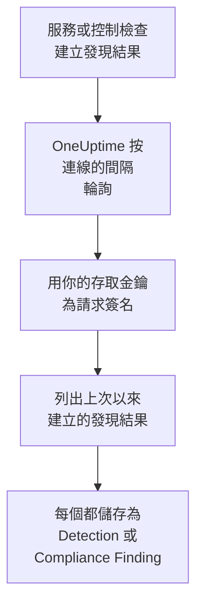

# AWS Security Hub

把 [AWS Security Hub](https://aws.amazon.com/security-hub/) 的發現結果匯入 OneUptime 的安全性事件：GuardDuty、Inspector、Macie 和 IAM Access Analyzer 的發現結果，Security Hub 自己的控制檢查，以及合作夥伴產品的發現結果。在那裡，你可以把它們與日誌、追蹤和指標放在一起搜尋，與其他所有來源進行關聯分析，並為重要的發現結果呼叫待命人員。OneUptime 使用你建立的、只允許一個只讀操作的存取金鑰讀取它們，不會在 AWS 中更改任何內容。無需設定代理、EventBridge 規則或 S3 匯出。

:::cards
- [設定連線](#設定連線): 一個 IAM 政策、一個存取金鑰，以及連線的表單。
- [匯入的內容](#匯入的內容): 每個發現結果如何成為一個安全性事件。
- [輪詢的運作方式](#輪詢的運作方式): 每次輪詢讀取的時間窗，以及它為何與上一個時間窗重疊 30 分鐘。
- [疑難排解](#疑難排解): 每個錯誤的含義，以及需要更改什麼。
:::

## 運作方式



OneUptime 每分鐘輪詢一次已過輪詢間隔的每個已啟用連線。一次輪詢會在你的地區中呼叫 Security Hub 的 `GetFindings`，並用 [Signature Version 4](https://docs.aws.amazon.com/IAM/latest/UserGuide/reference_sigv-create-signed-request.html) 簽名，取得自上次輪詢以來建立的發現結果。它把每個發現結果儲存為一個 [OCSF](https://schema.ocsf.io/) 事件：控制檢查儲存為 Compliance Finding（類 `2003`），其他所有發現結果儲存為 Detection Finding（類 `2004`）。之後，偵測規則、監測器和儀表板會像對待其他任何來源的安全性事件一樣對待它。

## 開始之前

- 在 OneUptime 中擁有 Project Owner、Project Admin 或 Security Admin 角色。Security Member 和 Security Viewer 可以檢視連線及其執行歷史，但不能更改它們。
- 一個在你要連線的地區中啟用了 Security Hub 的 AWS 帳戶。Security Hub 是地區性的：一個連線讀取的是一個帳戶在一個地區中持有的發現結果。
- 要透過一個連線讀取每個帳戶和每個地區的發現結果，需要使用 Security Hub 的委派管理員帳戶，在其主地區中並開啟[跨地區聚合](https://docs.aws.amazon.com/securityhub/latest/userguide/finding-aggregation.html)。**Security Hub → Settings → Regions** 會顯示主地區。
- 從 OneUptime 應用程式和工作程序到 `securityhub.<region>.amazonaws.com`（中國地區為 `securityhub.<region>.amazonaws.com.cn`）的傳出 HTTPS，以及這些主機上準確的時鐘：AWS 會拒絕簽名時間偏差超過 5 分鐘的請求。

## 設定連線

連線使用 IAM 存取金鑰為它的請求簽名。金鑰的身分只需要一個操作 `securityhub:GetFindings`，不需要其他任何權限：連線從不更改發現結果。

:::steps
### 允許讀取發現結果

在 [IAM 控制台](https://console.aws.amazon.com/iam/)中，開啟 **Policies → Create policy**，選擇 **JSON**，然後貼上這個政策。為它命名，例如 `OneUptimeSecurityHubRead`：

```json
{
  "Version": "2012-10-17",
  "Statement": [
    {
      "Effect": "Allow",
      "Action": "securityhub:GetFindings",
      "Resource": "*"
    }
  ]
}
```

`GetFindings` 無法限制到某個資源，所以 `Resource` 保持為 `*`。託管政策 `AWSSecurityHubReadOnlyAccess` 也可以使用，但允許的操作更多。

### 建立存取金鑰

1. 開啟 **Users → Create user**，為使用者命名，例如 `oneuptime-security-hub`，保持控制台存取關閉，並附加該政策。要讀取其他帳戶的發現結果，請在委派管理員帳戶中執行此操作。
2. 開啟該使用者，然後開啟 **Security credentials → Access keys → Create access key**，並選擇 **Third-party service**。
3. 複製 **存取金鑰 ID** 和 **秘密存取金鑰**。AWS 只顯示一次金鑰。

### 在 OneUptime 中新增連線

開啟 **產品 → Security Events → 連線**（`/dashboard/{projectId}/security-events/connections`），點選 **新增連線**，選擇 **AWS Security Hub**，然後點選 **下一步**。填寫下表中的設定，點選 **下一步**，然後把金鑰貼上到 **秘密存取金鑰** 中。

### 儲存之前先測試

點選 **儲存前測試** 下的 **測試這些設定**。測試會用表單中的值為一個請求簽名，不儲存任何內容，所以錯誤的金鑰或缺少的權限會在連線建立之前就暴露出來。然後點選 **下一步**，為連線設定一個 **名稱** 並建立它。
:::

| 設定 | 填寫什麼 |
| --- | --- |
| **地區** | 地區代碼，例如 `us-east-1`、`eu-central-1` 或 `us-gov-west-1`：讀取其他帳戶的發現結果時，填寫管理員帳戶的主地區。 |
| **存取金鑰 ID** | 金鑰的 ID：16 到 128 個字母或數字，通常是以 `AKIA` 開頭的 20 個字元，臨時認證資訊則以 `ASIA` 開頭。 |
| **秘密存取金鑰** | 金鑰的秘密部分。它會被加密，API 從不傳回它，也不會再次顯示。要替換它，請在連線上使用 **更新憑證**。 |
| **Session token** | 僅用於需要它的臨時認證資訊：沒有它時 `ASIA` 金鑰會被拒絕，有它時 `AKIA` 金鑰會被拒絕。 |

來自 `aws sts assume-role` 或 `aws sts get-session-token` 的臨時認證資訊會過期，對於代入的角色最多 12 小時，之後輪詢會停止，直到你用 **更新憑證** 貼上新的認證資訊。使用這個範圍很窄的政策的長期金鑰，按你自己的排程輪換，就能讓輪詢無人值守地持續進行。要從臨時認證資訊切換到長期金鑰，請在 **更新憑證** 中輸入新金鑰，並開啟 **Remove the stored Session token**。

**輪詢** 步驟還有選用的 **描述**、**輪詢間隔（分鐘）**（`1` 到 `1440` 之間的整數，初始為 `5`），以及初始為開啟的 **已啟用**。

## 匯入的內容

每個發現結果都會成為一個事件，供應商為 `Amazon Web Services`，產品為 `AWS Security Hub`。帶有 `Compliance` 物件的發現結果，即針對 AWS Foundational Security Best Practices 或 CIS 等標準的控制檢查，會成為 Compliance Finding（OCSF 類 `2003`）。其他所有發現結果會成為 Detection Finding（OCSF 類 `2004`）。

| 發現結果欄位 | OneUptime 欄位 |
| --- | --- |
| `Id`，對於 AWS 建立的發現結果是一個 ARN | 事件 UID，也是去除重複所依據的值 |
| `CreatedAt`，否則 `UpdatedAt`，否則 `FirstObservedAt` | 事件時間 |
| `Title` | 規則名稱 |
| `GeneratorId`，例如 GuardDuty 發現結果類型或控制的 ID | 規則 ID |
| `Title`，否則 `Description` | 訊息 |
| `Severity.Label`，否則按 `Severity.Normalized` 分檔 | 嚴重程度 |
| `Workflow.Status`：`NEW`、`NOTIFIED`、`RESOLVED` 或 `SUPPRESSED`，否則使用較舊的 `WorkflowState` | 狀態 |
| `TTPs/` 下的 `Types`：`TTPs/Initial Access/...` 變為 `TA0001` | MITRE ATT&CK 戰術和技術 |
| 存取金鑰或使用者資源的 IAM 使用者，`Network.SourceIpV4` 或 `SourceIpV6`，`Process.Name` 或 `Process.Path` | 內文的使用者、IP 和程序 |
| `AwsEc2Instance` 資源的執行個體 ID，`Network.DestinationIpV4` 或 `DestinationIpV6`，`Network.DestinationPort`，第一個 `Resources[].Id` | 目標的主機、IP、連接埠和資源 |
| 以上這些，以及每個 `Resources[].Id`、`AwsAccountId`、網路的網域、惡意軟體名稱和威脅情報值 | Observable |
| 整個發現結果，展平為點分隔的鍵，例如 `Compliance.Status` 和 `Remediation.Recommendation.Url` | `attributes` |

當發現結果沒有 `Severity.Label` 時，由 `Severity.Normalized` 決定：`0` 為 Informational，`1` 到 `39` 為 Low，`40` 到 `69` 為 Medium，`70` 到 `89` 為 High，`90` 到 `100` 為 Critical。Security Hub 之後更新的發現結果（新的 `Workflow.Status`，或現在透過的控制）會保留它的 `Id`，所以不會被再次匯入：事件保留的是匯入時的發現結果。

## 輪詢的運作方式

每次輪詢列出在它的時間窗中建立的發現結果，從最早的開始，每頁 100 個，並跟隨 `NextToken`，直到讀完整個時間窗：

```text
POST https://securityhub.{region}.amazonaws.com/findings
    {"Filters": {"CreatedAt": [{"Start": "{window start}", "End": "{window end}"}]},
     "SortCriteria": [{"Field": "CreatedAt", "SortOrder": "asc"}],
     "MaxResults": 100}
```

- **建立時間就是游標。** 發現結果按 `CreatedAt` 列出，從不按 `FirstObservedAt` 列出。GuardDuty 在觀察到足夠的活動後才建立發現結果，控制檢查則在 Security Hub 首次檢查資源時建立，可能是活動開始後幾小時甚至幾天。基於觀察時間的游標會把它們跳過。
- **第一次輪詢會回溯 24 小時**，所以新連線會立刻顯示最近的發現結果。
- **之後的每次輪詢都從儲存的游標之前 30 分鐘開始。** `CreatedAt` 由發現問題的服務設定，而發現結果到達 Security Hub 的時間更晚：GuardDuty 在五分鐘內傳送新的發現結果，透過 EventBridge 傳遞失敗時最多會重試 24 小時。重疊部分會在下一次輪詢中讀取這類發現結果。在其 `CreatedAt` 之後超過 30 分鐘才到達的發現結果可能會落在游標後面：匯入它的時間範圍即可找回。
- **一次輪詢最多讀取游標之後 24 小時。** 游標落後的連線會透過一連串 24 小時的時間窗追趕，此時它的 **健康狀況** 顯示為 **Catching up**。
- **重複項按發現結果的 `Id` 去除重複**，範圍是整個專案，所以重疊部分、重試的時間窗和匯入都不會把同一個發現結果儲存兩次。

### 當一個時間窗包含的內容超過一次輪詢能讀取的量時

一次輪詢最多傳送 20 個請求，每個請求 100 個發現結果，也就是 2,000 個發現結果。當時間窗中的發現結果更多時，這次執行為 **部分**，並帶有如下警告：

```text
Stopped after 20 findings requests (the per-run request limit) before the window was fully read. The last finding read was created at 2026-09-14T08:12:44.000Z.
```

發現結果從最早的開始讀取，所以 OneUptime 會把游標移到它讀取的最後一個發現結果的建立時間，下一次輪詢就從那裡開始，不帶 30 分鐘的重疊，時間窗長度不變。繁忙的帳戶每次輪詢追趕大約 2,000 個發現結果，而不是重複讀取同樣的內容。當游標越過那個點 30 分鐘之後，重疊會恢復。

當一次執行完全無法越過儲存的游標時，例如僅 30 分鐘的重疊部分就包含超過 2,000 個發現結果，OneUptime 會改為縮短時間窗：

1. **縮小。** 下一次輪詢從同一個起點讀取長度減半的時間窗，並不斷減半，直到某個時間窗能被完整讀取，最短為一分鐘。執行的警告會說明這一點：`This window holds more records than one poll can read; the next poll reads a {n} minute window from the same starting point.`
2. **恢復。** 一個時間窗被完整讀取後，下一個時間窗的長度會再次加倍，最長為 24 小時。
3. **越過單獨的一分鐘。** 如果連一分鐘內的內容都超過一次輪詢能讀取的量，輪詢會越過這一分鐘，讓更新的發現結果繼續到達，之後輪詢的重疊部分也不會再回到這一分鐘。這次執行仍為 **部分**，**最近的錯誤** 顯示 `More records were created in the one minute from {cursor} to {end} than one poll can read. Polling moved past this minute so newer records keep arriving; use Import this time range in Diagnostics on this minute to recover what one run can read.` 用 **Import this time range** 匯入這一分鐘，就能找回一次執行能讀取的內容。

因 AWS 的錯誤而徹底失敗的執行，會保留游標和時間窗長度，下一次輪詢會再次讀取同一個時間窗。唯一的例外是請求逾時：游標保持不變，但下一個時間窗的長度減半，因為重到無法及時得到回應的時間窗每次嘗試都會逾時。更改 **輪詢間隔（分鐘）** 不會改變這些：它決定的是輪詢多久開始一次，而不是時間窗從哪裡開始。

### 按需執行、預覽和匯入

在連線上點選 **診斷**，可以檢視它最近的執行，並手動操作它。能更改該連線的人都可以啟動這些操作；能檢視它的人都可以閱讀歷史記錄。

- **立即執行** 會立即開始一次輪詢，使用通常的游標，即使連線未處於 **已啟用** 狀態也可以。
- **Preview findings** 讀取最長 7 天的時間範圍，不匯入任何內容。
- **Import this time range** 在你確認後匯入最長 7 天的範圍，不會移動游標。已匯入的發現結果會被跳過。
- 執行上的 **Copy diagnostics** 會複製它的報告以便提供給支援人員。報告從不包含認證資訊。

## 測試連線

連線所在列中的 **測試連線** 和表單中的 **測試這些設定** 在 API 程序中執行，而不是在背景工作程序中執行，所以即使工作程序出了問題，測試仍然會給出結果。它按順序執行以下檢查：

| 檢查 | 檢查的內容 |
| --- | --- |
| **設定** | 每項設定都存在且格式正確。此項失敗時不會連線到任何地方。 |
| **Authenticate with AWS** | AWS 接受一個針對過去 24 小時內建立的某個發現結果的已簽名 `GetFindings` 請求。AWS 先檢查簽名，再檢查 IAM 政策，所以即使被政策拒絕，這項檢查也會透過：金鑰是正確的。 |
| **Read findings** | Security Hub 回應了該請求：該身分可以呼叫 `securityhub:GetFindings`，並且該地區中已啟用 Security Hub。 |
| **Findings available to import** | 過去 24 小時和過去 7 天內建立了多少個發現結果，各統計一頁（100 個），所以 `100+` 表示更多。7 天內一個都沒有是警告，而不是失敗。 |
| **Background workers**、**Poll scheduler**、**Security event storage** | OneUptime 自身的一側：有程序在處理 Worker 佇列的作業，輪詢作業每分鐘執行一次，安全性事件儲存能夠回應。 |
| **Scheduled polling** | 針對已儲存的連線：輪詢已開啟，沒有執行卡在等待工作程序的狀態，並且輪詢按時執行。 |

測試中的每個請求都有 20 秒的期限。測試從不匯入任何內容，也不移動游標，每個失敗的檢查都會說明需要更改什麼。

## 疑難排解

連線的 **最近的錯誤** 會保留完整的錯誤訊息（認證資訊已隱去），前面帶有一個指明失敗步驟的字首。連線出錯時，在它的 **操作** 欄中選擇 **檢視錯誤** 來閱讀，並在對話方塊中用 **複製錯誤** 複製。每條訊息都以 `AWS Security Hub findings request` 開頭；請閱讀後面的內容。

:::details Last Error 顯示 `failed (HTTP 401)` 或 `failed (HTTP 403)`
AWS 拒絕了請求。訊息會引用 AWS 的錯誤代碼，如果 AWS 沒有傳送代碼，則引用 AWS 自己的說法：

- `AccessDeniedException`，或 `is not authorized to perform`：金鑰是正確的，但它的身分不能呼叫 `securityhub:GetFindings`。請附加 [設定連線](#設定連線) 中的政策。權限邊界或服務控制政策也可能拒絕它。
- `InvalidAccessException`，或 `is not subscribed to AWS Security Hub`：在 **地區** 指定的地區中，此帳戶沒有啟用 Security Hub，或者此帳戶不是那裡的管理員。
- `InvalidSignatureException` 或 `SignatureDoesNotMatch`，或 `The request signature we calculated does not match`：**秘密存取金鑰** 不屬於 **存取金鑰 ID**。請建立一個新的存取金鑰，並用 **更新憑證** 儲存。
- `UnrecognizedClientException` 或 `InvalidClientTokenId`，或 `The security token included in the request is invalid`：AWS 不認識這個 **存取金鑰 ID**。它輸錯了、已刪除、已停用或來自另一個分割槽，或者是缺少 **Session token** 的臨時金鑰。
- `ExpiredTokenException`，或 `The security token included in the request is expired`：臨時認證資訊已過期。請簽發新的認證資訊，或者改用長期金鑰。
- `RequestTimeTooSkewed` 或 `RequestExpired`，或 `Signature expired`：OneUptime 主機的時鐘偏差超過 5 分鐘。請修復應用程式和工作程序主機上的 NTP。
- 完全沒有代碼：AWS 沒有說明是金鑰還是政策拒絕了它。請先檢查金鑰，再檢查政策。
:::

:::details Last Error 顯示 `failed (HTTP ...)` 和其他狀態
- `HTTP 404`：在 **地區** 指定的地區中，沒有 Security Hub 端點作出回應。請與 AWS 控制台的地區選單進行比較：應該是 `us-east-1`，而不是 `us-east1` 或 `N. Virginia`。
- `HTTP 429`：帳戶達到了 Security Hub 的限制，即每個地區每秒 3 個 `GetFindings` 請求。下一次輪詢會重試。如果這種情況持續發生，請找找是否有其他工具或連線在讀取同一個帳戶和地區。
- `HTTP 5xx`：Security Hub 自身出現了問題。下一次輪詢會重試。
- `HTTP 400`：Security Hub 拒絕了查詢，而查詢是由 OneUptime 建置的，與你的設定無關。請把訊息傳送給 OneUptime 支援團隊。
:::

:::details Last Error 顯示 `returned`、`timed out` 或 `Could not reach data source`
- `returned a non-JSON body` 或 `returned an unrecognized response shape`：回應的不是 Security Hub，而是其他東西，例如代理的登入頁面或會改寫回應的閘道器。這會被報告出來，而不是當作空時間窗處理，所以游標永遠不會越過沒人讀過的發現結果。
- `timed out after 60 seconds with no response`，或 `failed: Could not reach data source`：請求沒有得到回應。Security Hub 的端點是公開的，所以請檢查 OneUptime 應用程式和工作程序與 `securityhub.<region>.amazonaws.com` 之間的 DNS、防火牆和代理。
:::

:::details Last Polled 為 Never 且 Last Error 為空
這個連線還沒有完成過任何輪詢。執行 **測試連線**：它的 **Background workers** 和 **Poll scheduler** 檢查會指出原因。在自行託管安裝中，常見原因是應用程式上設定了 `DISABLE_QUEUE_WORKERS=true`，卻沒有單獨的工作程序部署來處理作業：把它設為 `false`，或執行工作程序部署（Helm：`worker.enabled: true`）。
:::

:::details 執行為 Partial
- `Stopped after 20 findings requests`：時間窗中的發現結果超過了一次執行能讀取的 2,000 個。不會遺失任何內容：下一次輪詢會從讀取的最後一個發現結果之後開始。一次又一次輪詢都保持 **部分** 的連線正在追趕積壓的內容，它的 **最近輪詢** 和 **最近匯入的事件** 會不斷前進。如果它始終追不上，說明該帳戶在每個輪詢間隔內建立的發現結果超過 2,000 個：請縮短 **輪詢間隔（分鐘）**。
- `More records were created in the one minute from ... than one poll can read`：輪詢越過了這一分鐘。請在 **診斷** 中用 **Import this time range** 匯入它。一次匯入讀取的量與一次輪詢相同。
:::

:::details 測試通過，但沒有匯入任何內容
閱讀測試報告中的 **Findings available to import**。過去 7 天為 `0` 表示 Security Hub 在這個帳戶和地區中沒有建立任何發現結果：請檢查那裡是否開啟了 GuardDuty、Inspector 或某個安全標準。要檢視其他帳戶和地區的發現結果，請在管理員帳戶的主地區中連線該帳戶。
:::

:::details Security Hub 控制台中的某個發現結果始終沒有到達
比較它的 `CreatedAt` 和 `ProcessedAt`（Security Hub 收到它的時間）。在其 `CreatedAt` 之後超過 30 分鐘才到達的發現結果可能會落在游標後面：請用 **Import this time range** 匯入它的 `CreatedAt`。
:::

## 你會得到什麼

- **搜尋。** 在安全性事件探索器中，與其他所有來源放在一起，按嚴重程度、狀態、規則、帳戶、資源或任何 observable 篩選發現結果。
- **關聯分析。** 每個發現結果的使用者、執行個體、IP、資源 ARN 和帳戶 ID 都會作為 observable 建立索引，所以一次搜尋就能找到提到它們的所有內容。
- **偵測規則。** 按排程對你的安全性事件執行的 Sigma 規則，會開啟呼叫待命人員的警示。
- **監測器。** 安全性事件監測器統計符合的事件，例如新的嚴重 GuardDuty 發現結果或失敗的控制，並在超過閾值時開啟事件或警示。

安全性事件與其他遙測資料一樣，按擷取的 GB 數計費。請參閱 [定價](https://oneuptime.com/pricing)。

## 後續步驟

:::cards
- [安全性事件](/docs/telemetry/security-events): 搜尋、關聯分析你匯入的內容，並據此發出警示。
- [Okta System Log](/docs/integrations/okta): 同時匯入身分提供方的登入。
- [角色](/docs/permissions/reference#角色): Security 角色可以檢視和更改的內容。
- [整合總覽](/docs/integrations/index): 你可以連接的其他工具。
:::
