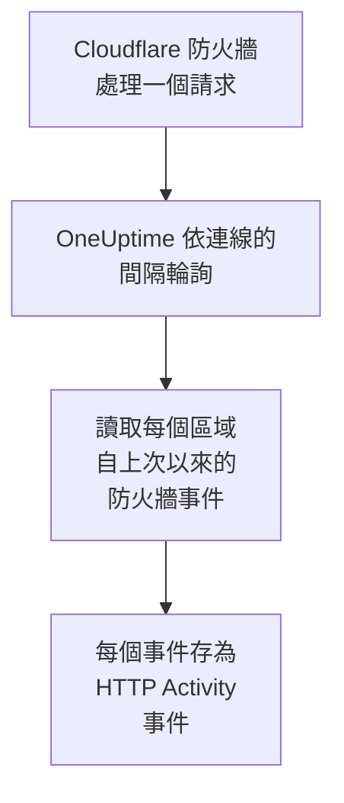

# Cloudflare

將 [Cloudflare](https://www.cloudflare.com) 防火牆在邊緣所做的事匯入 OneUptime 的安全事件：其受管理與自訂 WAF 規則、速率限制、IP Access Rules、機器人管理與 HTTP DDoS 防護所封鎖、質詢或記錄的請求。每個請求都與你的應用程式本身的請求並列，因此案例會說明 Cloudflare 攔下了什麼，以及什麼仍然到達了你的應用程式。OneUptime 使用只能讀取的 API 權杖讀取它們，除非你開啟封鎖，否則不會在 Cloudflare 中變更任何內容；開啟後，它會在那裡執行你的封鎖清單。

:::cards
- [設定連線](#設定連線): 一個具有兩項讀取權限的 API 權杖，以及連線的表單。
- [匯入的內容](#匯入的內容): 匯入哪些事件，以及每個事件如何成為一個安全性事件。
- [輪詢的運作方式](#輪詢的運作方式): 每次輪詢讀取的時間範圍，以及它為什麼重疊 10 分鐘。
- [在 Cloudflare 封鎖位址](#在-cloudflare-封鎖位址): 你的封鎖清單，由兩份 IP 清單和每份清單一條自訂規則執行。
- [疑難排解](#疑難排解): 每個錯誤的含義，以及需要更改什麼。
:::

## 運作方式

OneUptime 每分鐘輪詢每個已啟用且輪詢間隔已到的連線。一次輪詢會列出帳戶的區域，從 GraphQL Analytics API 的 settings 節點讀取每個區域的方案允許的範圍，並從 `firewallEventsAdaptive` 資料集（[Security Events](https://developers.cloudflare.com/waf/analytics/security-events/)）依由舊到新的順序讀取自上次輪詢以來每個區域的防火牆事件。每個事件都存為 [OCSF](https://schema.ocsf.io/) HTTP Activity 事件。

## 開始之前

- 在 OneUptime 中擁有專案擁有者、專案管理員或安全性管理員角色。安全性成員和安全性檢視者可以檢視連線及其執行歷史，但不能更改它們。
- 一個能為帳戶的區域建立 API 權杖的 Cloudflare 使用者。
- 流量經過 Cloudflare 的區域：它們的 DNS 記錄已開啟 Proxy。
- 從 OneUptime 應用程式和 worker 到 `api.cloudflare.com` 的輸出 HTTPS。

## 設定連線

此連線使用 [API 權杖](https://developers.cloudflare.com/fundamentals/api/get-started/create-token/)讀取，從不使用 Global API Key：權杖的範圍限於帳戶及其區域，並且可以單獨撤銷。它需要兩項[權限](https://developers.cloudflare.com/fundamentals/api/reference/permissions/)，都是唯讀的：

| 權限 | OneUptime 用它讀取什麼 |
| --- | --- |
| `Zone > Zone > Read` | 區域，以及它們的帳戶和方案。 |
| `Zone > Analytics > Read` | 透過 GraphQL Analytics API 讀取的每個區域的防火牆事件。 |

:::steps
### 建立 API 權杖

1. 在 Cloudflare 儀表板中開啟 **My Profile → API Tokens**，選擇 **Create Token**，再選擇 **Create Custom Token**。
2. 將它命名為 `oneuptime-security-events`。在 **Permissions** 下新增 `Zone > Zone > Read` 和 `Zone > Analytics > Read`。
3. 在 **Zone Resources** 下納入帳戶的所有區域，或要匯入的區域。
4. 選擇 **Continue to summary**，再選擇 **Create Token**，然後複製權杖。Cloudflare 只顯示它一次。

### 在 OneUptime 中新增連線

開啟 **產品 → 安全事件 → 連線**（`/dashboard/{projectId}/security-events/connections`），點擊 **新增連線**，在 **雲端安全** 下選擇 **Cloudflare**，然後點擊 **下一步**。將權杖貼到 **API 權杖** 中。OneUptime 接著會列出權杖能讀取的帳戶和區域：選擇 **帳戶**，並在 **區域** 中保留 **所有區域**，或選擇要匯入的區域。

### 儲存之前先測試

點擊 **儲存前測試** 下的 **測試這些設定**。測試會用表單中的值檢查每項權限，指出缺少的權限，而且不儲存任何內容。然後點擊 **下一步**，為連線填寫 **名稱** 並建立它。
:::

| 設定 | 填寫什麼 |
| --- | --- |
| **帳戶** | 要讀取的 Cloudflare 帳戶，從你的 API 權杖能讀取的帳戶中選擇。只能讀取一個帳戶的權杖會自動為你選好。 |
| **區域** | 選填。留空會讀取帳戶中所有作用中的區域，包括之後新增的區域。一個連線最多讀取 50 個區域。 |
| **API 權杖** | 只填權杖本身，不含 `Bearer`。它會被加密，API 從不傳回，也不會再次顯示。可在連線上用 **更新憑證** 取代它。 |

**輪詢** 步驟還有選填的 **描述**、**輪詢間隔（分鐘）**（一個從 `1` 到 `1440` 的整數，起始為 `5`），以及預設開啟的 **已啟用**。Cloudflare 的事件是請求而不是警示，因此表單不會詢問 **開啟案例的起始嚴重程度**：案例來自讀取這些事件的偵測規則。

### 寫入權限是另外的選擇

在你於該連線所在列開啟封鎖之前，此連線不會在 Cloudflare 中變更任何內容。只有那時 OneUptime 才會請求寫入權限，並在封鎖任何內容之前檢查它們：[在 Cloudflare 封鎖位址](#在-cloudflare-封鎖位址) 列出了每項權限及其用途。只在開啟封鎖時才將它們加入權杖。

## 匯入的內容

每個事件的供應商為 `Cloudflare`，產品為 `Cloudflare WAF`，是 HTTP Activity（`4002`）事件。

| Cloudflare 的欄位 | 在安全事件中 |
| --- | --- |
| `clientIP` | 主體 IP，以及 `client.address` |
| `clientRequestHTTPHost`, `clientRequestPath`, `clientRequestQuery` | 目標主機、目標資源（路徑和查詢），以及 `url.original` |
| `clientRequestHTTPMethodName`, `userAgent` | 活動、`http.request.method` 和 `user_agent.original` |
| `action` | 狀態，以及 `oneuptime.edge.action` |
| `source`, `ruleId`, `description` | 規則 ID、規則名稱，以及 `cloudflare.source` |
| `rayName`, `clientCountryName`, `clientAsn` | `cloudflare.ray_id`、`cloudflare.client.country` 和 `cloudflare.client.asn` |
| `sampleInterval` | `oneuptime.edge.sample_interval` |

| Cloudflare 做了什麼 | 狀態 | `oneuptime.edge.action` | 請求結果 | 嚴重程度 |
| --- | --- | --- | --- | --- |
| 封鎖、關閉了連線，或質詢失敗 | Blocked，關閉連線時為 Dropped | `blocked` | Rejected | Low |
| 以受管理、JS 或互動式質詢回應 | Challenge | `challenged` | Rejected | Low |
| 通過了質詢，或之前已通過質詢的訪客 | Allowed | `passed-challenge` | 無 | Informational |
| 記錄並放行 | Logged | `logged` | 來源伺服器的狀態碼 | Medium；來源伺服器失敗時為 High；來源伺服器拒絕請求時為 Low |
| 依你的 skip 或 allow 規則放行 | Allowed | `let-through` | 來源伺服器的狀態碼 | 與已記錄的請求相同 |

被你自己的 skip 或 allow 規則放行的請求，只有在攜帶攻擊（SQL 注入、路徑周遊或 Log4Shell 查詢），或 Cloudflare 的 WAF attack score 將其判定為攻擊時才會匯入。其餘的是你刻意允許的流量，例如你的監控：每次執行都會計數並將其排除。

Cloudflare 會對忙碌區域的事件進行取樣。每個事件都保留其取樣間隔，也就是它所代表的同類請求數，OneUptime 由此得出的每個數字都會標註 *約*。

這些事件會出現在事件、活動（依位址區分的攻擊請求）、實體風險和偵測規則中。關於某個位址的案例會在其影響的 **在邊緣** 下，並列顯示 Cloudflare 對該位址的請求做了什麼，以及什麼到達了你的應用程式。規則庫中的 Cloudflare 規則依這裡匯入的樣子讀取它們：來自一個位址的大量受管理規則命中、一個通過質詢後傳送攻擊的位址，以及一個被 Cloudflare 放行並到達你的應用程式的攻擊。

## 方案限制

每個方案都能透過 API 取得防火牆事件。**測試連線** 中的 **What each zone's plan gives** 會從 Cloudflare 讀取每個區域自己的限制。

| 方案 | Free | Pro | Business | Enterprise |
| --- | --- | --- | --- | --- |
| 保留的防火牆事件 | 31 天 | 31 天 | 31 天 | 31 天 |
| 最長查詢 | 30 天 | 30 天 | 30 天 | 31 天 |

Cloudflare 的 Logpush 也能傳送防火牆事件，自 2026 年 9 月 30 日起在每個方案上可用，依用量計費。此連線改為輪詢，因此除了兩項讀取權限之外什麼都不需要。

## 輪詢的運作方式

- **事件依其在邊緣發生的時間讀取。** Cloudflare 的分析資料在請求後一兩分鐘即可查詢。
- **第一次輪詢會回溯 24 小時**，所以新連線會立刻顯示最近的事件。
- **之後的每次輪詢都從儲存的游標之前 10 分鐘開始**，因此 Cloudflare 較晚才可讀取的事件會在下次輪詢時讀到，重複項目會在專案內依每個事件的 Ray ID 去除。
- **一次輪詢最多讀取游標之後 24 小時。** 游標落後的連線會透過一連串 24 小時的時間窗追趕。
- **區域依序輪流讀取**，每個區域一頁最多 2,000 個事件，因此忙碌的區域無法在安靜的區域被讀取之前耗盡一次輪詢。
- **遵守 Cloudflare 的速率限制。** Cloudflare 允許五分鐘內 1,200 個 REST 請求和 300 個 GraphQL 查詢。要求等待 30 秒或更短的 `429` 會等過之後再次請求；更長的則會停止本次輪詢，由下一次繼續。
- **權杖無法讀取的區域不會耽誤其他區域。** 其他區域照常匯入，執行為 **部分**，其警告會指出該區域。在那裡為權杖授予 `Zone > Analytics > Read`，然後使用 **匯入此時間範圍** 補回該時間範圍。
- **失敗的執行不會改變任何東西。** 發生網路錯誤或 Cloudflare 傳回錯誤狀態後，游標和時間範圍長度保持不變，下一次輪詢會再次讀取同一時間範圍。唯一的例外是逾時的請求：游標不變，但下一個時間範圍只有一半長，因為一個重到無法及時回應的時間範圍每次嘗試都會逾時。

### 當一個時間窗包含的內容超過一次輪詢能讀取的量時

一次輪詢最多傳送 120 個請求，最多讀取 20,000 個事件，並在 4 分鐘後停止。事件依由舊到新的順序讀取，因此當預算讓輪詢停止時，執行為 **部分**，下一次輪詢會從未完成區域已讀到的最舊事件處繼續。當並非每個區域都至少讀過一次時，OneUptime 會改為縮短時間範圍：

1. **縮小。** 下一次輪詢從同一起點讀取一半長度的時間範圍，並繼續減半，直到某個時間範圍被完整讀取，最短為一分鐘。執行的警告會這樣說明：`This window holds more records than one poll can read; the next poll reads a {n} minute window from the same starting point.` 已從較長時間範圍匯入的事件會作為重複項目略過。
2. **恢復。** 一個時間窗被完整讀取後，游標會移到它的末尾，下一個時間窗的長度會再次加倍，最長為 24 小時。
3. **越過單一分鐘。** 如果連一分鐘內的內容都超過一次輪詢能讀取的量，輪詢就會越過它，讓較新的事件繼續到達。執行仍為 **部分**，**最近的錯誤** 顯示 `More records were created in the one minute from {cursor} to {end} than one poll can read. Polling moved past this minute so newer records keep arriving; use Import this time range in Diagnostics on this minute to recover what one run can read.` 用 **匯入此時間範圍** 匯入這一分鐘，可補回一次執行能讀取的內容。

更改 **輪詢間隔（分鐘）** 不會改變這些：它決定的是輪詢多久開始一次，而不是時間窗從哪裡開始。

### 按需執行、預覽和匯入

在連線上點選 **診斷**，可以檢視它最近的執行，並手動操作它。能更改該連線的人都可以啟動這些操作；能檢視它的人都可以閱讀歷史記錄。

- **立即執行** 會立即開始一次輪詢，使用通常的游標，即使連線未處於 **已啟用** 狀態也可以。
- **預覽防火牆事件** 讀取最多 7 天的時間範圍，不匯入任何內容。
- **匯入此時間範圍** 在你確認後匯入最多 7 天的範圍，不移動游標。已匯入的事件會被略過。Cloudflare 保留 31 天的防火牆事件。
- 執行上的 **複製診斷資訊** 會複製它的報告以便提供給支援人員。報告從不包含認證資訊。

## 測試連線

連線所在列中的 **測試連線** 和表單中的 **測試這些設定** 在 API 程序中執行，而不是在背景工作程序中執行，所以即使工作程序出了問題，測試仍然會給出結果。它按順序執行以下檢查：

| 檢查 | 檢查的內容 |
| --- | --- |
| **設定** | 權杖、帳戶和區域格式正確。如果這一項失敗，不會聯絡任何地方。 |
| **Verify the API token** | Cloudflare 接受該權杖（使用者的權杖或帳戶擁有的權杖），而且它處於作用中狀態。14 天內到期的權杖是警告。 |
| **List the zones** | 權杖具有 `Zone > Zone > Read`：它會列出帳戶的區域，以及每個選定的區域。 |
| **Read firewall events** | 權杖在每個區域都具有 `Zone > Analytics > Read`。失敗時會指出缺少該權限的區域。 |
| **What each zone's plan gives** | 每個區域的方案保留防火牆事件多久，以及一次查詢可以多長。方案中沒有這些事件的區域是警告。 |
| **Firewall events available to import** | 過去 24 小時和過去 7 天大約有多少事件。沒有事件是警告。 |
| **Background workers**、**Poll scheduler**、**Security event storage** | OneUptime 自身的一側：有程序在處理 Worker 佇列的作業，輪詢作業每分鐘執行一次，安全性事件儲存能夠回應。 |
| **排定的輪詢** | 針對已儲存的連線：輪詢已開啟，沒有執行卡在等待工作程序的狀態，並且輪詢按時執行。 |

測試中的每個請求都有 20 秒的期限。測試從不匯入任何內容，也不移動游標，每個失敗的檢查都會說明需要更改什麼。

## 在 Cloudflare 封鎖位址

開啟封鎖後，Cloudflare 會執行你專案的[封鎖清單](/docs/telemetry/security-cases#封鎖清單)。你封鎖的每個位址會在 1 分鐘內加入你 Cloudflare 帳戶中的一份 IP 清單，而在每個區域中，每份清單對應的一條自訂規則會封鎖或挑戰清單中的位址。在 **封鎖清單** 中，對於 OneUptime 已從 Cloudflare 讀回的每個封鎖，**生效於** 會顯示 Cloudflare；10 分鐘內未讀回的封鎖在那裡不會生效。案件的封鎖步驟接著也會顯示自封鎖以來 Cloudflare 攔截了來自該位址的多少個請求。

封鎖需要連線的 API 權杖具有以下寫入權限：

| 權限 | OneUptime 用它做什麼 |
| --- | --- |
| `Account > Account Filter Lists > Edit` | 建立它的兩份清單，並新增和移除其中的位址。 |
| `Zone > Zone WAF > Edit`，在每個要封鎖的區域上 | 新增它的自訂規則，並讀取該區域自己的規則。 |
| `Account > Account Firewall Access Rules > Edit` | 在沒有空餘清單或自訂規則的方案上，新增和移除 IP Access Rules。 |

:::steps
### 為權杖授予寫入權限

在 Cloudflare 中開啟 **My Profile → API Tokens**，編輯該連線的權杖，並加入上面的權限。或者建立一個具有這些權限和兩項讀取權限的權杖。

### 開啟封鎖

在連線所在列選擇 **封鎖位址**。將新權杖貼到 **新的 API 權杖**，或留空以保留目前的權杖，並在 **區域** 中保留 **所有區域**，或選擇要封鎖的區域。**檢查權限** 會詢問 Cloudflare 權杖是否具有每項權限，不會變更任何內容。**開啟封鎖** 只在所有檢查都通過時才開啟封鎖，接著 OneUptime 會在 1 分鐘內設定好 Cloudflare。
:::

封鎖開啟期間，**測試連線** 也會執行相同的檢查：**How blocking is set up**、**Edit the lists**、**Edit custom rules in each zone**，以及在使用 IP Access Rules 時的 **Edit IP Access Rules**。

### OneUptime 加入 Cloudflare 的內容

| 在 Cloudflare 中 | 是什麼 |
| --- | --- |
| 清單 `oneuptime_block` 和 `oneuptime_challenge` | 帳戶中的兩份 IP 清單，一份用於封鎖，一份用於挑戰。它們的描述寫明你的 OneUptime 專案。 |
| 每個區域中，每份清單一條自訂規則 | 動作為 Block 的 `(ip.src in $oneuptime_block)`，以及動作為 Managed Challenge 的 `(ip.src in $oneuptime_challenge)`。它們的描述說明由 OneUptime 管理。 |
| 每個封鎖一個清單項目 | 其註解寫明案件以及封鎖的結束時間，例如 `OneUptime case CASE-42 until 2026-11-21 10:42 UTC`。 |

每條規則都排在該區域自訂規則的最前面，因此會比你的規則先執行：你的 Skip 規則無法讓被封鎖的位址通過。當你的 Skip 規則放行某些位址時，例如你的監視器或合作夥伴的位址，**封鎖狀態** 會列出它們。**保護這些位址** 會將它們加入 **受保護的實體**，任何人都無法封鎖其中的位址。

### 封鎖的方案限制

| 方案 | Free | Pro | Business | Enterprise |
| --- | --- | --- | --- | --- |
| 帳戶中的清單 | 1 | 10 | 10 | 1,000 |
| 帳戶中的清單項目 | 10,000 | 10,000 | 10,000 | 500,000 |
| 區域中的自訂規則 | 5 | 20 | 100 | 1,000 |

你自己的清單和規則也會計入。開啟封鎖時，如果方案還有空餘，每種動作會使用一份清單以及每個區域中的一條規則，Block 優先；沒有空餘時則使用 IP Access Rules。在唯一清單空著的 Free 方案上，封鎖使用該清單，挑戰使用 IP Access Rules。一個帳戶最多可容納 50,000 條 IP Access Rules，每條是一個位址、一個 /16 或 /24 的 IPv4 範圍，或一個 /32、/48 或 /64 的 IPv6 範圍：其他範圍的封鎖在那裡不會生效，**封鎖清單** 會說明原因。**How blocking is set up** 會說明每種動作使用什麼，以及原因。

### 當有人變更規則時

OneUptime 每 3 分鐘讀回一次它的清單和規則，而且從不復原別人在 Cloudflare 中所做的變更。在那裡被關閉、刪除或變更的規則，會連同其區域一起顯示在連線所在列和 **封鎖狀態** 中，**封鎖清單** 會將該區域規則對應的封鎖顯示為未在 Cloudflare 生效。**還原** 會重新設定該規則。只要 **區域** 為 **所有區域**，之後加入帳戶的區域也會自動設定。

### 關閉封鎖

**關閉封鎖** 會詢問是否從 Cloudflare 移除 OneUptime 的清單和規則，並預設選取 **從 Cloudflare 移除 OneUptime 的清單和規則**。移除作業會依據 OneUptime 賦予的名稱、參照和備註，找到並移除 OneUptime 的規則、它的兩份清單以及它加入的 IP Access Rules，不會動到其他任何內容。如果保留，它們會留在 Cloudflare 中，繼續封鎖其中的位址。正在封鎖位址的連線無法刪除：請先關閉封鎖，等移除完成後再刪除它。

## 疑難排解

連線的 **最近的錯誤** 會保留完整的錯誤訊息，憑證已遮蔽。連線出錯時，在其 **操作** 欄中選擇 **檢視錯誤** 閱讀，並在對話方塊中用 **複製錯誤** 複製。每則訊息都會指出失敗的請求，並引用 Cloudflare 自己給出的原因。

:::details 最近的錯誤顯示 `Invalid API Token (1000)`
Cloudflare 不認得該權杖：它已被刪除、輪替，或從未完整貼上。Global API Key 會在傳送前被拒絕。依上面的步驟建立權杖，並用 **更新憑證** 儲存。
:::

:::details 最近的錯誤顯示 `Unauthorized to access requested resource (9109)`
權杖無法列出區域。為它授予 `Zone > Zone > Read`，並在 **Zone Resources** 下納入要匯入的區域。
:::

:::details 最近的錯誤顯示 `cannot read the analytics of`
權杖在訊息指出的區域上缺少 `Zone > Analytics > Read`。在那裡新增它，然後使用 **匯入此時間範圍** 補回未匯入的內容。
:::

:::details 最近的錯誤顯示 `rate limit`
使用同一個 Cloudflare 使用者的其他東西用完了配額。五分鐘過後輪詢會自動繼續；給 OneUptime 一個專用使用者的權杖，可以把配額分開。
:::

:::details 最近的錯誤 顯示 `did not complete`
請求沒有收到回應：逾時、無法解析的名稱或被拒絕的位址。請檢查 OneUptime 應用程式和 worker 能否透過你使用的任何 Proxy 連到 `api.cloudflare.com`。
:::

:::details 案例顯示了 Cloudflare 的處理，但你的應用程式中沒有該位址的任何請求
在 Cloudflare 之後，你的應用程式收到的請求來自 Cloudflare 的位址，而訪客的位址是 Cloudflare 最後加入 `X-Forwarded-For` 的那一個。請在你的追蹤中記錄該標頭（`http.request.header.x-forwarded-for`）和連線本身的位址（`network.peer.address`）。只要此連線存在，OneUptime 就會將 Cloudflare 的位址視為受信任的代理，因此會從標頭讀取訪客，並將你應用程式的請求與 Cloudflare 處理過的位址對應起來。你的應用程式從 `CF-Connecting-IP` 複製的 `client.address` 不受信任：任何直接連到你應用程式的人都可以傳送該標頭。
:::

:::details 封鎖狀態顯示 `already exists in this Cloudflare account`
另一個 OneUptime 專案或某個人建立了名為 `oneuptime_block` 或 `oneuptime_challenge` 的清單，而 OneUptime 從不變更並非它為此專案建立的清單。請在 Cloudflare 中重新命名或刪除該清單，或在建立它的專案中關閉封鎖。OneUptime 會在 5 分鐘內重新設定封鎖。
:::

:::details 測試通過，但 Last Polled 為 Never
輪詢作業從未執行過。閱讀 **Background workers** 和 **Poll scheduler** 檢查。在自行託管安裝中，常見原因是應用程式上設定了 `DISABLE_QUEUE_WORKERS=true`，卻沒有單獨的工作程序部署來處理作業：把它設為 `false`，或執行工作程序部署（Helm：`worker.enabled: true`，預設為 `false`）。
:::

## 後續步驟

:::cards
- [安全性事件](/docs/telemetry/security-events): 搜尋、關聯分析你匯入的內容，並據此發出警示。
- [安全案例](/docs/telemetry/security-cases): 查看 Cloudflare 做了什麼，以及什麼到達了你的應用程式。
- [整合總覽](/docs/integrations/index): 你可以連接的其他工具。
:::
