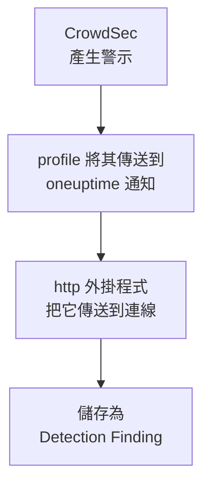

# CrowdSec

[CrowdSec](https://www.crowdsec.net/) 一產生警示，就在 OneUptime 的安全性事件中接收這些警示，並用 CrowdSec 封鎖你專案的封鎖清單中的位址。CrowdSec 自己的通知外掛程式會把每個警示傳送到一個 CrowdSec 連線，該連線會根據 CrowdSec 的偵測開啟案例。開啟封鎖後，OneUptime 會透過 CrowdSec 的 Local API 封鎖你封鎖的每個位址，讀取該 Local API 的每個 bouncer 都會封鎖該位址。

:::cards
- [設定連線](#設定連線): 一個連線，以及把 CrowdSec 的警示傳送到該連線的通知。
- [接收的內容](#接收的內容): 每個 CrowdSec 警示如何成為一個安全性事件。
- [使用 CrowdSec 封鎖位址](#使用-crowdsec-封鎖位址): 在 CrowdSec 中封鎖你封鎖清單中的位址。
- [讀取 CrowdSec 的封鎖清單](#讀取-crowdsec-的封鎖清單): CrowdSec Console 提供的清單，作為威脅情資來源。
- [疑難排解](#疑難排解): 每個錯誤的含義，以及需要更改什麼。
:::

## 運作方式



CrowdSec 的 Local API 會把 profile 傳送到某個通知的每個警示交給該通知的外掛程式。連線的通知使用 CrowdSec 的 `http` 外掛程式：它以 CrowdSec 自己的 JSON 格式，帶上你的擷取金鑰並指明連線，把警示傳送到安全性事件的擷取端點。OneUptime 將其儲存為 [OCSF](https://schema.ocsf.io/) Detection Finding 事件（類別 `2004`），用你的偵測規則檢查它，並為 CrowdSec 自己的、達到或高於連線的 **開啟案例的起始嚴重程度** 的每個偵測開啟一個案例。不進行任何輪詢：警示會在 CrowdSec 產生它後幾秒內到達。

## 開始之前

- 在 OneUptime 中擁有專案擁有者、專案管理員或安全性管理員角色。安全性成員和安全性檢視者可以檢視連線，但不能更改它們。
- CrowdSec 1.5 或更新版本，以及它的 Local API 和隨附的 `http` 通知外掛程式。本頁以 CrowdSec v1.8.2 為準撰寫。
- 從執行 CrowdSec 的 Local API 的主機到你的 OneUptime 的輸出 HTTPS。
- 如果還要封鎖位址：OneUptime 能夠連到的 Local API，以及一台供 OneUptime 使用的機器（見 [使用 CrowdSec 封鎖位址](#使用-crowdsec-封鎖位址)）。

## 設定連線

:::steps
### 在 OneUptime 中新增連線

開啟 **產品 → 安全事件 → 連線**（`/dashboard/{projectId}/security-events/connections`），點擊 **新增連線**，選擇 **CrowdSec**，然後點擊 **下一步**。如果只接收警示，請把下表中的所有設定留空；如果還要封鎖位址，請填寫它們。

### 儲存之前先測試

點擊 **儲存前測試** 下的 **測試這些設定**。未設定 Local API 時，測試會如實說明，而且不聯絡任何地方；設定了 Local API 時，測試會連到它並以該機器的身分登入，而且不儲存任何內容。然後點擊 **下一步**，在 **警示** 步驟中為連線填寫 **名稱**，選擇 **開啟案例的起始嚴重程度**，然後建立它。

### 在 CrowdSec 主機上儲存通知

建立連線會開啟它的 **傳送警示**，之後你也可以從連線所在列再次開啟它。在 **選擇擷取金鑰** 中選好金鑰，然後把它顯示的通知（已填好你的金鑰和連線）儲存到執行 CrowdSec 的 Local API 的主機上：

```yaml title="/etc/crowdsec/notifications/oneuptime.yaml"
type: http
name: oneuptime

# info or quieter: at debug, CrowdSec logs each request's headers.
log_level: info

format: |
  {{.|toJson}}

url: https://oneuptime.com/security-events/v1/ingest?connection=YOUR_CONNECTION_ID&format=crowdsec
method: POST
headers:
  Content-Type: application/json
  x-oneuptime-token: YOUR_INGESTION_TOKEN
```

### 將你的 profile 的警示傳送到此通知

在 `/etc/crowdsec/profiles.yaml` 中，把 `oneuptime` 加入每個其警示應由 OneUptime 接收的 profile 的 `notifications`，然後重新載入 CrowdSec：

```yaml title="/etc/crowdsec/profiles.yaml"
notifications:
  - oneuptime
```

```bash
sudo systemctl reload crowdsec
```

### 傳送測試警示

```bash
sudo cscli notifications test oneuptime
```

**傳送警示** 會顯示警示何時到達，**檢視警示** 會在安全性事件中開啟它。它是一個嚴重程度為 Informational 的事件，不會開啟案例。
:::

| 設定 | 填寫什麼 |
| --- | --- |
| **Local API 的 URL** | 僅用於封鎖位址：OneUptime 連到 CrowdSec 的 Local API 的位址，例如 `https://crowdsec.example.com:8080`。只要跨越網路，就使用 `https`。 |
| **機器 ID** | 僅用於封鎖位址：OneUptime 登入時所用的機器，在 CrowdSec 主機上用 `sudo cscli machines add oneuptime --auto -f -` 新增。 |
| **使用 CrowdSec 封鎖位址** | 新連線上是關閉的。開啟後，它會在 CrowdSec 中封鎖你封鎖清單中的位址和範圍，並且需要其他三項設定（見 [使用 CrowdSec 封鎖位址](#使用-crowdsec-封鎖位址)）。 |
| **機器密碼** | 僅用於封鎖位址：`cscli` 為該機器印出的密碼。它會被加密，API 從不傳回，也不會再次顯示。在連線上用 **更新憑證** 取代它。 |

**警示** 步驟還有選填的 **描述**，以及預設開啟的 **已啟用**。未啟用的連線會把收到的警示保留為事件，不會據此開啟案例。

在容器中，通知放在掛載到 `/etc/crowdsec/notifications/` 的資料夾裡，重新啟動容器後會讀取它。Kubernetes 安裝會在其 Helm 值的 `config.notifications` 下指定它，`profiles.yaml` 則放在旁邊的 `config` 下。

## 接收的內容

CrowdSec 傳送的每個警示都會成為一個 Detection Finding 事件（OCSF 類別 `2004`），供應商和產品均為 `CrowdSec`：

| CrowdSec 欄位 | OneUptime 欄位 |
| --- | --- |
| `uuid`，沒有它的警示則為其雜湊 | 事件 UID，也是去除重複所依據的值 |
| `stop_at`，或 `start_at` | 事件時間 |
| `scenario` | 規則 ID 和規則名稱：情境在 CrowdSec Hub 上的標題，或其名稱 |
| `source.ip`，或 `Ip` 警示的 `source.value` | 主體 IP |
| 警示或其事件的 `target_fqdn` 或 `target_host`，否則為其事件指明的 `machine` | 目標主機 |
| `target_user`、`target_uri` | 目標使用者和資源 |
| 第一個決策的 `type` | 狀態：封鎖為 `Blocked`，驗證碼為 `Challenge`，沒有決策或處於模擬模式時為 `Logged` |
| 情境的行為 | 嚴重程度，以及其 MITRE ATT&CK 戰術和技術 |
| 其他所有內容，例如 `source.cn`、`source.as_name` 和 `events_count` | `attributes`：警示的欄位展平為點分隔的鍵，其前 10 個事件完整保留，以及 `crowdsec.` 下的 OneUptime 解讀 |

CrowdSec 警示沒有自己的嚴重程度，因此 OneUptime 依據情境偵測的內容來決定，按 CrowdSec Hub 的標示（`ssh:bruteforce`、`http:exploit`）：

| 行為 | 嚴重程度 |
| --- | --- |
| 漏洞利用，例如 CVE 或 AppSec 元件封鎖的內容，或攻擊者進入後所做的事 | High |
| 暴力破解、阻斷服務、詐騙、不可能的登入，或 OneUptime 無法歸類的行為 | Medium |
| 掃描、探測、爬取、機器人、垃圾訊息和雲端稽核變更 | Low |
| CrowdSec 自己的測試情境 | Informational |

當 **開啟案例的起始嚴重程度** 為 **高及以上** 時，CrowdSec 的漏洞利用會開啟案例，而它對掃描器和密碼猜測者的日常封鎖會作為事件留給你的偵測規則。只有 CrowdSec 自己的偵測會開啟案例。有人用 `cscli` 或在 CrowdSec Console 中新增的決策、CrowdSec 封鎖清單中的位址、測試警示，以及傳回的 OneUptime 自己的封鎖，嚴重程度都是 Informational，不會開啟任何案例。像 `cscli notifications reinject` 那樣傳送兩次的警示只儲存一次。

## 使用 CrowdSec 封鎖位址

在連線上開啟 **使用 CrowdSec 封鎖位址**，你專案 [封鎖清單](/docs/telemetry/security-cases#封鎖清單) 中的位址和範圍就會在 CrowdSec 中被封鎖。讀取其 Local API 的每個 bouncer（例如其防火牆、nginx 和 Traefik bouncer）都會在其執行的位置封鎖它們，就像它執行 CrowdSec 自己的封鎖一樣。封鎖與執行你封鎖清單的其他每個地方一樣，經過相同的核准、相同的自動回應限制和相同的 **解除**。

新連線上這個開關是關閉的。要開啟它：

1. 在 CrowdSec 主機上為 OneUptime 新增一台機器，該命令會印出它的密碼：

   ```bash
   sudo cscli machines add oneuptime --auto -f -
   ```

2. 讓 OneUptime 能連到 Local API。除非另行指定，Local API 監聽 `127.0.0.1:8080`：在 CrowdSec 的 `config.yaml` 中設定 `api.server.listen_uri`，透過 TLS 或在 `https` 代理伺服器之後提供 Local API，並讓 OneUptime 的位址通過你的防火牆。
3. 編輯連線，填寫 **Local API 的 URL** 和 **機器 ID**，把密碼填入 **機器密碼**，開啟 **使用 CrowdSec 封鎖位址**，然後儲存。之後 **測試連線** 會檢查該機器能否登入並讀取 OneUptime 的封鎖，且不變更任何內容。

封鎖如何建立，又如何結束：

- 每個封鎖都是一個封鎖決策，像 `cscli decisions add` 那樣建立，情境為 `oneuptime/blocklist`。CrowdSec 把它作為手動決策保存，因此除非你分享手動決策，否則它絕不會與 CrowdSec 的 Central API 分享。OneUptime 只讀取和移除自己的封鎖，絕不動人或 CrowdSec 建立的封鎖。
- 有結束時間的封鎖會一直持續到恰好那個時間，屆時無論 OneUptime 能否連到 CrowdSec，CrowdSec 都會自行解除它。直到被解除為止的封鎖在 CrowdSec 中是一個 7 天的封鎖，剩餘 3 天或更少時會續期，因此 OneUptime 不再維持的封鎖會在一週內結束。
- **解除** 會在下一輪處理時、1 分鐘內移除該封鎖。在 CrowdSec 中透過 `cscli decisions delete` 或清空（flush）移除的封鎖，只要封鎖仍然有效，就會在下一輪處理時重新建立。
- 位於 CrowdSec 某個允許清單中的位址或範圍絕不會被封鎖：封鎖會顯示它在那裡未生效，並指明該允許清單；已建立的封鎖會在允許清單包含該位址後被移除。
- 你專案自己的位址，例如你的 **受信任的代理伺服器**、負載平衡器和邊緣網路，在任何地方都不會被封鎖，包括 CrowdSec。
- CrowdSec 只做封鎖：質詢不會在那裡套用，網域、URL 或檔案也不會傳送給它。

當 Local API 無法連線時，CrowdSec 中不會有任何變化：它持有的封鎖仍然保留，並按期結束。**封鎖清單** 上的 **生效於** 會顯示 CrowdSec 最後一次持有每個封鎖的時間，OneUptime 會在 1 分鐘後重試，之後每次等待兩倍的時間，最長 30 分鐘。新的封鎖會一直等到能夠建立為止。

## 讀取 CrowdSec 的封鎖清單

CrowdSec Console 以 Raw IP List 整合的形式提供你的組織訂閱的封鎖清單：每行一個位址，受使用者名稱和密碼保護。[威脅情資來源](/docs/telemetry/threat-intelligence) 會讀取它們，並將你的事件與它們進行比對：

1. 在 CrowdSec Console 中建立一個 Raw IP List 整合，並關閉 IP 彙總（IP aggregation）：OneUptime 比對的是位址，而不是範圍。複製它的端點、使用者名稱和密碼。
2. 在 OneUptime 中開啟 **產品 → 安全事件 → 偵測 → 威脅情報**，點擊 **建立威脅情報來源**，然後選擇 **指標清單**。
3. 把端點貼上為 **清單 URL**，在 **登入** 下選擇 **使用者名稱與密碼**，並貼上兩者。在 CrowdSec 的 Community 方案上（每天只允許下載一次），把 **輪詢間隔（分鐘）** 設為 `1440`。

這些清單屬於 CrowdSec：你可以在自己的工具中使用它們，但不能轉給他人。OneUptime 不提供自己的清單。

## 測試連線

連線所在列中的 **測試連線** 和表單中的 **測試這些設定** 在 API 程序中執行，而不是在背景工作程序中執行。它們按順序執行以下檢查：

| 檢查 | 檢查的內容 |
| --- | --- |
| **設定** | 各項設定要麼全部為空，要麼全部填寫，並且格式正確。如果這一項失敗，不會聯絡任何地方。 |
| **Reach CrowdSec's Local API** | `GET /health` 有回應。未設定 Local API 時，該檢查會說明連線只接收警示，後面三項不會執行。 |
| **Sign in to the Local API** | `POST /v1/watchers/login` 接受該機器及其密碼。 |
| **Read CrowdSec's allowlists** | `GET /v1/allowlists` 有回應，以及允許清單中有多少位址和範圍。早於 1.6.8 的 Local API 沒有允許清單，會通過此檢查。 |
| **Block with CrowdSec** | 僅在開啟 **使用 CrowdSec 封鎖位址** 時：該機器能讀回 OneUptime 的封鎖，以及有多少個正在生效。它不變更任何內容。 |
| **Background workers**、**Security event storage** | OneUptime 自身的一側：有程序在處理 Worker 佇列的作業（這些作業儲存 CrowdSec 傳送的內容），安全性事件儲存能夠回應。 |
| **Alerts received** | 針對已儲存的連線：最後一個警示何時到達。尚無警示時為警告，並說明如何傳送測試警示。 |

測試從不封鎖或移除任何內容。**複製報告** 會把檢查清單複製為 JSON，不包含密碼或權杖。

## 疑難排解

連線的 **健康狀況** 在第一個警示到達之前顯示 **等待警示**，之後無論下一個警示隔多久才來，都顯示 **正在接收警示**；**案例已暫停** 表示連線未啟用。CrowdSec 會把外掛程式得到的回應寫入它自己的日誌 `/var/log/crowdsec.log`，內容為 `HTTP server returned non 200 status code`。

:::details 沒有警示到達
- 執行 `sudo cscli notifications list`：`oneuptime` 必須在清單中，並且在某個 profile 中處於使用中狀態。沒有任何 profile 指定的通知不會傳送任何內容。
- `401`：`x-oneuptime-token` 中的擷取金鑰缺失、錯誤或已過期；`422`：它已被關閉。在 **傳送警示** 中選擇一個金鑰，然後重新複製通知。
- `400`：該位址沒有指向本專案的任何 CrowdSec 連線。從連線的 **傳送警示** 中複製位址：它以連線的 ID 結尾。
- 日誌中什麼都沒有：CrowdSec 主機無法連到你的 OneUptime。檢查從它發出的輸出 HTTPS，以及它的代理伺服器。
:::

:::details 測試連線在 Reach CrowdSec's Local API 處失敗
`CrowdSec Local API health check could not be completed` 表示沒有任何回應：Local API 預設監聽 `127.0.0.1`，因此在 `api.server.listen_uri` 和你的防火牆允許之前，OneUptime 無法連到它。提示它透過 `http` 回應的警告，表示機器密碼以未加密的方式穿過網路：請透過 TLS 提供 Local API，或在它前面放一個 `https` 代理伺服器。
:::

:::details 測試連線在 Sign in to the Local API 處失敗
`CrowdSec Local API login failed (HTTP 401)` 的結尾會說明該怎麼做：用 `sudo cscli machines list` 檢查機器 ID 和密碼，用 `sudo cscli machines validate oneuptime` 驗證尚未驗證的機器，或新增一台用密碼登入的機器。用 **更新憑證** 儲存新密碼。
:::

:::details 封鎖未在 CrowdSec 中生效
將滑鼠停在它的 **生效於** 上：它會指明包含該位址的允許清單、CrowdSec 不套用的質詢，或 Local API 的錯誤。在 Local API 無法連線期間，OneUptime 會持續重試，CrowdSec 已持有的封鎖仍然有效。
:::

:::details CrowdSec 傳送了警示，但沒有儲存任何警示
CrowdSec 傳送的內容由背景工作程序儲存：在應用程式上設定了 `DISABLE_QUEUE_WORKERS=true` 且沒有單獨工作程序部署的自行託管安裝中，警示會被接收，卻永遠不會被儲存。**測試連線** 會把它顯示為失敗的 **Background workers** 檢查。把它設為 `false`，或執行工作程序部署（Helm：`worker.enabled: true`）。
:::

## 後續步驟

:::cards
- [安全性事件](/docs/telemetry/security-events): 搜尋、關聯分析 CrowdSec 傳送的內容，並據此發出警示。
- [安全案例](/docs/telemetry/security-cases): 處理 CrowdSec 的偵測開啟的案例，並從中進行封鎖。
- [威脅情資](/docs/telemetry/threat-intelligence): 將你的事件與 CrowdSec 的封鎖清單進行比對。
- [整合總覽](/docs/integrations/index): 你可以連接的其他工具。
:::
