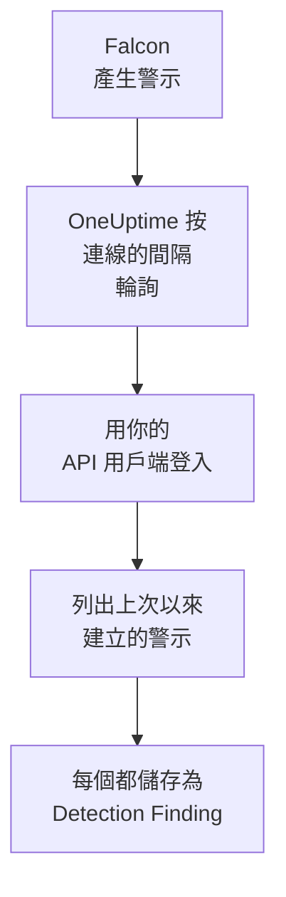

# CrowdStrike Falcon

把 [CrowdStrike Falcon](https://www.crowdstrike.com/platform/) 警示（來自端點、身分和雲端偵測）匯入 OneUptime 的安全性事件。在那裡，你可以把它們與日誌、追蹤和指標放在一起搜尋，與其他所有來源進行關聯分析，並為重要的警示呼叫待命人員。OneUptime 透過你建立的 API 用戶端，經由 Falcon Alerts API 讀取它們，從不向 Falcon 寫入任何內容。

:::cards
- [設定連線](#設定連線): 一個只有一個範圍的 API 用戶端，以及連線的表單。
- [匯入的內容](#匯入的內容): 每個 Falcon 警示如何成為一個安全性事件。
- [輪詢的運作方式](#輪詢的運作方式): 每次輪詢讀取的時間窗，以及繁忙的 CID 對它的影響。
- [疑難排解](#疑難排解): 每個錯誤的含義，以及需要更改什麼。
:::

## 運作方式



OneUptime 每分鐘輪詢一次已過輪詢間隔的每個已啟用連線。一次輪詢會用 API 用戶端的 ID 和金鑰登入你的 Falcon 雲端，向 Alerts API 請求自上次輪詢以來建立的警示，並把每個警示儲存為一個 [OCSF](https://schema.ocsf.io/) Detection Finding 事件（類別 `2004`）。之後，偵測規則、監測器和儀表板會像對待其他任何來源的安全性事件一樣對待它。

## 開始之前

- 在 OneUptime 中擁有 Project Owner、Project Admin 或 Security Admin 角色。Security Member 和 Security Viewer 可以檢視連線及其執行歷史，但不能更改它們。
- 一個 Falcon 客戶 ID（CID），以及一個能管理 API 用戶端的 Falcon 控制台使用者：Falcon Administrator 角色，或擁有 API clients and keys 權限的自訂角色。
- 從 OneUptime 應用程式和工作程序到你的 Falcon 雲端 API 主機的傳出 HTTPS，主機列在下面的 **Falcon cloud** 中。

## 設定連線

:::steps
### 建立 API 用戶端

1. 在 Falcon 控制台中，開啟 **Support and resources → API clients and keys**，然後選擇 **Create API client**。
2. 為它命名，例如 `OneUptime security events`。在 **API scopes** 下開啟 **Alerts → Read**，其他範圍全部保持關閉：連線從不向 Falcon 寫入任何內容。
3. 建立用戶端。Falcon 只會顯示一次它的用戶端 ID、金鑰和基礎 URL。現在就把這三項都複製下來：金鑰以後可以重設，但不會再次顯示。

### 找到你的 Falcon 雲端

Falcon 顯示的基礎 URL 會告訴你 CID 所在的雲端。**API clients and keys** 頁面也會在每個用戶端旁邊顯示它。一個雲端的用戶端會被其他雲端拒絕。

| Falcon 顯示的基礎 URL | Falcon 雲端 |
| --- | --- |
| `https://api.crowdstrike.com` | US-1 |
| `https://api.us-2.crowdstrike.com` | US-2 |
| `https://api.eu-1.crowdstrike.com` | EU-1 |
| `https://api.laggar.gcw.crowdstrike.com` | US-GOV-1 |

### 在 OneUptime 中新增連線

開啟 **產品 → Security Events → Connections**（`/dashboard/{projectId}/security-events/connections`），點選 **新增連線**，選擇 **CrowdStrike Falcon**，然後點選 **下一步**。填寫下表中的設定，點選 **下一步**，並把金鑰貼上到 **Client secret** 中。

### 儲存之前先測試

點選 **儲存前測試** 下的 **Test these settings**。測試會用表單中的值登入並讀取警示，但不會儲存任何內容，因此選錯的雲端或缺失的範圍會在連線存在之前暴露出來。然後點選 **下一步**，為連線填寫 **名稱** 並建立它。
:::

| 設定 | 填寫什麼 |
| --- | --- |
| **用戶端 ID** | API 用戶端的 ID，即你建立用戶端時 Falcon 顯示的那個。 |
| **Falcon cloud** | CID 所在的雲端：**US-1 (api.crowdstrike.com)**、**US-2 (api.us-2.crowdstrike.com)**、**EU-1 (api.eu-1.crowdstrike.com)** 或 **US-GOV-1 (api.laggar.gcw.crowdstrike.com)**。每個請求都會發往該雲端的 API 主機。 |
| **Client secret** | API 用戶端的金鑰。它會被加密，API 從不傳回，也不會再次顯示。在連線上用 **Update credentials** 替換它。 |

**Polling** 步驟還有選用的 **描述**、**Poll Interval (Minutes)**（`1` 到 `1440` 之間的整數，初始為 `5`），以及初始為開啟的 **已啟用**。未啟用的連線仍然可以被測試，也可以手動輪詢。

## 匯入的內容

連線讀取 Falcon 的警示：即 Falcon 控制台在 **Endpoint security → Endpoint detections** 和 **Next-Gen SIEM → Alerts** 下列出的內容，來自產生它們的每個產品。每個警示都會成為一個 Detection Finding 事件（OCSF 類別 `2004`），供應商為 `CrowdStrike`，產品為 `Falcon`：

| Falcon 欄位 | OneUptime 欄位 |
| --- | --- |
| `composite_id` | 事件 UID，也是去除重複所依據的值 |
| `created_timestamp` | 事件時間 |
| `display_name`，或 `name` | 規則名稱 |
| `pattern_id` | 規則 ID |
| `description`，或規則名稱 | 訊息 |
| `severity_name`，或 0 到 100 的 `severity` | 嚴重程度 |
| `status`，例如 `new`、`in_progress` 或 `closed` | 狀態 |
| `tactic_id`, `technique_id` | MITRE ATT&CK 戰術和技術 |
| `device.hostname`、`device.local_ip`、`user_name`、`filename` 或 `cmdline` | 主體的主機、IP、使用者和程序 |
| `filename`、`filepath` 和 `cmdline`；`parent_details.filename`、`parent_details.filepath` 和 `parent_details.cmdline` | 程序名稱、路徑和命令列；父程序名稱、路徑和命令列 |
| `device.hostname`、`device.local_ip`、`device.external_ip`、`user_name`、`sha256` | Observable |
| 其他所有內容，例如 `device.platform_name`、`falcon_host_link`、`product` 和 `timestamp` | `attributes`，展平為點分隔的鍵 |

事件的時間特意採用 Falcon 建立警示的時間：警示背後行為發生的時間 `timestamp` 保留在 `attributes.timestamp` 中。

## 輪詢的運作方式

- **建立時間就是游標。** 警示按 `created_timestamp` 列出，從不按其背後行為發生的時間列出。Falcon 可能在它所描述的活動發生很久之後才產生警示，基於活動時間的游標會跳過所有這樣的警示。
- **第一次輪詢會回溯 24 小時**，所以新連線會立刻顯示最近的警示。
- **之後的每次輪詢都從儲存的游標之前 1 分鐘開始**，所以在兩個時間窗邊界上建立的警示永遠不會被漏掉。
- **一次輪詢最多讀取游標之後 24 小時。** 游標落後的連線會透過一連串 24 小時的時間窗追趕。
- **重複項按 `composite_id` 去除重複**，範圍是整個專案，所以重疊部分和重試的時間窗都不會把同一個警示儲存兩次。
- **每個時間窗的開銷** 是一個權杖請求（在權杖有效期內保留），再加上每 1,000 個警示一個警示查詢和一個警示取得，每個請求都有自己的逾時。

### 當一個時間窗包含的內容超過一次輪詢能讀取的量時

一次輪詢最多傳送 20 個請求。由於需要一個權杖請求，並且每 1,000 個警示需要兩個請求，它最多讀取 9,000 個警示。當時間窗中的警示更多時，這次執行為 **Partial**，並帶有類似這樣的警告：

```text
Stopped after 19 requests before reading the whole window. Alerts are read oldest first; every alert created before 2026-09-14T08:12:44.995Z was read.
```

警示查詢按 `created_timestamp` 從早到晚排序，所以 OneUptime 會把游標移到它讀取的最後一個警示的建立時間，下一次輪詢就從那裡開始，時間窗長度不變，偏移量從 `0` 開始。繁忙的 CID 每次輪詢大約追趕 9,000 個警示，而不是重複讀取相同的警示。在同一時刻建立的警示會被讀取兩次，而去除重複檢查會丟棄第二份。

Falcon 的警示查詢無法翻頁超過 10,000 個結果（`limit` 加 `offset`）。請求上限會讓一次執行在 9,000 個警示時停下，早於這個上限。如果這個上限真的讓讀取停下，處理方式也相同：這次執行為 **Partial**，游標移到讀取的最後一個警示，下一次查詢再次從偏移量 `0` 開始。

當一次執行完全無法越過儲存的游標時，例如超過 9,000 個警示都落在重疊的那一分鐘裡，OneUptime 會改為縮短時間窗：

1. **縮小。** 下一次輪詢從同一個起點讀取長度減半的時間窗，並不斷減半，直到某個時間窗能被完整讀取，最短為一分鐘。執行的警告會說明這一點：`This window holds more records than one poll can read; the next poll reads a {n} minute window from the same starting point.`
2. **恢復。** 一個時間窗被完整讀取後，下一個時間窗的長度會再次加倍，最長為 24 小時。
3. **越過單獨的一分鐘。** 如果連一分鐘內的內容都超過一次輪詢能讀取的量，輪詢會越過這一分鐘，讓更新的警示繼續到達。這次執行仍為 **Partial**，**最近的錯誤** 顯示 `More records were created in the one minute from {cursor} to {end} than one poll can read. Polling moved past this minute so newer records keep arriving; use Import this time range in Diagnostics on this minute to recover what one run can read.` 用 **Import this time range** 匯入這一分鐘，即可找回一次執行能讀取的內容。

因 Falcon 的錯誤而徹底失敗的執行，會保留游標和時間窗長度，下一次輪詢會再次讀取同一個時間窗。唯一的例外是請求逾時：游標保持不變，但下一個時間窗的長度減半，因為太重而無法及時回應的時間窗每次重試都會逾時。更改 **Poll Interval (Minutes)** 不會改變以上任何一點：它決定輪詢多久開始一次，而不是時間窗從哪裡開始。

### 按需執行、預覽和匯入

在連線上點選 **Diagnostics**，可以檢視它最近的執行，並手動操作它。能更改該連線的人都可以啟動這些操作；能檢視它的人都可以閱讀歷史記錄。

- **Run now** 會立即開始一次輪詢，使用通常的游標，即使連線未處於 **已啟用** 狀態也可以。
- **Preview alerts** 讀取最長 7 天的時間範圍，不匯入任何內容。
- **Import this time range** 在你確認後匯入最長 7 天的範圍，不會移動游標。已匯入的警示會被跳過。
- 執行上的 **Copy diagnostics** 會複製它的報告以便提供給支援人員。報告從不包含認證資訊。

## 測試連線

連線所在列中的 **測試連線** 和表單中的 **Test these settings** 在 API 程序中執行，而不是在背景工作程序中執行，所以即使工作程序出了問題，測試仍然會給出結果。它按順序執行以下檢查：

| 檢查 | 檢查的內容 |
| --- | --- |
| **設定** | **用戶端 ID**、**Falcon cloud** 和 **Client secret** 都存在且格式正確。此項失敗時不會連線到任何地方。 |
| **Authenticate with CrowdStrike Falcon** | 在你所在雲端的主機上，用 API 用戶端的 ID 和金鑰呼叫 `POST /oauth2/token` 能傳回權杖。 |
| **Read alerts from the Falcon Alerts API** | 針對過去 24 小時、只取一個警示（`limit=1`）的警示查詢被接受，這證明了 **Alerts → Read** 範圍。 |
| **Alerts available to import** | 過去 24 小時和過去 7 天內建立了多少警示。7 天內一個都沒有是警告，而不是失敗：輪詢會在 Falcon 建立新警示時匯入它們。 |
| **Background workers**、**Poll scheduler**、**Security event storage** | OneUptime 自身的一側：有程序在處理 Worker 佇列的作業，輪詢作業每分鐘執行一次，安全性事件儲存能夠回應。 |
| **Scheduled polling** | 針對已儲存的連線：輪詢已開啟，沒有執行卡在等待工作程序的狀態，並且輪詢按時執行。 |

測試中的每個請求都有 20 秒的期限。測試從不匯入任何內容，也不移動游標，每個失敗的檢查都會說明需要更改什麼。**Copy report** 會把檢查清單複製為 JSON，不包含認證資訊或權杖。

## 疑難排解

連線的 **最近的錯誤** 和每個失敗的檢查都會保留完整的錯誤訊息（認證資訊已隱去），前面帶有一個指明失敗步驟的字首。連線出錯時，在它的 **操作** 欄中選擇 **檢視錯誤** 來閱讀，並在對話方塊中用 **複製錯誤** 複製。請先閱讀字首。

:::details Last Error 以 `CrowdStrike Falcon token request` 開頭
- `CrowdStrike Falcon token request failed (HTTP 401)` 或 `(HTTP 403)`：在聯絡 Alerts API 之前，Falcon 就拒絕了 API 用戶端的 ID 和金鑰。請檢查 **Falcon cloud** 是否為你的 CID 所在的雲端（來自其他雲端的用戶端會在這裡被拒絕），**用戶端 ID** 是否屬於該用戶端，以及 **Client secret** 是否為隨它一起頒發的金鑰。如果金鑰遺失，請在 Falcon 控制台中重設它，並用 **Update credentials** 儲存。
- `CrowdStrike Falcon token request returned ...`：Falcon 傳回了無法使用的內容，即不是 JSON 或沒有 `access_token` 的內文。這通常是中間的代理或閘道器造成的，而不是認證資訊的問題。
:::

:::details Last Error 以 `CrowdStrike Falcon alerts` 開頭
- `CrowdStrike Falcon alerts query failed (HTTP 403)`：權杖被接受了，但 API 用戶端沒有 **Alerts → Read** 範圍。在 **API clients and keys** 下為該用戶端開啟它，然後儲存。它會作用於下一個權杖，所以請一分鐘後再測試。
- `CrowdStrike Falcon alerts query failed (HTTP 401)`：Alerts API 拒絕了權杖，這幾乎總是表示 **Falcon cloud** 不是頒發該用戶端的雲端。
- `CrowdStrike Falcon alerts query failed (HTTP 429)` 或 `CrowdStrike Falcon alerts fetch failed (HTTP 429)`：Falcon 正在對這個 API 用戶端限速。OneUptime 的 HTTP 用戶端在出錯時不保留回應頭，所以訊息通常以 `the X-RateLimit-RetryAfter header was not available` 結尾，而不是引用該回應頭。排程的輪詢會自行重試。如果反覆出現，請給 OneUptime 一個專用的 API 用戶端，而不是與其他工具共用一個。
- `CrowdStrike Falcon alerts query failed (HTTP 400)`：Falcon 拒絕了查詢。連線傳送的是針對 `created_timestamp` 的固定 FQL 篩選器，所以請複製報告並發送給 OneUptime 支援人員。
- `CrowdStrike Falcon alerts query returned ...` 或 `CrowdStrike Falcon alerts fetch returned ...`：Falcon 傳回了 `200`，但內文不是 JSON，或不是連線認識的結構。這種情況會被報告出來，而不是被當作空時間窗，所以游標永遠不會越過沒人讀過的警示。
- `CrowdStrike Falcon alerts fetch failed (HTTP ...)`：警示已列出，但取得它們失敗了，原因與查詢相同。這裡出現 `403` 表示在兩次呼叫之間該範圍被移除了。
:::

:::details Last Error 顯示請求無法完成
`CrowdStrike Falcon token request could not be completed`、`CrowdStrike Falcon alerts query could not be completed` 和 `CrowdStrike Falcon alerts fetch could not be completed` 表示沒有任何回應傳回：逾時、DNS 失敗或傳出流量被阻止。檢查 OneUptime 應用程式和工作程序到你所在雲端的 API 主機（例如 `api.crowdstrike.com`）的傳出 HTTPS。
:::

:::details Last Error 指出了一個未知的雲端
`CrowdStrike Falcon cloud "..." is not one of us-1, us-2, eu-1, us-gov-1` 表示儲存的雲端不是連線認識的雲端。請編輯連線，並從清單中選擇一個雲端。
:::

:::details 執行為 Partial
- `Stopped after 19 requests before reading the whole window`：時間窗中的警示超過了一次執行能讀取的 9,000 個。不會遺失任何內容：下一次輪詢會從讀取的最後一個警示之後開始。一次又一次輪詢都保持 **Partial** 的連線正在追趕積壓，它的 **Last Polled** 和 **Last Event Imported** 會持續前進。如果執行期間續訂了權杖，這個計數可能略大於 19。
- `Falcon returned alerts out of created_timestamp order, so this run cannot name a point to resume from.`：查詢忽略了從早到晚的順序，所以這次執行無法把游標移到它的最後一個警示，下一次輪詢會改為讀取更短的時間窗。如果反覆出現，請把這次執行的報告發送給 OneUptime 支援人員。
- `More records were created in the one minute from ... than one poll can read`：輪詢越過了這一分鐘。請在 **Diagnostics** 中用 **Import this time range** 匯入它。一次匯入讀取的量與一次輪詢相同。
:::

:::details Last Polled 為 Never 且 Last Error 為空
還沒有任何輪詢執行過，所以沒有任何請求到達 Falcon。**測試連線** 會把它顯示為失敗的 **Background workers** 或 **Poll scheduler** 檢查。在自行託管安裝中，常見原因是應用程式上設定了 `DISABLE_QUEUE_WORKERS=true`，卻沒有單獨的工作程序部署來處理作業：把它設為 `false`，或執行工作程序部署（Helm：`worker.enabled: true`）。
:::

:::details 測試通過，但沒有出現任何事件
閱讀 **Alerts available to import**：那裡的警告表示 Falcon 在過去 7 天內沒有建立任何警示，所以暫時沒有可匯入的內容。否則，請開啟 **Diagnostics**，檢查上一次輪詢的時間窗和計數，並在某次執行上使用 **View events in this time range**，開啟它所匯入警示的時間範圍。
:::

## 你會得到什麼

- **搜尋。** 在安全性事件探索器中，與該主機的日誌和指標放在一起，按嚴重程度、狀態、MITRE 戰術、主機、使用者或任何 observable 篩選 Falcon 警示。
- **關聯分析。** 每個警示的主機名稱、IP、使用者和檔案雜湊都會作為 observable 建立索引，所以一次搜尋就能在所有來源中找到提到某個主機的所有內容。
- **偵測規則。** 按排程對你的安全性事件執行的 Sigma 規則，會開啟呼叫待命人員的警示。
- **監測器。** 安全性事件監測器統計符合的事件，並在超過閾值時開啟事件或警示。

安全性事件與其他遙測資料一樣，按擷取的 GB 數計費。請參閱 [定價](https://oneuptime.com/pricing)。

## 後續步驟

:::cards
- [安全性事件](/docs/telemetry/security-events): 搜尋、關聯分析你匯入的內容，並據此發出警示。
- [Microsoft Defender XDR](/docs/integrations/microsoft-defender-xdr): 同時匯入 Microsoft Defender 工作負載的警示。
- [角色](/docs/permissions/reference#角色): Security 角色可以檢視和更改的內容。
- [整合總覽](/docs/integrations/index): 你可以連接的其他工具。
:::
