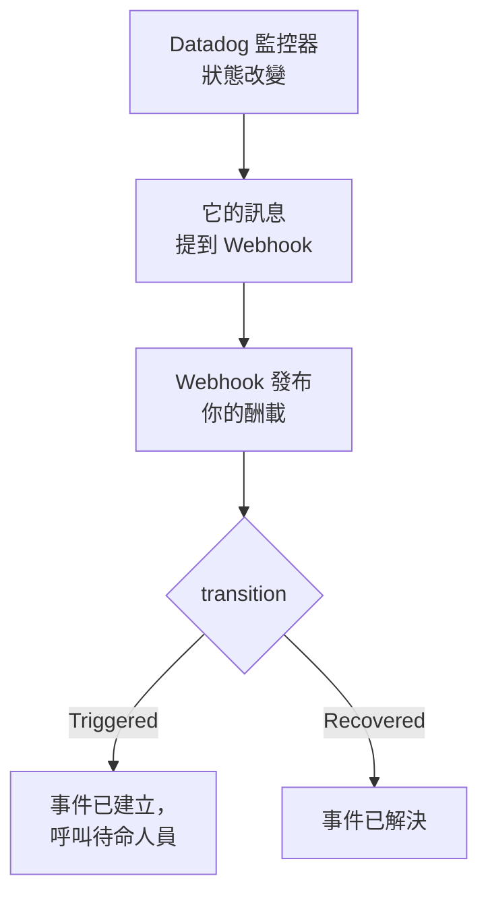

# Datadog

把 [Datadog](https://www.datadoghq.com) 監控器的警示傳送到 OneUptime，讓每個警示都成為一個呼叫待命團隊的事件，並在 Datadog 監控器恢復時解決。Datadog 透過它的 [Webhooks 整合](https://docs.datadoghq.com/integrations/webhooks/) 傳送警示，因此兩邊都無需安裝任何東西。

:::cards
- [選擇 OneUptime 接收警示的方式](#選擇-oneuptime-接收警示的方式): Incoming Request 監測器，或你自己的工作流程。
- [用監測器接收警示](#用監測器接收警示): 每個警示一個事件，恢復時自動解決。
- [設定 Datadog](#設定-datadog): 一個 Webhook，以及通知它的監控器。
- [疑難排解](#疑難排解): 警示沒有到達，或事件一直未關閉時。
:::

## 運作方式



Datadog 監控器在狀態改變時，也就是觸發、警告、恢復或沒有資料時，會通知其訊息中提到的 Webhook。Webhook 的 JSON 內文由你自己用 Datadog 的 [範本變數](https://docs.datadoghq.com/integrations/webhooks/#usage) 編寫，所以本指南給出一個能為每個警示命名、並說明它發生了什麼的內文。

## 開始之前

- 一個可以設定整合併編輯監控器的 Datadog 帳戶。
- 在 OneUptime 中建立監測器的權限；如果選擇工作流程方式，則需要建立工作流程的權限。

## 選擇 OneUptime 接收警示的方式

先設定 OneUptime：它會給你 Datadog 要傳送到的 URL。

| 方式 | 適用情況 |
| --- | --- |
| Incoming Request 監測器（建議） | 你希望每個警示都成為一個呼叫待命人員的事件，並在 Datadog 監控器恢復時解決。無需建置任何東西。 |
| 帶 Webhook 觸發器的工作流程 | 你需要自己的邏輯：先篩選警示、轉換格式或呼叫其他系統。工作流程會為收到的每個警示宣告一個事件，並且不會在恢復時解決它。 |

兩者從同一個 Webhook 收到相同的 JSON，所以你可以先用其中一種，之後只需修改 Datadog 中的一個 URL 就能切換。

## 用監測器接收警示

[Incoming Request 監測器](/docs/monitor/incoming-request-monitor) 會給你一個 URL，它的條件決定每個警示做什麼。

:::steps
### 建立監測器

前往 **監測器**，點選 **建立監測器**。在 **監測器類型** 下選擇 **Incoming Request**，將其命名為 `Datadog`，然後點選 **下一步**。

### 為每個警示宣告事件

在 **條件** 步驟中，開啟第一個條件，也就是把監測器標記為離線的那個。把它的篩選器設為 **請求內文**、**包含**、`"transition":"Triggered"`。這個條件在篩選器符合時已經會宣告事件。填寫事件資訊：

- **事件標題**：`{{requestBody.title}}`。
- **描述** 下的 **事件描述**：`{{requestBody.body}}`，然後在單獨一行寫上 `Datadog: {{requestBody.link}}`。
- **嚴重程度**：這些警示應有的事件嚴重程度。
- **待命** 下的 **待命策略**：要呼叫的策略。
- **更多欄位** 下的 **自動解決事件**：保持開啟，它預設就是開啟的。關閉後會忽略恢復，事件將一直保持開啟。

### 每個警示一個事件

在同一個條件中，開啟 **設定** 並開啟 **Group incidents and alerts by a payload field**。按下表填寫，讓每個警示都有自己的事件，並由它的恢復來解決：

| 欄位 | 值 |
| --- | --- |
| **Open a separate incident for each…** | `requestBody.alert_key` |
| **Field that signals recovery** | `requestBody.transition` |
| **Value that means recovered** | `Recovered` |

### 讓監測器恢復線上

開啟第二個條件，也就是把監測器標記為線上的那個，把它的篩選器設為 **請求內文**、**包含**、`"transition":"Recovered"`。

### 複製 URL

點選 **建立監測器**。監測器的 **概覽** 頁面會顯示它的 **Heartbeat URL**。複製它供 Datadog 使用：

```text
https://oneuptime.com/heartbeat/<secret key>
```

自行託管安裝使用自己的主機來代替 `oneuptime.com`。
:::

下面的酬載把 `alert_key` 設為 Datadog 監控器的 ID 加上發出警示的分組的標籤，因此多警示監控器的每個分組都有自己的事件，並由該分組的恢復來解決。在事件開啟期間再次觸發或重新通知的監控器不會再開啟第二個事件。每項設定的作用請參閱 [接收其他系統的警示](/docs/monitor/incoming-request-monitor#接收其他系統的警示)。

> [!NOTE]
> 使用這些篩選器時，**Warn** 或 **No Data** 通知不會開啟事件。如果也想在警告時被呼叫，請點選 **新增條件準則**，為新條件設定篩選器 **請求內文**、**包含**、`"transition":"Warn"`，一個帶有自己 **嚴重程度** 的事件，以及相同的分組設定，然後把它拖到第一個條件上方。條件從上往下檢查，第一個符合的條件起決定作用。

## 設定 Datadog

:::steps
### 新增 Webhook

在 Datadog 中開啟 [Webhooks 整合磁貼](https://app.datadoghq.com/integrations/webhooks)，如果尚未安裝，請先安裝。用以下設定新增一個 Webhook，然後儲存：

- **Name**：`oneuptime`。監控器用這個名稱提到該 Webhook，即 `@webhook-oneuptime`。
- **URL**：你從 OneUptime 複製的 URL。
- **Payload**：

  ```json
  {
    "alert_key": "$ALERT_ID $ALERT_SCOPE",
    "transition": "$ALERT_TRANSITION",
    "title": "$EVENT_TITLE",
    "body": "$TEXT_ONLY_MSG",
    "host": "$HOSTNAME",
    "priority": "$PRIORITY",
    "link": "$LINK"
  }
  ```

### 在監控器中提到該 Webhook

在每個應透過 OneUptime 呼叫的 Datadog 監控器中，把 `@webhook-oneuptime` 新增到監控器的通知訊息裡，然後儲存監控器。之後 Datadog 會把該監控器的警示和恢復傳送到 OneUptime。
:::

| 變數 | Datadog 填入的內容 |
| --- | --- |
| `$ALERT_ID` | 發出警示的 Datadog 監控器的 ID。 |
| `$ALERT_SCOPE` | 發出警示的分組的標籤，例如 `host:web-1`。 |
| `$ALERT_TRANSITION` | 發生了什麼：`Triggered`、`Re-Triggered`、`Warn`、`Recovered`、`No Data` 或 `Renotify` 等。 |
| `$EVENT_TITLE` | 事件的標題，例如 `[Triggered] High CPU`。 |
| `$TEXT_ONLY_MSG` | 去掉 Markdown 的監控器訊息。 |
| `$LINK` | 指向 Datadog 中該事件的連結。 |

## 測試

像 Datadog 那樣，向 OneUptime 傳送一個警示：

```bash
curl -X POST "https://oneuptime.com/heartbeat/<secret key>" \
  -H "Content-Type: application/json" \
  -d '{
    "alert_key": "1234 host:web-1",
    "transition": "Triggered",
    "title": "[Triggered] High CPU",
    "body": "CPU is above 90% on web-1.",
    "host": "web-1",
    "priority": "normal",
    "link": "https://app.datadoghq.com/event/event?id=1"
  }'
```

會開啟一個標題為 `[Triggered] High CPU` 的事件。把 `transition` 設為 `Recovered` 後傳送同樣的請求，事件就會被解決。

然後從 Datadog 測試：開啟一個提到該 Webhook 的監控器，點選 **Test Notifications**，並發送它的 **Alert** 通知。檢視 OneUptime 監測器的時間軸，確認它已到達。

## 用工作流程接收警示

當你需要在 Datadog 和事件之間加入自己的步驟時，請使用 [工作流程](/docs/workflows/index)。

:::steps
### 建立工作流程

前往 **工作流程**，點選 **建立工作流程**，然後點選 **從零開始**。將其命名為 `Datadog alerts`，然後點選 **建立工作流程**。

### 新增 Webhook 觸發器

點選虛線的 **選擇啟動此工作流程的方式** 區塊並選擇 **Webhook**。點選該觸發器，然後點選 **複製 URL**，把該 URL 用在 Datadog 的 Webhook 中。

### 檢查監控器是否已觸發

點選 **新增元件**，新增一個 **If / Else** 區塊，並把觸發器的 **Out** 點連接到它。把 **Value to check** 設為 `{{local.components.webhook-1.returnValues.request-body.transition}}`，**Comparison** 設為 **is equal to**，**Compare with** 設為 `Triggered`。

### 宣告事件

新增一個 **Create One Incident** 區塊，並把 **If / Else** 區塊的 **Yes** 一側連接到它。在 **Incident Template** 中選擇一個設定了嚴重程度和要呼叫的待命策略的範本（請參閱 [事件範本](/docs/incidents/settings#事件範本)）。在 **JSON Object** 中設定來自 Datadog 的內容：

```json
{
  "title": "{{local.components.webhook-1.returnValues.request-body.title}}",
  "description": "{{local.components.webhook-1.returnValues.request-body.body}}\nDatadog: {{local.components.webhook-1.returnValues.request-body.link}}"
}
```

如果不使用範本，**JSON Object** 中還需要 `incidentSeverityId`，即專案中某個事件嚴重程度的 ID。

### 啟用工作流程

在 **建構器** 頂部開啟 **已啟用**。處於關閉狀態的工作流程會以 `400` 回應 Datadog。
:::

每個 `Triggered` 通知都會宣告一個新事件。恢復會走向 **If / Else** 區塊的 **No** 一側，那裡沒有連接任何東西，因此執行到此結束。要讓每個警示一個事件並在恢復時解決，請使用監測器。

## 疑難排解

:::details OneUptime 沒有收到任何內容
- 檢查 Datadog 監控器的訊息是否提到了 `@webhook-oneuptime`，拼寫與 Webhook 的名稱一致。
- 監測器會在檢查任何內容之前立即回應 `200`，即使金鑰錯誤也是如此。請檢視監測器的時間軸，確認警示是否到達。
- 處於關閉狀態的工作流程會回應 `400`。在它的 **建構器** 頂部開啟 **已啟用**。
:::

:::details 事件被建立但從未被解決
- Datadog 監控器也必須把恢復通知給該 Webhook。如果訊息只在條件區塊中針對警示提到該 Webhook，就不會發送恢復。
- 條件中的事件需要開啟 **更多欄位** 下的 **自動解決事件**。
- **Value that means recovered** 必須恰好是 `Recovered`。比較區分大小寫。
- 恢復的 `alert_key` 必須與警示的相同：保持酬載中的 `$ALERT_ID $ALERT_SCOPE` 不變。
:::

:::details 欄位顯示的是變數名，或者什麼都沒有
Datadog 只會填入適用於該事件的變數。傳送一個測試通知，然後檢視到達的內容：在監測器的時間軸中，或者對於工作流程，在 **日誌 → 執行記錄** 中檢視。
:::

:::details 監控器的所有警示合併成了一個事件
每個分組都需要自己的 `alert_key`。檢查酬載是否同時用 `$ALERT_ID` 和 `$ALERT_SCOPE` 來設定它，以及分組路徑是否為 `requestBody.alert_key`。
:::

## 安全

- **像對待密碼一樣對待 URL。** 任何擁有它的人都可以建立事件。如果洩露，請重設它：在監測器的 **設定** 頁面使用 **重設傳入請求密鑰**，或在工作流程的 **Webhook** 觸發器中使用 **重設 URL**。然後在 Datadog 中更新該 Webhook 的 **URL**。
- **自行託管？** Datadog 從網際網路傳送 Webhook，所以你的 OneUptime 必須能從網際網路透過 HTTPS 存取。

## 後續步驟

:::cards
- [傳入請求監控](/docs/monitor/incoming-request-monitor): 接收警示的監測器的所有設定。
- [Prometheus Alertmanager](/docs/integrations/prometheus-alertmanager): 適用於 Alertmanager 的相同設定。
- [上報規則](/docs/on-call/escalation-rules): 決定待命策略呼叫誰、何時呼叫。
- [整合總覽](/docs/integrations/index): 你可以連接的其他工具。
:::
