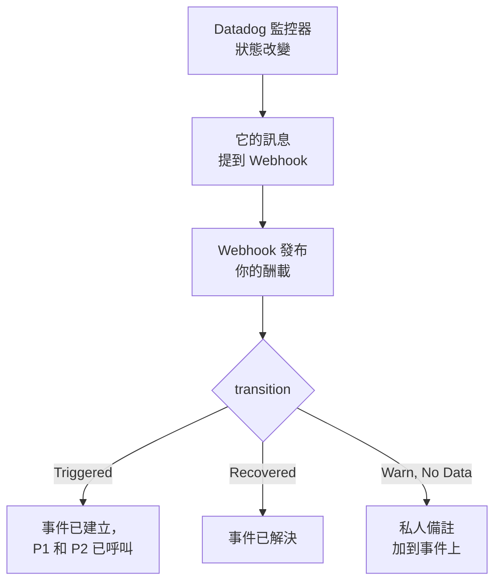

# Datadog

把 [Datadog](https://www.datadoghq.com) 監控器的警示傳送到 OneUptime，讓每個警示都成為一個事件或一個 OneUptime 警示，在緊急時呼叫你的待命團隊，並在 Datadog 監控器恢復時解決。Datadog 透過它的 [Webhooks 整合](https://docs.datadoghq.com/integrations/webhooks/) 傳送警示，因此兩邊都無需安裝任何東西。

:::cards
- [選擇 OneUptime 接收警示的方式](#選擇-oneuptime-接收警示的方式): 工作流程範本，或 Incoming Request 監測器。
- [從範本開始](#從範本開始): 選擇要呼叫誰、複製 URL，並了解每個警示會做什麼。
- [用監測器接收警示](#用監測器接收警示): 每個警示一個事件，恢復時自動解決。
- [設定 Datadog](#設定-datadog): 一個 Webhook，以及通知它的監控器。
- [疑難排解](#疑難排解): 警示沒有到達，或事件一直未關閉時。
:::

## 運作方式



Datadog 監控器在狀態改變時，也就是觸發、警告、恢復或沒有資料時，會通知其訊息中提到的 Webhook。Webhook 的 JSON 內文由你自己用 Datadog 的 [範本變數](https://docs.datadoghq.com/integrations/webhooks/#usage) 編寫，所以本指南給出一個能為每個警示命名、並說明它發生了什麼的內文。

## 開始之前

- 一個可以設定整合併編輯監控器的 Datadog 帳戶。
- 在 OneUptime 中建立工作流程的權限；如果選擇監測器方式，則需要建立監測器的權限。在 OneUptime Cloud 上，工作流程需要 **Growth** 或更高的方案。

## 選擇 OneUptime 接收警示的方式

先設定 OneUptime：它會給你 Datadog 要傳送到的 URL。

| 方式 | 適用情況 |
| --- | --- |
| 工作流程範本（推薦） | 你希望每個警示都按監控器優先順序所對應的嚴重程度成為一個事件或警示，P1 和 P2 時呼叫待命人員，警告記錄在其上，恢復時解決。無需建置任何東西。 |
| Incoming Request 監測器 | 你希望不用工作流程、在任何方案上都能建立事件，並有一個狀態跟隨 Datadog 的監測器。 |

兩者從同一個 Webhook 收到相同的 JSON，所以你可以先用其中一種，之後只需修改 Datadog 中的一個 URL 就能切換。

## 從範本開始

**建立工作流程** 對話框在其類別清單的 **Datadog** 下有兩個 Datadog 範本：**Declare an incident when a Datadog monitor triggers**，以及用於警示的 **Create an alert when a Datadog monitor triggers**。兩者作用相同，各自建立自己種類的記錄。

:::steps
1. 前往 **工作流程**，點選 **建立工作流程**。在 **或從範本開始** 下，在類別清單中選擇 **Datadog**，點選 **Declare an incident when a Datadog monitor triggers**，或 **Create an alert when a Datadog monitor triggers**，然後點選 **使用此範本**。
2. 在 **Who to page for P1 and P2 monitors** 底下選擇要呼叫的待命策略，不選則不呼叫任何人，然後點選 **建立工作流程**。工作流程會在 **建構器** 中開啟，處於關閉狀態。
3. 點選 **Webhook** 觸發器，然後點選 **複製 URL**，把 URL 留給 Datadog 使用。
4. 在 **建構器** 頂部開啟 **已啟用**。處於關閉狀態的工作流程會以 `400` 回應 Datadog。
:::

然後 [設定 Datadog](#設定-datadog)，讓它把警示傳送到這個 URL。工作流程的 `read-event-1` 步驟一開始就有相同的設定，供你回到 **建構器** 時使用。

### 工作流程做什麼

在 **Webhook** 觸發器之後， **Check With JavaScript** 步驟 `read-event-1` 讀取 Datadog 傳送的 `transition`，再由 **Incident From Another Tool**（警示範本中為 **Alert From Another Tool** ）依警示的週期金鑰執行它所代表的操作。Datadog 從警示觸發起到它恢復為止都保留該金鑰，下次再觸發時金鑰是新的，所以每次都有自己的事件。事件把該金鑰保存在其自訂欄位 `datadogAlertCycleKey` 中。

| 轉換 | 工作流程做什麼 |
| --- | --- |
| `Triggered`, `Re-Triggered` | 宣告一個標題為 `Datadog: <monitor>` 的事件，其嚴重程度為監控器優先順序所對應的嚴重程度，並且不顯示在你的狀態頁面上。它的描述連結到 Datadog 中的警示，並列出優先順序、主機、範圍和監控器的訊息。對於已有事件的警示，再收到通知不會建立第二個事件，也不會再次呼叫任何人。 |
| `Recovered` | 解決警示的事件，除非它已經解決。原因記錄在它的時間軸上。 |
| `Warn`, `Re-Warn`, `No Data`, `Re-No Data` | 把監控器現在的狀態作為私人備註新增到警示的事件。 |
| `Renotify` | 無：警示仍然開啟。 |

沒有事件的警示收到警告或恢復，不會改變任何東西。其他任何內容，例如來自其他工具的請求，都會原樣保留： `read-event-1` 走 **No**，執行的 **步驟** 會說明原因。不會有任何內容回到 Datadog：它會在訊號恢復時自行解決其警示，而這就是解決事件的原因。

### 優先順序與呼叫

當監控器為 P1 或 P2，或沒有優先順序時，新事件會呼叫你選擇的待命策略。P3、P4 和 P5 會建立事件，但不呼叫任何人。在新專案中，優先順序對應到以下事件和警示嚴重程度：

| Datadog 優先順序 | 事件 | 警示 | 待命 |
| --- | --- | --- | --- |
| P1 | Critical Incident | High | 呼叫 |
| P2 | Critical Incident | High | 呼叫 |
| 無優先順序 | Critical Incident | High | 呼叫 |
| P3 | Major Incident | Low | 不呼叫 |
| P4 | Minor Incident | Low | 不呼叫 |
| P5 | Minor Incident | Low | 不呼叫 |

使用你自己的嚴重程度時，P1、P2 和無優先順序對應最嚴重的一個，P3 對應中間的一個，P4 和 P5 對應最輕的一個。

- 要按名稱把某個優先順序對應到你的某個嚴重程度，請編輯 `read-event-1` 步驟中的 `SEVERITY_BY_NAME`，例如 `{ P3: 'Minor Incident' }`。
- 要讓 P3 也呼叫待命人員，請把 `if-page-1` **If / Else** 步驟的 **Compare with** 設為 `3`。

## 用監測器接收警示

[Incoming Request 監測器](/docs/monitor/incoming-request-monitor) 會給你一個 URL，它的條件決定每個警示做什麼。

:::steps
### 建立監測器

前往 **監測器**，點選 **建立監測器**。在 **監測器類型** 下選擇 **Incoming Request**，將其命名為 `Datadog`，然後點選 **下一步**。

### 為每個警示宣告事件

在 **條件** 步驟中，開啟第一個條件，也就是把監測器標記為離線的那個。把它的篩選器設為 **請求內文**、**包含**、`"transition":"Triggered"`。這個條件在篩選器符合時已經會宣告事件。填寫事件資訊：

- **事件標題**：`{{requestBody.title}}`。
- **描述** 下的 **事件描述**：`{{requestBody.body}}`，然後在單獨一行寫上 `Datadog: {{requestBody.link}}`。
- **嚴重程度**：這些警示應有的事件嚴重程度。
- **待命** 下的 **待命策略**：要呼叫的策略。
- **更多欄位** 下的 **自動解決事件**：保持開啟，它預設就是開啟的。關閉後會忽略恢復，事件將一直保持開啟。

### 每個警示一個事件

在同一個條件中，開啟 **設定** 並開啟 **Group incidents and alerts by a payload field**。按下表填寫，讓每個警示都有自己的事件，並由它的恢復來解決：

| 欄位 | 值 |
| --- | --- |
| **Open a separate incident for each…** | `requestBody.alert_key` |
| **Field that signals recovery** | `requestBody.transition` |
| **Value that means recovered** | `Recovered` |

### 讓監測器恢復線上

開啟第二個條件，也就是把監測器標記為線上的那個，把它的篩選器設為 **請求內文**、**包含**、`"transition":"Recovered"`。

### 複製 URL

點選 **建立監測器**。監測器的 **概覽** 頁面會顯示它的 **Heartbeat URL**。複製它供 Datadog 使用：

```text
https://oneuptime.com/heartbeat/<secret key>
```

自行託管安裝使用自己的主機來代替 `oneuptime.com`。
:::

下面的酬載把 `alert_key` 設為 Datadog 監控器的 ID 加上發出警示的分組的標籤，因此多警示監控器的每個分組都有自己的事件，並由該分組的恢復來解決。在事件開啟期間再次觸發或重新通知的監控器不會再開啟第二個事件。每項設定的作用請參閱 [接收其他系統的警示](/docs/monitor/incoming-request-monitor#接收其他系統的警示)。

> [!NOTE]
> 使用這些篩選器時，**Warn** 或 **No Data** 通知不會開啟事件。如果也想在警告時被呼叫，請點選 **新增條件準則**，為新條件設定篩選器 **請求內文**、**包含**、`"transition":"Warn"`，一個帶有自己 **嚴重程度** 的事件，以及相同的分組設定，然後把它拖到第一個條件上方。條件從上往下檢查，第一個符合的條件起決定作用。

## 設定 Datadog

:::steps
### 新增 Webhook

在 Datadog 中開啟 [Webhooks 整合磁貼](https://app.datadoghq.com/integrations/webhooks)，如果尚未安裝，請先安裝。用以下設定新增一個 Webhook，然後儲存：

- **Name**：`oneuptime`。監控器用這個名稱提到該 Webhook，即 `@webhook-oneuptime`。
- **URL**：你從 OneUptime 複製的 URL。
- **Payload**：

  ```json
  {
    "alert_key": "$ALERT_ID $ALERT_SCOPE",
    "alert_cycle_key": "$ALERT_CYCLE_KEY",
    "transition": "$ALERT_TRANSITION",
    "alert_priority": "$ALERT_PRIORITY",
    "title": "$EVENT_TITLE",
    "body": "$TEXT_ONLY_MSG",
    "host": "$HOSTNAME",
    "scope": "$ALERT_SCOPE",
    "priority": "$PRIORITY",
    "link": "$LINK"
  }
  ```

### 在監控器中提到該 Webhook

在每個應透過 OneUptime 呼叫的 Datadog 監控器中，把 `@webhook-oneuptime` 新增到監控器的通知訊息裡，然後儲存監控器。之後 Datadog 會把該監控器的警示和恢復傳送到 OneUptime。
:::

| 變數 | Datadog 填入的內容 |
| --- | --- |
| `$ALERT_ID` | 發出警示的 Datadog 監控器的 ID。 |
| `$ALERT_SCOPE` | 發出警示的分組的標籤，例如 `host:web-1`。 |
| `$ALERT_CYCLE_KEY` | 從警示觸發起到它恢復為止保持不變的 ID。 |
| `$ALERT_TRANSITION` | 發生了什麼：`Triggered`、`Re-Triggered`、`Warn`、`Recovered`、`No Data` 或 `Renotify` 等。 |
| `$ALERT_PRIORITY` | Datadog 監控器的優先順序，`P1` 到 `P5`，沒有優先順序的監控器則為空。 |
| `$EVENT_TITLE` | 事件的標題，例如 `[Triggered] High CPU`。 |
| `$TEXT_ONLY_MSG` | 去掉 Markdown 的監控器訊息。 |
| `$LINK` | 指向 Datadog 中該事件的連結。 |

同一個酬載兩種方式都適用：範本使用 `alert_cycle_key` 和 `alert_priority`，監測器使用 `alert_key`。全部保留，之後只需修改 URL 就能切換。

## 測試

像 Datadog 那樣，向你複製的 URL 傳送一個警示：

```bash
curl -X POST "<url>" \
  -H "Content-Type: application/json" \
  -d '{
    "alert_key": "1234 host:web-1",
    "alert_cycle_key": "7151157925468446720",
    "transition": "Triggered",
    "alert_priority": "P1",
    "title": "[Triggered] High CPU",
    "body": "CPU is above 90% on web-1.",
    "host": "web-1",
    "scope": "host:web-1",
    "priority": "normal",
    "link": "https://app.datadoghq.com/event/event?id=1"
  }'
```

使用範本時，會開啟一個標題為 `Datadog: High CPU` 的事件，並呼叫你選擇的待命策略。使用監測器時，會開啟一個標題為 `[Triggered] High CPU` 的事件。把 `transition` 設為 `Recovered` 後傳送同樣的請求，事件就會被解決。

然後從 Datadog 測試：開啟一個提到該 Webhook 的監控器，點選 **Test Notifications**，並發送它的 **Alert** 通知。要確認它已到達，請開啟工作流程的 **日誌 → 執行記錄**，或 OneUptime 監測器的時間軸。

## 疑難排解

:::details OneUptime 沒有收到任何內容
- 檢查 Datadog 監控器的訊息是否提到了 `@webhook-oneuptime`，拼寫與 Webhook 的名稱一致。
- 監測器會在檢查任何內容之前立即回應 `200`，即使金鑰錯誤也是如此。請檢視監測器的時間軸，確認警示是否到達。
- 處於關閉狀態的工作流程會回應 `400`。在它的 **建構器** 頂部開啟 **已啟用**。
:::

:::details 工作流程執行了，但沒有建立任何東西
在 **日誌 → 執行記錄** 中開啟該次執行。其 **步驟** 中的 `read-event-1` 項目會說明它為什麼走 **No**。

- `Datadog named no alert cycle key`：在 Datadog 中把 `"alert_cycle_key": "$ALERT_CYCLE_KEY"` 新增到 Webhook 的酬載中。
- `Datadog named no transition`：在 Datadog 中把 `"transition": "$ALERT_TRANSITION"` 新增到 Webhook 的酬載中。
:::

:::details 沒有呼叫待命人員
- 只有 P1 和 P2 監控器以及沒有優先順序的監控器會呼叫。請參閱 [優先順序與呼叫](#優先順序與呼叫)。
- 對於已有事件的警示，再收到通知不會再次呼叫任何人。
- 如果在 **建立工作流程** 對話框中沒有選擇任何人，工作流程就沒有呼叫的步驟。
:::

:::details 事件被建立但從未被解決
- Datadog 監控器也必須把恢復通知給該 Webhook。如果訊息只在條件區塊中針對警示提到該 Webhook，就不會發送恢復。
- 使用範本時，在 **日誌 → 執行記錄** 中開啟恢復的那次執行：它的最後一個步驟會說明原因。恢復的 `alert_cycle_key` 必須與警示的相同，所以請保持酬載中的 `$ALERT_CYCLE_KEY` 不變。
- 使用監測器時，條件中的事件需要開啟 **更多欄位** 下的 **自動解決事件**。
- **Value that means recovered** 必須恰好是 `Recovered`。比較區分大小寫。
- 恢復的 `alert_key` 必須與警示的相同：保持酬載中的 `$ALERT_ID $ALERT_SCOPE` 不變。
:::

:::details 欄位顯示的是變數名，或者什麼都沒有
Datadog 只會填入適用於該事件的變數。傳送一個測試通知，然後檢視到達的內容：在監測器的時間軸中，或者對於工作流程，在 **日誌 → 執行記錄** 中檢視。
:::

:::details 監控器的所有警示合併成了一個事件
使用監測器時，每個分組都需要自己的 `alert_key`。檢查酬載是否同時用 `$ALERT_ID` 和 `$ALERT_SCOPE` 來設定它，以及分組路徑是否為 `requestBody.alert_key`。
:::

## 安全

- **像對待密碼一樣對待 URL。** 任何擁有它的人都可以建立事件。如果洩露，請重設它：在工作流程的 **Webhook** 觸發器中使用 **重設 URL**，或在監測器的 **設定** 頁面使用 **重設傳入請求密鑰**。然後更新 Datadog 中 Webhook 的 **URL**。
- **連結指向 Datadog。** 無論請求中寫了什麼，範本只會連結到 Datadog 網站上的警示，並把 Datadog 傳送的內容作為文字寫入。
- **自行託管？** Datadog 從網際網路傳送 Webhook，所以你的 OneUptime 必須能從網際網路透過 HTTPS 存取。

## 後續步驟

:::cards
- [工作流程範本](/docs/workflows/authoring): 從範本建立工作流程，並在建構器中修改它。
- [傳入請求監控](/docs/monitor/incoming-request-monitor): 接收警示的監測器的所有設定。
- [New Relic](/docs/integrations/new-relic): 相同的範本，適用於 New Relic 問題。
- [上報規則](/docs/on-call/escalation-rules): 決定待命策略呼叫誰、何時呼叫。
- [整合總覽](/docs/integrations/index): 你可以連接的其他工具。
:::
