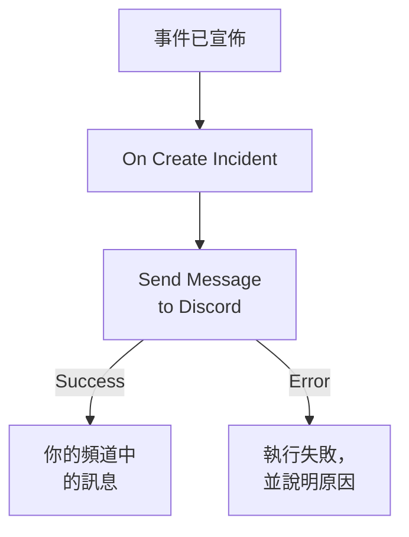

# Discord

在事件開啟時向 [Discord](https://discord.com) 頻道發布一條訊息，讓關注該頻道的人立刻知道。OneUptime 的工作流程步驟 **Send Message to Discord** 透過頻道的 webhook 發布訊息，現成的範本會為你建置整個工作流程。此整合屬於 **出站** 模式：OneUptime 只向頻道發布訊息，不讀取頻道裡的內容。

:::cards
- [運作方式](#運作方式): 事件開啟時工作流程會做什麼。
- [設定](#設定整合): Discord 中的 webhook，然後是工作流程：從範本建立或從零開始。
- [提示](#提示): 格式、長訊息和更多事件。
- [疑難排解](#疑難排解): 步驟的錯誤是什麼意思，以及該改什麼。
:::

## 運作方式



該步驟把 **Message Text** 發布到頻道的 webhook。Discord 接受訊息時，它走 **Success** 輸出；Discord 拒絕時，它帶著 Discord 給出的原因走 **Error** 輸出。像範本中那樣 **Error** 上沒有連接任何東西時，未能發布的執行會失敗，其 **步驟** 會說明原因。

## 開始之前

- 在 Discord 中，擁有該頻道的 **Manage Webhooks** 權限。
- 在 OneUptime 中，擁有建立工作流程和變數的權限。在 OneUptime Cloud 上，工作流程需要 **Growth** 或更高的方案。

## 設定整合

:::steps
### 在 Discord 中建立 webhook

1. 在 Discord 中，透過 **Edit Channel** 開啟頻道設定，然後開啟 **Integrations → Webhooks**，並選擇 **New Webhook**。
2. 為它命名，例如 `OneUptime`，並檢查它發布到的是正確的頻道。
3. 選擇 **Copy Webhook URL**。

任何擁有該 URL 的人都可以在頻道中發布訊息，所以請像保管密碼一樣保管它。

### 建置工作流程

從範本開始，它會為你建置整個工作流程，或者從零開始。

:::tabs
@tab 從範本建立
1. 開啟 **工作流程**，然後點選 **建立工作流程**。
2. 在 **搜尋範本…** 中輸入 `Discord`，點選 **Tell Discord when an incident opens**，然後點選 **使用此範本**。
3. 保留名稱 **Notify Discord on new incident** 或更改它，然後點選 **下一步**。
4. 把 URL 貼上到 **Discord Webhook URL** 中，然後點選 **建立工作流程**。

工作流程會在 **建構器** 中開啟，包含兩個步驟： **On Create Incident**，以及發布事件編號、標題、嚴重程度和狀態的 **Send Message to Discord**。URL 會儲存為工作流程的機密變數 `discordWebhookUrl`。
@tab 從零開始
1. 把 URL 儲存為機密的全域變數：前往 **工作流程 → 全域變數**，點選 **建立工作流程 變數**，將其命名為 `DISCORD_WEBHOOK_URL`，然後點選 **下一步**。把 URL 貼上到 **內容** 中，開啟 **密鑰**，然後點選 **建立工作流程 變數**。
2. 前往 **工作流程**，點選 **建立工作流程**，選擇 **從零開始**，為工作流程命名，然後點選 **建立工作流程**。
3. 在 **建構器** 中，點選 **選擇啟動此工作流程的方式**，然後在 **熱門** 下選擇 **On Create Incident**。點選觸發器：它的 **Fields to pass on** 已經包含 **標題**，所以點選 **新增欄位**，再選擇訊息要顯示的其他欄位，例如 **Incident Number With Prefix**。
4. 點選 **新增元件**，搜尋 `discord`，然後點選 **Send Message to Discord**。把觸發器的 **Success** 輸出連接到它。
5. 點選新步驟。在 **Discord Incoming Webhook URL** 中點選 **{ }**，然後在 **Global variables** 下選擇 `DISCORD_WEBHOOK_URL`。在 **Message Text** 中寫下訊息，並用 **{ }** 插入事件的欄位。
:::

從零開始編寫的訊息透過如下引用讀取事件的欄位：

```text
🚨 **Incident {{local.components.incident-on-create-1.returnValues.model.incidentNumberWithPrefix}} declared**
**Title:** {{local.components.incident-on-create-1.returnValues.model.title}}
```

### 開啟並測試

在 **建構器** 頂部開啟 **已啟用**。從現在起，每個新事件都會發布到頻道中。

要在不開啟事件的情況下進行測試，請點選 **執行工作流程**，在 **事件** 下選擇一個既有的事件：清單中會列出最近的事件，輸入它的編號或標題的一部分可以找到其他事件。點選 **手動執行工作流程**，然後用 **執行** 確認。**工作流程執行** 面板會追蹤這次執行，訊息會出現在頻道中。如果該步驟改走 **Error**，執行就會失敗， **步驟** 中該步驟的項目會說明原因：請參閱 [疑難排解](#疑難排解)。
:::

## 提示

- **用 Discord 的 Markdown 設定格式。** 文字按輸入的原樣傳送，所以 Discord 的 Markdown 可以在其中使用：用星號包圍一個詞會讓它變成粗體，URL 會顯示為連結。
- **注意 2,000 個字元的限制。** Discord 接受最多 2,000 個字元的訊息。更長的訊息會被截斷，並以 "… (truncated — see OneUptime for the full text)" 結尾，而不是被拒絕。
- **不只發布新事件。** 用同一個步驟，基於 **On Update Incident** 建置另一個工作流程來發布狀態變更，或基於 **On Create Alert** 建置工作流程來發布警示。要只發布部分事件，請在該步驟之前放一個 **If / Else** 區塊。
- **只用 Discord 自己的位址。** 該步驟發布到 `discord.com` 或 `discordapp.com` 上的 `https` URL，並且不跟隨重新導向，所以指向其他任何地方的 URL 都會讓執行停止。

## 疑難排解

當該步驟走 **Error** 時，執行會失敗，執行的 **步驟** 中該步驟的項目會給出 Discord 的原因。

:::details Discord 傳回 "Unknown Webhook" 或 "Invalid Webhook Token"
webhook 已被刪除，或者 URL 複製錯了。請建立一個新的 webhook 並替換 URL：在範本的工作流程中是變數 `discordWebhookUrl`；在你自己的工作流程中是 `DISCORD_WEBHOOK_URL` 的內容。
:::

:::details Discord 傳回 "You are being rate limited"
Discord 會限制一個 webhook 的發布頻率。集中出現的事件可能會觸及這個限制：請發布更少的訊息，例如只針對部分嚴重程度。
:::

:::details 執行停止並顯示 "Discord Webhook URL must be an https URL on discord.com or discordapp.com"
**Discord Incoming Webhook URL** 中填的不是 Discord webhook，或者它讀取的變數為空。請重新貼上 **Copy Webhook URL** 中的 URL。
:::

## 後續步驟

:::cards
- [工作流程元件](/docs/workflows/components#discord): 步驟的每項設定，以及各輸出的含義。
- [Telegram](/docs/integrations/telegram): 同樣的思路，用於 Telegram 聊天。
- [工作流程執行記錄](/docs/workflows/runs-and-logs): 檢視工作流程每次執行都做了什麼。
- [整合總覽](/docs/integrations/index): 傳出模式，以及你可以連接的其他工具。
:::
