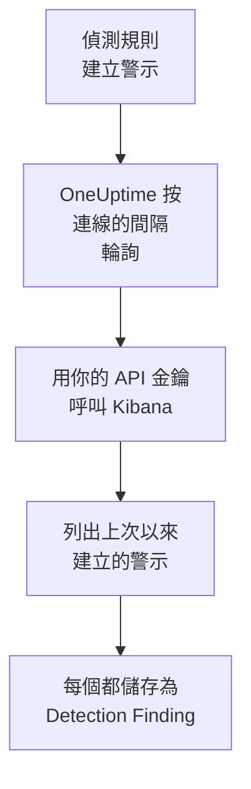

# Elastic Security

把你的 [Elastic Security](https://www.elastic.co/security) 規則產生的偵測警示匯入 OneUptime 的安全性事件。在那裡，你可以把它們與日誌、追蹤和指標放在一起搜尋，與其他所有來源進行關聯分析，並為重要的警示呼叫待命人員。OneUptime 使用你建立的 API 金鑰，透過 Kibana 的偵測引擎 API 讀取它們，不會在 Elastic 中更改任何內容。

:::cards
- [設定連線](#設定連線): 一個 API 金鑰、它的權限，以及連線的表單。
- [匯入的內容](#匯入的內容): 每個偵測警示如何成為一個安全性事件。
- [輪詢的運作方式](#輪詢的運作方式): 每次輪詢讀取的時間窗，以及繁忙的空間對它的影響。
- [疑難排解](#疑難排解): 每個錯誤的含義，以及需要更改什麼。
:::

## 運作方式



OneUptime 每分鐘輪詢一次已過輪詢間隔的每個已啟用連線。一次輪詢會向 Kibana 請求自上次輪詢以來在你的空間中建立的偵測警示，每次 1,000 個，並把每個警示儲存為一個 [OCSF](https://schema.ocsf.io/) Detection Finding 事件（類 `2004`）。所有規則類型都包括在內：自訂查詢、閾值、EQL、指標符合、機器學習和新術語。之後，偵測規則、監測器和儀表板會像對待其他任何來源的安全性事件一樣對待這些警示。

## 開始之前

- 在 OneUptime 中擁有 Project Owner、Project Admin 或 Security Admin 角色。Security Member 和 Security Viewer 可以檢視連線及其執行歷史，但不能更改它們。
- Elastic Security 8.x 或更高版本，位於 Elastic Cloud 或你自己的 Elastic 堆疊上，並且偵測規則在某個 Kibana 空間中執行。
- 能檢視該空間中偵測警示的 Kibana 存取權限：對 `.alerts-security.alerts-<space-id>` 的索引權限 `read` 和 `view_index_metadata`，以及允許在那裡讀取警示的 Kibana Security 功能權限。
- 一個 OneUptime 能透過 HTTPS 存取到的 Kibana。OneUptime Cloud 從網際網路連線，所以 Kibana 需要一個公開位址，就像 Elastic Cloud 部署那樣：私有位址會被拒絕。自行託管的 OneUptime 從它的應用程式和工作程序容器連線，可以存取你私有網路中的 Kibana，除非 `DATA_SOURCE_BLOCK_PRIVATE_ADDRESSES` 為 `true`。

## 設定連線

:::steps
### 建立 API 金鑰

1. 在 Kibana 中，開啟 **Stack Management → API keys** 並選擇 **Create API key**。
2. 為它命名，例如 `oneuptime-security-events`。除非你給它更少的權限，否則金鑰擁有建立它的使用者的權限：它只需要上面列出的權限。
3. 選擇它何時過期，或者永不過期。會過期的金鑰在你替換它之前會讓連線停止工作。
4. 建立金鑰並複製它的 **Base64** 值，Kibana 只顯示一次。不是金鑰的 ID，也不是 `id:api_key` 這一對值。

### 找到你的空間 ID

警示按空間儲存。開啟你的規則執行所在的空間：它的 ID 是 Kibana 位址中 `/s/` 之後的部分，例如 `https://kibana.example.com/s/security/app/security` 中的 `security`。預設空間沒有 `/s/` 部分，也不需要 ID。

### 在 OneUptime 中新增連線

開啟 **產品 → Security Events → Connections**（`/dashboard/{projectId}/security-events/connections`），點選 **新增連線**，選擇 **Elastic Security**，然後點選 **下一步**。填寫下表中的設定，點選 **下一步**，然後把金鑰貼上到 **API 金鑰** 中。

### 儲存之前先測試

點選 **儲存前測試** 下的 **Test these settings**。測試會用表單中的值進行驗證並讀取警示，不儲存任何內容，所以錯誤的空間或缺少的權限會在連線建立之前就暴露出來。然後點選 **下一步**，為連線設定一個 **名稱** 並建立它。
:::

| 設定 | 填寫什麼 |
| --- | --- |
| **Kibana URL** | 提供 Kibana 的位址，例如 `https://kibana.example.com` 或 `https://<deployment>.kb.<region>.cloud.es.io`。不帶路徑：沒有 `/app/security`，沒有 `/api`，也沒有 `/s/<space>` 部分。 |
| **Kibana space** | 空間的 ID，而不是它的名稱：字母、數字、連字元和底線。預設空間請留空。 |
| **API 金鑰** | 金鑰的 **Base64** 值本身：OneUptime 會自己加上 `ApiKey` 方案。它會被加密，API 從不傳回它，也不會再次顯示。要替換它，請在連線上使用 **Update credentials**。 |

**Polling** 步驟還有選用的 **描述**、**Poll Interval (Minutes)**（`1` 到 `1440` 之間的整數，初始為 `5`），以及初始為開啟的 **已啟用**。

## 匯入的內容

每個偵測警示都會成為一個 Detection Finding 事件（OCSF 類 `2004`），供應商為 `Elastic`，產品為 `Elastic Security`：

| 警示欄位 | OneUptime 欄位 |
| --- | --- |
| `_id`，即警示的 ID | 事件 UID，也是去除重複所依據的值 |
| `kibana.alert.original_time`，否則 `kibana.alert.start`，否則 `@timestamp` | 事件時間 |
| `kibana.alert.rule.name` | 規則名稱 |
| `kibana.alert.rule.uuid`，否則 `kibana.alert.rule.rule_id` | 規則 ID |
| `kibana.alert.reason`，否則規則名稱，否則 `kibana.alert.rule.description` | 訊息 |
| `kibana.alert.severity`，否則按 `kibana.alert.risk_score` 分檔 | 嚴重程度 |
| `kibana.alert.workflow_status`：`open`、`acknowledged` 或 `closed` | 狀態 |
| `kibana.alert.rule.threat`，包括子技術 | MITRE ATT&CK 戰術和技術 |
| `user.name`、`host.name`、`source.ip` 或 `host.ip`、`process.name` 或 `process.executable` | 內文的使用者、主機、IP 和程序 |
| `process.name`、`process.executable` 和 `process.command_line`；`process.parent.name`、`process.parent.executable` 和 `process.parent.command_line` | 程序名稱、路徑和命令列；父程序名稱、路徑和命令列 |
| `user.target.name`、`destination.domain`、`destination.ip`、`destination.port`、`file.path` | 目標的使用者、主機、IP、連接埠和資源 |
| 以上這些，以及 `related.*`、`dns.question.name`、`url.domain` 和檔案雜湊 | Observable |
| 整個警示，展平為點分隔的鍵，並帶有 `_index` 和 `_id` | `attributes` |

警示的時間特意採用它所涉及的活動的時間。規則建立它時的 `@timestamp` 才是輪詢讀取的值，所以今天針對昨天活動建立的警示，在安全性事件探索器中會顯示在昨天。當警示沒有嚴重程度時，由它的風險分數決定：`74` 及以上為 Critical，`48` 及以上為 High，`22` 及以上為 Medium，低於這些為 Low。

## 輪詢的運作方式

每次輪詢列出在它的時間窗中建立的警示，從最早的開始，每頁 1,000 個。在預設空間以外的空間中，路徑以 `/s/{Kibana space}` 開頭：

```text
POST {Kibana URL}/api/detection_engine/signals/search
    {"query": {"range": {"@timestamp": {"gte": "{window start}", "lt": "{window end}"}}},
     "size": 1000, "sort": [{"@timestamp": "asc"}]}
```

- **建立時間就是游標。** 警示按它們自己的 `@timestamp`（即規則執行建立它們的時間）列出，從不按它們所涉及的活動的時間列出。每小時執行一次的規則會為最多一小時前的活動建立警示，基於活動時間的游標會把它們全部跳過。
- **第一次輪詢會回溯 24 小時**，所以新連線會立刻顯示最近的警示。
- **之後的每次輪詢都從儲存的游標之前 1 分鐘開始**，所以在兩個時間窗邊界上建立的警示永遠不會被漏掉。
- **一次輪詢最多讀取游標之後 24 小時。** 游標落後的連線會透過一連串 24 小時的時間窗追趕，此時它的 **Health** 顯示為 **Catching up**。
- **重複項按警示的 `_id` 去除重複**，範圍是整個專案，所以重疊部分、重試的時間窗和匯入都不會把同一個警示儲存兩次。

Kibana 的警示搜尋接受大小和排序，但不接受頁面權杖。所以 OneUptime 透過把範圍的起點移到每一頁的最後一個警示來翻頁，並按 `_id` 排除在那一刻已經讀取過的警示。一次規則執行常常給許多警示打上相同的時間，這樣的一組警示會一頁一頁地讀取，既不會讀兩次，也不會被跳過。

### 當一個時間窗包含的內容超過一次輪詢能讀取的量時

一次輪詢最多用 20 個請求讀取最多 10,000 個警示。當時間窗中的警示更多時，這次執行為 **Partial**，並帶有如下警告：

```text
Stopped after collecting 10000 alerts; the window holds more.
```

警示從最早的開始讀取，所以 OneUptime 會把游標移到它讀取的最後一個警示的建立時間，下一次輪詢就從那裡開始，時間窗長度不變。繁忙的空間每次輪詢追趕 10,000 個警示，而不是重複讀取同樣的警示。在完全相同的時刻建立的警示會被讀取兩次，去除重複檢查會丟棄第二份副本。

被排除的 ID 會隨每個請求一起傳送，而 Kibana 會限制請求的大小。當共享同一時刻的警示多到一個請求無法全部排除（大約 7,800 個）時，這次執行會在那裡以 **Partial** 停止，並帶有指明該時刻的警告。

當一次執行完全無法越過儲存的游標時，OneUptime 會改為縮短時間窗：

1. **縮小。** 下一次輪詢從同一個起點讀取長度減半的時間窗，並不斷減半，直到某個時間窗能被完整讀取，最短為一分鐘。執行的警告會說明這一點：`This window holds more records than one poll can read; the next poll reads a {n} minute window from the same starting point.`
2. **恢復。** 一個時間窗被完整讀取後，下一個時間窗的長度會再次加倍，最長為 24 小時。
3. **越過單獨的一分鐘。** 如果連一分鐘內的內容都超過一次輪詢能讀取的量，輪詢會越過這一分鐘，讓更新的警示繼續到達。這次執行仍為 **Partial**，**最近的錯誤** 顯示 `More records were created in the one minute from {cursor} to {end} than one poll can read. Polling moved past this minute so newer records keep arriving; use Import this time range in Diagnostics on this minute to recover what one run can read.` 用 **Import this time range** 匯入這一分鐘，即可找回一次執行能讀取的內容。

因 Kibana 的錯誤而徹底失敗的執行，會保留游標和時間窗長度，下一次輪詢會再次讀取同一個時間窗。唯一的例外是請求逾時：游標保持不變，但下一個時間窗的長度減半，因為重到無法及時得到回應的時間窗每次嘗試都會逾時。更改 **Poll Interval (Minutes)** 不會改變這些：它決定的是輪詢多久開始一次，而不是時間窗從哪裡開始。

### 按需執行、預覽和匯入

在連線上點選 **Diagnostics**，可以檢視它最近的執行，並手動操作它。能更改該連線的人都可以啟動這些操作；能檢視它的人都可以閱讀歷史記錄。

- **Run now** 會立即開始一次輪詢，使用通常的游標，即使連線未處於 **已啟用** 狀態也可以。
- **Preview alerts** 讀取最長 7 天的時間範圍，不匯入任何內容。
- **Import this time range** 在你確認後匯入最長 7 天的範圍，不會移動游標。已匯入的警示會被跳過。
- 執行上的 **Copy diagnostics** 會複製它的報告以便提供給支援人員。報告從不包含認證資訊。

## 測試連線

連線所在列中的 **測試連線** 和表單中的 **Test these settings** 在 API 程序中執行，而不是在背景工作程序中執行，所以即使工作程序出了問題，測試仍然會給出結果。它按順序執行以下檢查：

| 檢查 | 檢查的內容 |
| --- | --- |
| **設定** | 每項設定都存在且格式正確。此項失敗時不會連線到任何地方。 |
| **Authenticate with Kibana** | Kibana 的 `/api/status` 給出完整的回應。Kibana 也會以較少的內容回應它沒有驗證身分的呼叫者，所以簡短的回應會使這項檢查失敗。 |
| **Read detection alerts** | 能讀取過去 24 小時內建立的一個警示。這證明了權限和空間都沒問題。 |
| **Alerts available to import** | 過去 24 小時和過去 7 天內建立了多少個警示，Elasticsearch 只統計了一部分時會帶有 `+`。7 天內一個都沒有是警告，而不是失敗。 |
| **Background workers**、**Poll scheduler**、**Security event storage** | OneUptime 自身的一側：有程序在處理 Worker 佇列的作業，輪詢作業每分鐘執行一次，安全性事件儲存能夠回應。 |
| **Scheduled polling** | 針對已儲存的連線：輪詢已開啟，沒有執行卡在等待工作程序的狀態，並且輪詢按時執行。 |

測試中的每個請求都有 20 秒的期限。測試從不匯入任何內容，也不移動游標，每個失敗的檢查都會說明需要更改什麼。

## 將安全性事件傳送到 Elastic Security

OneUptime 也可以把它發現的內容當作資料串流中的 Elastic Common Schema（ECS）文件傳送到 Elasticsearch，讓 Elastic Security 的警示、時間軸和偵測規則在你自己的偵測結果旁邊看到 OneUptime 的偵測結果。偵測結果是 `event.kind` 為 `alert` 的文件，其他所有事件的 `event.kind` 為 `event`。

:::steps
### 建立可以寫入的 API 金鑰

在 Kibana 中開啟 **Stack Management → API keys**，按一下 **Create API key**，授予它下面的權限，然後複製它的 **Encoded** 值。

### 新增目的地

開啟 **產品 → Security Events → Connections**。在 **傳送到你的 SIEM** 下按一下 **新增目的地**，在 **SIEM** 下選擇 Elastic Security，然後按一下 **下一步**。在 **Elasticsearch URL** 中填寫部署的 Elasticsearch 端點，而不是 Kibana 的端點，並把金鑰貼到 **API 金鑰** 中。**資料串流** 是選用的：留空時，文件會進入 `logs-oneuptime.security-default`，Elasticsearch 會在第一次寫入時建立它。

### 傳送測試事件並開始傳送

按一下 **傳送測試事件**：會有一份文件到達資料串流。接著在 **傳送內容** 下保留 **僅偵測結果** 或選擇 **所有安全事件**，再按一下 **開始傳送**。
:::

預設資料串流對應的金鑰權限：

```json title="oneuptime-writer-role.json"
{
  "oneuptime-writer": {
    "indices": [
      {
        "names": [
          "logs-oneuptime.security-*"
        ],
        "privileges": [
          "create_doc",
          "auto_configure"
        ]
      }
    ]
  }
}
```

- 文件以每批最多 500 份傳送，每份都帶有其事件自己的 id，所以傳送兩次的事件只會儲存一次。
- Elasticsearch 無法對應的文件會被略去並在 **檢視錯誤** 中列出，它暫時無法接收的文件（`429`）會被重新傳送。
- OneUptime 從 Elastic Security 匯入的警示永遠不會被傳回 Elastic Security。

## 疑難排解

連線的 **最近的錯誤** 會保留完整的錯誤訊息（認證資訊已隱去），前面帶有一個指明失敗步驟的字首。連線出錯時，在它的 **操作** 欄中選擇 **檢視錯誤** 來閱讀，並在對話方塊中用 **複製錯誤** 複製。請先閱讀字首。

:::details Last Error 以 `Elastic Security status request` 開頭
- `Elastic Security status request failed (HTTP ...)`：Kibana 拒絕了狀態請求。
  - `HTTP 401`：Kibana 沒有接受 API 金鑰。它不是 **Base64** 值，或者已過期或已失效。請建立一個新金鑰，並用 **Update credentials** 儲存。
  - `HTTP 404`：**Kibana URL** 帶有路徑，或者不是 Kibana。
  - `HTTP 503`：Kibana 報告自己不可用，通常是因為它無法存取 Elasticsearch。
  - `HTTP 3xx`：Kibana 重新導向了請求，而重新導向會被拒絕。請使用提供 Kibana 的位址。
- `Elastic Security status request returned ...`：回應的不是 Kibana，而是其他東西，例如登入頁面或代理。
- 如果只有測試失敗，並且提示 Kibana `answered without authenticating the request`，說明金鑰沒有到達 Kibana。請檢查它是否為 **Base64** 值，以及 Kibana 前面的代理是否沒有丟棄 `Authorization` 標頭。
:::

:::details Last Error 以 `Elastic Security alerts search` 開頭
- `Elastic Security alerts search failed (HTTP ...)`：Kibana 拒絕了警示搜尋。
  - `HTTP 403`：金鑰能登入，但無法讀取該空間的警示。請授予它 [開始之前](#開始之前) 中列出的權限。
  - `HTTP 404`：沒有空間使用該 **Kibana space** ID，或者該空間中沒有啟用 Elastic Security。
  - `HTTP 429` 或 `HTTP 5xx`：Kibana 或 Elasticsearch 正在限制請求或出現故障。下一次輪詢會重試。
- `Elastic Security alerts search returned ...`：Kibana 以 `200` 作出了回應，但沒有可讀的警示頁面，例如傳回了它自己的錯誤。訊息中會引用該內容。這會被報告出來，而不是當作空時間窗處理，所以游標永遠不會越過沒人讀過的警示。
:::

:::details Last Error 以 `did not complete` 結尾
`Elastic Security alerts search did not complete`（狀態請求也一樣）表示請求沒有得到回應：逾時、無法解析的名稱、被拒絕的連線，或者被拒絕的私有位址。請檢查 OneUptime 應用程式和工作程序能否用正確的方案和連接埠存取 Kibana。逾時之後，下一次輪詢會讀取長度減半的時間窗。
:::

:::details Last Polled 為 Never 且 Last Error 為空
這個連線還沒有完成過任何輪詢。執行 **測試連線**：它的 **Background workers** 和 **Poll scheduler** 檢查會指出原因。在自行託管安裝中，常見原因是應用程式上設定了 `DISABLE_QUEUE_WORKERS=true`，卻沒有單獨的工作程序部署來處理作業：把它設為 `false`，或執行工作程序部署（Helm：`worker.enabled: true`）。
:::

:::details 執行為 Partial
- `Stopped after collecting 10000 alerts; the window holds more`：時間窗中的警示超過了一次執行能讀取的 10,000 個。不會遺失任何內容：下一次輪詢會從讀取的最後一個警示之後開始。一次又一次輪詢都保持 **Partial** 的連線正在追趕積壓的內容，它的 **Last Polled** 和 **Last Event Imported** 會不斷前進。如果它始終追不上，說明該空間在每個輪詢間隔內建立的警示超過 10,000 個：請縮短 **Poll Interval (Minutes)**。
- `More records were created in the one minute from ... than one poll can read`：輪詢越過了這一分鐘。請在 **Diagnostics** 中用 **Import this time range** 匯入它。一次匯入讀取的量與一次輪詢相同。
:::

:::details 測試通過，但沒有匯入任何內容
閱讀測試報告中的 **Alerts available to import**。過去 7 天為 `0` 表示該空間中沒有任何規則建立過警示：請檢查那裡是否啟用了規則，以及 **Kibana space** 是否就是它們執行的空間。如果警示存在，請在安全性事件探索器中擴大時間範圍：警示顯示在其活動的時間下，而活動可能遠早於警示的建立時間。
:::

## 你會得到什麼

- **搜尋。** 在安全性事件探索器中，與其他所有來源放在一起，按嚴重程度、狀態、規則、MITRE ATT&CK 技術、使用者、主機或任何 observable 篩選警示。
- **關聯分析。** 每個警示的使用者、主機、IP、網域和雜湊都會作為 observable 建立索引，所以一次搜尋就能找到提到它們的所有內容。
- **偵測規則。** 按排程對你的安全性事件執行的 Sigma 規則，會開啟呼叫待命人員的警示。
- **監測器。** 安全性事件監測器統計符合的事件，例如新的嚴重警示，並在超過閾值時開啟事件或警示。

安全性事件與其他遙測資料一樣，按擷取的 GB 數計費。請參閱 [定價](https://oneuptime.com/pricing)。

## 後續步驟

:::cards
- [安全性事件](/docs/telemetry/security-events): 搜尋、關聯分析你匯入的內容，並據此發出警示。
- [Splunk Enterprise Security](/docs/integrations/splunk): 同時匯入 Splunk 搜尋頭的 notable event。
- [角色](/docs/permissions/reference#角色): Security 角色可以檢視和更改的內容。
- [整合總覽](/docs/integrations/index): 你可以連接的其他工具。
:::
