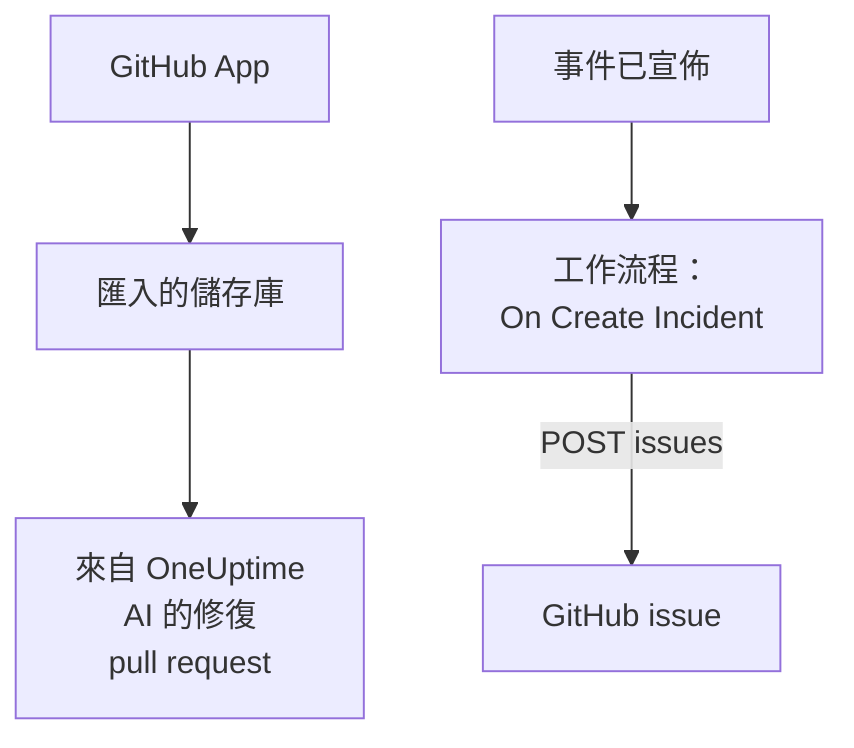

# GitHub

OneUptime 以兩種方式與 [GitHub](https://github.com) 配合使用。透過 OneUptime GitHub App 連接你的儲存庫後，OneUptime AI 會開啟修復它所發現問題的 pull request，並在你於 issue 或 pull request 中提及它時作出回應。或者，建置一個為每個事件開啟 GitHub issue 的工作流程，讓後續工作在擁有該服務的儲存庫中得到追蹤。

:::cards
- [選擇連線方式](#選擇連線方式): GitHub App 或工作流程，以及各自的作用。
- [連接你的儲存庫](#連接你的儲存庫): 用於修復 pull request 的 GitHub App。
- [為每個事件開啟 issue](#為每個事件開啟-github-issue): 一個工作流程，兩個區塊。
- [疑難排解](#疑難排解): 當 GitHub 拒絕請求時。
:::

## 運作方式



兩者相互獨立，你可以使用其中一種，也可以兩種都用。GitHub App 在你安裝它的儲存庫中工作。工作流程只需要一個權杖，並像呼叫其他任何 API 一樣呼叫 GitHub 的 [REST API](https://docs.github.com/en/rest/issues/issues#create-an-issue)。

## 選擇連線方式

| 方式 | 作用 | 需要什麼 |
| --- | --- | --- |
| GitHub App | 匯入你的儲存庫。OneUptime AI 會在其中開啟修復異常、慢追蹤以及其調查所發現原因的 pull request，並回應 issue 和 pull request 中的提及。 | 一個用於安裝該應用程式的組織或帳戶。在 OneUptime Cloud 上需要 **Growth** 方案。 |
| 工作流程 | 為每個事件在你選擇的儲存庫中開啟一個 GitHub issue。 | 一個能建立 issue 的 GitHub 權杖，以及一個由兩個區塊組成的工作流程。 |

## 連接你的儲存庫

開啟 **產品 → 程式碼**，點選 **連接 GitHub**。GitHub 會詢問要把應用程式安裝到哪裡，以及它可以使用哪些儲存庫。安裝中的每個儲存庫都會被匯入，並在你向安裝中新增或移除儲存庫時保持同步。

如果應用程式已安裝在該帳戶上（為另一個專案安裝，或直接從 GitHub 安裝），請點選 **連接 GitHub** 下方的 **連接現有安裝**，而不是再次安裝。這需要一個管理該安裝的 GitHub 帳戶：個人帳戶的擁有者，或對該安裝可存取的每個儲存庫都有 admin 權限的人，組織的擁有者就有這種權限。

自行託管執行個體首先需要它自己的 GitHub App：[GitHub 整合](/docs/self-hosted/github-integration) 介紹了如何建立它。之後，AI 會從 [程式碼](/docs/ai/ai-agent) 在你的儲存庫中開啟 pull request，[GitHub App](/docs/ai/github-app) 頁面則介紹了在 issue 或 pull request 中提及該應用程式時它會做什麼。

## 開始之前

本頁其餘部分將建置工作流程。它需要：

- 一個能在儲存庫中建立 issue 的 GitHub 權杖：用於該儲存庫、且 **Issues** 權限設為 **Read and write** 的 fine-grained personal access token，或者帶有 `repo` 範圍的經典權杖。在 GitHub 的[權杖設定](https://github.com/settings/tokens)中建立一個。
- 在 OneUptime 中建立工作流程和全域變數的權限。在 OneUptime Cloud 上，工作流程需要 **Growth** 或更高的方案。

## 儲存權杖

:::steps
1. 前往 **工作流程 → 全域變數**，點選 **建立工作流程 變數**。
2. 將其命名為 `GITHUB_TOKEN`，然後點選 **下一步**。
3. 把權杖貼上到 **內容** 中，開啟 **密鑰**，然後點選 **建立工作流程 變數**。
:::

機密變數在執行日誌中會被替換為 `[REDACTED]`，所以權杖永遠不會出現在執行中。

## 為每個事件開啟 GitHub issue

:::steps
### 建立工作流程

前往 **工作流程**，點選 **建立工作流程**，然後點選 **從零開始**。將其命名為 `Incidents to GitHub`，然後點選 **建立工作流程**。

### 新增觸發器

點選虛線的 **選擇啟動此工作流程的方式** 區塊，然後選擇 **On Create Incident**。點選觸發器：它的 **Fields to pass on** 已經包含 **標題**，所以點選 **新增欄位** 並選擇 **描述** 和 **Incident Number With Prefix**。

### 開啟 issue

點選 **新增元件**，新增一個 **API Post (JSON)** 區塊，然後把觸發器的 **Success** 點連接到它。把它的 **URL** 設為 `https://api.github.com/repos/your-org/your-repo/issues`，並換成你的儲存庫的擁有者和名稱。在 **更多欄位** 下，把它的 **Request Headers** 設為：

```json
{
  "Authorization": "Bearer {{global.variables.GITHUB_TOKEN}}",
  "Accept": "application/vnd.github+json",
  "X-GitHub-Api-Version": "2022-11-28"
}
```

把 **Request Body** 設為：

```json
{
  "title": "{{local.components.incident-on-create-1.returnValues.model.title}}",
  "body": "{{local.components.incident-on-create-1.returnValues.model.description}}\n\nOpened by OneUptime for incident {{local.components.incident-on-create-1.returnValues.model.incidentNumberWithPrefix}}.",
  "labels": ["incident"]
}
```

### 測試，然後啟用

點選 **執行工作流程**，在 **事件** 中選擇一個測試事件，然後執行它。**API Post (JSON)** 步驟會顯示一個包含新 issue 的 `201` 回應，其中帶有它的 `number` 和 `html_url`。然後在 **建構器** 頂部開啟 **已啟用**。
:::

事件解決後 issue 仍保持開啟，因為後續工作通常比事件持續得更久。如需與事件雙向保持同步的工單，請參閱 [Jira](/docs/integrations/jira)。

## 提示

- **GitHub Enterprise Server。** 改為把請求傳送到你的伺服器：`https://your-github-host/api/v3/repos/your-org/your-repo/issues`。位於私有網路位址上的伺服器需要一個由管理員允許這樣做的自行託管 OneUptime：請參閱 [對外網路存取](/docs/workflows/configuration#對外網路存取)。
- **指派它。** 在正文中新增 `"assignees": ["octocat"]` 或 `"milestone": 3`。當權杖無法推送到儲存庫時，GitHub 會悄無聲息地丟棄標籤、指派人和里程碑。
- **只針對部分事件。** 在觸發器和 API 區塊之間放一個 **If / Else** 區塊，只在它的 **Yes** 一側開啟 issue，例如只針對某一種嚴重程度。

## 疑難排解

當 GitHub 拒絕請求時，**API Post (JSON)** 步驟會走 **Error**。執行中的 **Response Status** 和 **Response Body** 會說明原因。

:::details GitHub 傳回 401
權杖錯誤、已過期或已被吊銷。請建立一個新權杖，並替換 `GITHUB_TOKEN` 的內容。
:::

:::details GitHub 傳回 403
權杖無法在那裡建立 issue：一個在此儲存庫上沒有把 **Issues** 設為 **Read and write** 的 fine-grained 權杖，一個你的組織尚未批准的權杖，或者一個未獲授權用於你的組織單點登入的經典權杖。正文提到速率限制的 403 表示該權杖傳送了太多請求：請等待，或者為更少的事件開啟 issue。
:::

:::details GitHub 傳回 404
**URL** 中的擁有者或儲存庫錯誤，或者權杖看不到該儲存庫。對於權杖看不到的私有儲存庫，GitHub 傳回的是 404，而不是 403。
:::

:::details GitHub 傳回 410 或 422
- `410`：儲存庫的設定中關閉了 issues。
- `422`：GitHub 無法讀取正文。請檢查它是否為有效的 JSON，`title` 是否已設定，以及 `labels` 和 `assignees` 是否為清單。
:::

## 後續步驟

:::cards
- [GitHub App](/docs/ai/github-app): 直接在 GitHub 中請 OneUptime AI 進行更改、修訂或審查。
- [GitLab](/docs/integrations/gitlab): 同樣的工作流程，用於 GitLab issue。
- [工作流程元件](/docs/workflows/components#api): API 區塊的所有設定。
- [整合總覽](/docs/integrations/index): 每個整合背後的模式。
:::
