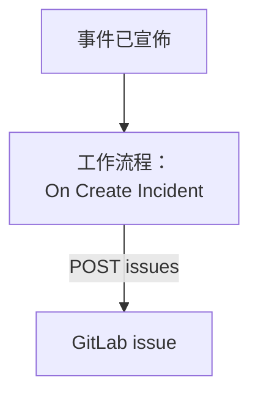

# GitLab

為每個 OneUptime 事件開啟一個 [GitLab](https://gitlab.com) issue，讓後續工作在擁有該服務的專案中得到追蹤。一個工作流程會在 GitLab.com 或你自己的 GitLab 上呼叫 GitLab 的 [Issues API](https://docs.gitlab.com/api/issues/#new-issue)。

:::cards
- [儲存權杖](#儲存權杖): 讓 GitLab 的權杖不出現在你的工作流程中。
- [為每個事件開啟 issue](#為每個事件開啟-gitlab-issue): 一個工作流程，兩個區塊。
- [提示](#提示): 你自己的 GitLab、專案路徑和指派人。
- [疑難排解](#疑難排解): 當 GitLab 拒絕請求時。
:::

> [!NOTE]
> OneUptime AI 也能在 GitLab 儲存庫中工作：用存取權杖在「程式碼」中連接它們，它會為每個修復開啟合併請求。請參閱 [連接儲存庫](/docs/ai/ai-agent#連接儲存庫)。

## 運作方式



每個新事件都會讓工作流程執行一次。它的 **API Post (JSON)** 區塊會把事件的標題和描述傳送到專案的 issues，並使用存取權杖簽名。

## 開始之前

- GitLab 專案的 ID。在專案的概覽頁面上，選擇操作選單（豎向省略號），然後選擇 **Copy project ID**。
- 一個帶有 `api` 範圍的 GitLab 存取權杖，屬於在專案中擁有可建立 issue 角色的使用者或機器人：專案、群組或個人存取權杖均可。在專案、群組或你的使用者設定中的 **Settings → Access tokens** 下建立它。
- 在 OneUptime 中建立工作流程和全域變數的權限。在 OneUptime Cloud 上，工作流程需要 **Growth** 或更高的方案。

## 儲存權杖

:::steps
1. 前往 **工作流程 → 全域變數**，點選 **建立工作流程 變數**。
2. 將其命名為 `GITLAB_TOKEN`，然後點選 **下一步**。
3. 把權杖貼上到 **內容** 中，開啟 **密鑰**，然後點選 **建立工作流程 變數**。
:::

機密變數在執行日誌中會被替換為 `[REDACTED]`，所以權杖永遠不會出現在執行中。

## 為每個事件開啟 GitLab issue

:::steps
### 建立工作流程

前往 **工作流程**，點選 **建立工作流程**，然後點選 **從零開始**。將其命名為 `Incidents to GitLab`，然後點選 **建立工作流程**。

### 新增觸發器

點選虛線的 **Choose what starts this workflow** 區塊，然後選擇 **On Create Incident**。點選觸發器：它的 **Fields to pass on** 已經包含 **標題**，所以點選 **新增欄位** 並選擇 **描述** 和 **Incident Number With Prefix**。

### 開啟 issue

點選 **新增元件**，新增一個 **API Post (JSON)** 區塊，然後把觸發器的 **Success** 點連接到它。把它的 **URL** 設為 `https://gitlab.com/api/v4/projects/12345678/issues`，並用你的專案 ID 替換 `12345678`。在 **更多欄位** 下，把它的 **Request Headers** 設為：

```json
{
  "PRIVATE-TOKEN": "{{global.variables.GITLAB_TOKEN}}"
}
```

把 **Request Body** 設為：

```json
{
  "title": "{{local.components.incident-on-create-1.returnValues.model.title}}",
  "description": "{{local.components.incident-on-create-1.returnValues.model.description}}\n\nOpened by OneUptime for incident {{local.components.incident-on-create-1.returnValues.model.incidentNumberWithPrefix}}.",
  "labels": "incident,oneuptime"
}
```

### 測試，然後啟用

點選 **執行工作流程**，在 **事件** 中選擇一個測試事件，然後執行它。**API Post (JSON)** 步驟會顯示一個包含新 issue 的 `201` 回應，其中帶有它的 `iid` 和 `web_url`。然後在 **建構器** 頂部開啟 **已啟用**。
:::

該區塊傳送的是 JSON，所以不需要 `Content-Type` 標頭。GitLab 會建立它沒見過的標籤，所以 `incident` 和 `oneuptime` 無需事先設定。事件解決後 issue 仍保持開啟，因為後續工作通常比事件持續得更久。

## 提示

- **你自己的 GitLab。** 改為把請求傳送到你的伺服器：`https://gitlab.example.com/api/v4/projects/12345678/issues`。位於私有網路位址上的伺服器需要一個由管理員允許這樣做的自行託管 OneUptime：請參閱 [對外網路存取](/docs/workflows/configuration#對外網路存取)。
- **用專案路徑代替 ID。** 路徑可以代替 ID 使用，其中的 `/` 寫作 `%2F`：`projects/your-group%2Fyour-project/issues`。URL 會完全按寫法傳送，所以請自己進行編碼。
- **指派它。** 在正文中新增 `"assignee_ids": [42]` 或 `"due_date": "2026-12-31"`，或者新增 `"confidential": true`，只讓專案成員看到它。
- **只針對部分事件。** 在觸發器和 API 區塊之間放一個 **If / Else** 區塊，只在它的 **Yes** 一側開啟 issue，例如只針對某一種嚴重程度。

## 疑難排解

當 GitLab 拒絕請求時，**API Post (JSON)** 步驟會走 **Error**。執行中的 **Response Status** 和 **Response Body** 會說明原因。

:::details GitLab 傳回 401
權杖錯誤、已過期或已被吊銷。請建立一個新權杖，並替換 `GITLAB_TOKEN` 的內容。
:::

:::details GitLab 傳回 403
權杖沒有 `api` 範圍，或者它的使用者在專案中的角色無法建立 issue。如果是範圍的問題，正文中會提到 `insufficient_scope`。
:::

:::details GitLab 傳回 404
**URL** 中的專案 ID 錯誤，或者權杖看不到該專案。對於權杖看不到的私有專案，GitLab 傳回的是 404，而不是 403。
:::

:::details GitLab 傳回 400
GitLab 無法讀取正文：缺少 `title`，或者某個欄位的類型錯誤。正文會指出該欄位。
:::

## 後續步驟

:::cards
- [GitHub](/docs/integrations/github): 用於 GitHub 的同樣工作流程，以及 GitHub App。
- [工作流程元件](/docs/workflows/components#api): API 區塊的所有設定。
- [工作流程執行記錄](/docs/workflows/runs-and-logs): 檢視每個請求傳送了什麼、收到了什麼。
- [整合總覽](/docs/integrations/index): 每個整合背後的模式。
:::
