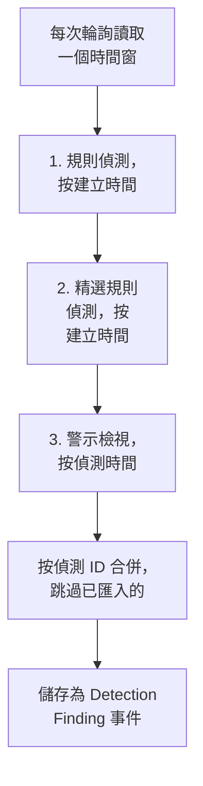

# Google SecOps

把 [Google SecOps](https://cloud.google.com/security/products/security-operations)（原 Chronicle）的警示和偵測匯入 OneUptime 的安全性事件。在那裡，你可以把它們與日誌、追蹤和指標放在一起搜尋，與其他所有來源進行關聯分析，並為重要的內容呼叫待命人員。

:::cards
- [選擇連線方式](#選擇連線方式): SOAR playbook Webhook、託管連接器，或 UDM 轉發。
- [設定託管連接器](#設定託管連接器): 一個服務帳號金鑰，以及連線的表單。
- [連接器如何輪詢](#連接器如何輪詢): 每個時間窗的三種讀取方式，以及它們的預算。
- [疑難排解](#疑難排解): Last Error 說了什麼，以及該怎麼做。
- [將安全性事件傳送到 Google SecOps](#將安全性事件傳送到-google-secops): 在 Google SecOps 中查看 OneUptime 的偵測結果。
:::

## 選擇連線方式

| 方式 | 到達的內容 | 適用情況 |
| --- | --- | --- |
| SOAR playbook Webhook | playbook 發布的每個警示，幾秒內到達 | 你在執行 SOAR playbook，並希望不經輪詢就在 OneUptime 中收到它們的警示。 |
| 託管連接器 | 警示，以及你選擇的規則偵測，按間隔輪詢 | 你希望 OneUptime 替你取得它們，而無需在 SecOps 中設定任何東西。 |
| UDM 事件轉發 | 原始 UDM 事件，用於完整的搜尋和關聯分析 | 你已經在匯出 UDM 事件，並希望收到其中的每一個。 |

每種方式都會把到達的內容正規化為 [OCSF](https://schema.ocsf.io/)，即 OneUptime 用來儲存每個安全性事件的 Open Cybersecurity Schema Framework，所以無論來源是什麼，偵測規則和儀表板的運作方式都相同。

## 開始之前

- 對於託管連接器，在 OneUptime 中擁有 Project Owner、Project Admin 或 Security Admin 角色。Security Member 和 Security Viewer 可以讀取連線，但不能建立它們。
- 對於 Webhook 和 UDM 轉發，需要一個擷取金鑰：開啟 **專案設定 → 遙測與 APM → 擷取金鑰**，然後點選 **建立擷取金鑰**。
- 對於託管連接器，需要在你的 SecOps 執行個體所繫結的專案上建立 Google Cloud 服務帳號的權限。

## 從 SOAR playbook 傳送警示

Google SecOps SOAR playbook 可以把警示發布到任何 HTTP 端點。讓其中一個 playbook 指向 OneUptime 的安全性事件擷取端點。

:::steps
### 新增 HTTP 請求操作

在你的 SecOps SOAR playbook 中，新增一個在新警示上執行的 **HTTP request** 操作。

### 讓它指向 OneUptime

把它的 **Method** 設為 `POST`，**URL** 設為 `https://oneuptime.com/security-events/v1/ingest`，自行託管安裝則設為 `https://<your-host>/security-events/v1/ingest`。新增以下標頭：

```text
Content-Type: application/json
x-oneuptime-token: <your telemetry ingestion key>
```

把警示的 JSON 作為 **Body** 傳送。偵測（即在 `collectionElements` 下帶有符合 UDM 事件的規則詳情）會被自動識別，儲存為 Detection Finding 事件，其符合事件中的使用者、主機和 IP 會作為 observable 保留。

### 檢查警示是否到達

執行該 playbook。它的警示會在幾秒內出現在 **產品 → Security Events** 中。
:::

## 轉發 UDM 事件

要獲得完整的搜尋和關聯分析，請轉發 UDM 事件本身，例如從 BigQuery 匯出管道、Cloud Function，或你已經在執行的任何轉發器傳送：

```bash
curl -X POST "https://oneuptime.com/security-events/v1/ingest?format=udm" \
  -H "Content-Type: application/json" \
  -H "x-oneuptime-token: <your telemetry ingestion key>" \
  -d '{
    "events": [
      {
        "metadata": {
          "event_type": "USER_LOGIN",
          "event_timestamp": "2026-08-21T10:00:00Z",
          "vendor_name": "Google",
          "product_name": "Google SecOps"
        },
        "principal": { "user": { "userid": "alice" }, "ip": ["203.0.113.7"] },
        "target": { "hostname": "vpn-gw-01" },
        "security_result": [{ "severity": "HIGH", "action": ["BLOCK"] }]
      }
    ]
  }'
```

- `format` 可以是 `udm`、`ocsf`、`google-secops-alert` 或 `generic`。省略它時，會逐個事件偵測格式。
- 內文可以是一個事件、一個事件清單，或 `{ "events": [...] }`。
- `x-oneuptime-service-name` 指定事件所屬的遙測服務。沒有它時，事件屬於以酬載中的產品命名的服務。

## 設定託管連接器

OneUptime 按間隔輪詢你租用戶的偵測和警示，無需任何 SOAR 設定。Google SecOps 是 Security Event Connections 的一個提供者，所以它的建立、測試、輪詢和診斷，都與其他所有託管連接器在同一個頁面上、以同樣的方式進行。

:::steps
### 建立服務帳號金鑰

在 Google Cloud 中，在你的 SecOps 執行個體所繫結的專案上建立一個服務帳號，並授予它 **Chronicle API Viewer** 角色（`roles/chronicle.viewer`）。該角色包含連接器讀取時使用的 `legacySearchDetections`、`legacySearchCuratedDetections`、`countAllCuratedRuleSetDetections` 和 `legacyFetchAlertsView` 權限。

在服務帳號的 **Keys** 索引標籤上，新增一個 **JSON** 類型的金鑰並下載。你會把整個檔案貼上到連線中。它的 `token_uri` 必須是 Google 主機上的 `https` URL，從 Google Cloud 下載的金鑰本來就是這樣。

### 找到地區和執行個體資源名稱

在 Google SecOps 中，開啟 **SIEM Settings → Profile**。執行個體資源名稱的形式為 `projects/{project}/locations/{location}/instances/{instance}`，其中 instance 部分是 SecOps 執行個體 ID；連線的顯示名稱或服務帳號名稱不能替代它。地區是服務於該位置的地區端點，它必須與執行個體資源名稱中的 locations 段符合，否則儲存時連線會被拒絕。

### 新增連線

開啟 **產品 → Security Events → 連線**（`/dashboard/{projectId}/security-events/connections`），選擇 **新增連線**，選擇 **Google SecOps**，並用下表中的設定填寫表單。

### 儲存之前先測試

儲存之前，選擇 **儲存前測試** 下的 **測試這些設定**。測試使用表單上的值執行，不儲存任何內容，因此格式錯誤的金鑰、缺失的角色或錯誤的執行個體會在連線存在之前被發現。在編輯表單上，同一個按鈕會用儲存的金鑰測試螢幕上顯示的 **地區**、**執行個體資源名稱** 和 **Data to import**；認證資訊欄位留空時會保留儲存的金鑰。當測試的任何內容與連線已儲存的內容不同時（包括新輸入的金鑰），不會記錄執行歷史記錄，因為連線還沒有這些設定。
:::

| 設定 | 在哪裡找到 | 必填 |
| --- | --- | --- |
| **地區** | 與執行個體資源名稱中的位置相符合的 Google SecOps 地區端點（`us`、`europe`、`asia-southeast1`……）。它沒有預設值，所以美國以外的租用戶不會意外儲存錯誤的端點。 | 是 |
| **執行個體資源名稱** | Google SecOps **SIEM Settings → Profile**：`projects/{project}/locations/{location}/instances/{instance}`。 | 是 |
| **案例關閉時關閉其警示** | 在表單的最後一步，在你開啟之前一直關閉。開啟後，關閉案件會關閉它的 Google SecOps 警示：請參閱 [案例關閉時關閉其警示](#案例關閉時關閉其警示)。 | 否 |
| **服務帳戶 JSON** | Google Cloud 中服務帳號的 **Keys** 索引標籤。貼上整個 JSON 金鑰檔案。只寫：靜態加密儲存，API 從不傳回，頁面上也從不回顯。在連線上使用 **更新憑證** 來輪換它。 | 是 |
| **Data to import** | **警示** 總會被匯入，因為 Google 的警示 API 總會傳回它們。選擇 **偵測** 可以同時匯入沒有生成警示的規則符合。這不會轉發原始 UDM 事件：請按上文自行轉發。 | 警示總是匯入 |

表單的輪詢步驟會詢問 **名稱**、選用的 **描述**、連線是否 **已啟用**，以及 **輪詢間隔（分鐘）**：`1` 到 `1440` 之間的整數，預設為 `5`。超出該範圍的值會在儲存時被拒絕。

新的偵測會作為 Detection Finding 事件匯入，歸屬於 `Google SecOps` 遙測服務。

## 檢視連線健康狀況

連線清單顯示 **名稱**、**提供者**（下方顯示連線的 Data to import 選擇）、**狀態**（已啟用或已停用）、**健康狀況**、**間隔（分鐘）**、**最近輪詢**、**最近一次成功輪詢** 和 **最近匯入的事件**。連線出錯時，它的 **操作** 欄中會出現 **檢視錯誤**，位於 **測試連線**、**立即執行**、**診斷**、**編輯** 和 **更新憑證** 旁邊。已啟用表示已設定自動輪詢。Last Polled 記錄的是一次嘗試；一個成功的空時間窗並不能說明某個特定的偵測已被匯入。

**健康狀況** 只有在匯入過事件之後才會顯示 **Last poll succeeded**。在此之前，一個成功輪詢的連線會顯示 **Polling, no events imported yet**，這正是需要用測試連線來排查的狀態。其他狀態有 **No records returned**、**Partial import**、**Catching up**、**Last poll failed**、**Poll overdue**、**Schedule paused** 和 **等待首次輪詢**；把滑鼠懸停在某個狀態上即可檢視它的含義。

> [!NOTE]
> 連接器使用 Chronicle 的 `v1alpha` 舊版偵測和警示 API，Google 將其作為正式發布前（pre-GA）的版本提供。輪詢失敗時，連線的 **最近的錯誤** 欄位會儲存完整的錯誤訊息（認證資訊已隱去），前面帶有一個指明失敗步驟的字首，包括 Chronicle 傳回 `200` 卻在內文中給出拒絕的情況。在連線的 **操作** 欄中選擇 **檢視錯誤** 來閱讀訊息，然後在對話方塊中用 **複製錯誤** 複製它以提供給支援人員。

## 連接器如何輪詢



背景工作程序每分鐘為自上次輪詢以來已過間隔的每個已啟用連線排入一次輪詢。每次輪詢都是連線歷史中的一次執行，由工作程序執行。它以三種方式讀取同一個時間窗，並按偵測 ID 合併結果，所以被多個讀取過程傳回的記錄只儲存一次：

1. **按建立時間讀取規則偵測。** 使用 `ruleId=-`（每條規則的每個修訂版本）和 `listBasis=CREATED_TIME` 呼叫 `legacy:legacySearchDetections`，並跟隨 `nextPageToken`，直到最後一頁。
2. **按建立時間讀取精選規則偵測。** 以同樣的方式呼叫 `legacy:legacySearchCuratedDetections`，每條精選（由 Google 編寫的）規則呼叫一次。該端點只接受一個精選規則 ID（`ur_...`），沒有「每條規則」的萬用字元，所以這個讀取過程會先針對從時間窗之前一週到時間窗結束的時間呼叫 `:countAllCuratedRuleSetDetections`，再逐一搜尋產生了偵測的每條精選規則。在那一週內沒有觸發過的精選規則沒有可匯入的內容。沒有精選規則存取權限的租用戶會以 `400`、`403` 或 `404` 回應這個讀取過程；這會被記錄為執行的警告，而不是失敗。
3. **按偵測時間讀取警示檢視。** 呼叫 `legacy:legacyFetchAlertsView`，它除了規則警示之外，還涵蓋遙測警示、SOAR 警示和機器智慧警示。該端點不支援分頁，所以被 Google 限制的回應會被拆分成更小的時間窗重新讀取。

警示檢視只能按偵測時間篩選，而 Google 常常在偵測時間之後很久才讓警示可被讀取（擷取延遲、排程規則、對遲到資料的重新執行）。因此，排程的輪詢還會 **在其時間窗之前的 24 小時內再掃描一遍警示檢視**，只讀取警示，並記錄為 **Read late alerts by detection time** 檢查。已匯入的記錄會被跳過，所以掃描中重複的記錄會出現在 **Already imported** 下。掃描是盡力而為的：當 Google 限制它、它的預算用完或它失敗時，執行會得到一條警告，但輪詢不會變為 Partial 或 Failed，游標仍會前進，因為它回溯的那一天早已被之前的輪詢讀過。

按 **建立時間** 輪詢是整個設計的核心。Google SecOps 規則按排程執行（每 10 分鐘、每小時、每天），它建立的偵測帶有 `detectionTime`，即規則時間窗的結束時間或符合事件的時間，而 `createdTime` 是偵測引擎實際生成它的時間。一個在 10:05 為截至 09:00 的時間窗建立的偵測，其偵測時間早已落在一個幾次輪詢之前就越過了 09:00 的游標之後，所以按偵測時間輪詢的連接器永遠看不到它，任何遲到的事件也是如此。按建立時間讀取，讓每次輪詢問的是「自我上次檢視以來，Google 建立了什麼」，這才是有答案的問題。每次執行都會記錄它的建立延遲，即取得的記錄中有多少是在其偵測時間之後超過一個輪詢間隔（再加一分鐘）才建立的，以及最大的時間差，所以這種影響在 Diagnostics 中清晰可見。

新連線的第一次輪詢按建立時間回溯 **24 小時**。此後的每次輪詢都從連線儲存的游標處恢復，並有 **1 分鐘** 的重疊；在時間窗邊界上建立的記錄會被兩次輪詢都讀到，但只儲存一次，因為輪詢會跳過已用相同來源識別碼儲存的事件。每次排程的輪詢最多讀取游標之後 **24 小時**，所以儲存的游標較舊的連線會透過連續的 24 小時時間窗追趕（Health 顯示 **Catching up**），而不會丟棄中間的偵測。對於第一個 24 小時時間窗之前建立的記錄，請使用 Diagnostics 中的 **Import this time range**。

### 當一個時間窗包含的內容超過一次輪詢能讀取的量時

連接器為每次輪詢設定固定的預算：規則偵測讀取過程有 **20** 個搜尋頁，精選讀取過程最多 **200** 個請求（計數請求，加上過去一週內觸發過的每條精選規則至少一頁，最繁忙的規則優先），警示檢視及其遲到警示掃描共用 **16** 個請求，整個讀取在 **4 分鐘** 後停止。當這段時間用掉 60% 後，精選讀取過程不再開始新的精選規則，以便警示檢視仍能執行。當一次輪詢無法搜尋每條活躍的精選規則時，它會記錄一條警告，說明有多少條沒有被搜尋，而不是停住游標，因為即使時間窗更短，這些規則也仍然都需要搜尋。被預算中途停下的讀取過程會被記錄為一個指明該預算的警告檢查（例如 `Read rule detections by created time was stopped by the request budget after 20 requests.`），而預算根本沒讓它開始的讀取過程會成為一個被跳過的檢查，相同的原因寫在執行的警告中，絕不會記為成功。偵測數量超過這些預算的時間窗無法在一次輪詢中讀完，而輪詢也絕不會永遠重複讀取同一個時間窗：

1. **縮小。** Google 的搜尋端點先傳回最新的偵測，所以提前停下的輪詢沒有可以恢復的位置。這次輪詢會被記錄為 **部分**，游標停在原處，下一次輪詢從同一個起點讀取長度減半的時間窗，並帶有警告 `This window holds more records than one poll can read; the next poll reads a {n} minute window from the same starting point.` 時間窗會不斷減半，最短到一分鐘，直到能夠容納。
2. **恢復。** 每次完整的輪詢都會讓下一個時間窗加倍，最長為 24 小時，所以一次突發只會帶來幾次短輪詢，而不會讓連線永久變慢。
3. **越過單獨的一分鐘。** 如果連一分鐘內的偵測都超過一次輪詢能讀取的量，輪詢會把游標移過這一分鐘，讓更新的偵測繼續到達。這次執行為 **部分**，並且 **最近的錯誤** 以同樣的文字開頭：`More records were created in the one minute from {start} to {end} than one poll can read. Polling moved past this minute so newer records keep arriving; use Import this time range in Diagnostics on this minute to recover what one run can read.` 要找回一次執行能讀取的內容，請開啟 **診斷**，選擇一個涵蓋那一分鐘的自訂範圍（範圍輸入使用你的本地時間；訊息使用 UTC），然後執行 **Import this time range**；一次匯入的單次執行上限與一次輪詢相同。已匯入的偵測會被跳過。

Partial 輪詢還會把它的警告儲存在 **最近的錯誤** 中，直到一次完整的輪詢將其清除。徹底失敗的輪詢（因為錯誤，而不是記錄太多）會保留游標和時間窗長度，並在下一個週期重試。唯一的例外是請求逾時：下一次輪詢會從同一個起點讀取長度減半的時間窗（`The source did not answer in time for this window; the next poll reads a {n} minute window from the same starting point.`），否則太重而無法及時回應的時間窗每次重試都會逾時。縮短輪詢間隔不會改變以上任何一點：時間窗由游標和上一次輪詢的結果決定，而不是由輪詢執行的頻率決定。

## 測試連線

**測試連線**（在連線所在列或 **診斷** 中）在 API 程序中同步執行。它不需要背景工作程序，這正是它能告訴你沒有工作程序在執行的原因。檢查清單：

1. **設定**：每個欄位都存在且格式正確：與執行個體位置相符合的受支援 **地區**、形式正確的 **執行個體資源名稱**，以及包含 `client_email`、可讀的 `private_key` 和 Google `token_uri` 的 **服務帳戶 JSON** 金鑰。此項失敗時不會連線到任何地方。
2. **Authenticate with Google**：在聯絡 Chronicle 之前，先在 Google 的 OAuth 端點用金鑰換取存取權杖。
3. **Read rule detections**、**Read curated rule detections** 和 **Read the alerts view**：對每個讀取過程在過去 24 小時內做一次只取一條記錄的探測。精選檢查會讀取過去 7 天的精選規則計數，並探測偵測最多的那條精選規則；如果那一週內沒有精選規則觸發過，它就無需探測而直接通過。以 `400`、`403` 或 `404` 回應的精選讀取是警告，因為租用戶可能只是沒有精選規則的存取權限。
4. **Detections available to import**：在過去 24 小時和過去 7 天內，Google 在已儲存的 **Data to import** 選擇下以及另一種選擇下（僅警示，或警示和 **偵測**）各有多少內容：每個範圍讀取警示檢視的符合計數和一頁按建立時間的搜尋結果，報告為一個數字或 `1000+`。當已儲存的選擇下什麼都沒有、而另一種選擇下有內容時，檢查會發出警告：你的規則會建立偵測，但沒有為它們啟用警示。請編輯連線，在 **Data to import** 下選擇 **偵測**，或在 Google SecOps 中為這些規則啟用警示。
5. **Background workers**、**Poll scheduler** 和 **Security event storage**：是否有程序在消費 OneUptime 的 Worker 佇列，每分鐘一次的輪詢作業是否已註冊，以及安全性事件儲存是否能回應輪詢在每次插入之前執行的同一個去除重複查詢，這樣損壞的分析資料庫會在這裡帶著名稱失敗，而不是一小時後作為輪詢錯誤出現。
6. **Scheduled polling**（僅限已儲存的連線）：輪詢是否已啟用，排入佇列的執行是否卡在等待工作程序的狀態，以及連線是否按排程被輪詢。

測試中的每個請求都有 20 秒的期限。測試不會觸碰輪詢游標和事件儲存。用已儲存的設定測試已儲存的連線時，會得到一條類型為 test 的執行歷史記錄，該記錄的詳細資訊會顯示同樣的檢查清單。

## 按需預覽、執行和匯入

在連線上開啟 **診斷**，可以檢視最近的執行並操作連接器。Project Owner、Project Admin 和 Security Admin 可以啟動操作。Security Member 和 Security Viewer 可以閱讀歷史記錄。

- **立即執行** 會立即排入一次輪詢，使用正常的游標和擷取路徑，即使排程輪詢已被停用也可以。工作程序執行請求期間，排入佇列中和執行中的狀態會一直可見。如果某次執行一直處於排入佇列狀態，請檢查工作程序是否在處理 Worker 佇列；測試連線中的 **Background workers** 檢查會告訴你是否有程序在處理。
- **Preview detections** 讀取選定的時間範圍，不匯入也不改變游標。可以使用過去 1 小時、24 小時、7 天，或最長 7 天的自訂範圍。該範圍與按偵測時間讀取的 SecOps 警示檢視一致，而兩個搜尋讀取過程既讀取在該範圍內建立的偵測，也讀取偵測時間落在該範圍內的偵測，所以預覽昨天時，也會顯示昨天建立的、關於更早事件的偵測。預覽會分別顯示偵測時間和建立時間。結果反映連線已儲存的 **Data to import** 選擇。
- **Import this time range** 在你確認後匯入選定的範圍，不會移動輪詢游標。如上文所述，這也是找回輪詢越過的那一分鐘的方法。請先預覽該範圍。重複的輪詢和匯入會跳過專案中已用相同來源識別碼儲存的事件。匯入可能會像排程輪詢一樣觸發已設定的偵測規則和監測器。

每次執行的詳細資訊會顯示 **Requested window (UTC)**、連線的 **Data to import** 選擇，以及五個計數：

| 計數 | 統計的內容 |
| --- | --- |
| **Returned by Google SecOps** | Google 在三個讀取過程中傳回的記錄，按 ID 合併之後的數量。 |
| **Imported into OneUptime** | 寫入事件儲存的資料列。 |
| **Already imported** | 因為相同的來源識別碼已儲存在這個專案中而被跳過的記錄；1 分鐘的重疊和重新執行使這種情況很正常。 |
| **已拒絕** | 傳回的不是 Google SecOps 偵測的物件。它們會被計數並發出警告，但從不重試，也不會停住游標。 |
| **失敗** | 無法正規化的記錄。輪詢會在更短的時間窗中重試它們。 |

**Provider details** 會補充 **Time basis read**、**Returned by each pass** 的記錄數（規則偵測、精選規則偵測和警示檢視）以及 **Creation lag**。之後依次是檢查（每個讀取過程一個）、警告和偵測樣本。排程輪詢的詳細資訊還會顯示 **Window read by this poll** 和 **Next scheduled poll reads** 的內容，而 Partial 輪詢會說明它是保留了起點並縮小了下一個時間窗，還是越過了它所指明的單獨一分鐘。**成功**、**No records returned**、**部分** 和 **失敗** 是不同的結果。

在某次執行上使用 **View events in this time range**，可以開啟它所傳回偵測的事件時間範圍。否則，一個今天建立、但偵測時間是昨天的偵測，可能會被「最近事件」篩選器隱藏。在之後的完整輪詢清除 Last Error 之後，執行歷史仍會保留失敗記錄。聯絡支援人員時請使用 **Copy diagnostics**；它從不包含服務帳號認證資訊和權杖。

## 為什麼我看不到事件？

請按順序逐一檢查。在 **診斷** 或 **測試連線** 中，每一項都能與下一項區分開來。

1. **Data to import。** 預設只匯入 **警示**，而只有在 Google SecOps 中為規則啟用了警示時，規則偵測才會成為警示。如果租用戶的規則只建立偵測而不發出警示，那麼輪詢結果就會一直如實地為空。執行 **測試連線**：**Detections available to import** 檢查會分別統計包含和不包含 **偵測** 時的數量，並在選擇它會增加記錄時告訴你。請編輯連線，在 **Data to import** 下選擇 **偵測**，或為規則啟用警示。
2. **規則執行頻率和偵測延遲。** 偵測在規則執行時建立，這可能比它所描述的事件晚一個小時甚至一天。連接器按建立時間輪詢，所以它們會在 Google 建立它們之後的第一次輪詢中到達，而不是在它們的偵測時間到達。剛啟用的規則還沒有建立任何東西，而安靜的租用戶沒有什麼可建立的。可用性檢查會報告過去 24 小時和 7 天內建立了多少偵測；包含和不包含 **偵測** 時都為零，表示 Google 暫時沒有可供 OneUptime 匯入的內容。
3. **閱讀上一次執行的計數。** 在 Diagnostics 中，如果 **Returned by Google SecOps** 有數量、**Imported into OneUptime** 為零，而 **Already imported** 的計數與之相符，說明連接器正在按設計工作：這些偵測已被之前的輪詢匯入。**已拒絕** 記錄是 Google 傳回的、根本不是偵測的物件。
4. **到底有沒有在輪詢？** Last Polled 顯示 `Never` 且 Last Error 為空，表示這個連線還沒有完成過任何輪詢。測試連線會報告 **Background workers**（消費 Worker 佇列的程序）、**Poll scheduler**（每分鐘一次的排程器註冊）和 **Scheduled polling**（這個連線自己的排程，包括逾期的輪詢或卡在排入佇列狀態的執行）。導致這種情況的部署設定請參閱下面的疑難排解條目。
5. **在正確的地方尋找。** 事件按偵測時間儲存，這可能比它們被建立和匯入的時間早幾個小時甚至幾天，所以安全性事件中的「最近 1 小時」篩選器會隱藏一個一分鐘前匯入的、關於昨天的偵測。請在 Diagnostics 中的某次執行上使用 **View events in this time range**：它會開啟該執行所傳回偵測的事件時間範圍。

## 嚴重程度如何設定

Google SecOps 會根據規則的編寫者，把偵測的嚴重程度儲存在不同的地方，OneUptime 按以下順序讀取，採用第一個給出嚴重程度的來源：

1. **Google 自己的嚴重程度**（`detection[].severity`）。Google 會在精選規則上設定它，例如 Applied Threat Intelligence 和精選規則集。
2. **警示的嚴重程度**（Collection 的 `severity`），用於 SOAR 警示和 Webhook 內文。
3. **規則的 `meta` 嚴重程度。** 對於自訂 YARA-L 規則，Google 會讓 `detection[].severity` 保持為空，並把規則的 `meta` 部分作為 `ruleLabels` 傳回。OneUptime 讀取 `severity` 標籤，也就是 Google SecOps 規則儀表板上顯示的值。可識別 Info、Informational、Low、Medium、High 和 Critical，不區分大小寫。
4. **規則的 `$risk_score` 結果**，在規則沒有設定嚴重程度時使用，按 [Google 推薦的範圍](https://docs.cloud.google.com/chronicle/docs/yara-l/outcome-syntax) 分級：90–100 Critical，80–89 High，50–79 Medium，20–49 Low，1–19 Informational。OneUptime 只使用規則自己設定的分數。它會忽略 Google 為沒有分數的規則填入的 `riskScore`（警示規則為 40，其他為 15），因為這個預設值說明不了偵測有多嚴重。

以上都無法分級的偵測會顯示為 Unknown。要為自訂規則分級，請在 Google SecOps 中為它的 `meta` 部分新增嚴重程度，例如 `severity = "High"`，或在它的 `outcome` 部分設定 `$risk_score`。此後該規則建立的偵測會以該嚴重程度匯入。

## 案例關閉時關閉其警示

開啟 **案例關閉時關閉其警示** 後，關閉一個 [安全案件](/docs/telemetry/security-cases#關閉案件) 會關閉它所來自的 Google SecOps 警示。每個警示都會依案件的結論標示為已關閉：True Positive 標為惡意，False Positive 或 Benign Positive 標為非惡意，並附上案件的關閉說明和返回案件的連結。案件的時間軸會說明關閉了多少個警示。

- 服務帳戶需要 `chronicle.legacies.legacyUpdateAlert`，`roles/chronicle.editor` 角色具有此權限。`roles/chronicle.viewer` 角色可以讀取警示但無法關閉它們，此時案件上會顯示 `403`。
- Google SecOps 中已不存在的警示會被略過。無法連線到 Google SecOps 時，OneUptime 會重試大約一小時，然後在案件上寫明哪些沒能關閉。

## 在其他事件中監看它的指標

**來源** 為 **Google SecOps** 的 [威脅情資來源](/docs/telemetry/threat-intelligence#如何讀取-google-secops) 會透過此連線讀取 Google SecOps 的威脅情資在其事件中找到的指標，並在你專案的其餘事件中監看這些指標：那些 Google SecOps 從未見過的登入、網路流量和端點事件。

## 將安全性事件傳送到 Google SecOps

OneUptime 也可以把找到的內容傳送到 Google SecOps，讓您的團隊所用的 SIEM 在自身偵測結果旁邊看到 OneUptime 的偵測結果。每個安全性事件都會以 UDM 事件匯入：登入為 `USER_LOGIN`，程序啟動為 `PROCESS_LAUNCH`，網路連線為 `NETWORK_CONNECTION`，其他一切為 `GENERIC_EVENT`，並附上其嚴重性、MITRE ATT&CK 標籤，以及找到它的規則。

:::steps
### 建立可以匯入事件的金鑰

在 Google Cloud 中，於您的 SecOps 執行個體所繫結的專案裡建立服務帳戶，並授予它具有 `chronicle.events.import` 權限的角色，例如 **Chronicle API Editor** (`roles/chronicle.editor`)。在其 **Keys** 分頁上新增類型為 **JSON** 的金鑰並下載。

### 新增目標

開啟 **產品 → Security Events → 連線**。在 **傳送到你的 SIEM** 下按一下 **新增目的地**，在 **SIEM** 下選擇 Google SecOps，然後按一下 **下一步**。選擇 **地區**，像上方的連接器一樣填寫 **執行個體資源名稱**，並把金鑰貼到 **服務帳戶 JSON** 中。

### 傳送測試事件

按一下 **傳送測試事件**。一個來自產品 `OneUptime Security Events` 的 `GENERIC_EVENT` 會依表單中的設定傳送到 Google SecOps，不會儲存任何內容。它會在幾分鐘內出現在 Google SecOps 中。

### 選擇要傳送的內容

在 **傳送內容** 下保留 **僅偵測結果**，也就是您的規則和威脅情資找到的內容，以及已連線產品發出的警示，或選擇 **所有安全事件**。按一下 **開始傳送**。
:::

- 目標只傳送儲存之後到達的事件，絕不傳送專案的歷史記錄，並且每分鐘傳送一次新事件。
- OneUptime 從 Google SecOps 匯入的警示絕不會被傳送回去。
- 當 Google SecOps 沒有回應或拒絕一批事件時，目標會保留其位置，並在下一次執行時重試。其 **狀態** 會顯示 **失敗**，**檢視錯誤** 會顯示 Google SecOps 的回覆。

## 疑難排解

:::details 自訂規則的偵測顯示嚴重程度為 Unknown，而精選規則的偵測已分級
該規則沒有設定嚴重程度。在規則的 `meta` 部分新增 `severity = "Low"`、`"Medium"`、`"High"` 或 `"Critical"`，或在它的 `outcome` 部分設定 `$risk_score`（請參閱 [嚴重程度如何設定](#嚴重程度如何設定)）。此更改之前的版本也會忽略自訂規則的 `meta` 嚴重程度；升級後，會使用與每個偵測一起儲存的規則標籤，重新為那些版本匯入的偵測分級。
:::

:::details 警示出現在 Google SecOps 中，卻從未出現在 OneUptime 中
請升級到會逐條讀取精選規則偵測、並掃描警示檢視以尋找遲到警示的版本。早期版本把 `ruleId=-` 傳送給沒有萬用字元的 `legacySearchCuratedDetections`，所以 Google 對每次精選搜尋都傳回一個空的成功結果；它們還只在輪詢自己那幾分鐘的偵測時間內讀取警示檢視，所以 Google 之後才讓其可讀的警示永遠不會被看到。兩者看起來都像一個健康而安靜的連線。升級後，請使用 Diagnostics 中的 **Import this time range** 匯入過去 7 天的內容。
:::

:::details Google 傳回零條記錄
在 Diagnostics 中檢查確切的時間窗、時間基準和已儲存的 **Data to import** 選擇，並執行測試連線，讀取包含和不包含 **偵測** 時的可用計數。不發出警示的規則符合需要勾選 **偵測** 核取方塊。預覽一個同時涵蓋其偵測時間和建立時間的時間段。第一次排程輪詢按建立時間回溯 24 小時；更早的記錄請使用 **Import this time range**。
:::

:::details Health 為 Partial import
在 **診斷** 中開啟最新的執行並閱讀它的警告；Last Error 中也有同樣的警告。`This window holds more records than one poll can read; ...` 表示輪詢正在從同一個起點縮小時間窗，無需任何操作：輪詢完整完成後，時間窗會恢復。`More records were created in the one minute from ...` 表示輪詢越過了那一分鐘；請用 **Import this time range** 匯入它，以找回被跳過的偵測。如果警告說某個讀取過程被請求預算或輪詢時間預算停下或因此沒有執行，它會指明被截斷的讀取過程。縮短輪詢間隔不會改變時間窗。僅憑 Last Error 為空，並不能說明涵蓋完整。
:::

:::details Health 為 Poll overdue
排程的輪詢沒有按時執行。請檢查工作程序佇列，並執行測試連線，檢視 **Background workers** 和 **Scheduled polling** 檢查。
:::

:::details 狀態為已停用
排程輪詢會跳過該連線。獲得授權的使用者仍然可以在 Diagnostics 中測試、預覽、用 **立即執行** 執行一次輪詢，或匯入。
:::

:::details Last Polled 為 `Never` 且 Last Error 為空
這個連線還沒有完成過任何輪詢。開啟 **診斷**：如果它的執行歷史中沒有輪詢，或只有一個卡在排入佇列狀態的輪詢，說明背景工作程序根本沒有執行過輪詢作業，所以從來沒有任何請求到達 Chronicle。在自行託管部署中，常見原因是應用程式容器上設定了 `DISABLE_QUEUE_WORKERS=true`，卻沒有單獨的工作程序部署來消費佇列。要麼設定 `DISABLE_QUEUE_WORKERS=false`（Docker Compose 隨附的 `config.example.env` 預設值），要麼執行專用的工作程序部署（Helm：`worker.enabled: true`，預設為 `false`）。測試連線會把它報告為失敗的 **Background workers**、**Poll scheduler** 或 **Scheduled polling** 檢查。已經執行、但在到達連線之前就停下的輪詢，則會作為失敗的執行出現在該歷史中：`Another poll or import for this source is still running in this project` 表示這個專案中另一個 Google SecOps 輪詢或匯入持有來源鎖，連線會在下一個週期重新排入佇列。連輪詢都無法排入的排程器會在 Last Error 上寫入 `Scheduler could not queue a poll:` 及原因。
:::

:::details Last Error 有內容
有一次輪詢被嘗試且其中某個步驟失敗了，或者一次輪詢無法讀完它的整個時間窗，或者排程器無法排入輪詢。對於失敗的輪詢，該欄位會儲存完整的錯誤訊息（認證資訊已隱去）。連線出錯時，在它的 **操作** 欄中選擇 **檢視錯誤** 開啟完整訊息，然後在對話方塊中用 **複製錯誤** 複製它以提供給支援人員。該欄位會在下一次完整輪詢時清除，**檢視錯誤** 操作也會隨之消失；執行歷史會保留它。請先閱讀字首。以 `More records were created in the one minute from` 開頭的訊息表示被跳過的那一分鐘，而不是失敗；請參閱上面的 **Health 為 Partial import**。只有四個字首帶有 HTTP 狀態碼，所以沒有狀態碼的訊息並不能證明問題出在 OneUptime 一側：

- `Google token exchange failed (HTTP ...)`：服務帳號認證資訊在 Google 的 OAuth 端點被拒絕，此時還從未聯絡過 Chronicle。通常是格式錯誤、已吊銷或屬於錯誤專案的金鑰。
- `Google token exchange returned ...`：同一個 OAuth 端點作出了回應，但內容無法使用：沒有 `access_token`，或內文不是 JSON。這仍然發生在聯絡 Chronicle 之前，通常是中間的代理或閘道器造成的，而不是金鑰本身的問題。
- `Google SecOps detections search failed (HTTP ...)`：Chronicle 本身拒絕了按建立時間的搜尋（`legacySearchDetections` 或 `legacySearchCuratedDetections`）。`403` 通常表示服務帳號在執行個體所繫結的專案上缺少 **Chronicle API Viewer** 角色；在精選讀取過程中，`400`、`403` 或 `404` 會被降級為警告，因為租用戶可能只是沒有精選規則的存取權限。
- `Google SecOps detections search returned ...`：Chronicle 對搜尋傳回了 `200`，但內文不是可讀的偵測頁面：為空、不是 JSON，或是解析器無法識別的結構。這會被報告出來，而不是被算作一個安靜的時間窗，所以游標無法越過遺漏的內容。
- `Google SecOps curated rule detection counts failed (HTTP ...)`：Chronicle 拒絕了 `countAllCuratedRuleSetDetections`，也就是確定精選讀取過程要搜尋哪些精選規則的呼叫。出於與精選搜尋相同的原因，`400`、`403` 或 `404` 會被降級為警告；其他任何狀態都會讓輪詢失敗。
- `Google SecOps curated rule detection counts returned ...`：Chronicle 對精選規則計數傳回了 `200`，但內文為空、不是 JSON，或是解析器無法識別的結構。這會被報告出來，而不是被讀作「沒有精選規則觸發」，所以精選偵測不會被悄悄跳過。
- `Google SecOps alerts fetch failed (HTTP ...)`：Chronicle 本身拒絕了警示檢視請求。`403` 通常表示服務帳號在執行個體所繫結的專案上缺少 **Chronicle API Viewer** 角色；`404` 通常表範執行個體資源名稱指向了另一個執行個體，或者地區字首不是 Chronicle 所服務的地區。
- `Google SecOps alerts fetch returned ...`：Chronicle 傳回了 `200`，但內文不是可讀的偵測警示流：為空、不是 JSON，或是解析器無法識別的結構。它被特意報告出來，而不是被算作空時間窗：把無法讀取的內文當作「沒有警示」，會讓游標越過遺漏的內容。
- `Google SecOps alerts query was rejected by Chronicle on an HTTP 200`：Chronicle 接受了請求並執行了它，然後在傳回的內文中拒絕了查詢（`validSnapshotQuery` 或 `validBaselineQuery` 為 false，或存在 `queryValidationErrors`）。這是 Google 的拒絕，其中任何地方都沒有 HTTP 狀態碼。
- `timed out after 60 seconds with no response`：在用戶端放棄之前，Google 的 OAuth 端點和 Chronicle 都沒有回應（連線測試對每個請求使用 20 秒期限，並用這個數字報告同樣的措辭）。沒有任何內容傳回，所以訊息不歸咎於任何一方；請檢查 OneUptime 工作程序的傳出流量以及租用戶。
- 與以上都不符合的訊息並非來自 Google。以欄位名稱（`Region`、`Instance resource name` 或 `Service account JSON`）開頭的訊息，表示儲存的設定未通過驗證：請編輯連線，或用 **更新憑證** 替換金鑰。從早期 Google SecOps 連接器移轉過來、儲存的設定已無法通過當前規則的連線，在被編輯之前都會落在這裡。否則，失敗發生在 OneUptime 一側：通常是偵測已經到達，而把它們寫入遙測儲存時失敗了。
:::

:::details Last Error 引用了 `Unknown name "pageSize": Cannot bind query parameter`
訊息為 `Google SecOps alerts fetch failed (HTTP 400)`，它指出警示檢視上有一個不受支援的請求參數。上游 **13.0.0** 已經在該端點上把 `pageSize` 替換為 `alertListOptions.maxReturnedAlerts`。如果這個錯誤仍然出現，請檢查實際使用的應用程式和工作程序映像，包括自訂建置和單獨部署的工作程序。輪換服務帳號金鑰並不能修正不受支援的查詢參數。成功的 OAuth 權杖交換可以確認認證資訊被接受；僅憑參數被拒絕，並不能說明驗證或授權的情況。
:::

### 警示請求仍然傳回 `400 INVALID_ARGUMENT`

成功的 OAuth 權杖交換可以確認 Google 接受了服務帳號認證資訊。它不能確認 SecOps 執行個體資源名稱，也不能確認讀取該執行個體的權限。通用的 `Request contains an invalid argument` 回應不會指出是哪個參數出錯。

上游 **13.0.0** 版本已經在警示檢視上使用 `alertListOptions.maxReturnedAlerts`。如果報告該版本的部署仍在那裡傳送 `pageSize`，請檢查每個輪詢工作程序實際使用的映像，包括單獨部署的工作程序和自訂建置。

1. 檢查 **正在執行的應用程式和工作程序映像版本**。更新本地的連接器原始檔或重新上傳服務帳號 JSON，都不會更新已部署的容器。請把包含連接器修正的映像部署到每個執行輪詢作業的應用程式或專用工作程序。如果你自己建置映像，請用修正後的原始碼重新建置，並部署一個新的、不可變的標籤；用舊映像重新啟動 pod 是不夠的。
2. 對照 [Google API 參考](https://docs.cloud.google.com/chronicle/docs/reference/rest/v1alpha/projects.locations.instances.legacy/legacyFetchAlertsView) 核實警示檢視請求。它使用 `timeRange.startTime`、`timeRange.endTime`、`snapshotQuery=`（空值包括所有警示狀態）、`alertListOptions.maxReturnedAlerts`，以及根據已儲存的 **Data to import** 選擇顯式設定的 `includeNonAlertingDetections`。它不得在該端點上傳送 `pageSize` 或 `pageToken`。兩個按建立時間的讀取過程使用 [`legacySearchDetections`](https://docs.cloud.google.com/chronicle/docs/reference/rest/v1alpha/projects.locations.instances.legacy/legacySearchDetections) 和 `legacySearchCuratedDetections`，它們記錄的參數是 `ruleId`、`listBasis`、`alertState`、`pageSize` 和 `pageToken`，它們的失敗帶有的是偵測搜尋字首。`legacySearchCuratedDetections` 總是接收一個精選規則 ID，從不接收 `-`。不要改用排除已關閉警示的篩選器，那樣會遺失偵測。
3. 把完整的 `projects/{project}/locations/{location}/instances/{instance}` 資源與你的 Google SecOps 租用戶設定中的值進行比較。instance 部分必須是 SecOps 執行個體 ID；連線的顯示名稱或服務帳號名稱不能替代它。確認地區端點與執行個體位置相符合。
4. 發布完成後，等待下一個設定的輪詢間隔。在一次完整輪詢後，**最近輪詢** 應當前進，**最近的錯誤** 應當被清除。如果時間窗中有偵測，它們應當出現在 **產品 → Security Events** 下；一個安靜的時間窗擷取零個事件也完全正常。

如果同樣的錯誤仍然存在，請從連線的 **操作** 欄開啟 **檢視錯誤**，在對話方塊中使用 **複製錯誤**，並把該訊息、映像標籤或摘要、地區和執行個體資源名稱提供給支援人員。記錄的訊息中的認證資訊已被隱去；請不要另外發送服務帳號私密金鑰、JWT 斷言或存取權杖。升級之前記錄的錯誤可能已被截斷；之後失敗的輪詢會記錄完整的訊息。失敗的輪詢會保留它的時間窗以便重試，而部分完成的輪詢會縮小下一個時間窗，或越過它在 Last Error 中指明的單獨一分鐘。排程的追趕每次執行最多處理 24 小時。

## 從早期的 Google SecOps 連接器升級

Google SecOps 過去有自己的連線卡片、API 和輪詢器。現在它是 Security Event Connections 的一個提供者，升級會替你移轉現有的連線。

- **連線會自動移轉。** 升級後的版本執行資料移轉時，每個 Google SecOps 連線都會以提供者 `google-secops` 複製到 Security Event Connections 中。它會保留自己的 ID、名稱、**地區**、**執行個體資源名稱**、服務帳號金鑰、**已啟用** 狀態、輪詢間隔、**Data to import** 選擇、輪詢游標、Last Polled、Last Successful Poll、Last Event Imported 和 Last Error，所以輪詢會從停下的地方繼續。連接器保留了早期連接器匯入時使用的 `Google` / `Google SecOps` 身分，所以已匯入的偵測會被計為 **Already imported**，而不會被儲存兩次。
- **最近的執行歷史也會一起移轉。** 每個連線最近的 500 次執行會被複制到 **診斷** 中它的執行歷史裡。仍在排入佇列或執行中的執行會以失敗狀態複製，並附帶 `This operation was still in progress when Google SecOps moved to Security Event Connections, so its outcome was not recorded here. Check the imported security events before running it again.`
- **早期的資料列會被停用，而不是刪除。** 因此，在滾動部署期間仍在執行的舊工作程序無法再次輪詢同一個執行個體。還原到帶有早期連接器的版本時，需要重新啟用這些資料列。
- **無法移轉的連線會留在原處。** 沒有儲存金鑰的連線，或者其金鑰無法用這臺伺服器的 `ENCRYPTION_SECRET` 解密的連線，會被跳過，並在工作程序日誌中列出名稱；請在 **產品 → Security Events → 連線** 下重新新增它。儲存的設定已無法通過當前驗證的連線仍會被移轉，但在你編輯它之前，它的輪詢會失敗，並帶有指明相應欄位的訊息。因臨時資料庫錯誤而中斷的連線，會在下一次工作程序啟動、移轉再次執行時被移轉，輪詢會從複製過來的游標處繼續。
- **API 路由已更改。** `/google-secops-connection` 和 `/google-secops-connection-run` 路由（包括 `/google-secops-connection/test` 和 `/google-secops-connection/:connectionId/run`）被提供者為 `google-secops` 的 `/security-event-connection` 和 `/security-event-connection-run` 取代；對應的操作是 `/security-event-connection/test` 和 `/security-event-connection/:connectionId/run`。早期的頂層欄位移入 `config` 和 `secrets`：

  ```json
  {
    "data": {
      "name": "Google SecOps production",
      "provider": "google-secops",
      "config": {
        "region": "us",
        "instanceResourceName": "projects/{project}/locations/{location}/instances/{instance}"
      },
      "secrets": {
        "serviceAccountJson": "<the service account key file, as a JSON string>"
      },
      "alertingOnly": true,
      "pollIntervalInMinutes": 5,
      "isEnabled": true
    }
  }
  ```

  `alertingOnly` 是早期 `includeNonAlertingDetections` 的反義：把它設為 `false` 即可同時匯入 **偵測**。與 `serviceAccountJson` 一樣，`secrets` 是只寫的。

- **事件帶有新的連線屬性。** 移轉之前匯入的偵測保留屬性 `oneuptime.google_secops.connection_id`。移轉之後匯入的偵測與每個託管連接器一樣，帶有 `oneuptime.security_connection.id`（並且 `oneuptime.security_connection.provider` 設為 `google-secops`）。兩者儲存的是同一個連線 ID，所以要跨越升級進行搜尋，請同時按這兩個屬性篩選。移轉過來的執行上的 **View events in this time range** 會使用寫入其事件時所用的屬性。

## 你會得到什麼

- **搜尋。** 在安全性事件探索器中，按嚴重程度、OCSF 類別、行為者、目標或任何 observable 篩選事件。
- **關聯分析。** 每個事件的使用者、主機、IP 和網域都會作為 observable 建立索引，所以一次搜尋就能找到提到某個主機的所有內容，並與該主機的日誌和指標並列顯示。
- **偵測規則。** 按排程對你的安全性事件執行的 Sigma 規則，會開啟呼叫待命人員的警示，並寫入 Detection Finding 事件。
- **監測器。** 安全性事件監測器統計符合的事件，並在超過閾值時開啟事件或警示。
- **儀表板和 AI。** 儀表板上的安全性事件小元件（其中包括 Sankey 流向檢視），以及用自然語言提問的 AI 工具 `search_security_events` 和 `security_event_summary`。

安全性事件與其他遙測資料一樣，按擷取的 GB 數計費。請參閱 [定價](https://oneuptime.com/pricing)。

## 後續步驟

:::cards
- [安全性事件](/docs/telemetry/security-events): 搜尋、關聯分析你匯入的內容，並據此發出警示。
- [Microsoft Sentinel](/docs/integrations/microsoft-sentinel): 同時匯入 Sentinel 工作區的事件。
- [角色](/docs/permissions/reference#角色): Security 角色可以檢視和更改的內容。
- [整合總覽](/docs/integrations/index): 你可以連接的其他工具。
:::
