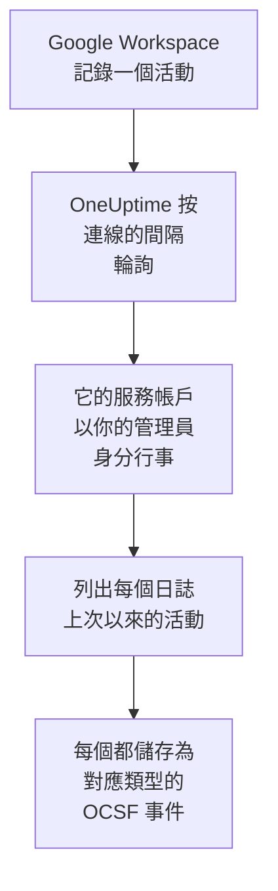

# Google Workspace

把 [Google Workspace](https://workspace.google.com) 的稽核日誌匯入 OneUptime 的安全性事件：登入以及 Google 對它們的標記、管理員的變更、獲得資料存取權的應用程式、單一登入、帳戶本身的安全性設定；如果你願意，還可以匯入在組織外部共用或在 Google 雲端硬碟中下載的檔案。在那裡，你可以把它們與日誌、追蹤和指標放在一起搜尋，與其他所有來源進行關聯分析，並為重要的內容呼叫待命人員。OneUptime 透過一個以你的某位管理員身分行事的服務帳戶讀取它們，不會變更 Google Workspace 中的任何內容。

:::cards
- [設定連線](#設定連線): 一個服務帳戶、全網域委派，以及連線的表單。
- [匯入的內容](#匯入的內容): 匯入哪些活動，以及每個活動如何成為一個安全性事件。
- [輪詢的運作方式](#輪詢的運作方式): 每次輪詢讀取的時間窗，以及它為何重疊 2 小時。
- [疑難排解](#疑難排解): 每個錯誤的含義，以及需要更改什麼。
:::

## 運作方式

OneUptime 每分鐘輪詢一次已過輪詢間隔的每個已啟用連線。一次輪詢會代表你指定的管理員，以你的服務帳戶身分登入，並列出每個稽核日誌自上次輪詢以來的活動（[Activities: list](https://developers.google.com/admin-sdk/reports/reference/rest/v1/activities/list)）：管理、登入、OAuth 權杖、SAML、帳戶安全性，以及在 **雲端硬碟活動** 選項開啟時的雲端硬碟。活動中的每個事件都儲存為一個 [OCSF](https://schema.ocsf.io/) 事件：登入存為 Authentication 事件，指派的管理員角色存為 User Access Management 事件，被 Google 標記的登入存為 Detection Finding。

## 開始之前

- 在 OneUptime 中擁有 Project Owner、Project Admin 或 Security Admin 角色。Security Member 和 Security Viewer 可以檢視連線及其執行歷史，但不能更改它們。
- 一位用於允許全網域委派的 Google Workspace 超級管理員，以及一位供服務帳戶代為行事、擁有 Reports 權限的管理員。超級管理員擁有該權限。
- 一個你可以在其中建立服務帳戶並開啟 Admin SDK API 的 Google Cloud 專案。
- 對於雲端硬碟活動：帶有雲端硬碟稽核日誌的版本，例如 Business Standard、Business Plus、Enterprise 或 Education。
- 從 OneUptime 應用程式和工作程序到 `oauth2.googleapis.com` 和 `admin.googleapis.com` 的傳出 HTTPS。

## 設定連線

連線使用服務帳戶的金鑰和 [全網域委派](https://developers.google.com/identity/protocols/oauth2/service-account#delegatingauthority) 登入，只使用一個唯讀範圍：`https://www.googleapis.com/auth/admin.reports.audit.readonly`。

:::steps
### 建立服務帳戶和金鑰

1. 在 [Google Cloud 控制台](https://console.cloud.google.com) 中選擇一個專案，開啟 **APIs & Services → Library**，找到 **Admin SDK API**，然後選擇 **Enable**。
2. 開啟 **IAM & Admin → Service accounts → Create service account**，將其命名為 `oneuptime-security-events`，然後選擇 **Done**。它在專案中不需要任何角色。
3. 開啟該服務帳戶，複製它的 **Unique ID**，也就是委派中填寫的用戶端 ID。在 **Keys** 分頁中選擇 **Add key → Create new key → JSON**，並保存好檔案：它就是金鑰。

### 允許全網域委派

1. 在 [Google 管理控制台](https://admin.google.com) 中，以超級管理員身分開啟 **Security → Access and data control → API controls → Manage domain-wide delegation**，然後選擇 **Add new**。
2. 把服務帳戶的 **Unique ID** 填為 **Client ID**，把 `https://www.googleapis.com/auth/admin.reports.audit.readonly` 填為唯一的 **OAuth scope**。選擇 **Authorize**。Google 可能需要幾分鐘才能生效。

### 在 OneUptime 中新增連線

開啟 **產品 → Security Events → 連線**（`/dashboard/{projectId}/security-events/connections`），點選 **新增連線**，在 **身分** 下選擇 **Google Workspace**，然後點選 **下一步**。填寫 **Administrator email**，點選 **下一步**，並把金鑰檔案的內容貼上到 **服務帳戶 JSON** 中。在 **輪詢** 步驟中開啟 **雲端硬碟活動**，即可同時讀取雲端硬碟。

### 儲存之前先測試

點選 **儲存前測試** 下的 **測試這些設定**。測試會用表單中的值登入並讀取登入日誌和管理日誌，但不會儲存任何內容，因此缺失的委派會在連線存在之前暴露出來。然後點選 **下一步**，為連線填寫 **名稱** 並建立它。
:::

| 設定 | 填寫什麼 |
| --- | --- |
| **Administrator email** | 服務帳戶代為行事的管理員的地址，例如 `admin@example.com`。該管理員必須擁有 Reports 權限。 |
| **雲端硬碟活動** | 選用，預設關閉。開啟後，每次輪詢也會讀取雲端硬碟的共用和下載。 |
| **服務帳戶 JSON** | 整個金鑰檔案，其中包含 `client_email` 和 `private_key`。它會被加密，API 從不傳回，也不會再次顯示。在連線上用 **更新憑證** 替換它。 |

**輪詢** 步驟還有選用的 **描述**、**輪詢間隔（分鐘）**（`1` 到 `1440` 之間的整數，初始為 `5`），以及初始為開啟的 **已啟用**。

## 匯入的內容

每個事件的供應商為 `Google`，產品為 `Google Workspace`。包含多個事件的活動會為每個事件產生一個安全性事件，每個事件都保留活動的欄位和它自己的欄位，形式為 `event.name`、`event.type` 和 `parameters.<name>`，因此規則可以按 Google 的名稱讀取它們。

| 日誌 | 事件 | OCSF 類別 | 嚴重性 |
| --- | --- | --- | --- |
| 登入（`login`） | `login_success`、附帶原因的 `login_failure`、`login_challenge`。登出會被讀取但不匯入。 | Authentication (`3002`) | Informational；失敗為 Low；Google 標記為 `is_suspicious` 時為 Medium |
| Google 的偵測（`login`） | `suspicious_login` 及其變體、`gov_attack_warning`、`account_disabled_hijacked` 以及 Google 停用的其他帳戶 | Detection Finding (`2004`) | Medium；政府支持的攻擊、遭盜用的帳戶或外洩的密碼為 High |
| 管理（`admin`） | 授予或撤銷的管理員權限和角色、全網域委派、建立、刪除或停權的使用者、關閉的兩步驟驗證、群組成員、設定 | User Access Management (`3005`)、Account Change (`3001`)、Group Management (`3006`)、Entity Management (`3004`) | 授予權力為 Medium；刪除使用者或關閉兩步驟驗證為 Low |
| OAuth 權杖（`token`） | 獲得某人資料存取權的應用程式及其範圍，或被撤銷該存取權的應用程式 | Authorize Session (`3003`) | Informational |
| SAML（`saml`） | 單一登入到某個應用程式 | Authentication (`3002`) | 失敗為 Low |
| 帳戶安全性（`user_accounts`） | 兩步驟驗證、密碼和復原資訊的變更 | Account Change (`3001`) | 削弱帳戶時為 Low |
| 雲端硬碟（`drive`），開啟該選項時 | `change_user_access`、`change_document_visibility`、`change_document_access_scope`、`change_acl_editors`、`download` | File Hosting Activity (`6006`) | 在擁有者網域外共用或對連結開放的檔案為 Low |

規則庫中針對 Google Workspace 的規則按這裡匯入的形式讀取它們，例如針對被 Google 標記的登入、授予的管理員權限以及在雲端硬碟中公開的檔案的規則。

## 輪詢的運作方式

- **活動按發生的時間讀取。** Reports API 沒有其他可用來列出它們的時間，而且 Google 文件說明其日誌會晚幾分鐘到幾小時到達。
- **第一次輪詢會回溯 24 小時**，所以新連線會立刻顯示最近的活動。
- **之後的每次輪詢都從儲存的游標之前 120 分鐘開始**，因此 Google 最多晚 2 小時才可讀取的活動會在下一次輪詢中讀取，重複項目會在專案內按每個事件的 ID 捨棄。更晚到達的活動不會被輪詢讀取：請從 **診斷** 中匯入它的時間範圍。
- **一次輪詢最多讀取游標之後 24 小時。** 游標落後的連線會透過一連串 24 小時的時間窗追趕。
- **雲端硬碟按事件逐一讀取**，因為雲端硬碟會記錄任何人開啟的每個檔案。當 Google 拒絕雲端硬碟的日誌時，執行會發出警告，其他日誌仍會被匯入。
- **失敗的執行不會改變任何東西。** 在網路錯誤或 Google 傳回錯誤狀態之後，游標和時間窗長度保持不變，下一次輪詢會再次讀取同一個時間窗。唯一的例外是請求逾時：游標保持不變，但下一個時間窗的長度減半，因為重到無法及時得到回應的時間窗每次嘗試都會逾時。

### 當一個時間窗包含的內容超過一次輪詢能讀取的量時

每個日誌都有自己的預算，以每頁 1,000 個活動計：登入 10 頁，管理、OAuth 權杖和 SAML 各 5 頁，帳戶安全性 3 頁，雲端硬碟的每個事件 4 頁。一次輪詢在 4 分鐘後停止。當預算在時間窗結束前讓某個日誌停止時，執行為 **部分**，其警告會指明該日誌和預算。Google 先列出最新的活動，因此 OneUptime 會縮短時間窗，而不是把游標移過它從未讀到的活動：

1. **縮小。** 下一次輪詢從同一個起點讀取長度減半的時間窗，並不斷減半，直到某個時間窗能被完整讀取，最短為一分鐘。執行的警告會說明這一點：`This window holds more records than one poll can read; the next poll reads a {n} minute window from the same starting point.` 已從較長時間窗匯入的活動會作為重複項目被跳過。
2. **恢復。** 一個時間窗被完整讀取後，游標會移到它的末尾，下一個時間窗的長度會再次加倍，最長為 24 小時。
3. **越過單獨的一分鐘。** 如果連一分鐘內的活動都超過一次輪詢能讀取的量，輪詢會越過這一分鐘，讓更新的活動繼續到達。這次執行仍為 **部分**，**最近的錯誤** 顯示 `More records were created in the one minute from {cursor} to {end} than one poll can read. Polling moved past this minute so newer records keep arriving; use Import this time range in Diagnostics on this minute to recover what one run can read.` 用 **Import this time range** 匯入這一分鐘，即可找回一次執行能讀取的內容。

更改 **輪詢間隔（分鐘）** 不會改變這些：它決定的是輪詢多久開始一次，而不是時間窗從哪裡開始。

### 按需執行、預覽和匯入

在連線上點選 **診斷**，可以檢視它最近的執行，並手動操作它。能更改該連線的人都可以啟動這些操作；能檢視它的人都可以閱讀歷史記錄。

- **立即執行** 會立即開始一次輪詢，使用通常的游標，即使連線未處於 **已啟用** 狀態也可以。
- **Preview audit events** 讀取最長 7 天的時間範圍，不匯入任何內容。
- **Import this time range** 在你確認後匯入最長 7 天的範圍，不會移動游標。已匯入的活動會被跳過。Google 會保留 6 個月的稽核日誌。
- 執行上的 **Copy diagnostics** 會複製它的報告以便提供給支援人員。報告從不包含認證資訊。

## 測試連線

連線所在列中的 **測試連線** 和表單中的 **測試這些設定** 在 API 程序中執行，而不是在背景工作程序中執行，所以即使工作程序出了問題，測試仍然會給出結果。它按順序執行以下檢查：

| 檢查 | 檢查的內容 |
| --- | --- |
| **設定** | 管理員地址和金鑰格式正確。此項失敗時不會連線到任何地方。 |
| **Authenticate with Google** | Google 允許服務帳戶以管理員身分行事：全網域委派已就位。 |
| **Read the audit logs** | 可以讀取過去 24 小時的登入日誌和管理日誌。 |
| **Read Drive activity** | 僅在開啟該選項時：可以讀取雲端硬碟的日誌。 |
| **Activities available to import** | 過去 24 小時內有多少登入活動和管理活動，每種最多數到 1,000，因此 `1000+` 表示更多。一個都沒有時為警告。 |
| **Background workers**、**Poll scheduler**、**Security event storage** | OneUptime 自身的一側：有程序在處理 Worker 佇列的作業，輪詢作業每分鐘執行一次，安全性事件儲存能夠回應。 |
| **Scheduled polling** | 針對已儲存的連線：輪詢已開啟，沒有執行卡在等待工作程序的狀態，並且輪詢按時執行。 |

測試中的每個請求都有 20 秒的期限。測試從不匯入任何內容，也不移動游標，每個失敗的檢查都會說明需要更改什麼。

## 疑難排解

連線的 **最近的錯誤** 會保留完整的錯誤訊息（認證資訊已隱去）。連線出錯時，在它的 **操作** 欄中選擇 **檢視錯誤** 來閱讀，並在對話方塊中用 **複製錯誤** 複製。每條訊息都以 `Google Workspace` 開頭，接著指明失敗的請求，並引用 Google 自己給出的原因。

:::details 最近的錯誤 顯示 `token request failed`
- `unauthorized_client`：服務帳戶沒有針對該範圍的全網域委派。請在 **Manage domain-wide delegation** 中，用 `https://www.googleapis.com/auth/admin.reports.audit.readonly` 新增它的 **Unique ID**。
- 帶有 `Invalid email or User ID` 的 `invalid_grant`：**Administrator email** 不是此 Google Workspace 的使用者。
- 帶有 `Invalid JWT Signature` 的 `invalid_grant`：金鑰已被刪除或停用。請建立一個新金鑰，並用 **更新憑證** 儲存。
:::

:::details 最近的錯誤 顯示 `activities request failed (HTTP 403)`
- 原因 `SERVICE_DISABLED` 或 `accessNotConfigured`：服務帳戶所在專案中的 Admin SDK API 已關閉。請開啟它，幾分鐘後再測試。
- 原因 `forbidden`：管理員缺少 Reports 權限。請在 Google 管理控制台的 **Account → Admin roles** 中指派它，或指定一位超級管理員。
:::

:::details 未讀取雲端硬碟活動
雲端硬碟的日誌需要包含它的版本，以及擁有 Reports 權限的管理員。每次執行都會警告 `Drive activity was not read`，其他日誌仍會被匯入。如果你的版本沒有雲端硬碟日誌，請關閉 **雲端硬碟活動**。
:::

:::details 最近的錯誤 顯示 `did not complete`
請求沒有得到回應：逾時、名稱無法解析或位址被拒絕。請檢查 OneUptime 應用程式和工作程序能否透過你使用的任何 Proxy 存取 `oauth2.googleapis.com` 和 `admin.googleapis.com`。
:::

:::details 測試通過，但 Last Polled 為 Never
輪詢作業從未執行過。閱讀 **Background workers** 和 **Poll scheduler** 檢查。在自行託管安裝中，常見原因是應用程式上設定了 `DISABLE_QUEUE_WORKERS=true`，卻沒有單獨的工作程序部署來處理作業：把它設為 `false`，或執行工作程序部署（Helm：`worker.enabled: true`，預設為 `false`）。
:::

## 後續步驟

:::cards
- [安全性事件](/docs/telemetry/security-events): 搜尋、關聯分析你匯入的內容，並據此發出警示。
- [Microsoft Entra ID](/docs/integrations/microsoft-entra-id): 匯入 Microsoft 的登入和目錄變更。
- [Google SecOps](/docs/integrations/google-secops): 同時引入 Google SecOps 的偵測。
- [整合總覽](/docs/integrations/index): 你可以連接的其他工具。
:::
