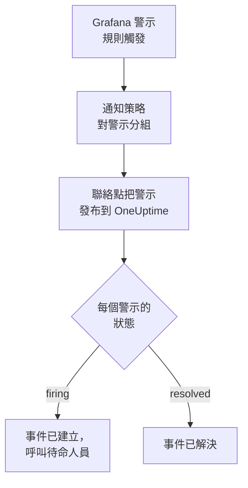

# Grafana

把 [Grafana](https://grafana.com) 警示傳送到 OneUptime，讓每個觸發的警示都成為一個呼叫待命團隊的事件，並在警示恢復時解決。Grafana 透過 Webhook 聯絡點發送警示，因此兩邊都無需安裝任何東西。

:::cards
- [選擇 OneUptime 接收警示的方式](#選擇-oneuptime-接收警示的方式): Incoming Request 監測器，或你自己的工作流程。
- [用監測器接收警示](#用監測器接收警示): 每個警示一個事件，恢復時自動解決。
- [設定 Grafana](#設定-grafana): 一個 Webhook 聯絡點，以及使用它的策略。
- [疑難排解](#疑難排解): 警示沒有到達，或事件一直未關閉時。
:::

## 運作方式



Grafana 的通知策略對觸發的警示分組，Webhook 聯絡點把每個組作為一個 JSON 通知發布出去。它的結構與 [Prometheus Alertmanager](/docs/integrations/prometheus-alertmanager) 的通知相同：一個 `status`，一個 `alerts` 清單（其中每個警示都有自己的 `status` 和 `fingerprint`），以及警示共有的 `commonLabels` 和 `commonAnnotations`。Grafana 還會加上寫給人看的 `title` 和 `message`。

## 開始之前

- Grafana 9 或更高版本，並使用 Grafana Alerting（自 Grafana 9 起為預設）。它必須能夠透過 HTTPS 存取你的 OneUptime。
- 在 OneUptime 中建立監測器的權限；如果選擇工作流程方式，則需要建立工作流程的權限。

## 選擇 OneUptime 接收警示的方式

先設定 OneUptime：它會給你 Grafana 要傳送到的 URL。

| 方式 | 適用情況 |
| --- | --- |
| Incoming Request 監測器（建議） | 你希望每個警示都成為一個呼叫待命人員的事件，並在警示恢復時解決。無需建置任何東西。 |
| 帶 Webhook 觸發器的工作流程 | 你需要自己的邏輯：先篩選警示、轉換格式或呼叫其他系統。工作流程為每個通知（而不是每個警示）開啟一個事件，並且不會在恢復時解決它。 |

兩者從同一個聯絡點收到相同的 JSON，所以你可以先用其中一種，之後只需修改 Grafana 中的一個 URL 就能切換。

## 用監測器接收警示

[Incoming Request 監測器](/docs/monitor/incoming-request-monitor) 會給你一個 URL，它的條件決定每個通知做什麼。

:::steps
### 建立監測器

前往 **監測器**，點選 **建立監測器**。在 **監測器類型** 下選擇 **Incoming Request**，將其命名為 `Grafana`，然後點選 **下一步**。

### 為每個觸發的警示宣告事件

在 **條件** 步驟中，開啟第一個條件，也就是把監測器標記為離線的那個。把它的篩選器設為 **請求內文**、**包含**、`"status":"firing"`。這個條件在篩選器符合時已經會宣告事件。填寫事件資訊：

- **事件標題**：`{{requestBody.commonLabels.alertname}}`。
- **描述** 下的 **事件描述**：`{{requestBody.message}}`，即 Grafana 為通知撰寫的文字。
- **嚴重程度**：這些警示應有的事件嚴重程度。
- **待命** 下的 **待命策略**：要呼叫的策略。
- **更多欄位** 下的 **自動解決事件**：保持開啟，它預設就是開啟的。關閉後會忽略恢復，事件將一直保持開啟。

### 每個警示一個事件

在同一個條件中，開啟 **設定** 並開啟 **Group incidents and alerts by a payload field**。按下表填寫，讓每個警示都有自己的事件，並由它的恢復來解決：

| 欄位 | 值 |
| --- | --- |
| **Open a separate incident for each…** | `requestBody.alerts[*].fingerprint` |
| **Field that signals recovery** | `requestBody.alerts[*].status` |
| **Value that means recovered** | `resolved` |

### 讓監測器恢復線上

開啟第二個條件，也就是把監測器標記為線上的那個，把它的篩選器設為 **請求內文**、**包含**、`"status":"resolved"`。

### 複製 URL

點選 **建立監測器**。監測器的 **概覽** 頁面會顯示它的 **Heartbeat URL**。複製它供 Grafana 使用：

```text
https://oneuptime.com/heartbeat/<secret key>
```

自行託管安裝使用自己的主機來代替 `oneuptime.com`。
:::

通知中的每個警示都會開啟自己的事件，數量最多為 **Max incidents per request**（不修改則為 `100`），每個警示自己的 `status` 決定它的事件何時被解決。Grafana 的 `fingerprint` 透過標籤來識別警示，所以它正是用來分組的值。每項設定的作用請參閱 [接收其他系統的警示](/docs/monitor/incoming-request-monitor#接收其他系統的警示)。

> [!WARNING]
> 不要按通知中所有警示共有的標籤分組。Grafana 的預設通知策略按 `grafana_folder` 和 `alertname` 對警示分組，所以同一個通知中的每個警示都有相同的 `alertname`：按 `requestBody.alerts[*].labels.alertname` 分組會把整個通知合併成一個事件。

`{{requestBody.commonLabels.alertname}}` 和 `{{requestBody.message}}` 描述的是整個通知，在預設策略下就是一條警示規則。分組鍵也是一個變數 `{{fingerprint}}`，但它是一個雜湊，對應變人員毫無意義。可以使用的所有變數請參閱 [事件與警示範本](/docs/monitor/incident-alert-templating)。

## 設定 Grafana

:::steps
### 新增 Webhook 聯絡點

在 Grafana 中前往 **Alerting → Contact points**，點選 **+ Add contact point**。在 Grafana 11 及更高版本中，**Alerting** 位於 **Alerts & IRM** 下，**Contact points** 是 **Notification configuration** 的一個索引標籤。

把聯絡點命名為 `OneUptime`，在 **Integration** 下選擇 **Webhook**，並把複製的 URL 貼上到 **URL** 中。**HTTP Method** 保持為 `POST`，然後點選 **Save contact point**。

### 把警示傳送到它

前往 **Alerting → Notification policies**。把預設策略的聯絡點設為 `OneUptime`，或者新增一個符合 OneUptime 應收到的警示的子策略，並把 `OneUptime` 設為它的聯絡點。
:::

Grafana 傳送 `Content-Type: application/json`，監測器需要它才能讀取通知中的欄位。聯絡點的 **Max Alerts** 設定會限制一個通知中的警示數：請保持為 `0`（不限制），或者不超過監測器的 **Max incidents per request**。

## 測試

1. 在 Grafana 中開啟 `OneUptime` 聯絡點，點選 **Test**。Grafana 會發送一個觸發中的測試警示，OneUptime 中會開啟一個事件。測試警示永遠不會恢復，所以請手動解決該事件。
2. 讓一條真實的警示規則觸發，例如暫時調低它的閾值，觀察它的事件被開啟，並在你恢復閾值後被解決。

## 用工作流程接收警示

當你需要在 Grafana 和事件之間加入自己的步驟時，請使用 [工作流程](/docs/workflows/index)。

:::steps
### 建立工作流程

前往 **工作流程**，點選 **建立工作流程**，然後點選 **從零開始**。將其命名為 `Grafana alerts`，然後點選 **建立工作流程**。

### 新增 Webhook 觸發器

點選虛線的 **選擇啟動此工作流程的方式** 區塊並選擇 **Webhook**。點選該觸發器，然後點選 **複製 URL**，把該 URL 用在 Grafana 的聯絡點中。

### 檢查通知是否為觸發狀態

點選 **新增元件**，新增一個 **If / Else** 區塊，並把觸發器的 **Out** 點連接到它。把 **Value to check** 設為 `{{local.components.webhook-1.returnValues.request-body.status}}`，**Comparison** 設為 **is equal to**，**Compare with** 設為 `firing`。

### 宣告事件

新增一個 **Create One Incident** 區塊，並把 **If / Else** 區塊的 **Yes** 一側連接到它。在 **Incident Template** 中選擇一個設定了嚴重程度和要呼叫的待命策略的範本（請參閱 [事件範本](/docs/incidents/settings#事件範本)）。在 **JSON Object** 中設定來自 Grafana 的內容：

```json
{
  "title": "{{local.components.webhook-1.returnValues.request-body.title}}",
  "description": "{{local.components.webhook-1.returnValues.request-body.message}}"
}
```

如果不使用範本，**JSON Object** 中還需要 `incidentSeverityId`，即專案中某個事件嚴重程度的 ID。

### 啟用工作流程

在 **建構器** 頂部開啟 **已啟用**。處於關閉狀態的工作流程會以 `400` 回應 Grafana。
:::

一次執行處理一個通知，所以無論通知包含多少個警示，它都只宣告一個事件。`resolved` 的通知會走向 **If / Else** 區塊的 **No** 一側，那裡沒有連接任何東西，因此執行到此結束。要讓每個警示一個事件並在恢復時解決，請使用監測器。

## 疑難排解

:::details OneUptime 沒有收到任何內容
- 在聯絡點上點選 **Test**：Grafana 無法存取該 URL 時會顯示錯誤。詳細資訊在 Grafana 的伺服器日誌中。
- 監測器會在檢查任何內容之前立即回應 `200`，即使金鑰錯誤也是如此。請檢視監測器的時間軸，確認通知是否到達。
- 處於關閉狀態的工作流程會回應 `400`。在它的 **建構器** 頂部開啟 **已啟用**。
:::

:::details 事件被建立但從未被解決
- 條件中的事件需要開啟 **更多欄位** 下的 **自動解決事件**。
- **Field that signals recovery** 必須是 `requestBody.alerts[*].status`，**Value that means recovered** 必須恰好是 `resolved`。比較區分大小寫。
- 分組路徑必須以 `requestBody.` 開頭，並且路徑中只有第一個 `[*]` 會讀取清單。違反任一規則的路徑不會符合任何內容，也不會顯示錯誤。
:::

:::details 一個裝滿警示的通知只得到一個事件
你按一個在通知內所有警示中都相同的標籤分組了，例如預設策略下的 `alertname`。請改為按 `requestBody.alerts[*].fingerprint` 分組。
:::

:::details 事件顯示的是引用而不是值
引用了通知中不存在的欄位時，該引用會連同大括號按原樣保留。請把欄位名稱與 Grafana 傳送的內容進行比較：對於工作流程，請在 **日誌 → 執行記錄** 中開啟這次執行，並與觸發器收到的內容進行比較。
:::

[Prometheus Alertmanager](/docs/integrations/prometheus-alertmanager#疑難排解) 指南涵蓋了更多情況，它們同樣適用於 Grafana 的通知。

## 安全

- **像對待密碼一樣對待 URL。** 任何擁有它的人都可以建立事件。如果洩露，請重設它：在監測器的 **設定** 頁面使用 **重設傳入請求密鑰**，或在工作流程的 **Webhook** 觸發器中使用 **重設 URL**。然後在 Grafana 中更新聯絡點的 **URL**。
- **自行託管？** 讓 Grafana 能夠穿過防火牆，透過 HTTPS 存取你的 OneUptime。

## 後續步驟

:::cards
- [傳入請求監控](/docs/monitor/incoming-request-monitor): 接收警示的監測器的所有設定。
- [Prometheus Alertmanager](/docs/integrations/prometheus-alertmanager): 相同的設定，外加一個監控警示系統本身的失效開關。
- [指標監控](/docs/monitor/metrics-monitor): 直接在 OneUptime 中對相同的指標發出警示。
- [整合總覽](/docs/integrations/index): 你可以連接的其他工具。
:::
